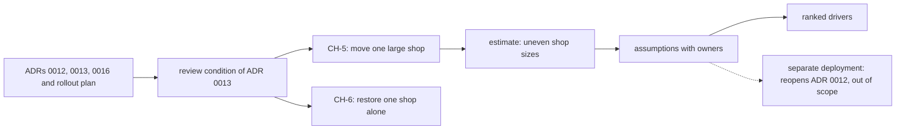

## Before you start

- [[sysdesign.l4.answering-challenges]] — you finished the framework with a design review; this lesson starts the module's first problem at step 1, requirements.
- [[backend.l4.shop-id-rollout]] — you know `multi-shop-data-rollout.md` adds `shop_id` to the shared tables over three releases.
- [[backend.l4.per-shop-limits]] — you know ADR `0016` caps each shop's load on top of the shared limits, instead of moving large shops out.
- [[devops.l3.point-in-time-recovery]] — you know a recovery returns every database on the server to the same moment.

## The situation

Two messages reach the team in one week. The largest shop expects to double its orders. Another shop's staff deleted half their products by mistake and want them back as of yesterday, without the other shops losing a single order.

A teammate opens a blank page for "the multi-shop design" and starts with: "Should we have used one database per shop after all?" Another asks whether the deployment should split too. The questions sound bold, and most of them were answered months ago.

Where does the requirements step of this problem start, and what may it leave out?

## Core concepts

- earlier decisions as constraints — ADRs `0012`, `0013`, `0016` and the rollout plan are inputs to the new problem, not options inside it.
- what is left open — the cases those decisions name in their review conditions (the sentences at the end of an ADR's consequences that say when the team must look at the decision again) but do not solve; here, a shop too large for the shared tables and restoring one shop alone.
- a scenario with a measure — each open case written as source, trigger, situation, required response and a number that says when the response is good enough.
- an assumption with an owner — a question nobody can answer yet, written as a statement the design relies on, with the role that must confirm it.
- ranked drivers — the scenarios and goals, in order, that the design must satisfy first when two of them pull in different directions.

## How it works



Read the diagram from the left. In the situation above, the teammate's blank page skips box A. ADR `0012` already serves every shop from one deployment (one running copy of the whole system), ADR `0013` keeps every shop's data in shared tables with `shop_id` and row-level security, ADR `0016` caps each shop's load, and `multi-shop-data-rollout.md` orders the releases. The requirements step treats all four as constraints and does not argue them again.

Box B is where the problem actually comes from. ADR `0013` ends its consequences with a review condition: the team looks again when one shop grows too large for the shared tables, or must be restored alone. Those two cases become the only new scenarios, CH-5 and CH-6, numbered on from CH-1 to CH-4 of the earlier requirements.

The estimate then asks how many shops could outgrow the shared tables. Its answer is "a few", because shop sizes are assumed to be very uneven.

Questions that nobody can answer yet become assumptions, each with the role that confirms it. One of them points outside the problem, the dashed arrow: if a contract demands a separate deployment, that reopens ADR `0012`, and the file leaves it there.

The step ends with three ranked drivers. They are what the design lesson that follows is judged against.

## In the Đơn Hàng system

The open cases and their scenarios, at this tag:

```markdown file=docs/team/multi-shop-open-requirements.md tag=stage-4 lines=20-43
Còn để mở hai điều, cả hai nằm trong điều kiện xem lại của ADR 0013: một cửa
hàng quá lớn so với bảng chung, và khôi phục riêng một cửa hàng mà không đưa
các cửa hàng khác về quá khứ. CH-1 tới CH-4 ở `multi-shop-requirements.md`
vẫn giữ; hai kịch bản mới đánh số tiếp từ CH-5.

### CH-5: chuyển một cửa hàng lớn

| Phần | Nội dung |
|---|---|
| Nguồn | Đội vận hành, khi một cửa hàng chạm điều kiện chuyển |
| Tác nhân | Chuyển dữ liệu của cửa hàng đó ra khỏi bảng chung |
| Môi trường | Giờ thấp điểm, hệ thống đang chạy cho mọi cửa hàng |
| Phản hồi | Cửa hàng đang chuyển dừng nhận ghi trong một khoảng có giới hạn; các cửa hàng khác không thấy thay đổi |
| Đo | Cửa hàng chuyển dừng ghi tối đa 15 phút (giả định), đọc vẫn chạy; các cửa hàng khác không có request bị từ chối hay chậm hơn ngày thường |

### CH-6: khôi phục riêng một cửa hàng

| Phần | Nội dung |
|---|---|
| Nguồn | Nhân viên của một cửa hàng xóa nhầm dữ liệu, hoặc một lỗi chỉ chạm một cửa hàng |
| Tác nhân | Yêu cầu đưa dữ liệu của cửa hàng đó về một thời điểm trước sự cố |
| Môi trường | Hệ thống đang chạy cho mọi cửa hàng |
| Phản hồi | Chỉ dữ liệu của cửa hàng đó quay về thời điểm đã chọn |
| Đo | Xong trong 4 giờ làm việc (giả định); các cửa hàng khác không mất dòng nào và không dừng |
```

The first paragraph names the two open cases and ties both to ADR `0013`'s review condition. The table rows are source (Nguồn), trigger (Tác nhân), situation (Môi trường), response (Phản hồi) and measure (Đo). Above the excerpt, the scope section lists the four earlier decisions and says the file does not reopen them.

CH-5 measures the move: the moving shop stops taking writes for at most 15 minutes (assumed) while reads keep working, and no other shop sees a refused or slower request. CH-6 measures the restore: done within 4 working hours (assumed), and the other shops lose no row and do not stop. Each number is marked "giả định", an assumption, not a measurement.

Between the two excerpts sits the estimate. Within the capacity plan's 1,000 shops and 50,000 orders on a normal day, it assumes 10 large shops hold about 30%, about 15,000 orders or 1,500 a day each; the other 35,000 over 990 shops average about 35. The largest shop, at 5,000 a day, holds about 10% of a normal day's orders; the file puts that right at the level where `capacity-plan.md` says the plan must be redone (a shop holding more than 10% of the busiest day's orders, a day assumed at twice a normal one). Right at, not yet past: if the busiest day doubles that shop too, it still holds 10%. The doubling its message announces, with the other shops unchanged, would push its share past that level, which is why CH-5 is written now.

A shop too large for the shared tables is CH-5's case, and ADR `0013`'s review condition says where it goes: to a database of its own, while the others stay in the shared tables. So a database for each of 1,000 shops is not needed, but one for the few largest may be.

The file's last two sections:

```markdown file=docs/team/multi-shop-open-requirements.md tag=stage-4 lines=65-81
### Câu hỏi chưa trả lời được, thành giả định

| Giả định | Người xác nhận (vai trò) |
|---|---|
| Cỡ cửa hàng chênh như mục Ước lượng | Product owner, từ hợp đồng đã ký |
| Cửa hàng chuyển chấp nhận dừng ghi 15 phút vào giờ thấp điểm | Product owner, cùng cửa hàng đó |
| Khôi phục riêng một cửa hàng là việc hiếm, vài lần mỗi năm | Đội vận hành |
| Không hợp đồng nào đòi một bản hệ thống riêng | Product owner, cùng bộ phận kinh doanh |

Giả định cuối sai thì đó là điều kiện xem lại của ADR 0012 (một bản riêng cho
cửa hàng đó), nằm ngoài phạm vi tài liệu này.

### Driver xếp hạng

1. Các cửa hàng khác không thấy thay đổi khi một cửa hàng chuyển (CH-5).
2. Khôi phục được riêng một cửa hàng (CH-6).
3. Tải của một cửa hàng lớn rời được khỏi bảng chung.
```

Each row turns an open question into a statement with a role: the uneven sizes and the 15-minute pause go to the product owner (the team role that decides what the product must do; here it reads signed contracts and asks the shops), how rare a restore is goes to the operations team. The last row is the separate-deployment question; the note under the table says that if it turns out false, ADR `0012`'s review condition applies, outside this file's scope.

The ranked drivers put the other shops first: they see no change while one shop moves. Restoring one shop alone comes second. Moving a large shop's load out of the shared tables comes third, with no CH number of its own.

## Trade-offs

| How the team starts step 1 | What the design gets | What it costs | Right when |
|---|---|---|---|
| A blank page: every earlier decision is open again | freedom to choose any layout | the review hour goes to ADRs already accepted; the rollout plan may be built on a layout that changes | an earlier ADR's review condition has fired, or its drivers changed |
| Only what the decisions left open (the file's choice) | two scenarios, a short estimate, three drivers | depends on the earlier ADRs staying right; a wrong assumption sends the team back to them | the open cases are named in a review condition, as here |
| Straight to "one database per shop for every shop" | the strongest isolation and the easiest restore | ADR `0013` counts 1,000 migration runs per release and a new database per new shop, against CH-2 (opening a shop needs no deploy or migration) | shop count is small, so per-database migrations and setup stay cheap |

The requirements do not choose how a shop moves or how it is restored. They fix what a good answer must achieve, and what it must not touch.

## What would you choose if…

…the product owner finds a contract that demands a separate deployment for one shop? That is the last assumption failing. Reopen ADR `0012` through its own review condition; do not stretch CH-5 to cover it.

…the large shop refuses a 15-minute pause and accepts one minute? Change CH-5's measure in the requirements first. The design is then judged against the new number, and options that passed at 15 minutes may fail.

…the shops turn out to be about the same size, near 50 orders a day each? No shop comes near the capacity plan's 10% trigger, so the third driver loses its reason. CH-6 stays, because a mistaken delete happens to small shops too.

## Seniors often assume…

- **"A new design problem should begin by reconsidering every earlier decision."** → Actually the open-requirements file lists ADRs `0012`, `0013`, `0016` and the rollout plan and says it does not reopen them; it starts from the cases ADR `0013`'s review condition names. A decision is reopened when its own condition fires, not because a new problem begins. You notice this when a design review spends its hour re-arguing shared tables and never reaches CH-5.
- **"Restoring one shop is easy, because every backup already holds every shop's data."** → Actually holding every shop's data is the difficulty. A recovery returns every database on the server to the same moment, so restoring in place takes 999 other shops back too. ADR `0013` records that one shop's rows must be extracted from a temporary restore. You notice this when the plan says "restore last night's backup" and nobody asks what happens to today's orders of every other shop.
- **"If one shop needs a database of its own, every shop should get one."** → Actually the estimate assumes 990 shops average about 35 orders a day, and ADR `0013` counts a database per shop as 1,000 migration runs per release. The case for a separate database is the few largest shops. You notice this when a proposal sized for one 5,000-order shop is applied to a shop with 30.

## Try it (3 minutes)

The product owner reads the signed contracts and finds that the 10 largest shops hold about 50% of the 50,000 orders on a normal day, not 30%. Work out the average orders a day for one large shop and for one of the other 990. Then say whether the conclusion "a database for each of 1,000 shops is not needed" still holds, and which assumption row changes.

Expected result: two numbers, a yes or no, and the name of one row in the assumptions table.

<details><summary>Suggested answer</summary>

Large shops: 25,000 ÷ 10 = 2,500 orders a day each. Other shops: 25,000 ÷ 990, about 25 a day each. The conclusion holds and gets stronger: the small shops shrink, and the case for a separate database stays with the few largest. The row that changes is the first one, shop sizes as in the estimate, which the product owner confirms from signed contracts.

</details>

## Connections

- [[sysdesign.l4.clarifying-requirements]] — the general step this lesson applies: scenarios, assumptions with owners and ranked drivers, with earlier ADRs as constraints.
- [[design.l4.a-thousand-shops]] — the earlier requirements, CH-1 to CH-4, that CH-5 and CH-6 continue.
- [[backend.l4.shop-data-layout]] — ADR `0013`, whose review condition is where this problem's two open cases come from.
- [[devops.l3.rpo-and-rto]] — CH-6's 4 working hours plays the role of an RTO for one shop; its "no row lost" is about the other shops, not the restored one.
- [[devops.l3.point-in-time-recovery]] — why restoring one shop in place would take every other shop back in time.
- [[sysdesign.l4.multi-shop-design]] — the next step: a design judged against these three ranked drivers.

## Five-line summary

1. The multi-shop problem starts from what ADRs `0012`, `0013`, `0016` and the rollout plan left open, not from a blank page.
2. Two cases are open: a shop too large for the shared tables, and restoring one shop without taking the others back.
3. CH-5 allows a moving shop 15 minutes without writes, CH-6 a restore within 4 working hours; every number is assumed.
4. Uneven shop sizes mean a database for each of 1,000 shops is not needed, but one for the largest may be.
5. A contract demanding a separate deployment would reopen ADR `0012`, out of scope; the drivers rank other shops' calm first.
