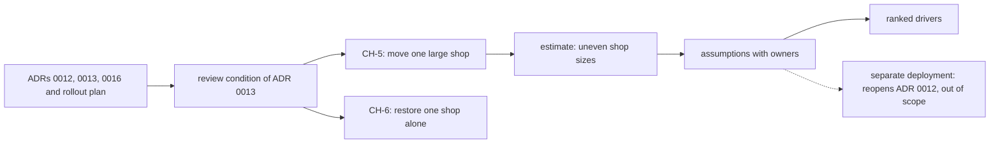

## Bạn cần biết trước

- [[sysdesign.l4.answering-challenges]] — bạn đã đi hết quy trình bằng một buổi review thiết kế. Bài này mở bài toán đầu tiên của module ở bước 1, phần yêu cầu.
- [[backend.l4.shop-id-rollout]] — bạn biết `multi-shop-data-rollout.md` thêm `shop_id` vào các bảng dùng chung qua ba bản phát hành.
- [[backend.l4.per-shop-limits]] — bạn biết ADR `0016` giới hạn tải của từng cửa hàng, chồng lên các giới hạn chung, thay vì chuyển cửa hàng lớn ra ngoài.
- [[devops.l3.point-in-time-recovery]] — bạn biết một lần khôi phục đưa mọi database trên server về cùng một thời điểm.

## Tình huống

Trong một tuần, nhóm nhận hai tin nhắn. Cửa hàng lớn nhất dự kiến số đơn tăng gấp đôi. Nhân viên một cửa hàng khác xóa nhầm nửa số sản phẩm và muốn lấy lại như hôm qua, mà các cửa hàng khác không mất một đơn nào.

Một đồng đội mở trang trắng cho "thiết kế đa cửa hàng" và viết ngay câu đầu: "Hay rốt cuộc mình nên dùng mỗi cửa hàng một database?" Người khác hỏi có nên tách luôn bản hệ thống đang chạy không. Câu hỏi nghe táo bạo, nhưng phần lớn đã được trả lời từ nhiều tháng trước.

Bước yêu cầu của bài toán này bắt đầu từ đâu, và được phép bỏ qua những gì?

## Khái niệm cốt lõi

- quyết định trước đó là ràng buộc — ADR `0012`, `0013`, `0016` và kế hoạch triển khai là đầu vào của bài toán mới, không phải các phương án bên trong nó.
- điều còn để mở — những trường hợp mà các quyết định đó nêu trong điều kiện xem lại (các câu cuối phần hệ quả của một ADR, nói khi nào nhóm phải xem lại quyết định) nhưng không giải. Ở đây là một cửa hàng quá lớn so với bảng chung, và khôi phục riêng một cửa hàng.
- kịch bản có phép đo — mỗi trường hợp còn mở viết thành nguồn, tác nhân, môi trường, phản hồi bắt buộc và một con số cho biết phản hồi khi nào là đủ tốt.
- giả định có người xác nhận — một câu hỏi chưa ai trả lời được, viết thành một khẳng định mà thiết kế dựa vào, kèm vai trò phải xác nhận nó.
- yếu tố định hình kiến trúc xếp hạng — các kịch bản và mục tiêu, theo thứ tự, mà thiết kế phải ưu tiên đáp ứng khi hai cái kéo về hai hướng khác nhau.

## Cơ chế hoạt động



Đọc sơ đồ từ trái sang. Trong tình huống trên, trang trắng của đồng đội bỏ qua ô A. ADR `0012` đã phục vụ mọi cửa hàng từ một bản hệ thống chạy chung, ADR `0013` giữ dữ liệu mọi cửa hàng trong bảng chung với `shop_id` và row-level security, ADR `0016` giới hạn tải của từng cửa hàng, còn `multi-shop-data-rollout.md` sắp thứ tự các bản phát hành. Bước yêu cầu coi cả bốn là ràng buộc và không tranh luận lại.

Ô B là nơi bài toán thật sự xuất phát. Phần hệ quả của ADR `0013` kết thúc bằng một điều kiện xem lại: nhóm xem lại khi một cửa hàng lớn quá mức bảng chung chịu được, hoặc phải được khôi phục riêng. Hai trường hợp đó thành hai kịch bản mới duy nhất, CH-5 và CH-6, đánh số tiếp từ CH-1 tới CH-4 của phần yêu cầu trước.

Sau đó, phần ước lượng hỏi có bao nhiêu cửa hàng có thể vượt bảng chung. Câu trả lời là "vài cửa hàng", vì cỡ các cửa hàng được giả định chênh nhau rất nhiều.

Câu hỏi chưa ai trả lời được thì thành giả định, mỗi giả định kèm vai trò xác nhận nó. Một giả định chỉ ra ngoài bài toán, mũi tên nét đứt: nếu một hợp đồng đòi một bản hệ thống riêng, điều đó mở lại ADR `0012`, và file dừng ở đó.

Bước này kết thúc bằng ba yếu tố định hình kiến trúc xếp hạng. Bài thiết kế tiếp theo được chấm theo chúng.

## Trong hệ thống Đơn Hàng

Các trường hợp còn mở và kịch bản của chúng, ở tag này:

```markdown file=docs/team/multi-shop-open-requirements.md tag=stage-4 lines=20-43
Còn để mở hai điều, cả hai nằm trong điều kiện xem lại của ADR 0013: một cửa
hàng quá lớn so với bảng chung, và khôi phục riêng một cửa hàng mà không đưa
các cửa hàng khác về quá khứ. CH-1 tới CH-4 ở `multi-shop-requirements.md`
vẫn giữ; hai kịch bản mới đánh số tiếp từ CH-5.

### CH-5: chuyển một cửa hàng lớn

| Phần | Nội dung |
|---|---|
| Nguồn | Đội vận hành, khi một cửa hàng chạm điều kiện chuyển |
| Tác nhân | Chuyển dữ liệu của cửa hàng đó ra khỏi bảng chung |
| Môi trường | Giờ thấp điểm, hệ thống đang chạy cho mọi cửa hàng |
| Phản hồi | Cửa hàng đang chuyển dừng nhận ghi trong một khoảng có giới hạn; các cửa hàng khác không thấy thay đổi |
| Đo | Cửa hàng chuyển dừng ghi tối đa 15 phút (giả định), đọc vẫn chạy; các cửa hàng khác không có request bị từ chối hay chậm hơn ngày thường |

### CH-6: khôi phục riêng một cửa hàng

| Phần | Nội dung |
|---|---|
| Nguồn | Nhân viên của một cửa hàng xóa nhầm dữ liệu, hoặc một lỗi chỉ chạm một cửa hàng |
| Tác nhân | Yêu cầu đưa dữ liệu của cửa hàng đó về một thời điểm trước sự cố |
| Môi trường | Hệ thống đang chạy cho mọi cửa hàng |
| Phản hồi | Chỉ dữ liệu của cửa hàng đó quay về thời điểm đã chọn |
| Đo | Xong trong 4 giờ làm việc (giả định); các cửa hàng khác không mất dòng nào và không dừng |
```

Đoạn đầu nêu hai trường hợp còn mở và gắn cả hai vào điều kiện xem lại của ADR `0013`. Các dòng trong bảng là nguồn, tác nhân, môi trường, phản hồi và phép đo. Phía trên đoạn trích, mục phạm vi liệt kê bốn quyết định trước đó và nói file không mở lại chúng.

CH-5 đo cuộc chuyển: cửa hàng đang chuyển dừng nhận ghi tối đa 15 phút (giả định) trong khi đọc vẫn chạy, và không cửa hàng nào khác thấy request bị từ chối hay chậm đi. CH-6 đo lần khôi phục: xong trong 4 giờ làm việc (giả định), và các cửa hàng khác không mất dòng nào, không dừng. Con số nào cũng ghi "giả định", tức là điều được giả định, không phải số đo.

Giữa hai đoạn trích là phần ước lượng. Trong 1.000 cửa hàng và 50.000 đơn một ngày thường của kế hoạch năng lực, nó giả định 10 cửa hàng lớn chiếm khoảng 30%, tức khoảng 15.000 đơn, mỗi cửa hàng 1.500 đơn một ngày. 35.000 đơn còn lại chia cho 990 cửa hàng, trung bình khoảng 35. Cửa hàng lớn nhất, 5.000 đơn một ngày, chiếm khoảng 10% số đơn của một ngày thường. File đặt con số đó đúng ở ngưỡng mà `capacity-plan.md` nói kế hoạch phải làm lại (một cửa hàng chiếm hơn 10% số đơn của ngày đông nhất, ngày được giả định gấp đôi ngày thường). Đúng ở ngưỡng, chưa vượt: nếu ngày đông nhất cũng nhân đôi cửa hàng đó thì nó vẫn chiếm 10%. Còn mức tăng gấp đôi mà tin nhắn của nó báo trước, trong khi các cửa hàng khác giữ nguyên, sẽ đẩy phần của nó qua ngưỡng, nên CH-5 được viết ngay bây giờ.

Một cửa hàng quá lớn so với bảng chung là trường hợp của CH-5, và điều kiện xem lại của ADR `0013` nói nó đi đâu: sang một database riêng, còn các cửa hàng khác ở lại bảng chung. Vậy không cần một database cho mỗi cửa hàng trong 1.000 cửa hàng, nhưng có thể cần cho vài cửa hàng lớn nhất.

Hai mục cuối của file:

```markdown file=docs/team/multi-shop-open-requirements.md tag=stage-4 lines=65-81
### Câu hỏi chưa trả lời được, thành giả định

| Giả định | Người xác nhận (vai trò) |
|---|---|
| Cỡ cửa hàng chênh như mục Ước lượng | Product owner, từ hợp đồng đã ký |
| Cửa hàng chuyển chấp nhận dừng ghi 15 phút vào giờ thấp điểm | Product owner, cùng cửa hàng đó |
| Khôi phục riêng một cửa hàng là việc hiếm, vài lần mỗi năm | Đội vận hành |
| Không hợp đồng nào đòi một bản hệ thống riêng | Product owner, cùng bộ phận kinh doanh |

Giả định cuối sai thì đó là điều kiện xem lại của ADR 0012 (một bản riêng cho
cửa hàng đó), nằm ngoài phạm vi tài liệu này.

### Driver xếp hạng

1. Các cửa hàng khác không thấy thay đổi khi một cửa hàng chuyển (CH-5).
2. Khôi phục được riêng một cửa hàng (CH-6).
3. Tải của một cửa hàng lớn rời được khỏi bảng chung.
```

Mỗi dòng biến một câu hỏi còn mở thành một khẳng định kèm vai trò. Cỡ cửa hàng chênh lệch và khoảng dừng 15 phút thuộc về product owner (vai trò trong nhóm quyết định sản phẩm phải làm gì, ở đây là người đọc hợp đồng đã ký và hỏi các cửa hàng). Khôi phục hiếm tới mức nào thuộc về đội vận hành. Dòng cuối là câu hỏi về bản hệ thống riêng. Ghi chú dưới bảng nói nếu nó hóa ra sai thì điều kiện xem lại của ADR `0012` được áp dụng, nằm ngoài phạm vi file này.

Các yếu tố định hình kiến trúc xếp hạng đặt các cửa hàng khác lên đầu: chúng không thấy thay đổi gì khi một cửa hàng chuyển. Khôi phục riêng một cửa hàng đứng thứ hai. Đưa tải của một cửa hàng lớn ra khỏi bảng chung đứng thứ ba, và không có số CH riêng.

## Đánh đổi

| Nhóm bắt đầu bước 1 thế nào | Thiết kế nhận được gì | Cái giá | Đúng khi |
|---|---|---|---|
| Một trang trắng: mọi quyết định trước đó lại mở | tự do chọn bất kỳ cách bố trí dữ liệu nào | giờ review tiêu vào các ADR đã chấp nhận, kế hoạch triển khai có thể dựng trên cách bố trí dữ liệu sắp đổi | điều kiện xem lại của một ADR trước đã xảy ra, hoặc yếu tố định hình kiến trúc của nó đã đổi |
| Chỉ những gì các quyết định còn để mở (lựa chọn của file) | hai kịch bản, một ước lượng ngắn, ba yếu tố định hình kiến trúc | chỉ ổn khi các ADR trước vẫn đúng, một giả định sai đưa nhóm quay lại chúng | các trường hợp còn mở được nêu trong một điều kiện xem lại, như ở đây |
| Đi thẳng tới "mỗi cửa hàng một database, cho mọi cửa hàng" | cách ly mạnh nhất và khôi phục dễ nhất | ADR `0013` tính 1.000 lần chạy migration mỗi bản phát hành và một database mới cho mỗi cửa hàng mới, ngược với CH-2 (mở cửa hàng không cần deploy hay migration) | số cửa hàng ít, nên migration theo từng database và khâu dựng vẫn rẻ |

Phần yêu cầu không chọn cách chuyển hay cách khôi phục một cửa hàng. Nó cố định những gì một câu trả lời tốt phải đạt, và những gì không được đụng tới.

## Bạn sẽ chọn gì nếu…

…product owner tìm thấy một hợp đồng đòi một bản hệ thống riêng cho một cửa hàng? Đó là giả định cuối bị sai. Mở lại ADR `0012` qua chính điều kiện xem lại của nó, đừng kéo giãn CH-5 để bao luôn trường hợp đó.

…cửa hàng lớn từ chối khoảng dừng 15 phút và chỉ chấp nhận một phút? Đổi phép đo của CH-5 trong phần yêu cầu trước. Thiết kế khi đó được chấm theo con số mới, và những phương án đạt ở mức 15 phút có thể trượt.

…các cửa hàng hóa ra cỡ gần bằng nhau, mỗi cửa hàng khoảng 50 đơn một ngày? Không cửa hàng nào tới gần ngưỡng 10% của kế hoạch năng lực, nên yếu tố định hình kiến trúc thứ ba mất lý do tồn tại. CH-6 vẫn giữ, vì cửa hàng nhỏ cũng xóa nhầm.

## Senior hay nhầm rằng…

- **"Một bài toán thiết kế mới nên bắt đầu bằng cách xem lại mọi quyết định trước đó."** → Thực ra file yêu cầu còn mở liệt kê ADR `0012`, `0013`, `0016` cùng kế hoạch triển khai và nói nó không mở lại chúng. Nó bắt đầu từ các trường hợp mà điều kiện xem lại của ADR `0013` nêu tên. Một quyết định được mở lại khi chính điều kiện của nó xảy ra, không phải vì một bài toán mới bắt đầu. Bạn sẽ nhận ra khi một buổi review thiết kế tiêu hết giờ để tranh luận lại bảng chung và không bao giờ tới CH-5.
- **"Khôi phục một cửa hàng thì dễ, vì bản sao lưu nào cũng đã chứa dữ liệu của mọi cửa hàng."** → Thực ra chứa dữ liệu của mọi cửa hàng chính là chỗ khó. Một lần khôi phục đưa mọi database trên server về cùng một thời điểm, nên khôi phục tại chỗ sẽ kéo 999 cửa hàng khác lùi theo. ADR `0013` ghi rằng các dòng của một cửa hàng phải được trích ra từ một bản khôi phục tạm. Bạn sẽ nhận ra khi kế hoạch ghi "khôi phục bản sao lưu đêm qua" mà không ai hỏi đơn hôm nay của mọi cửa hàng khác sẽ ra sao.
- **"Nếu một cửa hàng cần database riêng thì cửa hàng nào cũng nên có."** → Thực ra phần ước lượng giả định 990 cửa hàng trung bình khoảng 35 đơn một ngày, và ADR `0013` tính database cho từng cửa hàng là 1.000 lần chạy migration mỗi bản phát hành. Lý do cho một database riêng nằm ở vài cửa hàng lớn nhất. Bạn sẽ nhận ra khi một đề xuất tính cho cửa hàng 5.000 đơn bị áp lên một cửa hàng có 30 đơn.

## Thử ngay (3 phút)

Product owner đọc các hợp đồng đã ký và thấy 10 cửa hàng lớn nhất chiếm khoảng 50% trong 50.000 đơn của một ngày thường, không phải 30%. Tính số đơn trung bình một ngày của một cửa hàng lớn và của một cửa hàng trong 990 cửa hàng còn lại. Rồi cho biết kết luận "không cần một database cho mỗi cửa hàng trong 1.000 cửa hàng" còn đúng không, và dòng giả định nào thay đổi.

Kết quả mong đợi: hai con số, một câu có hoặc không, và tên một dòng trong bảng giả định.

<details><summary>Gợi ý đáp án</summary>

Cửa hàng lớn: 25.000 ÷ 10 = 2.500 đơn một ngày mỗi cửa hàng. Cửa hàng còn lại: 25.000 ÷ 990, khoảng 25 đơn một ngày mỗi cửa hàng. Kết luận vẫn đúng và còn chắc hơn: cửa hàng nhỏ nhỏ đi, và lý do cho database riêng vẫn nằm ở vài cửa hàng lớn nhất. Dòng thay đổi là dòng đầu, cỡ cửa hàng như mục Ước lượng, do product owner xác nhận từ hợp đồng đã ký.

</details>

## Liên hệ

- [[sysdesign.l4.clarifying-requirements]] — bước chung mà bài này áp dụng: kịch bản, giả định có người xác nhận và yếu tố định hình kiến trúc xếp hạng, với các ADR trước làm ràng buộc.
- [[design.l4.a-thousand-shops]] — phần yêu cầu trước, CH-1 tới CH-4, mà CH-5 và CH-6 nối tiếp.
- [[backend.l4.shop-data-layout]] — ADR `0013`, nơi điều kiện xem lại sinh ra hai trường hợp còn mở của bài toán này.
- [[devops.l3.rpo-and-rto]] — 4 giờ làm việc của CH-6 đóng vai trò RTO cho một cửa hàng, còn "không mất dòng nào" nói về các cửa hàng khác, không phải cửa hàng được khôi phục.
- [[devops.l3.point-in-time-recovery]] — vì sao khôi phục tại chỗ một cửa hàng sẽ kéo mọi cửa hàng khác lùi về quá khứ.
- [[sysdesign.l4.multi-shop-design]] — bước tiếp theo: một thiết kế được chấm theo ba yếu tố định hình kiến trúc xếp hạng này.

## Tóm tắt 5 dòng

1. Bài toán đa cửa hàng bắt đầu từ những gì ADR `0012`, `0013`, `0016` và kế hoạch triển khai còn để mở, không từ một trang trắng.
2. Hai trường hợp còn mở: một cửa hàng quá lớn so với bảng chung, và khôi phục riêng một cửa hàng mà không kéo các cửa hàng khác lùi theo.
3. CH-5 cho cửa hàng đang chuyển tối đa 15 phút không ghi, CH-6 cho lần khôi phục 4 giờ làm việc, và con số nào cũng là giả định.
4. Cỡ cửa hàng chênh lệch nên không cần một database cho mỗi cửa hàng trong 1.000 cửa hàng, nhưng có thể cần cho các cửa hàng lớn nhất.
5. Một hợp đồng đòi bản hệ thống riêng sẽ mở lại ADR `0012`, nằm ngoài phạm vi, và yếu tố định hình kiến trúc đặt sự yên ổn của các cửa hàng khác lên đầu.
