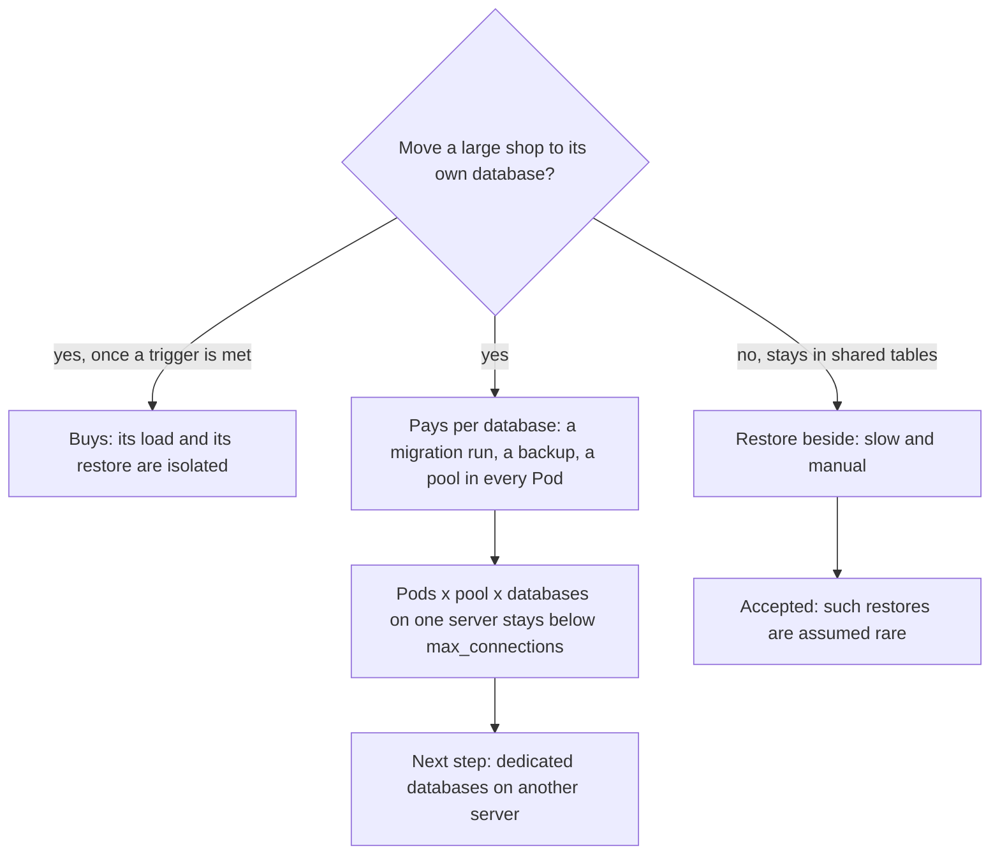

## Before you start

- [[sysdesign.l4.multi-shop-design]] — you know ADR `0026` lets a large shop move out of the shared tables in `donhang` through a shop map, and that a shop left in shared tables is restored beside.
- [[sysdesign.l4.finding-bottlenecks]] — you know removing one bottleneck moves it, and that more api Pods meet `max_connections` next.
- [[design.l4.trade-off-points]] — you know a trade-off point is one decision that moves two quality attributes in opposite directions.
- [[backend.l4.capacity-planning]] — you know `capacity-plan.md` keeps Pods times connections per Pod below `max_connections`, and names the resource that runs out first.

## The situation

The design review for ADR `0026` is under way, and the shop map has survived the deep dive. Then the questions turn to cost. A Payments developer asks: if a database of its own protects the largest shop so well, why not give one to each of the ten largest, or to every one of the about 1,000 shops? The developer who runs releases asks what changes on release day when `donhang` is no longer the only database the API migrates. Someone from operations asks what happens to the connections of the 2 api Pods.

What does each extra database cost, and what stops the team from paying that cost for every shop?

## Core concepts

- a dedicated database — a database of its own for one shop that ADR `0026` moved out of the shared tables in `donhang`; at first it sits on the same PostgreSQL server as `donhang`.
- the cost per database — what every dedicated database adds, whatever its shop's size: one more migration run per release, one more backup with its own restore, one more connection pool in every api Pod.
- the move trigger — the assumed condition in ADR `0026` that a shop must meet before it moves, so the cost is paid only where a driver needs it.
- the review condition — the count written in ADR `0026` at which the whole decision is weighed again.

## How it works



The three questions point at one trade-off point the review records: moving a large shop once it meets a trigger. It improves two things for that shop. Its load leaves the shared tables, and, once on a server of its own, it can be restored without copying rows back by hand. It worsens three things for the team, each multiplied by the number of dedicated databases.

Migrations come first. Each migration runs once more for every dedicated database, so a release can migrate `donhang` while one dedicated database is still behind. Expand and contract keeps each migration working with the code before it, so the version already running still works on the database left behind. The new version waits, or keeps away from the new shape, until that database catches up.

Connections come next. `capacity-plan.md` says the api Pods times connections per Pod, plus every other service's connections, must stay below PostgreSQL's `max_connections`. Each database the API reaches has its own connection pool in every Pod, so the review multiplies the rule by the number of databases on one server. `donhang` is one of those databases, so with one shop moved the server already counts two. The review expects this limit first; its next step is another server for dedicated databases.

Backups come last: each dedicated database gets a backup and restore of its own. Not moving has a price too: a shop left in shared tables is restored beside, slowly and by hand, which the review accepts because such restores are assumed rare.

None of these costs disappears for a small shop: it adds the same count of runs, backups and pools as the largest one.

## In the Đơn Hàng system

Like the design, these costs are not built at stage-4: ADR `0026` has no multi-shop code behind it. The ADR answers the Payments developer with a trigger, a list of consequences and a limit:

```markdown file=docs/adr/0026-cua-hang-lon-chuyen-sang-database-rieng.md tag=stage-4 lines=46-66
Một cửa hàng chuyển khi chạm một trong hai điều kiện (giả định): giữ hơn 10%
tổng số đơn của ngày đông nhất, hoặc cần khôi phục riêng theo hợp đồng.

### Hệ quả

- Bảng ánh xạ là phụ thuộc của mọi request: không đọc được nó thì không biết
  database nào.
- Mỗi migration chạy thêm một lần cho mỗi database riêng; một lần phát hành có
  thể để một database đi sau, nên migration giữ cách expand và contract.
- Mỗi database riêng có bản sao lưu và khôi phục riêng; khôi phục cửa hàng đó
  là khôi phục database của nó.
- Kết nối: số Pod × kết nối mỗi Pod × số database trên một server phải nhỏ hơn
  `max_connections`; quy tắc của `capacity-plan.md` nhân thêm số database.
- Đội chỉ chờ một vài database riêng, không hàng trăm.

Đội xem lại quyết định khi:

- Số database riêng vượt khoảng 10 (giả định): chi phí migration và kết nối lại
  gần phương án database cho mỗi cửa hàng.
- Một cửa hàng đã chuyển vẫn cần cô lập nhiều hơn database (ví dụ hợp đồng đòi
  bản riêng): điều kiện xem lại của ADR 0012.
```

The first two lines are the move trigger: a shop moves when it holds more than 10% of all orders on the busiest day, or when a contract requires restoring it alone, both assumed. The design review's estimate puts the largest shop at about 10% and the ten largest at about 30% together (assumed), so only a shop near the largest's size can meet the first trigger.

The consequences after the map are the cost per database. The team therefore expects a few dedicated databases, not hundreds. The first review condition gives that a number: above about 10 (assumed), migration and connection costs come close to the rejected option of a database for every shop. The second reopens it when a moved shop's contract demands more than a database, such as a copy of its own, which is ADR `0012`'s case. The risks table in `multi-shop-design-review.md` gives the migration cost an owner, a backend developer, with expand and contract and a job that checks each database's schema version.

The review records the bottleneck and the two trade-off points:

```markdown file=docs/design/multi-shop-design-review.md tag=stage-4 lines=74-95
### Nút cổ chai và điểm hỏng đơn lẻ (bước 5)

Mỗi database API chạm tới có pool kết nối riêng trong mỗi Pod. Quy tắc của
`capacity-plan.md` thành: số Pod × kết nối tối đa mỗi Pod × số database trên
một server, cộng kết nối của các service khác, nhỏ hơn `max_connections` (đọc
bằng `SHOW max_connections`). Đây là giới hạn chạm trước khi số database riêng
tăng; bước kế tiếp là đặt database riêng lên server khác.

Điểm hỏng đơn lẻ mới: bảng ánh xạ. Cache trong Pod cho mọi request chạy tiếp
30 giây khi không đọc được nó; quá thời gian đó, request mới dừng.

### Phương án bị loại và điểm đánh đổi (bước 3 và 4)

- Database cho mỗi cửa hàng: bị loại theo ADR 0013, mỗi migration chạy một lần
  cho mỗi cửa hàng, 1.000 lần.
- Bản triển khai riêng cho cửa hàng lớn: ADR 0012 giữ cho hợp đồng đòi nó.
- Điểm đánh đổi: chuyển một cửa hàng lớn được cô lập tải và khôi phục của nó,
  nhưng mỗi database thêm làm migration, sao lưu và kết nối tăng theo. Driver
  quyết định: 3 (tải rời khỏi bảng chung) và 2; vì vậy chỉ chuyển khi chạm điều
  kiện của ADR 0026.
- Điểm đánh đổi: khôi phục cửa hàng ở bảng chung chậm và làm tay hơn khôi phục
  một database riêng. Chấp nhận, vì khôi phục riêng giả định là hiếm.
```

The first paragraph is the connection rule from above; the map paragraph belongs to the previous lesson.

The first trade-off point names the deciding drivers, 3 (load leaves the shared tables) and 2 (restore one shop alone), and ties the cost to ADR `0026`'s trigger.

The second point is the price of not moving, described above; the estimate behind "rare" is a few times a year, as the operations team confirms. As the previous lesson noted, "restore that database alone" holds once it has a server of its own. Point-in-time recovery restores a whole server, so while a dedicated database shares `donhang`'s server, such a restore takes every other shop back too.

The rejected options keep their reasons. A database for every shop fails on ADR `0013`'s cost: each migration would run 1,000 times. A separate deployment is what ADR `0012` keeps for contracts that demand one.

## Trade-offs

| Trade-off point | What the design buys | What it pays | What holds the cost, or reopens it |
|---|---|---|---|
| Move a large shop to a dedicated database | its load leaves the shared tables (driver 3); once on a server of its own, it can be restored alone (driver 2) | per database: a migration run, a backup and restore, a pool in every api Pod | the move trigger; review condition above about 10 dedicated databases |
| Keep most shops in shared tables | no extra database for the other shops | restoring one of them is slow and manual | restores alone assumed a few times a year |
| Rejected: a database for every shop | the strongest isolation without new deployments | each migration runs 1,000 times; a pool per shop in every api Pod | ADR `0013` |
| Rejected: a separate deployment | isolation beyond the database | a second copy of every service to run | ADR `0012`, for a contract that demands one |

Each row rests on an assumption: very uneven shop sizes, rare restores, a few dedicated databases at most. A database for every shop fits a different context: tens of shops, not a thousand, each with a contract asking for its own restore. Then isolation is the driver, and the team accepts tens of migration runs and spreads the databases over more than one server for connections. Neither holds at Đơn Hàng's estimated size, and the review condition says when the team would look again.

## What would you choose if…

…a second shop meets the trigger, but the connection rule leaves no room on `donhang`'s server for one more pool in every Pod? The review already names the next step: put the dedicated databases on another server. The rule counts databases per server, so the new server starts its own count.

…a release migrates `donhang` but fails on one dedicated database? Expand and contract keeps each migration working with the code before it, so the version already running keeps serving while that database is fixed. The schema-version job in the risks table is what notices the gap; without it, the next release could assume a schema the lagging database never got.

…the operations team now restores one shop from shared tables every month, not a few times a year? The second trade-off point was accepted on "rare", so it is weighed again. First check whether that shop now meets a move trigger.

## Seniors often assume…

- **"Giving a shop its own database costs nothing beyond the server it runs on."** → Actually a dedicated database at first shares `donhang`'s server, and its cost is elsewhere: a migration run, a backup to test, and a pool in every api Pod. You notice this when a release leaves one database a migration behind, or when the server refuses new connections after a second shop moves.
- **"A design that still has trade-offs is a design that is not finished."** → Actually every option here has a cost, and the review's job is to name it, accept it under an assumption, and write the condition that reopens it. You notice this when costs a review never listed show up later as surprises nobody owns.
- **"More databases always give the whole system more capacity."** → Actually while dedicated databases share one server, they share its `max_connections`, and each adds a pool in every Pod, so the number of api Pods the server can carry falls. The review's next step for more room is to put dedicated databases on another server. You notice this when moving a second shop leaves no room for a third api Pod.

## Try it (3 minutes)

Use these assumed numbers: 2 api Pods; each Pod's pool opens at most 40 connections to each database; Notifications, Payments, migrations and backups use at most 60 connections; `SHOW max_connections` on `donhang`'s server returns 300.

1. One shop has moved, and its dedicated database is on `donhang`'s server. Does the rule hold?
2. A second shop moves to the same server. Does it still hold?
3. If it does not, what step does the design review name?

Expected result: two sums, one yes and one no, and one next step.

<details><summary>Suggested answer</summary>

1. 2 × 40 × 2 + 60 = 220, below 300. Yes.
2. 2 × 40 × 3 + 60 = 300, which is not below 300. No.
3. Put the dedicated databases on another server, so each server counts only its own databases. Keeping one shop moved and adding a third api Pod would also fail: 3 × 40 × 2 + 60 is 300 too.

</details>

## Connections

- [[sysdesign.l4.multi-shop-design]] — the design whose costs this lesson lists.
- [[design.l4.trade-off-points]] — the idea applied here: one decision buys isolation and pays with operating work.
- [[backend.l4.capacity-planning]] — the connection rule this design multiplies by the number of databases on one server.
- [[sysdesign.l4.finding-bottlenecks]] — the same move of the bottleneck: more databases, like more Pods, meet `max_connections` next.
- [[backend.l4.expand-and-contract]] — the migration discipline that lets one database lag behind a release without breaking the running code.
- [[devops.l3.restore-testing]] — the rule each dedicated database's backup falls under.
- [[backend.l3.tenant-isolation-models]] — the layouts weighed here: shared tables for most shops, a database each for very few.
- [[sysdesign.l4.multi-shop-challenges]] — the next step: answering the review's challenges from ADRs already accepted.

## Five-line summary

1. A dedicated database isolates one shop's load and restore, but every such database adds a migration run, a backup and a connection pool to run.
2. A release can leave one dedicated database a migration behind, so expand and contract keeps the running code working until all catch up.
3. The connection rule becomes Pods times connections per Pod times databases on one server, plus other services, below `max_connections`.
4. So ADR `0026` moves a shop only on an assumed trigger, expects a few dedicated databases, and is weighed again above about 10.
5. Restoring a shop in shared tables is slow and manual, accepted because restores are rare; ADRs `0013` and `0012` keep the other options rejected.
