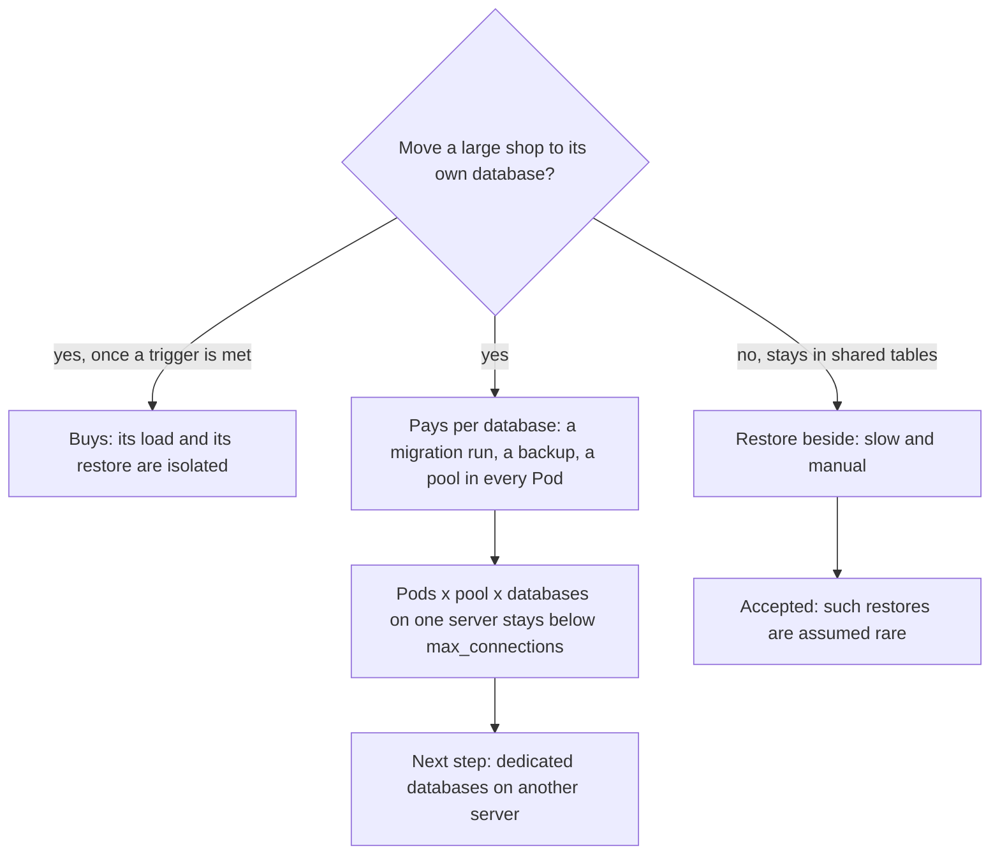

## Bạn cần biết trước

- [[sysdesign.l4.multi-shop-design]] — bạn biết ADR `0026` cho một cửa hàng lớn chuyển ra khỏi các bảng chung trong `donhang` qua một bảng ánh xạ cửa hàng, và cửa hàng ở lại bảng chung thì được khôi phục ở bên cạnh.
- [[sysdesign.l4.finding-bottlenecks]] — bạn biết gỡ một nút cổ chai thì nó dời sang chỗ khác, và thêm Pod api thì chỗ chạm tiếp theo là `max_connections`.
- [[design.l4.trade-off-points]] — bạn biết điểm đánh đổi là một quyết định đẩy hai thuộc tính chất lượng đi hai hướng ngược nhau.
- [[backend.l4.capacity-planning]] — bạn biết `capacity-plan.md` giữ số Pod nhân số kết nối mỗi Pod nhỏ hơn `max_connections`, và nêu tên tài nguyên cạn trước tiên.

## Tình huống

Buổi review thiết kế cho ADR `0026` đang diễn ra, và bảng ánh xạ cửa hàng đã qua được phần đi sâu. Rồi câu hỏi chuyển sang chi phí. Một developer bên Payments hỏi: nếu database riêng bảo vệ cửa hàng lớn nhất tốt như vậy, sao không cấp cho mười cửa hàng lớn nhất, hay cho cả khoảng 1.000 cửa hàng? Developer phụ trách phát hành hỏi ngày phát hành sẽ đổi gì khi `donhang` không còn là database duy nhất API phải migrate. Một người bên vận hành hỏi chuyện gì xảy ra với kết nối của 2 Pod api.

Mỗi database thêm vào tốn gì, và điều gì ngăn đội trả chi phí đó cho mọi cửa hàng?

## Khái niệm cốt lõi

- database riêng — database của riêng một cửa hàng mà ADR `0026` đã chuyển ra khỏi các bảng chung trong `donhang`. Lúc đầu nó nằm trên cùng server PostgreSQL với `donhang`.
- chi phí cho mỗi database — thứ mà database riêng nào cũng thêm vào, dù cửa hàng của nó lớn hay nhỏ: thêm một lượt chạy migration mỗi lần phát hành, thêm một bản sao lưu với lần khôi phục riêng, thêm một pool kết nối trong mỗi Pod api.
- điều kiện chuyển — điều kiện giả định trong ADR `0026` mà một cửa hàng phải chạm trước khi chuyển, để chi phí chỉ phải trả ở chỗ có yếu tố định hình kiến trúc cần đến nó.
- điều kiện xem lại — con số ghi trong ADR `0026` mà khi chạm tới, đội cân nhắc lại cả quyết định.

## Cơ chế hoạt động



Ba câu hỏi cùng chỉ về một điểm đánh đổi mà buổi review ghi lại: chuyển một cửa hàng lớn khi nó chạm một điều kiện chuyển. Với cửa hàng đó, có hai điều tốt lên. Tải của nó rời khỏi bảng chung, và khi đã có server riêng, nó được khôi phục mà không phải chép tay các dòng trở lại. Với cả đội, có ba điều kém đi, mỗi điều nhân theo số database riêng.

Trước tiên là migration. Mỗi migration chạy thêm một lần cho mỗi database riêng, nên một lần phát hành có thể đã migrate `donhang` trong khi một database riêng vẫn đi sau. Expand and contract giữ cho mỗi migration chạy được với code của bản trước, nên phiên bản đang chạy vẫn làm việc được trên database bị bỏ lại. Phiên bản mới thì chờ, hoặc tránh dùng dạng mới, cho tới khi database đó bắt kịp.

Kế đến là kết nối. `capacity-plan.md` nói số Pod api nhân số kết nối mỗi Pod, cộng kết nối của mọi service khác, phải nhỏ hơn `max_connections` của PostgreSQL. Mỗi database API chạm tới có pool kết nối riêng trong mỗi Pod, nên buổi review nhân quy tắc đó với số database trên một server. Bản thân `donhang` cũng là một trong số đó, nên chỉ cần một cửa hàng chuyển là server đã đếm hai database. Buổi review dự đoán giới hạn này bị chạm trước tiên. Bước kế tiếp nó nêu là một server khác cho các database riêng.

Cuối cùng là sao lưu: mỗi database riêng có bản sao lưu và lần khôi phục của riêng nó. Không chuyển cũng có giá: cửa hàng ở lại bảng chung được khôi phục ở bên cạnh, chậm và làm tay. Buổi review chấp nhận điều này vì giả định những lần khôi phục như vậy hiếm.

Không chi phí nào biến mất với một cửa hàng nhỏ: nó thêm đúng số lượt chạy, bản sao lưu và pool như cửa hàng lớn nhất.

## Trong hệ thống Đơn Hàng

Cũng như thiết kế, các chi phí này chưa được xây ở stage-4: ADR `0026` chưa có code đa cửa hàng nào đứng sau. ADR trả lời developer bên Payments bằng một điều kiện chuyển, một danh sách hệ quả và một giới hạn:

```markdown file=docs/adr/0026-cua-hang-lon-chuyen-sang-database-rieng.md tag=stage-4 lines=46-66
Một cửa hàng chuyển khi chạm một trong hai điều kiện (giả định): giữ hơn 10%
tổng số đơn của ngày đông nhất, hoặc cần khôi phục riêng theo hợp đồng.

### Hệ quả

- Bảng ánh xạ là phụ thuộc của mọi request: không đọc được nó thì không biết
  database nào.
- Mỗi migration chạy thêm một lần cho mỗi database riêng; một lần phát hành có
  thể để một database đi sau, nên migration giữ cách expand và contract.
- Mỗi database riêng có bản sao lưu và khôi phục riêng; khôi phục cửa hàng đó
  là khôi phục database của nó.
- Kết nối: số Pod × kết nối mỗi Pod × số database trên một server phải nhỏ hơn
  `max_connections`; quy tắc của `capacity-plan.md` nhân thêm số database.
- Đội chỉ chờ một vài database riêng, không hàng trăm.

Đội xem lại quyết định khi:

- Số database riêng vượt khoảng 10 (giả định): chi phí migration và kết nối lại
  gần phương án database cho mỗi cửa hàng.
- Một cửa hàng đã chuyển vẫn cần cô lập nhiều hơn database (ví dụ hợp đồng đòi
  bản riêng): điều kiện xem lại của ADR 0012.
```

Hai dòng đầu là điều kiện chuyển: một cửa hàng chuyển khi giữ hơn 10% tổng số đơn của ngày đông nhất, hoặc khi hợp đồng đòi khôi phục riêng nó, cả hai đều là giả định. Ước lượng của buổi review thiết kế đặt cửa hàng lớn nhất ở khoảng 10%, còn mười cửa hàng lớn nhất cộng lại khoảng 30% (giả định), nên chỉ cửa hàng gần cỡ cửa hàng lớn nhất mới chạm được điều kiện đầu.

Các hệ quả sau bảng ánh xạ chính là chi phí cho mỗi database. Vì vậy đội chỉ chờ vài database riêng, không phải hàng trăm. Điều kiện xem lại đầu tiên gắn cho điều đó một con số: vượt khoảng 10 (giả định), chi phí migration và kết nối tiến gần phương án đã bị loại, mỗi cửa hàng một database. Điều kiện thứ hai mở lại quyết định khi hợp đồng của một cửa hàng đã chuyển đòi nhiều hơn một database, như một bản riêng cho nó, tức trường hợp của ADR `0012`. Bảng rủi ro trong `multi-shop-design-review.md` giao chi phí migration cho một người chịu trách nhiệm, một backend developer, kèm expand and contract và một job kiểm tra phiên bản schema của từng database.

Buổi review ghi lại nút cổ chai và hai điểm đánh đổi:

```markdown file=docs/design/multi-shop-design-review.md tag=stage-4 lines=74-95
### Nút cổ chai và điểm hỏng đơn lẻ (bước 5)

Mỗi database API chạm tới có pool kết nối riêng trong mỗi Pod. Quy tắc của
`capacity-plan.md` thành: số Pod × kết nối tối đa mỗi Pod × số database trên
một server, cộng kết nối của các service khác, nhỏ hơn `max_connections` (đọc
bằng `SHOW max_connections`). Đây là giới hạn chạm trước khi số database riêng
tăng; bước kế tiếp là đặt database riêng lên server khác.

Điểm hỏng đơn lẻ mới: bảng ánh xạ. Cache trong Pod cho mọi request chạy tiếp
30 giây khi không đọc được nó; quá thời gian đó, request mới dừng.

### Phương án bị loại và điểm đánh đổi (bước 3 và 4)

- Database cho mỗi cửa hàng: bị loại theo ADR 0013, mỗi migration chạy một lần
  cho mỗi cửa hàng, 1.000 lần.
- Bản triển khai riêng cho cửa hàng lớn: ADR 0012 giữ cho hợp đồng đòi nó.
- Điểm đánh đổi: chuyển một cửa hàng lớn được cô lập tải và khôi phục của nó,
  nhưng mỗi database thêm làm migration, sao lưu và kết nối tăng theo. Driver
  quyết định: 3 (tải rời khỏi bảng chung) và 2; vì vậy chỉ chuyển khi chạm điều
  kiện của ADR 0026.
- Điểm đánh đổi: khôi phục cửa hàng ở bảng chung chậm và làm tay hơn khôi phục
  một database riêng. Chấp nhận, vì khôi phục riêng giả định là hiếm.
```

Đoạn đầu là quy tắc kết nối đã nói ở trên. Đoạn về bảng ánh xạ thuộc bài trước.

Điểm đánh đổi thứ nhất nêu tên các yếu tố định hình kiến trúc quyết định, 3 (tải rời khỏi bảng chung) và 2 (khôi phục riêng một cửa hàng), và gắn chi phí vào điều kiện chuyển của ADR `0026`.

Điểm thứ hai là cái giá khi không chuyển, đã nói ở trên. Ước lượng đứng sau chữ "hiếm" là vài lần mỗi năm, như đội vận hành xác nhận. Như bài trước đã lưu ý, "khôi phục database đó một mình" chỉ đúng khi nó có server riêng. Khôi phục về thời điểm đưa cả một server về quá khứ, nên khi một database riêng còn dùng chung server với `donhang`, lần khôi phục như vậy kéo mọi cửa hàng khác lùi theo.

Các phương án bị loại vẫn giữ lý do của chúng. Mỗi cửa hàng một database trượt vì chi phí trong ADR `0013`: mỗi migration sẽ chạy 1.000 lần. Bản triển khai riêng là thứ ADR `0012` để dành cho hợp đồng đòi điều đó.

## Đánh đổi

| Điểm đánh đổi | Thiết kế nhận được gì | Cái giá | Điều giữ chi phí, hoặc mở lại quyết định |
|---|---|---|---|
| Chuyển một cửa hàng lớn sang database riêng | tải của nó rời khỏi bảng chung (yếu tố định hình kiến trúc 3), và khi có server riêng, nó được khôi phục một mình (yếu tố định hình kiến trúc 2) | mỗi database: một lượt chạy migration, một bản sao lưu và lần khôi phục, một pool trong mỗi Pod api | điều kiện chuyển, cùng điều kiện xem lại khi vượt khoảng 10 database riêng |
| Giữ phần lớn cửa hàng trong bảng chung | không thêm database nào cho các cửa hàng khác | khôi phục một trong số đó chậm và làm tay | khôi phục riêng giả định vài lần mỗi năm |
| Bị loại: mỗi cửa hàng một database | cô lập mạnh nhất mà không thêm bản triển khai | mỗi migration chạy 1.000 lần, một pool cho mỗi cửa hàng trong mỗi Pod api | ADR `0013` |
| Bị loại: bản triển khai riêng | cô lập vượt ra ngoài database | thêm một bản sao của mọi service phải vận hành | ADR `0012`, cho hợp đồng đòi điều đó |

Mỗi dòng dựa trên một giả định: cỡ cửa hàng rất chênh lệch, khôi phục hiếm, nhiều nhất vài database riêng. Mỗi cửa hàng một database hợp với một bối cảnh khác: vài chục cửa hàng chứ không phải một nghìn, cửa hàng nào cũng có hợp đồng đòi khôi phục riêng. Khi đó cô lập là yếu tố định hình kiến trúc, và đội chấp nhận vài chục lượt chạy migration, đồng thời rải database ra hơn một server vì kết nối. Ở cỡ ước lượng của Đơn Hàng, không điều nào trong đó đúng, và điều kiện xem lại cho biết khi nào đội sẽ nhìn lại.

## Bạn sẽ chọn gì nếu…

…một cửa hàng thứ hai chạm điều kiện chuyển, nhưng quy tắc kết nối không còn chỗ trên server của `donhang` cho thêm một pool trong mỗi Pod? Buổi review đã nêu bước kế tiếp: đặt các database riêng lên server khác. Quy tắc đếm database trên từng server, nên server mới bắt đầu số đếm của riêng nó.

…một lần phát hành migrate xong `donhang` nhưng lỗi ở một database riêng? Expand and contract giữ cho mỗi migration chạy được với code của bản trước, nên phiên bản đang chạy vẫn phục vụ trong lúc sửa database đó. Job kiểm tra phiên bản schema trong bảng rủi ro là thứ phát hiện khoảng lệch. Không có nó, lần phát hành sau có thể giả định một schema mà database đi sau chưa bao giờ nhận.

…đội vận hành giờ khôi phục một cửa hàng từ bảng chung mỗi tháng, chứ không phải vài lần mỗi năm? Điểm đánh đổi thứ hai được chấp nhận dựa trên chữ "hiếm", nên phải cân nhắc lại. Trước hết, xem cửa hàng đó giờ có chạm điều kiện chuyển nào không.

## Senior hay nhầm rằng…

- **"Cấp database riêng cho một cửa hàng không tốn gì ngoài server nó chạy trên đó."** → Thực ra lúc đầu database riêng dùng chung server với `donhang`, và chi phí của nó nằm ở chỗ khác: một lượt chạy migration, một bản sao lưu phải kiểm thử, và một pool trong mỗi Pod api. Bạn sẽ nhận ra khi một lần phát hành để một database chậm một migration, hoặc khi server từ chối kết nối mới sau khi cửa hàng thứ hai chuyển.
- **"Thiết kế còn đánh đổi là thiết kế chưa xong."** → Thực ra phương án nào ở đây cũng có giá, và nhiệm vụ của buổi review là nêu tên cái giá đó, chấp nhận nó dưới một giả định, và ghi điều kiện mở lại nó. Bạn sẽ nhận ra khi những chi phí buổi review chưa từng liệt kê về sau hiện ra thành bất ngờ không ai chịu trách nhiệm.
- **"Thêm database thì cả hệ thống luôn có thêm năng lực."** → Thực ra khi các database riêng dùng chung một server, chúng dùng chung `max_connections` của server đó, và mỗi database thêm một pool trong mỗi Pod, nên số Pod api server gánh được giảm xuống. Bước kế tiếp của buổi review để có thêm chỗ là đặt database riêng lên server khác. Bạn sẽ nhận ra khi chuyển cửa hàng thứ hai xong thì không còn chỗ cho Pod api thứ ba.

## Thử ngay (3 phút)

Dùng các số giả định sau. Có 2 Pod api. Pool của mỗi Pod mở tối đa 40 kết nối tới mỗi database. Notifications, Payments, migration và sao lưu dùng tối đa 60 kết nối. `SHOW max_connections` trên server của `donhang` trả về 300.

1. Một cửa hàng đã chuyển, và database riêng của nó nằm trên server của `donhang`. Quy tắc có còn đúng không?
2. Cửa hàng thứ hai chuyển lên cùng server đó. Quy tắc còn đúng không?
3. Nếu không, buổi review thiết kế nêu bước nào?

Kết quả mong đợi: hai phép tính, một "có" và một "không", cùng một bước kế tiếp.

<details><summary>Gợi ý đáp án</summary>

1. 2 × 40 × 2 + 60 = 220, nhỏ hơn 300. Có.
2. 2 × 40 × 3 + 60 = 300, không nhỏ hơn 300. Không.
3. Đặt các database riêng lên server khác, để mỗi server chỉ đếm database của chính nó. Giữ một cửa hàng đã chuyển rồi thêm Pod api thứ ba cũng không được: 3 × 40 × 2 + 60 cũng bằng 300.

</details>

## Liên hệ

- [[sysdesign.l4.multi-shop-design]] — thiết kế mà bài này liệt kê chi phí.
- [[design.l4.trade-off-points]] — ý tưởng áp dụng ở đây: một quyết định đổi lấy sự cô lập bằng công vận hành.
- [[backend.l4.capacity-planning]] — quy tắc kết nối mà thiết kế này nhân thêm số database trên một server.
- [[sysdesign.l4.finding-bottlenecks]] — cùng kiểu nút cổ chai dời chỗ: thêm database, cũng như thêm Pod, thì chạm `max_connections` tiếp theo.
- [[backend.l4.expand-and-contract]] — kỷ luật migration cho phép một database đi sau một lần phát hành mà không làm hỏng code đang chạy.
- [[devops.l3.restore-testing]] — quy tắc mà bản sao lưu của mỗi database riêng phải theo.
- [[backend.l3.tenant-isolation-models]] — các cách bố trí được cân nhắc ở đây: bảng chung cho phần lớn cửa hàng, mỗi cửa hàng một database cho rất ít cửa hàng.
- [[sysdesign.l4.multi-shop-challenges]] — bước tiếp theo: trả lời các câu phản biện của buổi review bằng những ADR đã được chấp nhận.

## Tóm tắt 5 dòng

1. Database riêng cô lập tải và lần khôi phục của một cửa hàng, nhưng mỗi database như vậy thêm một lượt chạy migration, một bản sao lưu và một pool kết nối phải vận hành.
2. Một lần phát hành có thể để một database riêng chậm một migration, nên expand and contract giữ code đang chạy hoạt động cho tới khi mọi database bắt kịp.
3. Quy tắc kết nối thành: số Pod nhân kết nối mỗi Pod nhân số database trên một server, cộng các service khác, nhỏ hơn `max_connections`.
4. Vì vậy ADR `0026` chỉ chuyển cửa hàng khi chạm một điều kiện giả định, chờ vài database riêng, và cân nhắc lại khi vượt khoảng 10.
5. Khôi phục cửa hàng ở bảng chung chậm và làm tay, được chấp nhận vì khôi phục hiếm, còn ADR `0013` và `0012` giữ các phương án kia ở trạng thái bị loại.
