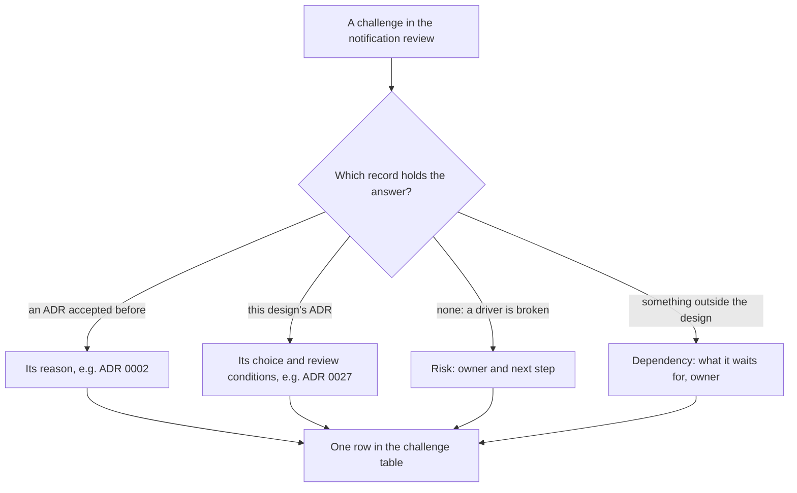

## Before you start

- [[sysdesign.l4.notification-trade-offs]] — you know why email is sent at least once and SMS at most once, and that email is the channel of record, a sensitivity point of ADR `0027`.
- [[sysdesign.l4.answering-challenges]] — you answer a challenge with the driver or trade-off point behind a decision, named with its file, and turn an uncovered case into an open question with an owner.
- [[backend.l4.per-shop-limits]] — you know ADR `0016`'s cap per shop, which stops one busy shop at its share of a shared limit.

## The situation

The review of the notification design reaches its challenges. Four questions come in a row. Why does the API not call the SMS provider itself, which looks simpler? What happens if the external email service is down for a whole day? Can one shop's sale day delay every other shop's order emails? Why is push designed, but not built?

Each question sounds like it wants something new: a shortcut, a longer retry, a fair split, a release date.

Where does each answer come from, and which of them changes anything?

## Core concepts

- an answer from an earlier ADR — the question was settled before this design began, so the answer is that ADR's reason, named with its number.
- an answer from the design's own ADR — the question is about a choice ADR `0027` made, so the answer quotes that choice and the review conditions written for it.
- a risk — a case where the design, as written, works against one of its own drivers; the review records it with an owner by role and a next step.
- a dependency — part of the design waits for something outside it; the review records what it waits for and who owns that, while the rest goes ahead.

## How it works



In the situation above, each of the four questions lands on a different branch. The SMS shortcut is answered by a reason decided before this design, in ADR `0002`. The day-long outage is about a choice ADR `0027` made, its retry window. The sale day finds a driver the design does not yet meet, so it becomes a risk. Push waits for something no notification decision controls, so it becomes a dependency.

The first two branches need nothing new. The answer already exists in a file a reviewer can open, and quoting it is checkable in a way an argument made up in the session is not. ADR `0027` also wrote when it should be reviewed, so a challenge about its limits is answered from those conditions.

The last two branches leave work behind, but neither asks for a new mechanism invented in the room. The risk gets a next step taken from a decision the team already has, ADR `0016`'s cap per shop. The dependency gets an owner who tracks it.

Whatever the branch, the answer ends up as one row of the review's challenge table: the question, the answer with the ADR or driver it traces to, the next step, and an owner by role when something stays open.

## In the Đơn Hàng system

The challenge table at the end of `notification-design-review.md` keeps every question from the session:

```markdown file=docs/design/notification-design-review.md tag=stage-4 lines=108-116
### Câu hỏi phản biện trong buổi review

| Câu hỏi | Trả lời, trỏ driver, ADR hoặc rủi ro | Việc tiếp theo | Người phụ trách (vai trò) |
|---|---|---|---|
| Sao API không gọi thẳng nhà cung cấp SMS? | ADR 0002: mọi service báo tin cùng một cách; nhà cung cấp chậm nằm ngoài process nhận đơn | Không | |
| Dịch vụ email sập một ngày thì sao? | ADR 0027: thử lại 24 giờ, rồi `failed` cho đội vận hành gửi lại; sập lặp lại là xét điều kiện xem lại của ADR 0024 | Không | |
| Ngày khuyến mãi của một cửa hàng có làm chậm email cửa hàng khác không? | Có: sender nhận dòng theo thời gian, không theo cửa hàng | Ghi rủi ro; trần theo cửa hàng như ADR 0016 | Lập trình viên backend |
| Sao thiết kế push mà không xây? | Push cần bản app cho điện thoại (ADR 0017), chưa có | Ghi phụ thuộc | Product owner |
| Khách bỏ email, chỉ nhận SMS được không? | Không: email là kênh chính, điểm nhạy của ADR 0027 | Không | |
```

The first row answers the SMS shortcut with ADR `0002`. That ADR moved notifications into their own service so that every service notifies customers the same way, and so that a slow mail server or provider ties up the sending work, not the resources of the process that takes orders. ADR `0027` lists "the API, or each service, calls the provider" as a rejected option for the same reason.

The second row answers from ADR `0027`'s choice, as the review's retry section spells it out. Each channel retries for 24 hours, an assumed figure, with the gap between attempts growing up to a ceiling. After 24 hours the row becomes `failed` and is shown to the operations team, who resend it by hand when the provider is back. A day-long outage therefore meets the edge of that window. ADR `0027` wrote a review condition for exactly this: the team reviews the decision when 24 hours of retry is not enough for one outage of the email service.

Repeated outages lead somewhere else, to the conditions of ADR `0024`, which chose the email service, called Service A:

```markdown file=docs/adr/0024-dich-vu-gui-email-ben-ngoai.md tag=stage-4 lines=58-63
Đội xem lại quyết định khi:

- Tỉ lệ email tới hộp thư khách thấp hơn mức giả định trong
  `email-service-evaluation.md`.
- Giá của A vượt TCO giả định trong `email-service-evaluation.md`.
- A ngừng nhận email qua SMTP.
```

The three conditions are a delivery rate below the assumed level, a price above the assumed TCO, and Service A no longer accepting email over SMTP, the standard protocol for handing an email to a mail server. None of them names an outage. So, as written, repeated outages alone do not reopen the choice of service; a reviewer who thinks they should raises an uncovered case, an open question with an owner.

The third row is a risk. Each message waiting to go out is a row with a `next_attempt_at` time. A sender repeatedly takes the rows whose time has come, by that time and never by shop, so a shop with a sale fills each round and other shops' emails wait. That works against driver 3: one shop's busy day does not slow other shops' emails. The next step reuses ADR `0016`'s idea, a cap per shop for each round of claiming rows, and the backend developer owns it. Nothing about it is built at stage-4.

The fourth row is a dependency. At stage-4 none of ADR `0027` is built yet; Notifications still sends only email. What differs is what each channel waits for. Email and SMS do not wait for a phone build, though SMS still needs a provider chosen in its own ADR, as push does. Push needs a phone build of the app, and ADR `0017` keeps one Flutter code base with no Android or iOS build at stage-4. The product owner owns that dependency.

The last row, not in the situation, answers that a customer cannot drop email for SMS only: email is the channel of record.

## Trade-offs

| Way to answer | What it buys | What it pays | When it is the wrong choice |
|---|---|---|---|
| Quote the earlier ADR's reason | a short, checkable answer; the session moves on | rests on that ADR's facts still holding | the challenge brings a fact the ADR never weighed |
| Quote this design's choice and its review conditions | the limit is stated before anyone hits it | the conditions must be watched by someone | a condition is already met, and nobody reopens the ADR |
| Record a risk with a next step from an existing decision | the design is accepted for what it covers | the broken driver stays broken until the step is done | the risk breaks driver 1, no lost order email |
| Record a dependency with an owner | the channels that are ready go ahead | the waiting part has no date | the dependency blocks the channel of record |
| Design a new mechanism in the session | the question closes at once | a change no driver asked for and nobody reviewed | almost always, at review time |

Recording a risk fits driver 3 because the drivers are ranked: driver 1, no lost order email, is still met by the same design. A risk against driver 1 would weigh far more heavily, a strong reason to question accepting the design as written.

## What would you choose if…

…the email service is down for 30 hours? Emails from the first hours of the outage pass the 24-hour window and become `failed`, so the operations team resends them by hand. The outage also meets ADR `0027`'s own review condition, so the team reviews the retry window in that ADR, not in a quick change to the sender.

…a large shop asks for an installed app on its customers' phones? ADR `0017` already planned for this: Android and iOS are built from the same code when a shop needs an installed app. Push then still needs a push service chosen in its own ADR, the way ADR `0024` chose the email service.

…a reviewer wants the per-shop cap for senders built before the design is accepted? The review keeps it as a risk with its owner: driver 3 ranks below driver 1, so the design is accepted for what it covers.

## Seniors often assume…

- **"If the review finds a risk, the notification design was wrong."** → Actually the risk shows one driver, the third-ranked, is not yet met by how senders claim rows, while the rest of the design stands. You notice this when a team rejects a whole design over one recorded risk, and the next design repeats the same claiming.
- **"A channel that is designed but not built is a hole in the design."** → Actually push is a dependency: the design says what it waits for, a phone build of the app, and who owns that. Email and SMS do not wait for it. You notice this when a design is held back until every channel can ship, and email, the channel that matters most, waits too.
- **"Every challenge needs a new mechanism as its answer."** → Actually three of the five rows have "none" as next step, and the risk reuses ADR `0016`'s cap. You notice this when the review notes end with new components nobody can trace to a driver.

## Try it (3 minutes)

Three more challenges come up later in the same session. For each one, name where the answer comes from: an earlier ADR, ADR `0027`, a risk, or a dependency.

1. "Why does Payments not send its refund emails itself?"
2. "If the SMS provider times out and we do not know whether the message went out, do we send it again?"
3. "What happens to an order email that still fails after 24 hours of retry?"

Expected result: one source for each, with the fact from that source that answers it.

<details><summary>Suggested answer</summary>

1. An earlier ADR, `0002`. Payments had to notify customers too, and the ADR chose one way for every service: a message to Notifications, not a call to a provider from each service.
2. ADR `0027`. SMS is sent at most once: the row is marked before the call, and when it is unclear whether the message went out, it is not sent again. The same message also goes by email.
3. ADR `0027`, as detailed in the review's retry section. The row becomes `failed` and is shown to the operations team, who resend it by hand when the provider is back.

</details>

## Connections

- [[sysdesign.l4.notification-trade-offs]] — the step before, whose choices these challenges question.
- [[sysdesign.l4.answering-challenges]] — the method applied here, to a design whose answers sit in four different places.
- [[backend.l4.per-shop-limits]] — where ADR `0016`'s cap was decided, reused as the next step for the risk.
- [[frontend.l4.client-technology-drivers]] — where ADR `0017` kept one Flutter code base, the reason push waits.
- [[management.l3.superseding-an-adr]] — what happens when one of ADR `0027`'s review conditions is met.
- [[sysdesign.l4.multi-shop-challenges]] — the same kind of review for this module's other problem.
- [[sysdesign.l4.payment-reconciliation-requirements]] — the next problem, which starts from this design being reviewed.

## Five-line summary

1. A challenge to the notification design is answered from the record behind the choice: an earlier ADR, ADR `0027` itself, a risk or a dependency.
2. "Why not call the SMS provider from the API" is answered by ADR `0002`: one way to notify, slow providers outside order taking.
3. A day-long email outage meets ADR `0027`'s 24-hour retry and its review condition; repeated outages go to ADR `0024`'s conditions.
4. One shop's sale delaying others is a recorded risk against driver 3, with ADR `0016`'s cap per shop as the next step and an owner.
5. Push is a dependency on a phone build of the app, recorded with its owner, so email and SMS do not wait for it.
