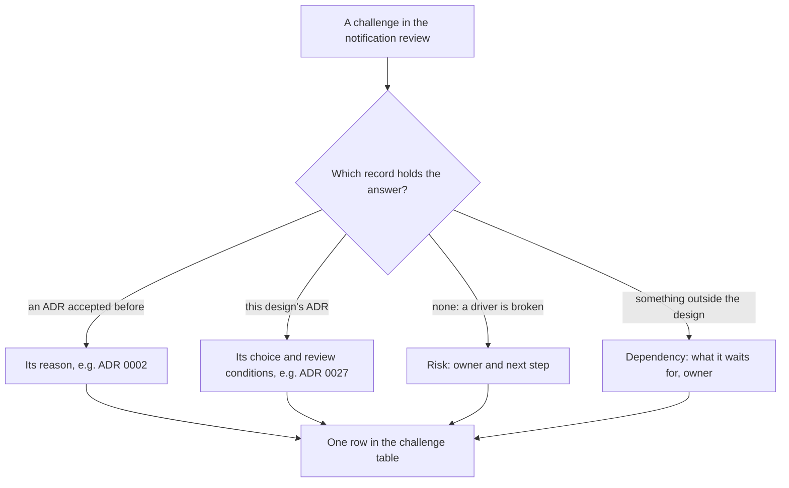

## Bạn cần biết trước

- [[sysdesign.l4.notification-trade-offs]] — bạn biết vì sao email được gửi ít nhất một lần còn SMS nhiều nhất một lần, và email là kênh chính, một điểm nhạy của ADR `0027`.
- [[sysdesign.l4.answering-challenges]] — bạn trả lời một câu phản biện bằng yếu tố định hình kiến trúc hay điểm đánh đổi đứng sau quyết định, nêu kèm tên file, còn trường hợp thiết kế chưa tính tới thì thành câu hỏi mở có người phụ trách.
- [[backend.l4.per-shop-limits]] — bạn biết trần theo cửa hàng của ADR `0016`, thứ giữ một cửa hàng đông khách ở đúng phần của nó trong một giới hạn dùng chung.

## Tình huống

Buổi review thiết kế thông báo tới phần phản biện. Bốn câu hỏi đến liền nhau. Sao API không tự gọi nhà cung cấp SMS, trông đơn giản hơn mà? Dịch vụ email bên ngoài sập cả ngày thì sao? Ngày khuyến mãi của một cửa hàng có làm chậm email về đơn của mọi cửa hàng khác không? Sao thiết kế push mà không xây?

Câu nào nghe cũng như đòi một thứ mới: một lối tắt, một khoảng thử lại dài hơn, một kiểu chia công bằng, một ngày phát hành.

Mỗi câu trả lời lấy từ đâu, và câu nào trong số đó làm thay đổi điều gì?

## Khái niệm cốt lõi

- câu trả lời từ một ADR có trước — câu hỏi đã được chốt trước khi thiết kế này bắt đầu, nên câu trả lời là lý do của ADR đó, nêu kèm số của nó.
- câu trả lời từ chính ADR của thiết kế — câu hỏi nhắm vào một lựa chọn của ADR `0027`, nên câu trả lời trích lựa chọn đó và các điều kiện xem lại đã viết cho nó.
- rủi ro — trường hợp mà thiết kế, như đang viết, đi ngược một yếu tố định hình của chính nó. Buổi review ghi nó lại kèm người phụ trách theo vai trò và một bước tiếp theo.
- phụ thuộc — một phần của thiết kế phải chờ thứ nằm ngoài nó. Buổi review ghi nó chờ gì và ai phụ trách thứ đó, trong khi phần còn lại vẫn đi tiếp.

## Cơ chế hoạt động



Trong tình huống trên, bốn câu hỏi rơi vào bốn nhánh khác nhau. Lối tắt gọi SMS được trả lời bằng một lý do đã chốt trước thiết kế này, trong ADR `0002`. Sự cố sập cả ngày nhắm vào một lựa chọn của ADR `0027`: khoảng thời gian thử lại. Ngày khuyến mãi chạm vào một yếu tố định hình mà thiết kế chưa đáp ứng, nên thành rủi ro. Push chờ một thứ mà không quyết định nào về thông báo điều khiển được, nên thành phụ thuộc.

Hai nhánh đầu không cần gì mới. Câu trả lời đã nằm sẵn trong một file người review mở ra đọc được, và trích nó thì kiểm được, còn một lập luận nghĩ ra ngay trong buổi họp thì không. ADR `0027` cũng đã viết khi nào cần xem lại nó, nên câu phản biện về giới hạn của nó được trả lời từ các điều kiện đó.

Hai nhánh sau để lại việc phải làm, nhưng không nhánh nào đòi một cơ chế mới nghĩ ra ngay trong phòng họp. Rủi ro nhận một bước tiếp theo lấy từ quyết định đội đã có: trần theo cửa hàng của ADR `0016`. Phụ thuộc nhận một người phụ trách theo dõi nó.

Dù ở nhánh nào, câu trả lời cũng thành một dòng trong bảng câu phản biện của buổi review: câu hỏi, câu trả lời kèm ADR hay yếu tố mà nó dẫn về, bước tiếp theo, và người phụ trách theo vai trò khi còn việc chưa xong.

## Trong hệ thống Đơn Hàng

Bảng câu phản biện ở cuối `notification-design-review.md` giữ mọi câu hỏi của buổi review:

```markdown file=docs/design/notification-design-review.md tag=stage-4 lines=108-116
### Câu hỏi phản biện trong buổi review

| Câu hỏi | Trả lời, trỏ driver, ADR hoặc rủi ro | Việc tiếp theo | Người phụ trách (vai trò) |
|---|---|---|---|
| Sao API không gọi thẳng nhà cung cấp SMS? | ADR 0002: mọi service báo tin cùng một cách; nhà cung cấp chậm nằm ngoài process nhận đơn | Không | |
| Dịch vụ email sập một ngày thì sao? | ADR 0027: thử lại 24 giờ, rồi `failed` cho đội vận hành gửi lại; sập lặp lại là xét điều kiện xem lại của ADR 0024 | Không | |
| Ngày khuyến mãi của một cửa hàng có làm chậm email cửa hàng khác không? | Có: sender nhận dòng theo thời gian, không theo cửa hàng | Ghi rủi ro; trần theo cửa hàng như ADR 0016 | Lập trình viên backend |
| Sao thiết kế push mà không xây? | Push cần bản app cho điện thoại (ADR 0017), chưa có | Ghi phụ thuộc | Product owner |
| Khách bỏ email, chỉ nhận SMS được không? | Không: email là kênh chính, điểm nhạy của ADR 0027 | Không | |
```

Dòng đầu trả lời lối tắt gọi SMS bằng ADR `0002`. ADR đó tách thông báo ra service riêng để mọi service báo tin cho khách theo cùng một lối, và để một mail server hay nhà cung cấp chậm chỉ giữ chân phần gửi tin, không chiếm tài nguyên của process đang nhận đơn. ADR `0027` liệt kê "API, hay từng service, gọi nhà cung cấp" là một phương án bị loại, cũng vì lý do đó.

Dòng thứ hai trả lời bằng lựa chọn của ADR `0027`, như phần thử lại trong tài liệu review đã nêu rõ. Mỗi kênh thử lại trong 24 giờ, một con số giả định, với khoảng cách giữa các lần thử tăng dần tới một mức trần. Hết 24 giờ, dòng thành `failed` và hiện cho đội vận hành, họ gửi lại bằng tay khi nhà cung cấp hoạt động trở lại. Vì thế sự cố sập cả ngày chạm đúng mép khoảng thời gian đó. ADR `0027` đã viết sẵn một điều kiện xem lại cho đúng trường hợp này: đội xem lại quyết định khi 24 giờ thử lại không đủ phủ một lần sập của dịch vụ email.

Sập lặp lại thì dẫn tới chỗ khác, tới các điều kiện của ADR `0024`, ADR đã chọn dịch vụ email, gọi là Dịch vụ A:

```markdown file=docs/adr/0024-dich-vu-gui-email-ben-ngoai.md tag=stage-4 lines=58-63
Đội xem lại quyết định khi:

- Tỉ lệ email tới hộp thư khách thấp hơn mức giả định trong
  `email-service-evaluation.md`.
- Giá của A vượt TCO giả định trong `email-service-evaluation.md`.
- A ngừng nhận email qua SMTP.
```

Ba điều kiện là: tỉ lệ email tới hộp thư thấp hơn mức giả định, giá vượt TCO giả định, và Dịch vụ A không còn nhận email qua SMTP, giao thức chuẩn để trao một email cho mail server. Không điều kiện nào nhắc tới sự cố sập. Vậy theo đúng những gì đã viết, chỉ riêng việc sập lặp lại không mở lại lựa chọn dịch vụ. Người review nào cho rằng nên mở lại thì nêu một trường hợp chưa được tính tới, thành câu hỏi mở có người phụ trách.

Dòng thứ ba là một rủi ro. Mỗi tin đang chờ gửi là một dòng có thời điểm `next_attempt_at`. Sender liên tục lấy các dòng đã tới giờ, theo thời điểm đó và không bao giờ theo cửa hàng, nên một cửa hàng đang khuyến mãi lấp đầy mỗi lượt lấy, còn email của các cửa hàng khác phải chờ. Điều này đi ngược yếu tố thứ 3: ngày đông khách của một cửa hàng không làm chậm email của cửa hàng khác. Bước tiếp theo dùng lại ý của ADR `0016`, một trần theo cửa hàng cho mỗi lượt lấy dòng, và lập trình viên backend phụ trách nó. Ở stage-4, chưa phần nào của nó được xây.

Dòng thứ tư là một phụ thuộc. Ở stage-4, chưa phần nào của ADR `0027` được xây: Notifications vẫn chỉ gửi email. Điều khác nhau là mỗi kênh chờ gì. Email và SMS không chờ bản cho điện thoại, dù SMS vẫn cần chọn một nhà cung cấp trong ADR riêng, giống push. Push cần một bản app cho điện thoại, còn ADR `0017` giữ một code base Flutter và không có bản Android hay iOS nào ở stage-4. Product owner phụ trách phụ thuộc này.

Dòng cuối, không có trong tình huống, trả lời rằng khách không thể bỏ email để chỉ nhận SMS: email là kênh chính.

## Đánh đổi

| Cách trả lời | Được gì | Cái giá | Khi nào là lựa chọn sai |
|---|---|---|---|
| Trích lý do của ADR có trước | câu trả lời ngắn, kiểm được, buổi review đi tiếp | dựa vào việc các dữ kiện của ADR đó vẫn đúng | câu phản biện mang tới một dữ kiện mà ADR chưa từng cân |
| Trích lựa chọn của chính thiết kế và các điều kiện xem lại | giới hạn được nói ra trước khi có người chạm vào nó | phải có người theo dõi các điều kiện | một điều kiện đã thỏa mà không ai mở lại ADR |
| Ghi rủi ro, với bước tiếp theo lấy từ quyết định đã có | thiết kế được chấp nhận cho phần nó đã phủ | yếu tố bị vi phạm vẫn bị vi phạm cho tới khi làm xong bước đó | rủi ro vi phạm yếu tố thứ 1, không mất email nào về đơn |
| Ghi phụ thuộc kèm người phụ trách | các kênh đã sẵn sàng được đi tiếp | phần đang chờ không có ngày | phụ thuộc chặn chính kênh chính |
| Thiết kế một cơ chế mới ngay trong buổi họp | câu hỏi khép lại ngay | một thay đổi không yếu tố nào đòi và không ai review | gần như luôn luôn, ở thời điểm review |

Ghi rủi ro hợp với yếu tố thứ 3 vì các yếu tố đã được xếp hạng: yếu tố thứ 1, không mất email nào về đơn, vẫn được chính thiết kế đó đáp ứng. Một rủi ro đi ngược yếu tố thứ 1 sẽ nặng hơn nhiều, đủ là lý do mạnh để đặt câu hỏi có nên chấp nhận thiết kế như đang viết hay không.

## Bạn sẽ chọn gì nếu…

…dịch vụ email sập 30 giờ? Email từ những giờ đầu của sự cố vượt khoảng 24 giờ và thành `failed`, nên đội vận hành gửi lại chúng bằng tay. Sự cố này cũng chạm điều kiện xem lại của chính ADR `0027`, nên đội xem lại khoảng thời gian thử lại trong ADR đó, không phải bằng một thay đổi vội ở sender.

…một cửa hàng lớn muốn khách của họ có app cài trên điện thoại? ADR `0017` đã tính tới chuyện này: Android và iOS được build từ cùng code khi có cửa hàng cần app cài trên máy. Khi đó push vẫn cần một dịch vụ push được chọn trong ADR riêng, như cách ADR `0024` chọn dịch vụ email.

…một người review muốn trần theo cửa hàng cho sender được xây xong trước khi chấp nhận thiết kế? Buổi review giữ nó là rủi ro kèm người phụ trách: yếu tố thứ 3 xếp dưới yếu tố thứ 1, nên thiết kế được chấp nhận cho phần nó đã phủ.

## Senior hay nhầm rằng…

- **"Buổi review tìm ra rủi ro nghĩa là thiết kế thông báo đã sai."** → Thực ra rủi ro cho thấy một yếu tố, yếu tố xếp thứ ba, chưa được đáp ứng bởi cách sender lấy dòng, còn phần còn lại của thiết kế vẫn đứng vững. Bạn sẽ nhận ra khi một đội bác cả thiết kế chỉ vì một rủi ro đã ghi, rồi thiết kế kế tiếp lặp lại đúng cách lấy dòng đó.
- **"Một kênh đã thiết kế mà chưa xây là một lỗ hổng của thiết kế."** → Thực ra push là một phụ thuộc: thiết kế nói nó chờ gì, một bản app cho điện thoại, và ai phụ trách thứ đó. Email và SMS không chờ nó. Bạn sẽ nhận ra khi một thiết kế bị giữ lại cho tới khi mọi kênh đều phát hành được, và email, kênh quan trọng nhất, cũng phải chờ theo.
- **"Câu phản biện nào cũng cần một cơ chế mới làm câu trả lời."** → Thực ra ba trong năm dòng có bước tiếp theo là "Không", và rủi ro thì dùng lại trần của ADR `0016`. Bạn sẽ nhận ra khi ghi chú của buổi review kết thúc bằng những thành phần mới mà không ai dẫn về được một yếu tố nào.

## Thử ngay (3 phút)

Lát sau, cũng trong buổi review đó, có thêm ba câu phản biện. Với mỗi câu, nói câu trả lời lấy từ đâu: một ADR có trước, ADR `0027`, một rủi ro, hay một phụ thuộc.

1. "Sao Payments không tự gửi email hoàn tiền của nó?"
2. "Nếu nhà cung cấp SMS hết thời gian chờ và ta không biết tin đã đi chưa, ta có gửi lại không?"
3. "Một email về đơn vẫn lỗi sau 24 giờ thử lại thì sao?"

Kết quả mong đợi: mỗi câu một nguồn, kèm dữ kiện từ nguồn đó trả lời câu hỏi.

<details><summary>Gợi ý đáp án</summary>

1. Một ADR có trước, `0002`. Payments cũng phải báo tin cho khách, và ADR đó chọn cách báo tin chung cho mọi service: gửi message tới Notifications, không để từng service gọi nhà cung cấp.
2. ADR `0027`. SMS được gửi nhiều nhất một lần: dòng được đánh dấu trước khi gọi, và khi không rõ tin đã đi hay chưa thì không gửi lại. Cùng tin đó cũng đi bằng email.
3. ADR `0027`, như phần thử lại trong tài liệu review đã nêu rõ. Dòng thành `failed` và hiện cho đội vận hành, họ gửi lại bằng tay khi nhà cung cấp hoạt động trở lại.

</details>

## Liên hệ

- [[sysdesign.l4.notification-trade-offs]] — bước trước, có các lựa chọn mà những câu phản biện này chất vấn.
- [[sysdesign.l4.answering-challenges]] — phương pháp được áp dụng ở đây, cho một thiết kế có câu trả lời nằm ở bốn chỗ khác nhau.
- [[backend.l4.per-shop-limits]] — nơi trần theo cửa hàng của ADR `0016` được quyết định, ở đây dùng lại làm bước tiếp theo cho rủi ro.
- [[frontend.l4.client-technology-drivers]] — nơi ADR `0017` giữ một code base Flutter, lý do push phải chờ.
- [[management.l3.superseding-an-adr]] — chuyện gì xảy ra khi một điều kiện xem lại của ADR `0027` thỏa.
- [[sysdesign.l4.multi-shop-challenges]] — cùng kiểu review cho bài toán còn lại của module này.
- [[sysdesign.l4.payment-reconciliation-requirements]] — bài toán tiếp theo, bắt đầu từ thiết kế vừa được review này.

## Tóm tắt 5 dòng

1. Câu phản biện thiết kế thông báo được trả lời từ bản ghi đứng sau lựa chọn: một ADR có trước, chính ADR `0027`, một rủi ro hay một phụ thuộc.
2. "Sao không gọi nhà cung cấp SMS từ API" được ADR `0002` trả lời: mọi service báo tin chung một lối, nhà cung cấp chậm nằm ngoài phần nhận đơn.
3. Dịch vụ email sập cả ngày chạm khoảng thử lại 24 giờ và điều kiện xem lại của ADR `0027`, còn sập lặp lại thì xét theo các điều kiện của ADR `0024`.
4. Ngày khuyến mãi của một cửa hàng làm chậm cửa hàng khác là rủi ro đã ghi, đi ngược yếu tố thứ 3, với trần theo cửa hàng của ADR `0016` làm bước tiếp theo và có người phụ trách.
5. Push là phụ thuộc vào một bản app cho điện thoại, được ghi kèm người phụ trách, nên email và SMS không phải chờ nó.
