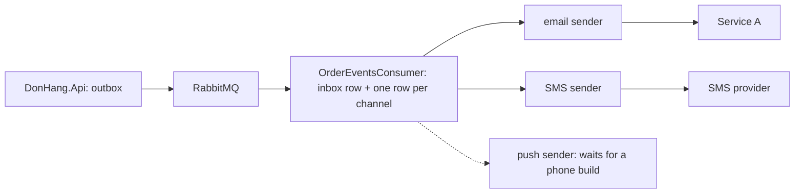

## Before you start

- [[sysdesign.l4.notification-requirements]] — you have the agreed requirements, the estimate of about 6.6 emails a second at the busiest hour, and the four ranked drivers this design is judged against.
- [[backend.l3.bulkhead]] — you know a bulkhead splits shared capacity into parts, so a flood of one kind of work fills only its own part.
- [[backend.l2.retry-with-backoff]] — you know `RecordFailure` retries a row after 2, 4, 8 and 16 seconds and marks it `failed` on the fifth failure, never to be retried automatically.
- [[backend.l4.data-ownership]] — you know each kind of data has one owner, and everywhere else holds a copy with a stated rule.

## The situation

The requirements are agreed, and a teammate opens a branch: `SendOneAsync` gets an `if` on the row's channel, and SMS rows go through the same loop as email.

In the design review you play two afternoons forward. On the first, the SMS provider takes ten seconds to answer each call. On the second, Service A is down for twenty minutes. With the branch, each email waits ten more seconds for every SMS row ahead of it, and every email that keeps failing for half a minute is marked `failed` for good.

How should Notifications send over several channels, so that one slow provider holds back no other and an outage of hours loses no email?

## Core concepts

- one row per channel — the consumer saves a row for each channel the customer chose, where stage-3 saves one email row.
- a sender per channel — a separate sending loop for each channel, with its own batch size, retries and pace; together they form a bulkhead between channels.
- a channel interface — each sender reaches its provider only through an interface for that channel, as `NotificationSender` reaches email through `IEmailSender`.
- the retry window — how long a sender keeps retrying one row before it marks it `failed`: about 30 seconds at stage-3, 24 hours (assumed) in the design.
- pacing — sending no faster than the rate the provider allows, so a backlog is sent rather than refused.
- notification preferences — which channels each customer chose; Notifications becomes their owner.

## How it works



Read the diagram from the left. The first two arrows are stage-3 unchanged: the API writes each `order.*` message to its outbox, and a background job reads the outbox and publishes each message to RabbitMQ. The high-level design changes only what happens after a message reaches Notifications.

In the situation above, the teammate's branch puts every channel after node C into one loop. The design splits it. The consumer first saves one row per channel the customer chose, in the same transaction as its inbox row. Stage-3 already has room for this: each row has a `Channel` column, and every row today says `email`.

Each channel then has its own sender: the email sender calls Service A, the SMS sender calls the SMS provider. When the SMS provider takes ten seconds a call, only the SMS sender's batch waits; the email sender keeps sending at its own pace. That is the bulkhead between channels. Each sender sees only its channel's interface, the same shape as `IEmailSender`. The push sender is dashed: push waits for a phone build of the app, which Đơn Hàng does not have at stage-4 (ADR `0017`).

To save one row per chosen channel, the consumer needs each customer's choices: Notifications becomes the owner of notification preferences.

To name the shop, it reads `shopId`. The shop rollout, the stepwise change of Ordering to many shops, adds this optional property to `order.*` messages in its second release. Notifications keeps a copy of the shop's name, whose owner is `shops` in Ordering; ADR `0027` leaves the copy's rule to be written into the ownership list when it is built.

## In the Đơn Hàng system

None of this is built at stage-4. ADR `0027` says so in its header: Notifications still sends only email, as at stage-3. So the code below is today's single loop, the one the teammate's branch would extend:

```csharp file=DonHang.Notifications/NotificationSender.cs tag=stage-4 lines=42-57
    // One round: claim the due rows, send each email, save what happened.
    // The sender sees only IEmailSender, never MailKit. The scope comes from
    // IServiceScopeFactory; disposing it disposes this round's DbContext.
    private async Task SendDueAsync(CancellationToken stoppingToken)
    {
        using var scope = scopeFactory.CreateScope();
        var queue = scope.ServiceProvider.GetRequiredService<NotificationQueue>();
        var email = scope.ServiceProvider.GetRequiredService<IEmailSender>();

        var due = await queue.ClaimDueAsync(BatchSize, stoppingToken);
        foreach (var notification in due)
        {
            await SendOneAsync(email, notification, stoppingToken);
        }
        await queue.CompleteAsync(stoppingToken);
    }
```

One round claims, that is locks until the round is saved, up to `BatchSize` due rows, set to 10 above the excerpt. It sends them one after another in the `foreach`, each awaited before the next, and saves the whole round in `CompleteAsync`. Put SMS rows in the same `due` list, and a ten-second SMS call holds every email after it in the batch, and the save as well. The comment shows the half of the design already in place: the loop sees only `IEmailSender`, never MailKit, the email library behind it, so each new channel gets an interface the same way.

The design review's high-level design and its deep dive, written in Vietnamese; the paragraphs after it say the same in English:

```markdown file=docs/design/notification-design-review.md tag=stage-4 lines=49-69
Đường đi từ API tới consumer giữ nguyên như stage-3; chỉ phần sau khi message
tới Notifications đổi. Consumer lưu một dòng cho mỗi kênh khách chọn, cùng
transaction với dòng inbox; cột `Channel` của `Notification` (mọi dòng stage-3
là `email`) đã có chỗ cho việc này. Mỗi sender gọi nhà cung cấp qua một
interface của kênh, như `IEmailSender`.

### Đi sâu: thử lại (bước 4)

Stage-3: `NotificationSender` thử lại sau 2, 4, 8, 16 giây; lần lỗi thứ 5 là
cuối, dòng thành `failed` sau khoảng 30 giây. Đủ cho Mailpit trong lab; không
đủ khi dịch vụ email bên ngoài sập vài phút, vì mọi email trong lúc đó thành
`failed`.

Thiết kế mới, theo ADR 0027:

- Mỗi kênh thử lại trong 24 giờ (giả định), khoảng cách giữa hai lần tăng dần
  tới một trần, như `RefundSender` của Payments làm với cổng thanh toán.
- Mỗi sender gửi không quá tốc độ nhà cung cấp cho phép; với email, hai bản
  Notifications chia nhau 10 email mỗi giây.
- Hết 24 giờ, dòng thành `failed` và hiện cho đội vận hành để gửi lại bằng
  tay khi nhà cung cấp quay lại.
```

The first paragraph is the diagram in words, as "How it works" tells it above.

The deep dive starts from stage-3: retries after 2, 4, 8 and 16 seconds, the fifth failure final, so a row is `failed` after about 30 seconds. That is enough for Mailpit, the local mail server the lab sends to. It is not enough once an external email service is down for a few minutes, because every email in that time ends `failed`.

The new design retries each channel for 24 hours (assumed), with the gap between attempts growing up to a fixed maximum, as Payments' `RefundSender` does when it retries refunds. Each sender stays under its provider's allowed rate; for email, two copies of Notifications share 10 emails a second (assumed). After 24 hours a row becomes `failed` and is shown to the operations team, to resend by hand once the provider is back. ADR `0027` gives the reason for pacing: the backlog after an outage is then sent without being refused.

## Trade-offs

| Choice | What it gives | What it costs | Right when |
|---|---|---|---|
| One sending loop for every channel (the branch) | little code, one loop to watch | a slow provider delays every channel; every channel gets the same retries | only one channel exists, as at stage-3 |
| A sender per channel (ADR `0027`'s choice) | a slow or failing provider holds back only its own channel | one more loop to run, configure and watch for each channel | channels differ in provider, speed and allowed rate |
| Give up after about 30 seconds (stage-3) | a failure shows at once | every email failing over a longer outage ends `failed`, against driver 1 (no lost email) | the mail server is local, like Mailpit in the lab |
| Retry for 24 hours, assumed (the design's choice) | an outage of hours loses no email | an email can arrive hours late, against driver 2 (emails arrive within minutes) | the provider is external and can be down for hours |
| Send as fast as the sender can | the shortest delay while the provider is healthy | after an outage the backlog exceeds the allowed rate, and sends above it are refused | the provider sets no allowed rate |
| Pace to the allowed rate (the design's choice) | the backlog is sent without refusals | a backlog takes longer to clear | the provider sets an allowed rate, as Service A's assumed 10 a second |
## What would you choose if…

…someone proposed keeping stage-3's code and raising `MaxAttempts` from 5 to 20, instead of a retry window? The gap doubles each time with no cap: the waits before attempts 2 to 20 add up to about 2^20 seconds, around 12 days, and the last gaps alone are days long. A row that kept failing through a four-hour outage waits up to about two more hours after the provider is back, and every further failure doubles that wait. Keep the window, and cap the gap, as the review does.

…the SMS provider's contract allowed fewer SMS a second than the peak's assumed 0.7? The SMS sender paces at the allowed rate, so SMS rows wait during the peak and drain after it. Emails do not notice, because their sender is separate. Ask the product owner how late an SMS may arrive; the drivers give no number for it.

## Seniors often assume…

- **"A slow SMS provider cannot affect emails, because they are different channels."** → Actually that holds only when different loops send them. In one round of `SendDueAsync`, rows are sent one after another and saved together at the end, so a slow SMS call holds every email behind it. ADR `0027` rejects one loop for every channel for this reason. You notice this when email delays climb on an afternoon when only the SMS provider reports trouble.
- **"A retry policy that worked against the local mail server will work against any provider."** → Actually stage-3's five attempts in about 30 seconds were enough for Mailpit in the lab, and the review says so. An external service can be down for minutes or hours, and every email that keeps failing for longer than about 30 seconds ends `failed`. You notice this when one short outage of Service A leaves hundreds of `failed` rows that were never tried again after it came back.
- **"Adding a channel means changing every service that publishes order messages."** → Actually the publishers keep sending the same `order.*` messages; the channel is chosen inside Notifications, from the notification preferences it owns. The one message change the design relies on, `shopId`, comes from the shop rollout's release 2, not from the new channel. You notice this when a plan for SMS lists edits to the API's outbox code.

## Try it (3 minutes)

Service A is down from minute 0 to minute 10 on a normal day. Use stage-3's retries (2, 4, 8 and 16 seconds; the fifth failure is final) and the estimate's average of about 1.2 emails a second.

Write down the status at minute 10 of an email first tried at minute 2, under stage-3 and under ADR `0027`. Then estimate roughly how many emails stage-3 leaves `failed`.

Expected result: two statuses and one rounded number.

<details><summary>Suggested answer</summary>

Under stage-3 the email is `failed` from about minute 2.5, two minutes plus about 30 seconds, and is never tried again. Under ADR `0027` it is still waiting at minute 10, inside the 24-hour window, and goes out at its next attempt after the service returns.

An email first tried at second t fails for the last time at about t + 30, so every email first tried before about second 570 ends `failed`: about 1.2 × 570, roughly 700. Emails first tried in the last 30 seconds still have an attempt left after minute 10 and go out.

</details>

## Connections

- [[design.l2.adapter-pattern]] — the pattern behind `IEmailSender`, which each new channel's interface repeats.
- [[backend.l3.idempotent-consumer]] — why saving the channel rows in the inbox row's transaction keeps a repeated message from adding them twice.
- [[backend.l4.message-schema-evolution]] — why messages can gain the optional `shopId` without breaking readers that do not use it yet.
- [[backend.l4.shop-id-rollout]] — release 2, from which messages carry `shopId`, the key to the shop's name.
- [[sysdesign.l4.notification-trade-offs]] — the next step: which channel may send twice, which may lose a message, and what pacing costs after an outage.

## Five-line summary

1. Notifications gives each channel its own sender, so one slow or failing provider holds back only its own channel.
2. The path from the API's outbox through RabbitMQ stays as at stage-3; only what Notifications does after a message arrives changes.
3. The consumer saves one row per chosen channel with its inbox row; the `Channel` column already makes room.
4. Stage-3 gives up after about 30 seconds; the design retries for 24 hours (assumed) and paces to the provider's allowed rate.
5. Notifications owns notification preferences and takes the shop's name from `shopId`, which messages carry from release 2.
