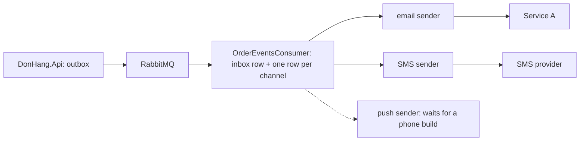

## Bạn cần biết trước

- [[sysdesign.l4.notification-requirements]] — bạn đã có phần yêu cầu được chốt, ước lượng khoảng 6,6 email mỗi giây ở giờ đông nhất, và bốn yếu tố định hình kiến trúc xếp hạng mà thiết kế này được chấm theo.
- [[backend.l3.bulkhead]] — bạn biết bulkhead chia tài nguyên chung thành nhiều phần, nên khi một loại việc dồn tới thì nó chỉ làm đầy phần của mình.
- [[backend.l2.retry-with-backoff]] — bạn biết `RecordFailure` thử lại một dòng sau 2, 4, 8 và 16 giây, rồi đánh dấu `failed` ở lần lỗi thứ năm, và từ đó không tự thử lại nữa.
- [[backend.l4.data-ownership]] — bạn biết mỗi loại dữ liệu có một chủ sở hữu, còn mọi nơi khác chỉ giữ bản sao kèm một quy tắc được ghi rõ.

## Tình huống

Phần yêu cầu đã chốt, và một đồng đội mở một branch: `SendOneAsync` thêm một `if` theo kênh của dòng, và các dòng SMS đi chung vòng lặp với email.

Trong buổi review thiết kế, bạn hình dung trước hai buổi chiều. Chiều thứ nhất, nhà cung cấp SMS mất mười giây để trả lời mỗi lệnh gọi. Chiều thứ hai, Dịch vụ A sập hai mươi phút. Với branch đó, mỗi email phải chờ thêm mười giây cho từng dòng SMS đứng trước nó, và email nào lỗi liên tục nửa phút thì bị đánh dấu `failed` vĩnh viễn.

Notifications nên gửi qua nhiều kênh thế nào để một nhà cung cấp chậm không giữ chân kênh nào khác, và một sự cố kéo dài nhiều giờ không làm mất email nào?

## Khái niệm cốt lõi

- một dòng cho mỗi kênh — consumer lưu một dòng cho mỗi kênh khách đã chọn, trong khi stage-3 chỉ lưu một dòng email.
- mỗi kênh một sender — một vòng lặp gửi riêng cho từng kênh, có batch size, cơ chế thử lại và tốc độ gửi của riêng nó. Gộp lại, chúng tạo thành một bulkhead giữa các kênh.
- interface của kênh — mỗi sender chỉ tới được nhà cung cấp của mình qua một interface dành cho kênh đó, giống `NotificationSender` tới email qua `IEmailSender`.
- khoảng thời gian thử lại — một sender còn thử lại một dòng bao lâu trước khi đánh dấu nó `failed`: khoảng 30 giây ở stage-3, 24 giờ (giả định) trong thiết kế.
- điều tiết tốc độ gửi — không gửi nhanh hơn tốc độ nhà cung cấp cho phép, để phần tồn đọng được gửi đi chứ không bị từ chối.
- lựa chọn nhận thông báo — mỗi khách đã chọn những kênh nào. Notifications trở thành chủ sở hữu của dữ liệu này.

## Cơ chế hoạt động



Đọc sơ đồ từ trái sang. Hai mũi tên đầu giữ nguyên như stage-3: API ghi mỗi message `order.*` vào outbox, và một background job đọc outbox rồi đưa từng message lên RabbitMQ. Thiết kế tổng thể chỉ đổi những gì xảy ra sau khi message tới Notifications.

Trong tình huống trên, branch của đồng đội dồn mọi kênh sau ô C vào một vòng lặp. Thiết kế thì tách ra. Trước tiên consumer lưu một dòng cho mỗi kênh khách đã chọn, trong cùng giao dịch với dòng inbox. Stage-3 đã có sẵn chỗ cho việc này: mỗi dòng có cột `Channel`, và hôm nay mọi dòng đều ghi `email`.

Sau đó mỗi kênh có sender riêng: sender email gọi Dịch vụ A, sender SMS gọi nhà cung cấp SMS. Khi nhà cung cấp SMS mất mười giây cho mỗi lệnh gọi, chỉ batch của sender SMS phải chờ. Sender email vẫn gửi theo tốc độ của mình. Đó là bulkhead giữa các kênh. Mỗi sender chỉ thấy interface của kênh mình, cùng dạng với `IEmailSender`. Sender push vẽ nét đứt: push chờ bản app cho điện thoại, thứ Đơn Hàng chưa có ở stage-4 (ADR `0017`).

Để lưu một dòng cho mỗi kênh được chọn, consumer cần biết từng khách đã chọn gì: Notifications trở thành chủ sở hữu của lựa chọn nhận thông báo.

Để ghi tên cửa hàng, consumer đọc `shopId`. Đợt triển khai cửa hàng, tức quá trình chuyển Ordering sang nhiều cửa hàng theo từng bước, thêm thuộc tính không bắt buộc này vào các message `order.*` ở bản phát hành thứ hai. Notifications giữ một bản sao tên cửa hàng, còn chủ sở hữu là `shops` trong Ordering. ADR `0027` để quy tắc của bản sao này được ghi vào danh sách sở hữu khi bắt tay xây dựng.

## Trong hệ thống Đơn Hàng

Ở stage-4, chưa phần nào trong số này được xây. ADR `0027` ghi rõ ở phần đầu: Notifications vẫn chỉ gửi email, như ở stage-3. Vì vậy đoạn code dưới đây là vòng lặp duy nhất hiện có, chính vòng lặp mà branch của đồng đội định mở rộng:

```csharp file=DonHang.Notifications/NotificationSender.cs tag=stage-4 lines=42-57
    // One round: claim the due rows, send each email, save what happened.
    // The sender sees only IEmailSender, never MailKit. The scope comes from
    // IServiceScopeFactory; disposing it disposes this round's DbContext.
    private async Task SendDueAsync(CancellationToken stoppingToken)
    {
        using var scope = scopeFactory.CreateScope();
        var queue = scope.ServiceProvider.GetRequiredService<NotificationQueue>();
        var email = scope.ServiceProvider.GetRequiredService<IEmailSender>();

        var due = await queue.ClaimDueAsync(BatchSize, stoppingToken);
        foreach (var notification in due)
        {
            await SendOneAsync(email, notification, stoppingToken);
        }
        await queue.CompleteAsync(stoppingToken);
    }
```

Mỗi lượt nhận, tức khóa lại cho tới khi lượt đó được lưu, tối đa `BatchSize` dòng tới hạn, giá trị đặt là 10 ở phía trên đoạn trích. Lượt đó gửi lần lượt từng dòng trong `foreach`, dòng này xong mới tới dòng sau, rồi lưu cả lượt trong `CompleteAsync`. Nếu bỏ dòng SMS vào cùng danh sách `due`, một lệnh gọi SMS mười giây sẽ giữ chân mọi email phía sau nó trong batch, giữ luôn cả bước lưu. Phần chú thích cho thấy nửa thiết kế đã có sẵn: vòng lặp chỉ thấy `IEmailSender`, không bao giờ thấy MailKit, thư viện email phía sau. Mỗi kênh mới cũng sẽ có interface riêng theo cách đó.

Phần thiết kế tổng thể và phần đi sâu của buổi review thiết kế, viết bằng tiếng Việt. Các đoạn phía sau giải thích lại cùng nội dung:

```markdown file=docs/design/notification-design-review.md tag=stage-4 lines=49-69
Đường đi từ API tới consumer giữ nguyên như stage-3; chỉ phần sau khi message
tới Notifications đổi. Consumer lưu một dòng cho mỗi kênh khách chọn, cùng
transaction với dòng inbox; cột `Channel` của `Notification` (mọi dòng stage-3
là `email`) đã có chỗ cho việc này. Mỗi sender gọi nhà cung cấp qua một
interface của kênh, như `IEmailSender`.

### Đi sâu: thử lại (bước 4)

Stage-3: `NotificationSender` thử lại sau 2, 4, 8, 16 giây; lần lỗi thứ 5 là
cuối, dòng thành `failed` sau khoảng 30 giây. Đủ cho Mailpit trong lab; không
đủ khi dịch vụ email bên ngoài sập vài phút, vì mọi email trong lúc đó thành
`failed`.

Thiết kế mới, theo ADR 0027:

- Mỗi kênh thử lại trong 24 giờ (giả định), khoảng cách giữa hai lần tăng dần
  tới một trần, như `RefundSender` của Payments làm với cổng thanh toán.
- Mỗi sender gửi không quá tốc độ nhà cung cấp cho phép; với email, hai bản
  Notifications chia nhau 10 email mỗi giây.
- Hết 24 giờ, dòng thành `failed` và hiện cho đội vận hành để gửi lại bằng
  tay khi nhà cung cấp quay lại.
```

Đoạn đầu là sơ đồ viết thành lời, như phần "Cơ chế hoạt động" đã kể ở trên.

Phần đi sâu bắt đầu từ stage-3: thử lại sau 2, 4, 8 và 16 giây, lần lỗi thứ năm là cuối, nên một dòng thành `failed` sau khoảng 30 giây. Như vậy đủ cho Mailpit, mail server chạy cục bộ mà lab gửi tới. Nhưng không đủ khi một dịch vụ email bên ngoài sập vài phút, vì mọi email trong khoảng đó đều thành `failed`.

Thiết kế mới thử lại mỗi kênh trong 24 giờ (giả định), khoảng cách giữa các lần tăng dần tới một mức trần cố định, giống cách `RefundSender` của Payments thử lại các lệnh hoàn tiền. Mỗi sender giữ dưới tốc độ nhà cung cấp cho phép. Với email, hai bản Notifications chia nhau 10 email mỗi giây (giả định). Hết 24 giờ, dòng thành `failed` và hiện cho đội vận hành, để gửi lại bằng tay khi nhà cung cấp hoạt động trở lại. ADR `0027` nêu lý do điều tiết tốc độ gửi: nhờ vậy phần tồn đọng sau sự cố được gửi đi mà không bị từ chối.

## Đánh đổi

| Lựa chọn | Được gì | Cái giá | Đúng khi |
|---|---|---|---|
| Một vòng lặp gửi cho mọi kênh (branch kia) | ít code, chỉ một vòng lặp phải theo dõi | một nhà cung cấp chậm làm trễ mọi kênh, mọi kênh chịu chung cách thử lại | chỉ có một kênh, như ở stage-3 |
| Mỗi kênh một sender (lựa chọn của ADR `0027`) | nhà cung cấp chậm hay lỗi chỉ giữ chân kênh của chính nó | mỗi kênh thêm một vòng lặp phải chạy, cấu hình và theo dõi | các kênh khác nhau về nhà cung cấp, tốc độ và tốc độ cho phép |
| Bỏ cuộc sau khoảng 30 giây (stage-3) | lỗi lộ ra ngay | mọi email lỗi trong một sự cố dài hơn đều thành `failed`, trái với yếu tố thứ 1 (không mất email) | mail server chạy cục bộ, như Mailpit trong lab |
| Thử lại trong 24 giờ, giả định (lựa chọn của thiết kế) | sự cố kéo dài nhiều giờ không làm mất email nào | một email có thể tới trễ nhiều giờ, trái với yếu tố thứ 2 (email tới trong vài phút) | nhà cung cấp ở bên ngoài và có thể sập nhiều giờ |
| Gửi nhanh hết mức sender làm được | độ trễ ngắn nhất khi nhà cung cấp bình thường | sau sự cố, phần tồn đọng vượt tốc độ cho phép, và các lần gửi vượt mức bị từ chối | nhà cung cấp không đặt tốc độ cho phép |
| Điều tiết theo tốc độ cho phép (lựa chọn của thiết kế) | phần tồn đọng được gửi đi mà không bị từ chối | phần tồn đọng mất lâu hơn mới hết | nhà cung cấp có đặt tốc độ cho phép, như mức 10 mỗi giây giả định của Dịch vụ A |

## Bạn sẽ chọn gì nếu…

…có người đề xuất giữ code stage-3 và tăng `MaxAttempts` từ 5 lên 20, thay cho khoảng thời gian thử lại? Khoảng cách nhân đôi mỗi lần mà không có trần: tổng thời gian chờ trước các lần thử 2 tới 20 là khoảng 2^20 giây, tức gần 12 ngày, riêng mấy khoảng cuối đã dài nhiều ngày. Một dòng lỗi liên tục suốt sự cố bốn giờ sẽ phải chờ thêm tới khoảng hai giờ sau khi nhà cung cấp quay lại, và mỗi lần lỗi tiếp theo lại nhân đôi thời gian chờ đó. Hãy giữ khoảng thời gian thử lại, và đặt trần cho khoảng cách, như buổi review đã làm.

…hợp đồng với nhà cung cấp SMS chỉ cho ít SMS mỗi giây hơn mức 0,7 giả định ở giờ đông nhất? Sender SMS điều tiết theo tốc độ cho phép, nên các dòng SMS chờ trong giờ đông và vơi dần sau đó. Email không bị ảnh hưởng, vì sender của email là riêng. Hãy hỏi product owner một SMS được phép tới trễ bao lâu, vì các yếu tố định hình kiến trúc không nêu con số nào cho điều này.

## Senior hay nhầm rằng…

- **"Nhà cung cấp SMS chậm không thể ảnh hưởng tới email, vì đó là hai kênh khác nhau."** → Thực ra điều đó chỉ đúng khi hai kênh được gửi bằng hai vòng lặp khác nhau, vì trong một lượt `SendDueAsync`, các dòng được gửi lần lượt rồi lưu chung ở cuối, nên một lệnh gọi SMS chậm giữ chân mọi email phía sau. ADR `0027` loại phương án một vòng lặp cho mọi kênh vì lý do này. Bạn sẽ nhận ra khi độ trễ email tăng vọt vào một buổi chiều mà chỉ nhà cung cấp SMS báo trục trặc.
- **"Cách thử lại chạy ổn với mail server cục bộ thì sẽ chạy ổn với mọi nhà cung cấp."** → Thực ra năm lần thử trong khoảng 30 giây của stage-3 chỉ đủ cho Mailpit trong lab, và buổi review đã ghi rõ điều đó, vì một dịch vụ bên ngoài có thể sập vài phút hoặc vài giờ, và email nào lỗi liên tục quá khoảng 30 giây đều thành `failed`. Bạn sẽ nhận ra khi một sự cố ngắn của Dịch vụ A để lại hàng trăm dòng `failed` không hề được thử lại sau khi dịch vụ hoạt động trở lại.
- **"Thêm một kênh nghĩa là phải sửa mọi service phát message về đơn."** → Thực ra các bên phát vẫn gửi đúng các message `order.*` như cũ, vì kênh được chọn bên trong Notifications, dựa trên lựa chọn nhận thông báo mà nó sở hữu. Thay đổi message duy nhất mà thiết kế dựa vào là `shopId`, đến từ bản phát hành thứ 2 của đợt triển khai cửa hàng, không phải từ kênh mới. Bạn sẽ nhận ra khi một kế hoạch thêm SMS lại liệt kê các chỗ sửa trong code outbox của API.

## Thử ngay (3 phút)

Dịch vụ A sập từ phút 0 tới phút 10 vào một ngày bình thường. Dùng cách thử lại của stage-3 (2, 4, 8 và 16 giây, lần lỗi thứ năm là cuối) và mức trung bình khoảng 1,2 email mỗi giây trong phần ước lượng.

Ghi lại trạng thái ở phút 10 của một email được thử lần đầu ở phút 2, theo stage-3 và theo ADR `0027`. Rồi ước lượng sơ bộ stage-3 để lại bao nhiêu email `failed`.

Kết quả mong đợi: hai trạng thái và một con số làm tròn.

<details><summary>Gợi ý đáp án</summary>

Theo stage-3, email thành `failed` từ khoảng phút 2,5, tức hai phút cộng khoảng 30 giây, và không bao giờ được thử lại. Theo ADR `0027`, ở phút 10 email vẫn đang chờ, còn trong khoảng 24 giờ, và sẽ được gửi đi ở lần thử kế tiếp sau khi dịch vụ quay lại.

Một email thử lần đầu ở giây t sẽ lỗi lần cuối vào khoảng t + 30, nên mọi email thử lần đầu trước khoảng giây 570 đều thành `failed`: khoảng 1,2 × 570, tức chừng 700. Các email thử lần đầu trong 30 giây cuối vẫn còn một lần thử sau phút 10 nên sẽ được gửi đi.

</details>

## Liên hệ

- [[design.l2.adapter-pattern]] — pattern đứng sau `IEmailSender`, mà interface của mỗi kênh mới lặp lại.
- [[backend.l3.idempotent-consumer]] — vì sao lưu các dòng kênh trong cùng giao dịch với dòng inbox giúp một message lặp lại không thêm chúng hai lần.
- [[backend.l4.message-schema-evolution]] — vì sao message có thể thêm `shopId` không bắt buộc mà không làm hỏng các bên đọc chưa dùng tới nó.
- [[backend.l4.shop-id-rollout]] — bản phát hành thứ 2, từ đó message mang `shopId`, khóa để tìm tên cửa hàng.
- [[sysdesign.l4.notification-trade-offs]] — bước tiếp theo: kênh nào được phép gửi hai lần, kênh nào có thể mất tin, và điều tiết tốc độ gửi tốn gì sau một sự cố.

## Tóm tắt 5 dòng

1. Notifications cho mỗi kênh một sender riêng, nên một nhà cung cấp chậm hay lỗi chỉ giữ chân kênh của chính nó.
2. Đường đi từ outbox của API qua RabbitMQ giữ nguyên như stage-3, chỉ phần Notifications làm sau khi message tới là thay đổi.
3. Consumer lưu một dòng cho mỗi kênh được chọn cùng với dòng inbox, và cột `Channel` đã có sẵn chỗ cho việc này.
4. Stage-3 bỏ cuộc sau khoảng 30 giây, còn thiết kế thử lại trong 24 giờ (giả định) và điều tiết theo tốc độ nhà cung cấp cho phép.
5. Notifications sở hữu lựa chọn nhận thông báo và lấy tên cửa hàng từ `shopId`, thuộc tính message mang từ bản phát hành thứ 2.
