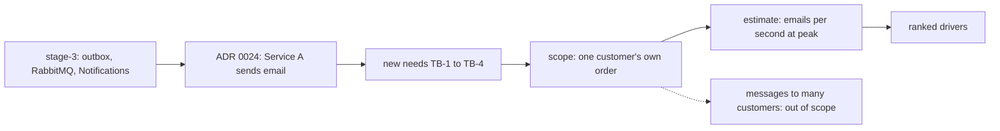

## Before you start

- [[sysdesign.l4.multi-shop-challenges]] — you finished the module's first problem with a design review; this lesson starts the second problem at step 1, requirements.
- [[management.l4.weighted-scoring-matrix]] — you know ADR `0024` chose Service A to send email; this lesson takes that choice as given.
- [[backend.l3.consumer-acknowledgements]] — you know `OrderEventsConsumer` turns each order message into a `pending` row and acknowledges only after saving it.
- [[backend.l2.skip-locked-claiming]] — you know several copies of `NotificationSender` share one table of rows through `FOR UPDATE SKIP LOCKED`.

## The situation

The product owner's draft reaches the team on a Monday. Shops want their own name in every order email. Customers want a text message when a parcel ships, and some want a notification on their phone.

A teammate answers at once: "Easy. `NotificationSender` already calls `IEmailSender`; we add an SMS call on the next line." Another asks how many emails the busiest hour sends, and nobody knows. Nobody has said which messages must never be lost, either, or how late a message may arrive.

What must the requirements step pin down before anyone picks a library?

## Core concepts

- the starting point — what stage-3 already runs: an outbox, RabbitMQ, a consumer that saves one email row per order message, and a sender that sends due rows and retries.
- **push notification** — a message a phone's operating system shows for an installed app, sent through a push service that the platform's vendor runs.
- scope by recipient — messages about one customer's own order are in the problem; messages sent to many customers at once are out.
- a rate against limits — the estimate turns orders per second at the busiest hour into emails per second, then compares that with each limit on the way out.
- ranked drivers — the needs in order, so the first one wins when two pull the design in different directions.

## How it works



Read the diagram from the left. In the situation above, "an SMS call on the next line" skips box A, which runs in four steps:

1. The API writes each `order.*` message to the outbox in the order's transaction.
2. A background job, the relay, reads new outbox rows and puts them on RabbitMQ.
3. Notifications, a separate service you can run in several copies, turns each message into one email row in `notifications` in `OrderEventsConsumer`, in the same transaction as its inbox row.
4. `NotificationSender` claims due rows, sends each through `IEmailSender`, and only then saves. A crash in between leaves the row `pending`, so it is sent again; a failed send is retried a few times.

Box B is the one change already decided: ADR `0024` moves the sending to Service A, an external email service. Your local setup, the lab, keeps Mailpit, so nothing in the lab sends email outside.

Box C adds what 1,000 shops and the product owner ask for, numbered TB-1 to TB-4 in the file. Each email names the customer's shop. A customer may also choose SMS or a push notification for some order events. No order email may be lost, even when the email service fails for hours, and a paid SMS must not go out twice.

Box D draws the line by recipient. A message about one customer's own order is in scope. A promotion sent to many customers at once is out, the dashed arrow, because it needs its own consent rules and far larger sends.

Box E sizes the work against two limits: the sender's, which exists today, and Service A's allowed rate, still assumed until the contract arrives. Box F ranks what the design must protect first.

## In the Đơn Hàng system

The new needs and the scope, as `notification-requirements.md` writes them at this tag:

```markdown file=docs/team/notification-requirements.md tag=stage-4 lines=21-39
### Nhu cầu mới

- TB-1: Mỗi email ghi tên cửa hàng mà khách đã mua.
- TB-2: Khách chọn nhận thêm SMS hoặc push notification cho một số sự kiện của
  đơn (giao hàng, hoàn tiền xong).
- TB-3: Email về đơn không bao giờ mất, kể cả khi dịch vụ gửi email lỗi vài
  giờ.
- TB-4: Một SMS đã trả tiền không được gửi hai lần.

Push notification là tin do hệ điều hành của điện thoại hiện cho một app đã
cài, gửi qua dịch vụ push của hãng làm nền tảng. App Đơn Hàng chưa có bản cho
điện thoại ở stage-4 (ADR 0017), nên push chờ bản đó.

### Phạm vi

- Trong phạm vi: tin về đơn của chính một khách (đặt, giao, hủy, hoàn tiền).
- Ngoài phạm vi: tin gửi cho nhiều khách cùng lúc (khuyến mãi). Loại tin đó
  cần quy tắc đồng ý nhận tin riêng và lượng gửi lớn hơn nhiều, nên là một bài
  toán khác.
```

The four needs are numbered TB-1 to TB-4. TB-1 and TB-2 add data and channels: the shop's name, and SMS or push for some events such as delivery and a finished refund. TB-3 and TB-4 are about loss and duplicates, and both return as drivers. The paragraph under them defines a push notification and says why it waits: the app has no phone build at stage-4, citing ADR `0017`. The scope keeps messages about one customer's order (placed, delivered, cancelled, refunded) and sets promotions aside as a different problem.

The estimate and the drivers:

```markdown file=docs/team/notification-requirements.md tag=stage-4 lines=41-63
### Ước lượng

| Đầu vào | Giá trị |
|---|---|
| Đơn mỗi giây, giờ đông nhất | Khoảng 3,3 (`capacity-plan.md`) |
| Email mỗi đơn | 2: đặt đơn, giao hàng (giả định) |
| Email mỗi giây, giờ đông nhất | Khoảng 6,6, nếu cả hai rơi vào giờ đó |
| Email mỗi giây, trung bình ngày thường | Khoảng 1,2 (50.000 đơn × 2 / 86.400 giây) |
| Trần của sender, mỗi bản Notifications | 10 dòng mỗi 2 giây, tức 5 email mỗi giây |
| Tốc độ Dịch vụ A cho phép | 10 email mỗi giây (giả định, chờ hợp đồng) |
| Khách chọn thêm SMS | 20% số đơn (giả định) |

Một bản Notifications không theo kịp giờ đông nhất (6,6 so với 5 mỗi giây):
hàng chờ tăng khoảng 1,6 email mỗi giây trong giờ đó. Hai bản theo kịp, vì
sender nhận dòng bằng `FOR UPDATE SKIP LOCKED`, và vẫn dưới tốc độ Dịch vụ A
cho phép. SMS ở giờ đông khoảng 0,7 mỗi giây: lượng nhỏ, nhưng mỗi tin có giá.

### Driver xếp hạng

1. Không mất email nào về đơn (TB-3).
2. Email tới trong vài phút (giả định) kể từ khi đơn đổi trạng thái.
3. Ngày đông của một cửa hàng không làm chậm email của các cửa hàng khác.
4. Một SMS đã trả tiền không gửi hai lần (TB-4).
```

The estimate starts from the capacity plan's busiest hour, about 3.3 orders a second, and assumes two emails per order. If both fall in that hour, that is about 6.6 emails a second; a normal day averages about 1.2. The sender's ceiling is 10 rows every 2 seconds, 5 emails a second for each copy of Notifications, set by two settings in `NotificationSender.cs` outside this excerpt.

So at the assumed peak one copy falls behind, and its queue grows by about 1.6 emails a second for that hour. Two copies keep up, because `FOR UPDATE SKIP LOCKED` lets each claim different rows, and they stay under Service A's assumed 10 a second. SMS is small, about 0.7 a second at the peak (20% of 3.3 orders a second), but each message has a price.

The drivers put no lost email first, then an email within minutes (assumed) of the order's change. Third, one shop's busy day must not slow other shops' emails; fourth, no paid SMS goes out twice. Driver 3 is not one of TB-1 to TB-4: it is a noisy neighbor, as in the module's first problem, since every shop's rows wait in one `notifications` table and the sender claims the oldest due rows first. None of the drivers names a library or a provider.

## Trade-offs

| Choice in the requirements | What the design gets | What it costs | Right when |
|---|---|---|---|
| Scope: one customer's own order messages (the file's choice) | volume follows orders, no consent rules to design | promotions become a separate problem later | the product owner asks for order messages, as here |
| Scope: also messages to many customers at once | one system for every kind of message | consent rules and far larger sends now shape the whole design | promotions are a confirmed need for the same release |
| Size from the daily average, about 1.2 a second | one copy looks like plenty | the busiest hour's queue grows unseen | load is flat across the day |
| Size from the busiest hour, about 6.6 a second (the file's choice) | the first limit that breaks is found before the peak | may overstate the load, since both emails are assumed to fall in that hour | orders bunch into a few hours, as `capacity-plan.md` assumes |

The requirements do not decide how channels are sent or retried. They fix what a good answer must survive.

## What would you choose if…

…Service A's contract allows 5 emails a second, not the assumed 10? Then the limit moves outside Đơn Hàng. If the sends above that rate wait rather than fail, the queue still grows by about 1.6 a second at the peak however many copies run, and driver 2 depends on how fast it drains after that hour. Change the row in the estimate first; how to pace the sends is the design's question.

…a shop asks to send its weekend sale to every customer? That is the out-of-scope line: a message to many customers at once. Answer with the scope section and open it as a separate problem, with its own consent rules.

…the product owner wants push in the first release? Push needs a phone build of the app, which stage-4 does not have. Keep it in TB-2, marked as waiting for that build, as the file already writes it.

## Seniors often assume…

- **"A notification system is just a call to an email library."** → Actually stage-3 already wraps that call in an outbox, a queue, an inbox row, a table of pending rows and retries. The new needs add more: no loss through hours of outage, no paid SMS twice, one shop's busy day not delaying the others. Because the sender sends before it saves (box A, step 4), a crash can send a message twice. That is harmless for an email and a second charge for an SMS. You notice this when a proposal adds an SMS call beside the email call and nobody asks what a resend costs.
- **"Every new channel needs its own service, because SMS and email have nothing in common."** → Actually the two channels carry the same order messages to the same customer, and nothing in the requirements stops SMS from following email's save-a-row-then-send path. Each row in `notifications` carries a channel, and `OrderEventsConsumer` sets `Channel = "email"`, so the table has room for another. What differs is the price of a message, which TB-4 records, and the provider behind it, which the requirements leave open. You notice this when a plan copies the consumer and its inbox into a second service before anyone has listed what differs.
- **"If the email service is fast, there is nothing to estimate."** → Actually the first limit at the peak is inside Đơn Hàng: one copy's sender sends at most 5 emails a second against about 6.6 arriving. The external service's allowed rate is a second limit, which caps how far adding copies helps. You notice this when the `pending` rows in `notifications` climb during the busiest hour while the email service reports no error.

## Try it (3 minutes)

The product owner adds a third email per order, assumed, and assumes all three fall in the busiest hour. Using the estimate's other rows, work out the emails per second at the peak. Then say how many copies of Notifications keep up, and whether a third copy would help.

Expected result: one rate, a number of copies, and a yes or no with the limit that decides it.

<details><summary>Suggested answer</summary>

3.3 orders × 3 emails = about 9.9 emails a second. One copy sends 5 a second and falls behind by about 4.9. Two copies send up to 10 a second and just keep up, with almost no room. A third copy would not help much: Service A's assumed allowed rate is also 10 a second, so the external limit now decides, and the row to confirm is Service A's rate in the contract.

</details>

## Connections

- [[sysdesign.l4.multi-shop-challenges]] — the module's first problem ended at its design review; this second problem restarts the same framework at step 1.
- [[sysdesign.l4.back-of-the-envelope]] — the method the estimate applies: stated assumptions, units at every step, stop once a number rules an option in or out.
- [[backend.l4.capacity-planning]] — where the 3.3 orders a second at the busiest hour comes from.
- [[backend.l2.skip-locked-claiming]] — why two copies of the sender split the rows instead of sending each email twice.
- [[management.l4.weighted-scoring-matrix]] — how ADR `0024` chose Service A, which this problem takes as a constraint.
- [[frontend.l4.client-technology-drivers]] — the client decisions, including ADR `0017`, that push now waits on.
- [[sysdesign.l4.notification-design]] — the next step: a design judged against these four ranked drivers.

## Five-line summary

1. A notification system is shaped by which messages must arrive and how late, so the requirements state that before any library is chosen.
2. Stage-3 already turns each order message into an email row and sends it, and ADR `0024` moves the sending to Service A.
3. The new needs add the shop's name, SMS and push, no lost email and no paid SMS twice; push waits for a phone build.
4. Scope keeps messages about one customer's own order and leaves messages to many customers out.
5. At the busiest hour about 6.6 emails a second meet one copy's 5, and the drivers rank no lost email first.
