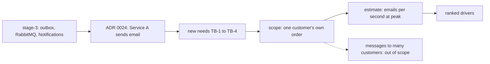

## Bạn cần biết trước

- [[sysdesign.l4.multi-shop-challenges]] — bạn đã đi hết bài toán đầu tiên của module bằng một buổi review thiết kế. Bài này mở bài toán thứ hai ở bước 1, phần yêu cầu.
- [[management.l4.weighted-scoring-matrix]] — bạn biết ADR `0024` chọn Dịch vụ A để gửi email. Bài này coi lựa chọn đó là đã chốt.
- [[backend.l3.consumer-acknowledgements]] — bạn biết `OrderEventsConsumer` biến mỗi message về đơn thành một dòng `pending` và chỉ acknowledge sau khi đã lưu dòng đó.
- [[backend.l2.skip-locked-claiming]] — bạn biết nhiều bản `NotificationSender` chia nhau một bảng dòng nhờ `FOR UPDATE SKIP LOCKED`.

## Tình huống

Bản nháp của product owner tới tay nhóm vào một sáng thứ Hai. Các cửa hàng muốn tên mình có trong mọi email về đơn. Khách muốn nhận tin nhắn SMS khi hàng được gửi đi, và một số khách muốn có thông báo trên điện thoại.

Một đồng đội trả lời ngay: "Dễ thôi. `NotificationSender` đã gọi `IEmailSender` rồi, mình thêm một lệnh gọi SMS ở dòng dưới." Người khác hỏi giờ đông nhất gửi bao nhiêu email, và không ai biết. Cũng chưa ai nói tin nào không bao giờ được mất, hay một tin được phép tới trễ bao lâu.

Bước yêu cầu phải chốt được những gì trước khi có người chọn thư viện?

## Khái niệm cốt lõi

- điểm xuất phát — những gì stage-3 đã chạy: một outbox, RabbitMQ, một consumer lưu một dòng email cho mỗi message về đơn, và một sender gửi các dòng tới hạn rồi thử lại khi lỗi.
- **thông báo đẩy** (push notification) — tin mà hệ điều hành của điện thoại hiện ra cho một app đã cài, gửi qua một dịch vụ đẩy do hãng làm nền tảng vận hành.
- phạm vi theo người nhận — tin về đơn của chính một khách nằm trong bài toán, tin gửi cho nhiều khách cùng lúc nằm ngoài.
- tốc độ so với giới hạn — phần ước lượng đổi số đơn mỗi giây ở giờ đông nhất thành số email mỗi giây, rồi so với từng giới hạn trên đường gửi ra ngoài.
- yếu tố định hình kiến trúc xếp hạng — các nhu cầu theo thứ tự, để khi hai nhu cầu kéo thiết kế về hai hướng thì nhu cầu đứng trước thắng.

## Cơ chế hoạt động



Đọc sơ đồ từ trái sang. Trong tình huống trên, "một lệnh gọi SMS ở dòng dưới" bỏ qua ô A, vốn chạy qua bốn bước:

1. API ghi mỗi message `order.*` vào outbox, trong cùng giao dịch với đơn.
2. Một background job, gọi là relay, đọc các dòng outbox mới và đưa lên RabbitMQ.
3. Notifications, một service riêng có thể chạy nhiều bản, biến mỗi message thành một dòng email trong `notifications` ở `OrderEventsConsumer`, cùng giao dịch với dòng inbox của message đó.
4. `NotificationSender` nhận các dòng tới hạn, gửi từng dòng qua `IEmailSender`, rồi mới lưu. Nếu sập ở giữa, dòng vẫn là `pending` nên sẽ được gửi lại. Một lần gửi lỗi được thử lại vài lần.

Ô B là thay đổi duy nhất đã chốt: ADR `0024` chuyển khâu gửi sang Dịch vụ A, một dịch vụ email bên ngoài. Môi trường chạy trên máy bạn, gọi là lab, vẫn giữ Mailpit, nên trong lab không có email nào gửi ra ngoài.

Ô C thêm những gì 1.000 cửa hàng và product owner yêu cầu, đánh số TB-1 tới TB-4 trong file. Mỗi email ghi tên cửa hàng của khách. Khách có thể chọn nhận thêm SMS hoặc thông báo đẩy cho một số sự kiện của đơn. Không email nào về đơn được mất, kể cả khi dịch vụ email lỗi nhiều giờ, và một SMS đã trả tiền không được gửi hai lần.

Ô D vạch ranh giới theo người nhận. Tin về đơn của chính một khách nằm trong phạm vi. Tin khuyến mãi gửi cho nhiều khách cùng lúc nằm ngoài, là mũi tên nét đứt, vì loại tin đó cần quy tắc đồng ý nhận tin riêng và lượng gửi lớn hơn nhiều.

Ô E đo khối lượng công việc với hai giới hạn: giới hạn của sender, đang có từ hôm nay, và tốc độ Dịch vụ A cho phép, vẫn là giả định tới khi có hợp đồng. Ô F xếp hạng những gì thiết kế phải bảo vệ trước tiên.

## Trong hệ thống Đơn Hàng

Các nhu cầu mới và phạm vi, như `notification-requirements.md` ghi ở tag này:

```markdown file=docs/team/notification-requirements.md tag=stage-4 lines=21-39
### Nhu cầu mới

- TB-1: Mỗi email ghi tên cửa hàng mà khách đã mua.
- TB-2: Khách chọn nhận thêm SMS hoặc push notification cho một số sự kiện của
  đơn (giao hàng, hoàn tiền xong).
- TB-3: Email về đơn không bao giờ mất, kể cả khi dịch vụ gửi email lỗi vài
  giờ.
- TB-4: Một SMS đã trả tiền không được gửi hai lần.

Push notification là tin do hệ điều hành của điện thoại hiện cho một app đã
cài, gửi qua dịch vụ push của hãng làm nền tảng. App Đơn Hàng chưa có bản cho
điện thoại ở stage-4 (ADR 0017), nên push chờ bản đó.

### Phạm vi

- Trong phạm vi: tin về đơn của chính một khách (đặt, giao, hủy, hoàn tiền).
- Ngoài phạm vi: tin gửi cho nhiều khách cùng lúc (khuyến mãi). Loại tin đó
  cần quy tắc đồng ý nhận tin riêng và lượng gửi lớn hơn nhiều, nên là một bài
  toán khác.
```

Bốn nhu cầu được đánh số TB-1 tới TB-4. TB-1 và TB-2 thêm dữ liệu và kênh: tên cửa hàng, và SMS hoặc thông báo đẩy cho một số sự kiện như giao hàng và hoàn tiền xong. TB-3 và TB-4 nói về mất tin và gửi trùng, và cả hai quay lại thành yếu tố định hình kiến trúc. Đoạn bên dưới định nghĩa thông báo đẩy và nói vì sao nó phải chờ: app chưa có bản cho điện thoại ở stage-4, theo ADR `0017`. Phần phạm vi giữ các tin về đơn của một khách (đặt, giao, hủy, hoàn tiền) và để khuyến mãi sang một bài toán khác.

Phần ước lượng và các yếu tố định hình kiến trúc:

```markdown file=docs/team/notification-requirements.md tag=stage-4 lines=41-63
### Ước lượng

| Đầu vào | Giá trị |
|---|---|
| Đơn mỗi giây, giờ đông nhất | Khoảng 3,3 (`capacity-plan.md`) |
| Email mỗi đơn | 2: đặt đơn, giao hàng (giả định) |
| Email mỗi giây, giờ đông nhất | Khoảng 6,6, nếu cả hai rơi vào giờ đó |
| Email mỗi giây, trung bình ngày thường | Khoảng 1,2 (50.000 đơn × 2 / 86.400 giây) |
| Trần của sender, mỗi bản Notifications | 10 dòng mỗi 2 giây, tức 5 email mỗi giây |
| Tốc độ Dịch vụ A cho phép | 10 email mỗi giây (giả định, chờ hợp đồng) |
| Khách chọn thêm SMS | 20% số đơn (giả định) |

Một bản Notifications không theo kịp giờ đông nhất (6,6 so với 5 mỗi giây):
hàng chờ tăng khoảng 1,6 email mỗi giây trong giờ đó. Hai bản theo kịp, vì
sender nhận dòng bằng `FOR UPDATE SKIP LOCKED`, và vẫn dưới tốc độ Dịch vụ A
cho phép. SMS ở giờ đông khoảng 0,7 mỗi giây: lượng nhỏ, nhưng mỗi tin có giá.

### Driver xếp hạng

1. Không mất email nào về đơn (TB-3).
2. Email tới trong vài phút (giả định) kể từ khi đơn đổi trạng thái.
3. Ngày đông của một cửa hàng không làm chậm email của các cửa hàng khác.
4. Một SMS đã trả tiền không gửi hai lần (TB-4).
```

Phần ước lượng bắt đầu từ giờ đông nhất trong kế hoạch năng lực, khoảng 3,3 đơn mỗi giây, và giả định mỗi đơn có hai email. Nếu cả hai rơi vào giờ đó thì là khoảng 6,6 email mỗi giây. Một ngày thường trung bình khoảng 1,2. Trần của sender là 10 dòng mỗi 2 giây, tức 5 email mỗi giây cho mỗi bản Notifications, do hai thiết lập trong `NotificationSender.cs` nằm ngoài đoạn trích này quy định.

Vậy ở giờ đông nhất theo giả định, một bản sẽ tụt lại, và hàng chờ của nó tăng khoảng 1,6 email mỗi giây trong giờ đó. Hai bản theo kịp, vì `FOR UPDATE SKIP LOCKED` cho mỗi bản nhận những dòng khác nhau, và chúng vẫn dưới mức 10 mỗi giây giả định của Dịch vụ A. SMS thì ít, khoảng 0,7 mỗi giây ở giờ đông nhất (20% của 3,3 đơn mỗi giây), nhưng tin nào cũng tốn tiền.

Các yếu tố định hình kiến trúc đặt "không mất email nào" lên đầu, rồi tới email tới trong vài phút (giả định) kể từ khi đơn đổi trạng thái. Thứ ba, ngày đông của một cửa hàng không được làm chậm email của các cửa hàng khác. Thứ tư, không SMS đã trả tiền nào bị gửi hai lần. Yếu tố thứ 3 không nằm trong TB-1 tới TB-4: đó là một noisy neighbor, như ở bài toán đầu tiên của module, vì dòng của mọi cửa hàng đều chờ trong cùng một bảng `notifications` và sender nhận các dòng tới hạn cũ nhất trước. Không yếu tố nào nêu tên một thư viện hay một nhà cung cấp.

## Đánh đổi

| Lựa chọn trong phần yêu cầu | Thiết kế nhận được gì | Cái giá | Đúng khi |
|---|---|---|---|
| Phạm vi: tin về đơn của chính một khách (lựa chọn của file) | lượng tin đi theo số đơn, không phải thiết kế quy tắc đồng ý nhận tin | khuyến mãi về sau thành một bài toán riêng | product owner yêu cầu tin về đơn, như ở đây |
| Phạm vi: thêm cả tin gửi cho nhiều khách cùng lúc | một hệ thống cho mọi loại tin | quy tắc đồng ý nhận tin và lượng gửi lớn hơn nhiều định hình cả thiết kế ngay từ giờ | khuyến mãi là nhu cầu đã xác nhận cho cùng bản phát hành |
| Tính theo trung bình ngày, khoảng 1,2 mỗi giây | một bản trông như dư sức | hàng chờ ở giờ đông nhất tăng mà không ai thấy | tải đều suốt ngày |
| Tính theo giờ đông nhất, khoảng 6,6 mỗi giây (lựa chọn của file) | tìm ra giới hạn vỡ đầu tiên trước khi tới giờ đông | có thể phóng đại tải, vì giả định cả hai email rơi vào giờ đó | đơn dồn vào vài giờ, như `capacity-plan.md` giả định |

Phần yêu cầu không quyết định các kênh được gửi hay thử lại ra sao. Nó cố định những gì một câu trả lời tốt phải chịu được.

## Bạn sẽ chọn gì nếu…

…hợp đồng của Dịch vụ A chỉ cho 5 email mỗi giây, không phải 10 như giả định? Khi đó giới hạn chuyển ra ngoài Đơn Hàng. Nếu các lần gửi vượt mức đó phải chờ chứ không lỗi, hàng chờ vẫn tăng khoảng 1,6 mỗi giây ở giờ đông nhất dù chạy bao nhiêu bản, và yếu tố thứ 2 phụ thuộc vào việc hàng chờ vơi nhanh tới đâu sau giờ đó. Hãy sửa dòng trong phần ước lượng trước. Điều tiết tốc độ gửi thế nào là câu hỏi của bước thiết kế.

…một cửa hàng muốn gửi chương trình giảm giá cuối tuần cho mọi khách? Đó là ranh giới ngoài phạm vi: tin gửi cho nhiều khách cùng lúc. Trả lời bằng mục phạm vi và mở nó thành một bài toán riêng, với quy tắc đồng ý nhận tin của riêng nó.

…product owner muốn có thông báo đẩy ngay ở bản phát hành đầu tiên? Thông báo đẩy cần một bản app cho điện thoại, mà stage-4 chưa có. Giữ nó trong TB-2, ghi là đang chờ bản đó, đúng như file đã viết.

## Senior hay nhầm rằng…

- **"Hệ thống thông báo chỉ là một lệnh gọi tới thư viện gửi email."** → Thực ra stage-3 đã bọc lệnh gọi đó trong outbox, hàng đợi, dòng inbox, một bảng các dòng đang chờ và cơ chế thử lại. Các nhu cầu mới còn thêm: không mất tin qua nhiều giờ sự cố, không gửi SMS đã trả tiền hai lần, ngày đông của một cửa hàng không làm trễ các cửa hàng khác. Vì sender gửi trước rồi mới lưu (ô A, bước 4), một lần sập có thể làm một tin bị gửi hai lần. Với email thì vô hại, với SMS là tốn tiền thêm một lần. Bạn sẽ nhận ra khi một đề xuất thêm lệnh gọi SMS cạnh lệnh gọi email mà không ai hỏi gửi lại thì tốn bao nhiêu.
- **"Mỗi kênh mới cần một service riêng, vì SMS và email chẳng có gì chung."** → Thực ra hai kênh mang cùng các tin về đơn tới cùng một khách, và không gì trong phần yêu cầu ngăn SMS đi theo đường lưu-dòng-rồi-gửi của email. Mỗi dòng trong `notifications` có một kênh, và `OrderEventsConsumer` đặt `Channel = "email"`, nên bảng có chỗ cho kênh khác. Khác nhau là giá của mỗi tin, điều TB-4 ghi lại, và nhà cung cấp phía sau, điều phần yêu cầu để mở. Bạn sẽ nhận ra khi một kế hoạch chép consumer và inbox của nó sang service thứ hai trước khi ai liệt kê xem hai kênh khác nhau ở đâu.
- **"Dịch vụ email nhanh thì chẳng có gì phải ước lượng."** → Thực ra giới hạn đầu tiên ở giờ đông nhất nằm bên trong Đơn Hàng: sender của một bản gửi tối đa 5 email mỗi giây, trong khi khoảng 6,6 email đổ tới. Tốc độ dịch vụ bên ngoài cho phép là giới hạn thứ hai, nó chặn mức lợi khi thêm bản. Bạn sẽ nhận ra khi số dòng `pending` trong `notifications` tăng dần suốt giờ đông nhất mà dịch vụ email không báo lỗi nào.

## Thử ngay (3 phút)

Product owner thêm một email thứ ba cho mỗi đơn, theo giả định, và giả định cả ba rơi vào giờ đông nhất. Dùng các dòng còn lại của phần ước lượng, tính số email mỗi giây ở giờ đông nhất. Rồi cho biết bao nhiêu bản Notifications thì theo kịp, và bản thứ ba có giúp được không.

Kết quả mong đợi: một tốc độ, một số bản, và một câu có hoặc không kèm giới hạn quyết định điều đó.

<details><summary>Gợi ý đáp án</summary>

3,3 đơn × 3 email = khoảng 9,9 email mỗi giây. Một bản gửi 5 mỗi giây và tụt lại khoảng 4,9. Hai bản gửi tối đa 10 mỗi giây và vừa đủ theo kịp, gần như không còn dư. Bản thứ ba không giúp được bao nhiêu: tốc độ giả định Dịch vụ A cho phép cũng là 10 mỗi giây, nên giờ giới hạn bên ngoài quyết định, và dòng cần xác nhận là tốc độ của Dịch vụ A trong hợp đồng.

</details>

## Liên hệ

- [[sysdesign.l4.multi-shop-challenges]] — bài toán đầu tiên của module kết thúc ở buổi review thiết kế. Bài toán thứ hai này chạy lại cùng quy trình từ bước 1.
- [[sysdesign.l4.back-of-the-envelope]] — phương pháp mà phần ước lượng áp dụng: nêu rõ giả định, ghi đơn vị ở từng bước, dừng khi một con số đủ để giữ hay loại một phương án.
- [[backend.l4.capacity-planning]] — nơi con số 3,3 đơn mỗi giây ở giờ đông nhất xuất phát.
- [[backend.l2.skip-locked-claiming]] — vì sao hai bản sender chia nhau các dòng thay vì gửi mỗi email hai lần.
- [[management.l4.weighted-scoring-matrix]] — ADR `0024` đã chọn Dịch vụ A thế nào, lựa chọn mà bài toán này coi là ràng buộc.
- [[frontend.l4.client-technology-drivers]] — các quyết định về phía client, gồm ADR `0017`, mà thông báo đẩy đang phải chờ.
- [[sysdesign.l4.notification-design]] — bước tiếp theo: một thiết kế được chấm theo bốn yếu tố định hình kiến trúc xếp hạng này.

## Tóm tắt 5 dòng

1. Hệ thống thông báo được định hình bởi tin nào phải tới và được trễ bao lâu, nên phần yêu cầu nêu rõ điều đó trước khi chọn thư viện.
2. Stage-3 đã biến mỗi message về đơn thành một dòng email rồi gửi đi, và ADR `0024` chuyển khâu gửi sang Dịch vụ A.
3. Các nhu cầu mới thêm tên cửa hàng, SMS và thông báo đẩy, không mất email và không gửi SMS đã trả tiền hai lần. Thông báo đẩy chờ bản app cho điện thoại.
4. Phạm vi giữ các tin về đơn của chính một khách và để tin gửi cho nhiều khách ra ngoài.
5. Ở giờ đông nhất, khoảng 6,6 email mỗi giây gặp mức 5 của một bản, và yếu tố định hình kiến trúc đặt "không mất email nào" lên đầu.
