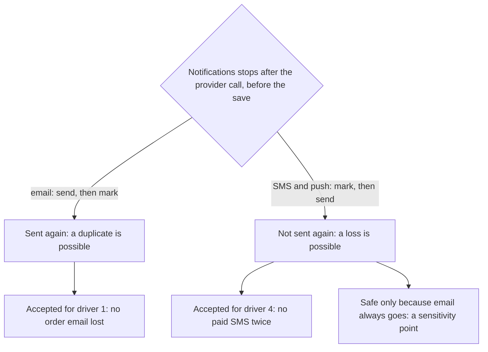

## Before you start

- [[sysdesign.l4.notification-design]] — you know ADR `0027` gives each channel its own sender, retries for 24 hours (assumed) and paces sends to the provider's allowed rate, and the review's drivers include 1, no order email lost; 2, emails arrive within minutes; 4, no paid SMS sent twice.
- [[backend.l2.at-least-once-jobs]] — you know sending before saving `sent` is at-least-once, saving first is at-most-once, and no order gives exactly once.
- [[design.l4.trade-off-points]] — you know a sensitivity point is a decision one quality attribute depends on strongly, and a trade-off point moves two in opposite directions.
- [[backend.l4.load-testing]] — you know Little's law relates what waits to a rate and a time.

## The situation

The design review for ADR `0027` turns to failures. A tester points at `SendOneAsync` and asks what happens if Notifications stops right after the provider accepts a message, but before the round is saved. For email the team knows the answer: the row is still `pending`, so the customer gets a second copy. For SMS, that second copy is paid for twice.

Then someone from operations asks: after Service A, the external email service Notifications sends through, has been down for an hour at the busiest hour, why not send the backlog as fast as the senders can?

Which failure does each channel accept, and what does clearing a backlog cost?

## Core concepts

- at-least-once email — email keeps stage-3's order, send and then save, so a stop between the two sends it again and never loses it.
- at-most-once SMS and push — the row is marked before the provider is called, so a stop between the two can lose the message but never sends it twice.
- the channel of record — the channel every order message always goes out on; in ADR `0027` it is email.
- the drain rate — how fast a backlog shrinks: the allowed rate minus the rate at which new messages keep arriving.
- the review's trade-off record — a line in the design review naming a choice, what it helps, what it hurts and the driver that decided it.

## How it works



Both branches start from the accident in the situation: Notifications stops after the provider has the message, before the row's new status is saved. No order of steps across a sender and an external provider rules that out, so each channel chooses which result it can live with.

Email keeps stage-3's order: send, mark the row `sent`, save. After the stop the row is still `pending`, so the restarted sender sends it again. The design keeps this because driver 1 says no order email may be lost, and the team judges a missing order email worse than a second copy.

For SMS, a second copy is a second payment, against driver 4. So ADR `0027` reverses the order for SMS and push: the row is marked before the provider is called, and an error that leaves it unclear whether the message went out is not retried. A stop can now lose one SMS.

That loss is acceptable only under one condition: every order message also goes out by email. Email becomes the channel of record, so customers cannot turn order emails off. The review writes this down as a sensitivity point, because the SMS choice depends on it entirely. Drop email from one kind of message, and a lost SMS becomes a lost notification, so the ADR is reviewed again.

Pacing answers the operations question. The design keeps each sender at its provider's allowed rate. After an outage, emails therefore arrive later, but they are not refused. A refused email waits a growing gap before its next attempt, and one still unsent after 24 hours of retries becomes `failed`, against driver 1 until operations resends it by hand.

## In the Đơn Hàng system

Only the email half of these choices runs at stage-4; ADR `0027`'s header says Notifications still sends only email. This is the order the tester pointed at:

```csharp file=DonHang.Notifications/NotificationSender.cs tag=stage-4 lines=59-78
    // lesson: backend.l2.at-least-once-jobs
    // The order matters: (1) send the email, (2) mark the row sent, (3) save
    // it in CompleteAsync. A crash after (1) and before (3) leaves the row
    // pending, so the email goes out again: at least once, never lost.
    private async Task SendOneAsync(IEmailSender email, Notification notification, CancellationToken stoppingToken)
    {
        try
        {
            await email.SendAsync(notification.Email, $"Order {notification.OrderId}: {notification.Subject}",
                $"Hello {notification.FullName}, this is about your order {notification.OrderId}: {notification.Subject}.",
                stoppingToken);
            notification.Status = "sent";
            notification.SentAt = DateTimeOffset.UtcNow;
            logger.LogInformation("Sent notification {NotificationId} for order {OrderId}", notification.Id, notification.OrderId);
        }
        catch (Exception ex) when (!stoppingToken.IsCancellationRequested)
        {
            RecordFailure(notification, ex);
        }
    }
```

The comment names the three steps, and the code follows them: `SendAsync` first, then `Status = "sent"`, while the save happens later in `CompleteAsync`, outside the excerpt. On a stop the `when` filter lets the exception pass, so nothing is recorded and the row stays `pending`. A failed call goes to `RecordFailure`, which, below the excerpt, schedules another attempt, until the fifth failure marks the row `failed`. The SMS sender exists only in the ADR, so its reversed order, mark first and call second, is not code you can read yet.

The design review records the bottleneck, the backlog and every choice above:

```markdown file=docs/design/notification-design-review.md tag=stage-4 lines=71-93
### Nút cổ chai và điểm hỏng đơn lẻ (bước 5)

- Nút cổ chai: tốc độ nhà cung cấp cho phép, không phải sender; thêm bản
  Notifications quá hai không gửi nhanh hơn được.
- Dịch vụ email là điểm hỏng đơn lẻ cho việc email tới, không cho việc đặt
  đơn: dòng chờ trong `donhang_notifications`.
- Theo định luật Little, dịch vụ email sập một giờ ở giờ đông để lại khoảng
  6,6 × 3.600 = khoảng 24.000 email. Hàng chờ chỉ giảm với tốc độ cho phép trừ
  email mới đến: 10 − 6,6 = 3,4 mỗi giây, khoảng 2 giờ. Ngày thường: khoảng
  4.300 email, giảm 8,8 mỗi giây, khoảng 8 phút.

### Phương án bị loại và điểm đánh đổi (bước 3 và 4)

- Một vòng gửi cho mọi kênh: một nhà cung cấp chậm làm chậm mọi kênh.
- API hay từng service gọi nhà cung cấp: trái ADR 0002.
- SMS ít nhất một lần: trái driver 4.
- Điểm đánh đổi: email ít nhất một lần (lợi: không mất email, driver 1; thiệt:
  có thể nhận hai lần). SMS và push nhiều nhất một lần (lợi: không trả tiền hai
  lần, driver 4; thiệt: có thể mất một tin).
- Điểm nhạy: email là kênh chính. Lựa chọn cho SMS chỉ an toàn khi mọi tin về
  đơn cũng đi bằng email; bỏ email khỏi một loại tin là mở lại ADR 0027.
- Điểm đánh đổi: theo nhịp nhà cung cấp, đổi độ trễ lấy việc không bị từ chối
  (driver 2 bị thiệt sau một lần sập, driver 1 được lợi).
```

The first bullet answers the operations question. At the busiest hour the design runs two copies of Notifications, which share Service A's assumed 10 emails a second, about 5 each. The bottleneck is that allowed rate, not the senders, so a third copy sends no faster.

The third bullet is the backlog. The review reasons the way Little's law does, a rate times a time: for an hour nothing leaves, so about 6.6 emails a second times 3,600 seconds, roughly 24,000 emails, wait. New emails keep arriving, so the drain rate is 10 − 6.6 = 3.4 a second while the busiest hour's rate holds, about 2 hours.

On a normal day about 1.2 emails a second arrive. The same outage leaves about 4,300 emails, which drain at 10 − 1.2 = 8.8 a second in about 8 minutes.

The rejected options keep their reasons: one round for every channel lets a slow provider slow them all, providers called by the API or each service go against ADR `0002`, and SMS at-least-once goes against driver 4. The two "Điểm đánh đổi" bullets are the trade-off records: each names what the choice helps and hurts, and the driver behind it. Between them sits the sensitivity point, email as the channel of record. Among the conditions ADR `0027` lists for looking again are a kind of message that needs SMS without email, and 24 hours of retries that do not cover an outage of Service A.

## Trade-offs

| Choice | Helps | Hurts | Deciding driver, or what reopens it |
|---|---|---|---|
| Email at-least-once (kept from stage-3) | no order email lost | a customer may get two copies | driver 1 |
| SMS and push at-most-once (ADR `0027`'s choice) | no SMS paid for twice | a stop can lose one message | driver 4; reopens if a kind of message needs SMS without email |
| Rejected: SMS at-least-once | no SMS lost | a stop sends a paid SMS twice | rejected on driver 4 |
| Email as the channel of record (sensitivity point) | makes losing one SMS harmless | customers cannot turn email off | reopens ADR `0027` if any order message drops email |
| Pace to the allowed rate (ADR `0027`'s choice) | the backlog is sent, not refused | emails after an outage arrive late: about 2 hours after an hour's outage at the busiest hour | driver 1 over driver 2 |

Every row rests on assumptions: that a duplicate email is merely annoying, that SMS costs money per message, and that Service A allows 10 emails a second. A system where a duplicate does harm, such as one that sends a one-time code that may be used only once, weighs the first row differently. The trade-off records exist so that a changed assumption points at the one row to weigh again.

## What would you choose if…

…the product owner asks to let customers turn email off and receive only SMS? That removes the condition the SMS choice rests on: a lost SMS would then be a lost notification, against driver 1. ADR `0027` already answered a tester's same question this way: email always goes. Saying yes means reviewing the ADR, not changing a setting.

…the contract gives Service A an allowed rate of 7 emails a second, not the assumed 10? At the busiest hour the drain rate becomes 7 − 6.6 = 0.4 a second, so an hour's backlog barely shrinks until the busiest hour ends. As long as the backlog drains before each email's 24 hours of retries end, the design still loses no email, but driver 2 suffers far more. The risks table at the end of `notification-design-review.md` already asks the product owner to confirm this rate before Service A is connected; this is why it matters.

## Seniors often assume…

- **"Every notification must be delivered exactly once, whatever the channel."** → Actually no order of steps across a sender and an external provider gives exactly once, so each channel chooses its failure: email a duplicate, SMS a loss. The review records which driver each choice serves. You notice this when a plan promises exactly-once SMS and nobody can say what happens when Notifications stops mid-send.
- **"At-most-once delivery is always a bug."** → Actually for SMS it is the chosen behaviour, because a duplicate costs money and every order message also goes by email. It becomes a bug the day email stops covering a kind of message. You notice this when a change adds an SMS-only message and nobody reopens ADR `0027`.
- **"Sending as fast as possible after an outage always gets the backlog out sooner."** → Actually the backlog cannot leave faster than the allowed rate minus new arrivals. Sends above that rate are refused and wait for another attempt, while a third copy of Notifications adds no speed. You notice this when Service A returns, refusals climb, and some emails can arrive later than emails queued after them, because a refused email waits a growing gap before its next attempt.

## Try it (3 minutes)

Service A is down for 30 minutes at the busiest hour. Use the review's numbers: about 6.6 emails a second arrive, Service A allows 10 a second (assumed), and the busiest hour's rate holds throughout.

1. About how many emails wait when Service A returns?
2. About how long does the backlog take to drain at the paced rate?
3. A teammate proposes a third copy of Notifications for the drain. What does it change?

Expected result: two rounded numbers and one sentence.

<details><summary>Suggested answer</summary>

1. 6.6 × 1,800 = 11,880, about 12,000 emails.
2. The drain rate is 10 − 6.6 = 3.4 a second; 11,880 ÷ 3.4 is about 3,500 seconds, roughly an hour.
3. Nothing useful: the bottleneck is Service A's allowed rate, which two copies already reach, so the third copy only adds sends that would be refused.

</details>

## Connections

- [[sysdesign.l4.notification-design]] — the design whose choices this lesson weighs.
- [[backend.l2.at-least-once-jobs]] — the two orders of send and save, applied here one per channel.
- [[design.l4.trade-off-points]] — the idea applied here: each choice records what it helps, what it hurts and its driver.
- [[backend.l4.load-testing]] — Little's law, used here to size the backlog after an outage.
- [[backend.l3.idempotent-consumer]] — the same duplicate on the receiving side, where Notifications can check a repeated message itself.
- [[sysdesign.l4.finding-bottlenecks]] — the same search for the lowest limit on a path, here the provider's allowed rate.
- [[management.l3.weighing-options-in-an-adr]] — how ADR `0027` keeps its rejected options and their reasons.
- [[sysdesign.l4.notification-challenges]] — the next step: answering the review's challenges from the ADRs behind each choice.

## Five-line summary

1. No order of steps gives exactly once, so each channel chooses its failure: email may be sent twice, SMS and push may be lost.
2. Email stays at-least-once because driver 1 forbids losing an order email; a second copy is the accepted cost.
3. SMS is marked before the call because a duplicate is paid twice; losing one is safe only because email always goes.
4. Pacing trades delay for not being refused: a backlog equals rate times outage and drains at the allowed rate minus arrivals.
5. The review records each choice with what it helps, what it hurts and its driver, so a changed driver reopens the right one.
