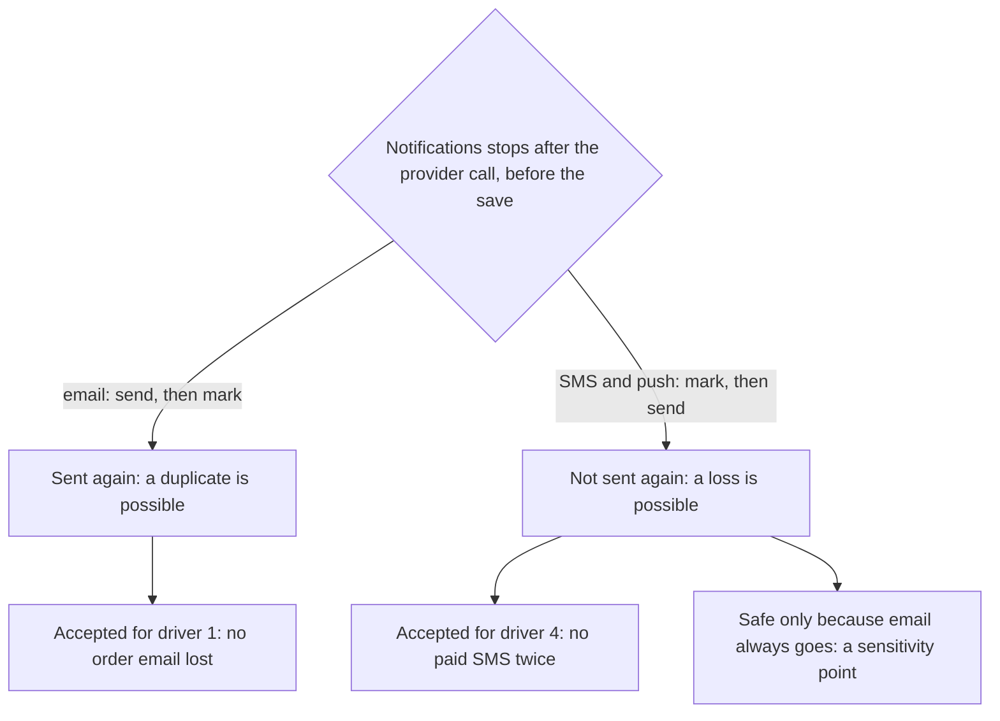

## Bạn cần biết trước

- [[sysdesign.l4.notification-design]] — bạn biết ADR `0027` cho mỗi kênh một sender riêng, thử lại trong 24 giờ (giả định) và điều tiết tốc độ gửi theo mức nhà cung cấp cho phép, còn các yếu tố định hình kiến trúc của buổi review gồm: thứ 1, không mất email nào về đơn, thứ 2, email tới trong vài phút, thứ 4, không SMS trả phí nào bị gửi hai lần.
- [[backend.l2.at-least-once-jobs]] — bạn biết gửi trước rồi mới lưu `sent` là at-least-once, lưu trước là at-most-once, và không thứ tự nào cho đúng một lần.
- [[design.l4.trade-off-points]] — bạn biết điểm nhạy là quyết định mà một thuộc tính chất lượng phụ thuộc mạnh vào, còn điểm đánh đổi kéo hai thuộc tính theo hai hướng ngược nhau.
- [[backend.l4.load-testing]] — bạn biết định luật Little nối số việc đang chờ với một tốc độ và một khoảng thời gian.

## Tình huống

Buổi review thiết kế cho ADR `0027` chuyển sang các tình huống hỏng. Một tester chỉ vào `SendOneAsync` và hỏi: nếu Notifications dừng ngay sau khi nhà cung cấp nhận tin, nhưng trước khi lượt gửi được lưu, thì sao? Với email, cả đội biết câu trả lời: dòng vẫn ở `pending`, nên khách nhận thêm một bản. Với SMS, bản thứ hai đó phải trả tiền thêm lần nữa.

Rồi một người bên vận hành hỏi: Dịch vụ A, dịch vụ email bên ngoài mà Notifications gửi qua, vừa sập một giờ đúng giờ đông nhất, vậy sao không gửi phần tồn đọng nhanh hết mức các sender làm được?

Mỗi kênh chấp nhận kiểu hỏng nào, và gửi hết phần tồn đọng tốn gì?

## Khái niệm cốt lõi

- email at-least-once — email giữ thứ tự của stage-3, gửi rồi mới lưu, nên nếu dừng giữa hai bước thì email được gửi lại và không bao giờ mất.
- SMS và push at-most-once — dòng được đánh dấu trước khi gọi nhà cung cấp, nên nếu dừng giữa hai bước thì có thể mất tin, nhưng không bao giờ gửi hai lần.
- kênh chính — kênh mà mọi tin về đơn luôn đi qua. Trong ADR `0027`, đó là email.
- tốc độ vơi — phần tồn đọng giảm nhanh cỡ nào: tốc độ cho phép trừ tốc độ tin mới tiếp tục đến.
- dòng ghi đánh đổi của buổi review — một dòng trong tài liệu review thiết kế nêu một lựa chọn, nó giúp gì, làm thiệt gì và yếu tố nào quyết định nó.

## Cơ chế hoạt động



Cả hai nhánh bắt đầu từ sự cố trong tình huống: Notifications dừng khi nhà cung cấp đã nhận tin, nhưng trạng thái mới của dòng chưa được lưu. Không thứ tự bước nào giữa một sender và một nhà cung cấp bên ngoài loại được khả năng này, nên mỗi kênh phải chọn kết quả mà nó chấp nhận được.

Email giữ thứ tự của stage-3: gửi, đánh dấu dòng `sent`, rồi lưu. Sau khi dừng, dòng vẫn ở `pending`, nên sender khởi động lại sẽ gửi lần nữa. Thiết kế giữ cách này vì yếu tố thứ 1 không cho phép mất email nào về đơn, và cả đội đánh giá mất một email về đơn tệ hơn nhận hai bản.

Với SMS, bản thứ hai là lần trả tiền thứ hai, trái với yếu tố thứ 4. Vì vậy ADR `0027` đảo thứ tự cho SMS và push: dòng được đánh dấu trước khi gọi nhà cung cấp, và lỗi nào khiến không rõ tin đã đi hay chưa thì không thử lại. Giờ một lần dừng có thể làm mất một SMS.

Mất tin như vậy chỉ chấp nhận được với một điều kiện: mọi tin về đơn cũng đi bằng email. Email trở thành kênh chính, nên khách không tắt được email về đơn. Buổi review ghi điều này là một điểm nhạy, vì lựa chọn cho SMS phụ thuộc hoàn toàn vào nó. Bỏ email khỏi một loại tin, một SMS bị mất sẽ thành một thông báo bị mất, và ADR phải được xem lại.

Điều tiết tốc độ gửi trả lời câu hỏi của bên vận hành. Thiết kế giữ mỗi sender ở tốc độ nhà cung cấp cho phép. Vì thế sau một sự cố, email tới trễ hơn, nhưng không bị từ chối. Email bị từ chối phải chờ một khoảng tăng dần trước lần thử kế tiếp, và email nào thử lại hết 24 giờ vẫn chưa đi sẽ thành `failed`, trái với yếu tố thứ 1, cho tới khi đội vận hành gửi lại bằng tay.

## Trong hệ thống Đơn Hàng

Ở stage-4, chỉ phần email trong các lựa chọn này đang chạy. Phần đầu ADR `0027` ghi rằng Notifications vẫn chỉ gửi email. Đây là thứ tự mà tester chỉ vào:

```csharp file=DonHang.Notifications/NotificationSender.cs tag=stage-4 lines=59-78
    // lesson: backend.l2.at-least-once-jobs
    // The order matters: (1) send the email, (2) mark the row sent, (3) save
    // it in CompleteAsync. A crash after (1) and before (3) leaves the row
    // pending, so the email goes out again: at least once, never lost.
    private async Task SendOneAsync(IEmailSender email, Notification notification, CancellationToken stoppingToken)
    {
        try
        {
            await email.SendAsync(notification.Email, $"Order {notification.OrderId}: {notification.Subject}",
                $"Hello {notification.FullName}, this is about your order {notification.OrderId}: {notification.Subject}.",
                stoppingToken);
            notification.Status = "sent";
            notification.SentAt = DateTimeOffset.UtcNow;
            logger.LogInformation("Sent notification {NotificationId} for order {OrderId}", notification.Id, notification.OrderId);
        }
        catch (Exception ex) when (!stoppingToken.IsCancellationRequested)
        {
            RecordFailure(notification, ex);
        }
    }
```

Phần chú thích nêu ba bước, và code làm đúng theo đó: `SendAsync` trước, rồi `Status = "sent"`, còn bước lưu nằm sau, trong `CompleteAsync`, ngoài đoạn trích. Khi dừng, bộ lọc `when` để exception đi qua, nên không gì được ghi lại và dòng vẫn ở `pending`. Lệnh gọi lỗi thì vào `RecordFailure`. Hàm này, nằm dưới đoạn trích, hẹn một lần thử nữa, cho tới khi lần lỗi thứ năm đánh dấu dòng `failed`. Sender SMS mới chỉ có trong ADR, nên thứ tự đảo ngược của nó, đánh dấu trước rồi mới gọi, chưa phải code bạn đọc được.

Tài liệu review thiết kế ghi lại nút cổ chai, phần tồn đọng và mọi lựa chọn ở trên:

```markdown file=docs/design/notification-design-review.md tag=stage-4 lines=71-93
### Nút cổ chai và điểm hỏng đơn lẻ (bước 5)

- Nút cổ chai: tốc độ nhà cung cấp cho phép, không phải sender; thêm bản
  Notifications quá hai không gửi nhanh hơn được.
- Dịch vụ email là điểm hỏng đơn lẻ cho việc email tới, không cho việc đặt
  đơn: dòng chờ trong `donhang_notifications`.
- Theo định luật Little, dịch vụ email sập một giờ ở giờ đông để lại khoảng
  6,6 × 3.600 = khoảng 24.000 email. Hàng chờ chỉ giảm với tốc độ cho phép trừ
  email mới đến: 10 − 6,6 = 3,4 mỗi giây, khoảng 2 giờ. Ngày thường: khoảng
  4.300 email, giảm 8,8 mỗi giây, khoảng 8 phút.

### Phương án bị loại và điểm đánh đổi (bước 3 và 4)

- Một vòng gửi cho mọi kênh: một nhà cung cấp chậm làm chậm mọi kênh.
- API hay từng service gọi nhà cung cấp: trái ADR 0002.
- SMS ít nhất một lần: trái driver 4.
- Điểm đánh đổi: email ít nhất một lần (lợi: không mất email, driver 1; thiệt:
  có thể nhận hai lần). SMS và push nhiều nhất một lần (lợi: không trả tiền hai
  lần, driver 4; thiệt: có thể mất một tin).
- Điểm nhạy: email là kênh chính. Lựa chọn cho SMS chỉ an toàn khi mọi tin về
  đơn cũng đi bằng email; bỏ email khỏi một loại tin là mở lại ADR 0027.
- Điểm đánh đổi: theo nhịp nhà cung cấp, đổi độ trễ lấy việc không bị từ chối
  (driver 2 bị thiệt sau một lần sập, driver 1 được lợi).
```

Gạch đầu dòng đầu tiên trả lời câu hỏi của bên vận hành. Ở giờ đông nhất, thiết kế chạy hai bản Notifications, chia nhau mức 10 email mỗi giây (giả định) của Dịch vụ A, khoảng 5 email mỗi bản. Nút cổ chai là tốc độ cho phép đó, không phải các sender, nên bản thứ ba không gửi nhanh hơn được.

Gạch đầu dòng thứ ba là phần tồn đọng. Buổi review tính theo đúng cách của định luật Little, một tốc độ nhân một khoảng thời gian: trong một giờ không email nào đi, nên khoảng 6,6 email mỗi giây nhân 3.600 giây, tức chừng 24.000 email, phải chờ. Email mới vẫn tiếp tục đến, nên tốc độ vơi là 10 − 6,6 = 3,4 email mỗi giây khi mức của giờ đông nhất còn giữ, mất khoảng 2 giờ.

Vào ngày thường, khoảng 1,2 email đến mỗi giây. Cùng sự cố đó để lại khoảng 4.300 email, vơi đi với tốc độ 10 − 1,2 = 8,8 email mỗi giây, hết trong khoảng 8 phút.

Các phương án bị loại vẫn giữ lý do của mình: một vòng gửi cho mọi kênh khiến một nhà cung cấp chậm làm chậm tất cả, để API hay từng service gọi nhà cung cấp thì trái ADR `0002`, còn SMS at-least-once thì trái yếu tố thứ 4. Hai gạch đầu dòng "Điểm đánh đổi" chính là các dòng ghi đánh đổi: mỗi dòng nêu lựa chọn giúp gì, làm thiệt gì, và yếu tố đứng sau nó. Nằm giữa chúng là điểm nhạy: email là kênh chính. Trong các điều kiện mà ADR `0027` liệt kê để xem lại có hai điều: một loại tin cần SMS mà không có email, và 24 giờ thử lại không đủ phủ một lần sập của Dịch vụ A.

## Đánh đổi

| Lựa chọn | Được gì | Cái giá | Yếu tố quyết định, hoặc điều khiến phải xem lại |
|---|---|---|---|
| Email at-least-once (giữ từ stage-3) | không mất email nào về đơn | khách có thể nhận hai bản | yếu tố thứ 1 |
| SMS và push at-most-once (lựa chọn của ADR `0027`) | không SMS nào bị trả tiền hai lần | một lần dừng có thể làm mất một tin | yếu tố thứ 4, xem lại nếu có loại tin cần SMS mà không có email |
| Bị loại: SMS at-least-once | không mất SMS nào | một lần dừng khiến một SMS trả phí bị gửi hai lần | bị loại vì yếu tố thứ 4 |
| Email là kênh chính (điểm nhạy) | mất một SMS không gây hại | khách không tắt được email | mở lại ADR `0027` nếu bất kỳ tin nào về đơn bỏ email |
| Điều tiết theo tốc độ cho phép (lựa chọn của ADR `0027`) | phần tồn đọng được gửi đi, không bị từ chối | email sau sự cố tới trễ: khoảng 2 giờ sau một giờ sập ở giờ đông nhất | yếu tố thứ 1 được ưu tiên hơn yếu tố thứ 2 |

Mỗi dòng đều dựa trên giả định: email trùng chỉ gây phiền, SMS tính tiền theo từng tin, và Dịch vụ A cho phép 10 email mỗi giây. Một hệ thống mà tin trùng gây hại, chẳng hạn gửi mã dùng một lần chỉ được dùng đúng một lần, sẽ cân dòng đầu tiên khác đi. Các dòng ghi đánh đổi tồn tại để khi một giả định thay đổi, nó chỉ thẳng vào đúng dòng cần cân lại.

## Bạn sẽ chọn gì nếu…

…product owner muốn cho khách tắt email và chỉ nhận SMS? Điều đó gỡ bỏ chính điều kiện mà lựa chọn cho SMS dựa vào: khi ấy một SMS bị mất sẽ là một thông báo bị mất, trái với yếu tố thứ 1. ADR `0027` đã trả lời đúng câu hỏi này của một tester theo cách đó: email luôn được gửi. Đồng ý nghĩa là phải xem lại ADR, không phải đổi một thiết lập.

…hợp đồng chỉ cho Dịch vụ A tốc độ 7 email mỗi giây, thay vì mức 10 giả định? Ở giờ đông nhất, tốc độ vơi chỉ còn 7 − 6,6 = 0,4 email mỗi giây, nên phần tồn đọng của một giờ sập gần như không giảm cho tới khi hết giờ đông. Miễn phần tồn đọng vơi hết trước khi 24 giờ thử lại của từng email kết thúc, thiết kế vẫn không mất email nào, nhưng yếu tố thứ 2 chịu thiệt nặng hơn nhiều. Bảng rủi ro ở cuối `notification-design-review.md` đã yêu cầu product owner xác nhận tốc độ này trước khi nối Dịch vụ A, và đây là lý do nó quan trọng.

## Senior hay nhầm rằng…

- **"Thông báo nào cũng phải tới đúng một lần, dù qua kênh nào."** → Thực ra không thứ tự bước nào giữa một sender và một nhà cung cấp bên ngoài cho đúng một lần, vì thế mỗi kênh tự chọn kiểu hỏng của mình: email thì trùng, SMS thì mất. Buổi review ghi lại mỗi lựa chọn phục vụ yếu tố nào. Bạn sẽ nhận ra khi một kế hoạch hứa SMS đúng một lần mà không ai nói được chuyện gì xảy ra khi Notifications dừng giữa lúc gửi.
- **"Gửi at-most-once lúc nào cũng là bug."** → Thực ra với SMS đó là hành vi được chọn, vì tin trùng tốn tiền và mọi tin về đơn cũng đi bằng email. Nó thành bug vào ngày email không còn phủ một loại tin nào đó. Bạn sẽ nhận ra khi một thay đổi thêm một tin chỉ gửi bằng SMS mà không ai mở lại ADR `0027`.
- **"Sau sự cố, gửi nhanh hết mức thì phần tồn đọng luôn hết sớm hơn."** → Thực ra phần tồn đọng không thể đi nhanh hơn tốc độ cho phép trừ tin mới đến, vì các lần gửi vượt mức đó bị từ chối và phải chờ lần thử khác, còn bản Notifications thứ ba không thêm chút tốc độ nào. Bạn sẽ nhận ra khi Dịch vụ A hoạt động trở lại, số lần bị từ chối tăng vọt, và có email tới muộn hơn cả những email xếp hàng sau nó, vì email bị từ chối phải chờ một khoảng tăng dần trước lần thử kế tiếp.

## Thử ngay (3 phút)

Dịch vụ A sập 30 phút vào giờ đông nhất. Dùng số liệu của buổi review: khoảng 6,6 email đến mỗi giây, Dịch vụ A cho phép 10 email mỗi giây (giả định), và mức của giờ đông nhất giữ nguyên suốt thời gian đó.

1. Khi Dịch vụ A quay lại, khoảng bao nhiêu email đang chờ?
2. Ở tốc độ đã điều tiết, phần tồn đọng mất khoảng bao lâu để vơi hết?
3. Một đồng đội đề xuất thêm bản Notifications thứ ba để gửi phần tồn đọng. Điều đó thay đổi gì?

Kết quả mong đợi: hai con số làm tròn và một câu.

<details><summary>Gợi ý đáp án</summary>

1. 6,6 × 1.800 = 11.880, tức khoảng 12.000 email.
2. Tốc độ vơi là 10 − 6,6 = 3,4 email mỗi giây. 11.880 ÷ 3,4 vào khoảng 3.500 giây, tức chừng một giờ.
3. Không có ích gì: nút cổ chai là tốc độ cho phép của Dịch vụ A, hai bản đã chạm tới mức đó, nên bản thứ ba chỉ thêm những lần gửi sẽ bị từ chối.

</details>

## Liên hệ

- [[sysdesign.l4.notification-design]] — thiết kế có các lựa chọn mà bài này đem ra cân.
- [[backend.l2.at-least-once-jobs]] — hai thứ tự gửi và lưu, ở đây mỗi kênh dùng một thứ tự.
- [[design.l4.trade-off-points]] — ý tưởng được áp dụng ở đây: mỗi lựa chọn ghi lại nó giúp gì, làm thiệt gì và yếu tố đứng sau nó.
- [[backend.l4.load-testing]] — định luật Little, ở đây dùng để ước lượng phần tồn đọng sau một sự cố.
- [[backend.l3.idempotent-consumer]] — cùng kiểu trùng lặp nhưng ở phía nhận, nơi Notifications tự kiểm tra được một message lặp lại.
- [[sysdesign.l4.finding-bottlenecks]] — cùng cách tìm giới hạn thấp nhất trên một đường đi, ở đây là tốc độ nhà cung cấp cho phép.
- [[management.l3.weighing-options-in-an-adr]] — cách ADR `0027` giữ lại các phương án bị loại cùng lý do.
- [[sysdesign.l4.notification-challenges]] — bước tiếp theo: trả lời các câu chất vấn của buổi review từ những ADR đứng sau mỗi lựa chọn.

## Tóm tắt 5 dòng

1. Không thứ tự bước nào cho đúng một lần, nên mỗi kênh tự chọn kiểu hỏng: email có thể gửi hai lần, SMS và push có thể mất.
2. Email giữ at-least-once vì yếu tố thứ 1 không cho mất email nào về đơn, và bản thứ hai là cái giá được chấp nhận.
3. SMS được đánh dấu trước khi gọi vì tin trùng phải trả tiền hai lần, và mất một tin chỉ an toàn vì email luôn được gửi.
4. Điều tiết tốc độ gửi đổi độ trễ lấy việc không bị từ chối: phần tồn đọng bằng tốc độ nhân thời gian sập, và vơi đi với tốc độ cho phép trừ tin mới đến.
5. Buổi review ghi mỗi lựa chọn kèm điều nó giúp, điều nó làm thiệt và yếu tố đứng sau, nên khi một yếu tố đổi, đúng lựa chọn đó được mở lại.
