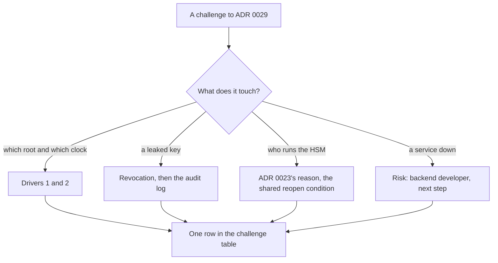

## Before you start

- [[sysdesign.l4.bank-signing-trade-offs]] — you know each piece of evidence ADR `0029` keeps adds a service signing waits on, and why an own HSM stays rejected unless a contract demands own machines.
- [[sysdesign.l4.answering-challenges]] — you answer a challenge with the driver or decision behind it, named with its file, and turn an uncovered case into a risk or open question with an owner.
- [[management.l3.superseding-an-adr]] — you know a changed decision gets a new ADR, and the old one is kept, changed only to point to the replacement.

## The situation

The review of ADR `0029` reaches its challenges. A developer asks why statements are not simply signed with the server's time and a root of Đơn Hàng's own, as the lab's practice sample `InvoiceCertificates.cs` does. Someone from accounting asks what happens to last year's statements if the key leaks. The product owner, who decides what the product offers customers, asks why a bank does not get an HSM of Đơn Hàng's own. An operator asks what happens if the timestamp authority is down at month end.

Each question sounds like it asks for more machinery.

Which written driver, ADR or risk answers each one, and which answer leaves work behind?

## Core concepts

- a driver answer — the reply names one of the review's ranked drivers: (1) checkable for many years, even after the certificate ends; (2) a leaked key's damage limited in time; (3) no key outside an HSM.
- revocation's line in time — the bank compares a statement's trusted timestamp with the revocation status saved at signing, so revocation splits statements into before and after.
- the reopen condition — the event an ADR names for deciding again; a contract demanding the key on own machines meets that of ADR `0022` and ADR `0023`, and only then does a new ADR replace ADR `0023`, for this key only.
- a risk with an owner — a case the design does not yet cover, recorded with a role and a next step instead of a mechanism invented in the session.
- the challenge table — the review's last section: each question, its answer with what it traces to, the next step, and an owner by role when something stays open.

## How it works



The first branch is answered by the drivers. The bank trusts only roots it names, so a root of Đơn Hàng's own fails driver 1. The server's clock fails driver 2, because whoever holds a leaked key can set the clock back to before the revocation, so a time the signer supplies proves nothing. The key itself stays in the HSM, so read "a leaked key" as anyone able to get signatures with it, such as whoever has taken over Payments.

The second branch is answered by how the bank checks. A statement timestamped before the revocation stays valid; one after fails. But whoever held the key before the revocation could also get statements signed and timestamped, and those land before the line too. So the answer adds the audit log, which lists the statements Payments asked to sign.

The third branch is answered by earlier ADRs, not a new purchase. ADR `0022` decided that production runs on a provider's managed Kubernetes, which brings the provider's key service (ADR `0023`). ADR `0023` rejected an own HSM, and a contract demanding the key on own machines meets the reopen condition of both.

The fourth branch finds a case the design does not close by itself. The statement waits and is signed late, within the bank's deadline (assumed), and the review records a risk with an owner. ADR `0029` treats a failing HSM or CA the same way: the statement waits and is retried while taking orders goes on.

The fifth row, the second bank, comes from ADR `0029`'s review conditions, not from a branch. Each answer becomes one row of the challenge table, traced to a driver, an ADR or a risk.

## In the Đơn Hàng system

Stage-4 has no code that signs statements. The challenge table closes `bank-signing-design-review.md`, in Vietnamese:

```markdown file=docs/design/bank-signing-design-review.md tag=stage-4 lines=99-107
### Câu hỏi phản biện trong buổi review

| Câu hỏi | Trả lời, trỏ driver, ADR hoặc rủi ro | Việc tiếp theo | Người phụ trách (vai trò) |
|---|---|---|---|
| Sao không ký bằng giờ server và root của Đơn Hàng? | Driver 1, 2: ngân hàng chỉ tin root họ chỉ định; khóa lộ ghi được bất kỳ giờ nào server cho thấy | Không | |
| Khóa lộ thì bảng kê cũ thì sao? | Thu hồi: bảng kê có dấu thời gian trước lúc thu hồi vẫn hợp lệ, sau thì không; nhật ký kiểm toán cho thấy Payments thật sự đã xin ký những bảng kê nào | Không | |
| Sao ngân hàng không có HSM riêng của Đơn Hàng? | Lý do của ADR 0023; hợp đồng đòi máy riêng là điều kiện mở lại của ADR 0022, khi đó ADR mới thay 0023 cho đúng khóa này | Không | |
| Timestamp authority sập cuối tháng thì sao? | Bảng kê chờ và được ký muộn, trong hạn của ngân hàng | Ghi rủi ro | Lập trình viên backend |
| Ngân hàng thứ hai thì sao? | Điều kiện xem lại của ADR 0029: mỗi ngân hàng một khóa? | Mở | Trưởng nhóm |
```

The first three rows need no next step; the last two leave work, each with an owner.

The first row answers the developer. `InvoiceCertificates.cs` trusts a root of Đơn Hàng's own that the bank does not trust, and sets `RevocationMode.NoCheck`, so it does not check revocation.

The second row's audit log comes from ADR `0015`, which put the invoice key in an HSM only Payments may call:

```markdown file=docs/adr/0015-khoa-ky-hoa-don-trong-hsm.md tag=stage-4 lines=33-41
### Quyết định

Chọn HSM. Kẻ chiếm được Payments chỉ xin được chữ ký trong lúc còn chiếm,
không mang khóa đi được; sau khi vá, không chữ ký mới nào được tạo bằng khóa
đó.

HSM ký mọi thứ một bên được phép gửi tới, nên Payments tự giới hạn những gì
nó xin ký: chỉ hóa đơn của đơn mà Payments ghi là đã thanh toán, và mỗi lần
xin ký được ghi vào nhật ký kiểm toán (`docs/design/audit-log.md`).
```

The HSM signs whatever an allowed caller sends, so Payments limits its requests and logs each one; ADR `0029` keeps that rule for every signing, timestamp and status request. The option ADR `0015` rejected, a key in a SealedSecret, is read into Payments' memory at start, so it can be copied.

The third row cites ADR `0023`'s reason, which ADR `0029` repeats: devices in two places and people to run them. The bank key lives in the provider's HSM service instead, which already meets driver 3. ADR `0022` reopens when a customer's contract demands own machines or data in a set place. If the contract demands the key in an HSM on own machines, a new ADR replaces ADR `0023` for this key only, as the review's "ADR sẽ viết" (ADRs to write) section says.

The fourth row is a risk, owned by the backend developer: sign from the first day of the month, retry over many hours, and tell the bank if the deadline gets close. The deadline is the fifth working day of the next month (assumed). The same risk table gives the product owner an open question: the bank has not yet confirmed which root and CA.

The last row, not in the situation, is open: whether each bank gets its own key is the team lead's to answer.

## Trade-offs

| Way to answer | What it buys | What it pays | When it is the wrong choice |
|---|---|---|---|
| Name the ranked driver | a short answer checked against the requirements | rests on the bank naming the roots, which the product owner must still confirm | the bank's requirements change the drivers |
| Point to how the bank checks | past statements need no new signature after a revocation | every signing request must reach the audit log | the audit log cannot show which requests Payments made |
| Cite an ADR's reason and reopen condition | ADRs `0022` and `0023` are not decided again in the session | someone must notice when a contract meets the condition | the contract already demands own machines |
| Record a risk with an owner | the design goes ahead; the month-end case has a name and a step | the backend developer must act each month end | an outage could outlast the time before the bank's deadline |
| Leave a question open with an owner | no key design for a bank nobody has signed | the team lead must close it before a second bank's statements | a second bank's contract is already signed |

## What would you choose if…

…the bank, after a revocation, asks which statements signed with the old key it should trust? Each signing request wrote an audit log entry, so the team lists the statements Payments asked to sign. A statement timestamped before the revocation that the audit log does not list never went through Payments' logged signing path, so the team tells the bank to treat it as suspect, even though its signature checks. Nothing is signed again.

…a second bank wants monthly statements? The open row is now due, as one of ADR `0029`'s review conditions. The team lead decides whether each bank gets its own key, and a new ADR records it instead of a quick change to the existing key.

## Seniors often assume…

- **"Revoking a leaked key makes every document it ever signed invalid."** → Actually the bank checks each statement's trusted timestamp against the status saved at signing, so statements timestamped before the revocation stay valid and later ones fail. You notice this when, after a revocation, someone plans to sign every past statement again with a new key.
- **"A challenge about who owns the HSM can only be settled by buying one."** → Actually the review answers it with ADR `0023`'s reason and the reopen condition ADR `0022` and ADR `0023` share, a contract demanding the key on own machines. You notice this when a review's next step says "buy an HSM" while no contract has asked for one.
- **"If the design cannot answer a challenge on the spot, it must be redesigned before the review ends."** → Actually the month-end outage became a risk owned by the backend developer, and the second bank an open row owned by the team lead, yet the review is marked reviewed and ADR `0029` accepted. You notice this when a review ends with no decision because one row had no immediate answer.

## Try it (3 minutes)

Three more challenges come up after the session. For each, name the row, driver or ADR that answers it.

1. "Why not keep the bank key in a SealedSecret, like the secret value Payments sends to the payment gateway?"
2. "After a revocation, do we sign all of last year's statements again?"
3. "The CA's status service is down on the second working day of the month. Do orders stop?"

Expected result: one source for each, with the fact from that source that answers it.

<details><summary>Suggested answer</summary>

1. Driver 3 and ADR `0015`. A key in a SealedSecret is read into Payments' memory, so whoever takes over Payments can copy it and keep signing after the hole is fixed; in an HSM the key never leaves.
2. The challenge table's second row. Statements timestamped before the revocation stay valid, and the audit log shows which of them Payments asked for.
3. The same answer as the fourth row. ADR `0029` lets the statement wait and be retried when the CA fails, and taking orders is not affected; the bank's deadline is the fifth working day (assumed).

</details>

## Connections

- [[sysdesign.l4.bank-signing-trade-offs]] — the step before, whose choices these challenges question.
- [[sysdesign.l4.answering-challenges]] — the method applied here, to answers that sit in three ADRs.
- [[management.l3.superseding-an-adr]] — what happens to ADR `0023` if a contract demands the key on own machines.
- [[backend.l4.threat-modeling]] — the habit of asking what an attacker could do, applied to one key.
- [[sysdesign.l4.multi-shop-challenges]] — the same kind of review for the multi-shop design.
- [[management.l4.deciding-under-uncertainty]] — the open second-bank row, an assumption left with an owner.
- [[sysdesign.l4.product-search-requirements]] — the next problem, product search inside one shop.

## Five-line summary

1. Each bank signing challenge is answered from a ranked driver, ADR `0015`, `0023` or `0029`, or a risk written down before the session.
2. Server time and an own root fail drivers 1 and 2: the bank trusts only named roots; a key holder can backdate the clock.
3. After a revocation, statements timestamped before it stay valid; the audit log shows which ones Payments really asked to sign.
4. An own HSM stays rejected for ADR `0023`'s reason; a contract demanding the key on own machines reopens it, and a new ADR replaces `0023`.
5. A timestamp authority down at month end is a risk owned by the backend developer: statements wait and are signed late, within the deadline (assumed).
