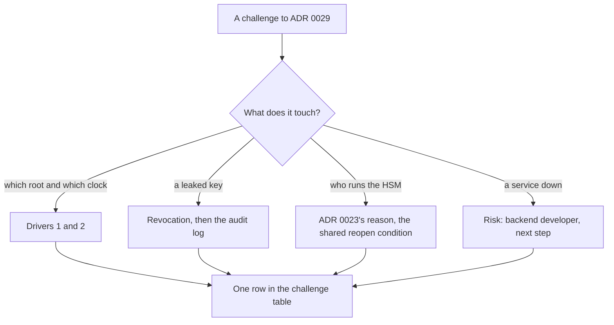

## Bạn cần biết trước

- [[sysdesign.l4.bank-signing-trade-offs]] — bạn biết mỗi bằng chứng mà ADR `0029` giữ kèm chữ ký thêm một dịch vụ mà việc ký phải chờ, và vì sao HSM riêng vẫn bị loại, trừ khi hợp đồng đòi máy riêng.
- [[sysdesign.l4.answering-challenges]] — bạn trả lời một câu phản biện bằng yếu tố định hình kiến trúc hoặc quyết định đứng sau nó, kèm tên file, và biến một trường hợp chưa được che thành rủi ro hoặc câu hỏi mở có người phụ trách.
- [[management.l3.superseding-an-adr]] — bạn biết một quyết định thay đổi thì có ADR mới, còn ADR cũ được giữ lại, chỉ sửa để trỏ tới ADR thay nó.

## Tình huống

Buổi review ADR `0029` đến phần câu phản biện. Một lập trình viên hỏi sao không ký bảng kê bằng giờ của server và một root của riêng Đơn Hàng, như file mẫu thực hành `InvoiceCertificates.cs` trong lab. Một người bên kế toán hỏi nếu khóa bị lộ thì bảng kê năm ngoái ra sao. Product owner, người quyết định sản phẩm cung cấp gì cho khách hàng, hỏi sao ngân hàng không có một HSM của riêng Đơn Hàng. Một người vận hành hỏi nếu timestamp authority sập đúng cuối tháng thì sao.

Câu nào nghe cũng như đòi thêm máy móc.

Yếu tố định hình kiến trúc, ADR hay rủi ro nào đã viết sẵn trả lời từng câu, và câu trả lời nào còn để lại việc phải làm?

## Khái niệm cốt lõi

- câu trả lời bằng yếu tố định hình kiến trúc — câu trả lời nêu tên một trong các yếu tố đã xếp hạng của buổi review: (1) kiểm được trong nhiều năm, kể cả khi chứng chỉ đã hết hạn, (2) thiệt hại từ một khóa bị lộ được giới hạn theo thời gian, (3) không khóa nào nằm ngoài HSM.
- lằn ranh thời gian của lần thu hồi — ngân hàng so dấu thời gian tin cậy của bảng kê với trạng thái thu hồi đã lưu lúc ký, nên lần thu hồi chia bảng kê thành hai phía, trước và sau.
- điều kiện mở lại — sự kiện mà một ADR ghi sẵn để quyết định lại. Một hợp đồng đòi đặt khóa trên máy riêng chạm điều kiện đó của cả ADR `0022` lẫn ADR `0023`, và chỉ khi ấy mới có ADR mới thay ADR `0023`, cho riêng khóa này.
- rủi ro có người phụ trách — một trường hợp thiết kế chưa che được, ghi lại kèm một vai trò và một việc tiếp theo, thay vì nghĩ ra một cơ chế ngay trong buổi họp.
- bảng câu phản biện — phần cuối của buổi review: mỗi câu hỏi, câu trả lời kèm nơi nó dẫn về, việc tiếp theo, và người phụ trách theo vai trò khi còn điều gì để mở.

## Cơ chế hoạt động



Nhánh thứ nhất được trả lời bằng các yếu tố định hình kiến trúc. Ngân hàng chỉ tin những root do họ chỉ định, nên root của riêng Đơn Hàng trái yếu tố 1. Giờ của server trái yếu tố 2, vì ai giữ khóa bị lộ có thể chỉnh giờ về trước lúc thu hồi, nên một mốc giờ do chính bên ký đưa ra không chứng minh được gì. Bản thân khóa vẫn nằm trong HSM, nên hãy hiểu "khóa bị lộ" là bất kỳ ai xin được chữ ký bằng nó, chẳng hạn kẻ đã chiếm được Payments.

Nhánh thứ hai được trả lời bằng cách ngân hàng kiểm. Bảng kê có dấu thời gian trước lần thu hồi vẫn hợp lệ, sau thì không. Nhưng trước lần thu hồi, kẻ giữ khóa cũng xin được chữ ký và dấu thời gian cho bảng kê, và những bảng kê đó cũng rơi vào phía trước lằn ranh. Vì vậy câu trả lời thêm nhật ký kiểm toán, nơi liệt kê các bảng kê mà Payments đã xin ký.

Nhánh thứ ba được trả lời bằng các ADR đã có, không phải bằng một lần mua sắm mới. ADR `0022` quyết định production chạy trên Kubernetes managed của một nhà cung cấp, kéo theo dịch vụ khóa của nhà cung cấp đó (ADR `0023`). ADR `0023` đã loại HSM riêng, và một hợp đồng đòi đặt khóa trên máy riêng chạm điều kiện mở lại của cả hai.

Nhánh thứ tư gặp một trường hợp mà thiết kế tự nó không khép lại được. Bảng kê chờ và được ký muộn, trong hạn của ngân hàng (giả định), và buổi review ghi một rủi ro có người phụ trách. ADR `0029` xử lý HSM hay CA hỏng theo cùng cách: bảng kê chờ và được thử lại, trong khi việc nhận đơn vẫn chạy.

Dòng thứ năm, ngân hàng thứ hai, đến từ các điều kiện xem lại của ADR `0029`, không từ nhánh nào. Mỗi câu trả lời thành một dòng của bảng câu phản biện, dẫn về một yếu tố định hình kiến trúc, một ADR hoặc một rủi ro.

## Trong hệ thống Đơn Hàng

Stage-4 chưa có code ký bảng kê. Bảng câu phản biện khép lại `bank-signing-design-review.md`, viết bằng tiếng Việt:

```markdown file=docs/design/bank-signing-design-review.md tag=stage-4 lines=99-107
### Câu hỏi phản biện trong buổi review

| Câu hỏi | Trả lời, trỏ driver, ADR hoặc rủi ro | Việc tiếp theo | Người phụ trách (vai trò) |
|---|---|---|---|
| Sao không ký bằng giờ server và root của Đơn Hàng? | Driver 1, 2: ngân hàng chỉ tin root họ chỉ định; khóa lộ ghi được bất kỳ giờ nào server cho thấy | Không | |
| Khóa lộ thì bảng kê cũ thì sao? | Thu hồi: bảng kê có dấu thời gian trước lúc thu hồi vẫn hợp lệ, sau thì không; nhật ký kiểm toán cho thấy Payments thật sự đã xin ký những bảng kê nào | Không | |
| Sao ngân hàng không có HSM riêng của Đơn Hàng? | Lý do của ADR 0023; hợp đồng đòi máy riêng là điều kiện mở lại của ADR 0022, khi đó ADR mới thay 0023 cho đúng khóa này | Không | |
| Timestamp authority sập cuối tháng thì sao? | Bảng kê chờ và được ký muộn, trong hạn của ngân hàng | Ghi rủi ro | Lập trình viên backend |
| Ngân hàng thứ hai thì sao? | Điều kiện xem lại của ADR 0029: mỗi ngân hàng một khóa? | Mở | Trưởng nhóm |
```

Ba dòng đầu không cần việc tiếp theo. Hai dòng cuối còn để lại việc, mỗi dòng có một người phụ trách.

Dòng đầu trả lời lập trình viên. `InvoiceCertificates.cs` tin một root của riêng Đơn Hàng mà ngân hàng không tin, và đặt `RevocationMode.NoCheck`, nên nó không kiểm thu hồi.

Nhật ký kiểm toán ở dòng thứ hai đến từ ADR `0015`, quyết định đặt khóa hóa đơn trong một HSM mà chỉ Payments được gọi:

```markdown file=docs/adr/0015-khoa-ky-hoa-don-trong-hsm.md tag=stage-4 lines=33-41
### Quyết định

Chọn HSM. Kẻ chiếm được Payments chỉ xin được chữ ký trong lúc còn chiếm,
không mang khóa đi được; sau khi vá, không chữ ký mới nào được tạo bằng khóa
đó.

HSM ký mọi thứ một bên được phép gửi tới, nên Payments tự giới hạn những gì
nó xin ký: chỉ hóa đơn của đơn mà Payments ghi là đã thanh toán, và mỗi lần
xin ký được ghi vào nhật ký kiểm toán (`docs/design/audit-log.md`).
```

HSM ký bất cứ thứ gì một bên được phép gửi tới, nên Payments tự giới hạn những gì nó xin và ghi lại từng lần xin. ADR `0029` giữ quy tắc này cho mọi lần xin chữ ký, dấu thời gian và trạng thái. Phương án ADR `0015` đã loại, đặt khóa trong một SealedSecret, sẽ đọc khóa vào bộ nhớ của Payments lúc khởi động, nên khóa có thể bị chép đi.

Dòng thứ ba dẫn lý do của ADR `0023`, cũng là lý do ADR `0029` nhắc lại: thiết bị ở hai nơi và người vận hành chúng. Thay vào đó, khóa ngân hàng nằm trong dịch vụ HSM của nhà cung cấp, vốn đã đáp ứng yếu tố định hình kiến trúc 3. ADR `0022` được mở lại khi hợp đồng của một khách hàng đòi máy riêng hoặc đòi dữ liệu nằm ở một nơi nhất định. Nếu hợp đồng đòi khóa nằm trong một HSM trên máy riêng, một ADR mới thay ADR `0023` cho riêng khóa này, đúng như mục "ADR sẽ viết" của buổi review ghi.

Dòng thứ tư là một rủi ro, do lập trình viên backend phụ trách: ký từ ngày đầu tháng, thử lại trong nhiều giờ, và báo ngân hàng nếu sắp tới hạn. Hạn là ngày làm việc thứ năm của tháng sau (giả định). Cũng bảng rủi ro đó giao cho product owner một câu hỏi mở: ngân hàng chưa xác nhận root và CA nào.

Dòng cuối, không có trong tình huống, đang để mở: mỗi ngân hàng có khóa riêng hay không là câu trưởng nhóm phải trả lời.

## Đánh đổi

| Cách trả lời | Được gì | Cái giá | Khi nào là lựa chọn sai |
|---|---|---|---|
| Nêu tên yếu tố định hình kiến trúc đã xếp hạng | câu trả lời ngắn, đối chiếu được với yêu cầu | dựa vào việc ngân hàng chỉ định root, điều product owner vẫn phải xác nhận | yêu cầu của ngân hàng làm đổi các yếu tố đó |
| Chỉ ra cách ngân hàng kiểm | bảng kê cũ không cần ký lại sau một lần thu hồi | mọi lần xin ký phải vào nhật ký kiểm toán | nhật ký kiểm toán không cho thấy Payments đã gửi những lần xin nào |
| Dẫn lý do và điều kiện mở lại của một ADR | ADR `0022` và `0023` không bị quyết lại ngay trong buổi họp | phải có người để ý khi một hợp đồng chạm điều kiện đó | hợp đồng đã đòi máy riêng |
| Ghi một rủi ro có người phụ trách | thiết kế đi tiếp, trường hợp cuối tháng có tên và có việc cần làm | lập trình viên backend phải xử lý mỗi cuối tháng | một lần sập có thể kéo dài quá thời gian còn lại trước hạn của ngân hàng |
| Để mở một câu hỏi có người phụ trách | không thiết kế khóa cho một ngân hàng chưa ai ký hợp đồng | trưởng nhóm phải chốt trước khi có bảng kê của ngân hàng thứ hai | hợp đồng với ngân hàng thứ hai đã được ký |

## Bạn sẽ chọn gì nếu…

…sau một lần thu hồi, ngân hàng hỏi nên tin những bảng kê nào đã ký bằng khóa cũ? Mỗi lần xin ký đều ghi một dòng vào nhật ký kiểm toán, nên đội liệt kê các bảng kê mà Payments đã xin ký. Một bảng kê có dấu thời gian trước lần thu hồi mà nhật ký kiểm toán không có thì chưa từng đi qua đường ký có ghi nhật ký của Payments. Vì vậy đội báo ngân hàng coi nó là đáng ngờ, dù chữ ký của nó vẫn kiểm đúng. Không có gì phải ký lại.

…một ngân hàng thứ hai muốn nhận bảng kê hằng tháng? Dòng đang để mở giờ tới hạn, đúng như một trong các điều kiện xem lại của ADR `0029`. Trưởng nhóm quyết định mỗi ngân hàng có khóa riêng hay không, và một ADR mới ghi lại quyết định đó, thay vì sửa vội khóa hiện có.

## Senior hay nhầm rằng…

- **"Thu hồi một khóa bị lộ làm mọi tài liệu nó từng ký đều mất hiệu lực."** → Thực ra ngân hàng so dấu thời gian tin cậy của từng bảng kê với trạng thái đã lưu lúc ký, nên bảng kê có dấu thời gian trước lần thu hồi vẫn hợp lệ, còn bảng kê sau đó thì không. Bạn sẽ nhận ra khi, sau một lần thu hồi, có người định ký lại mọi bảng kê cũ bằng khóa mới.
- **"Câu phản biện về việc ai sở hữu HSM chỉ giải quyết được bằng cách mua một cái."** → Thực ra buổi review trả lời nó bằng lý do của ADR `0023` và điều kiện mở lại chung của ADR `0022` và ADR `0023`: một hợp đồng đòi đặt khóa trên máy riêng. Bạn sẽ nhận ra khi việc tiếp theo của một buổi review ghi "mua HSM" trong khi chưa hợp đồng nào đòi điều đó.
- **"Nếu thiết kế không trả lời được một câu phản biện ngay tại chỗ, phải thiết kế lại trước khi buổi review kết thúc."** → Thực ra sự cố cuối tháng thành một rủi ro do lập trình viên backend phụ trách, ngân hàng thứ hai thành một dòng để mở do trưởng nhóm phụ trách, vậy mà buổi review vẫn được đánh dấu đã review và ADR `0029` vẫn được chấp nhận. Bạn sẽ nhận ra khi một buổi review kết thúc mà không có quyết định nào, chỉ vì một dòng chưa có câu trả lời ngay.

## Thử ngay (3 phút)

Sau buổi họp có thêm ba câu phản biện. Với mỗi câu, nêu dòng, yếu tố định hình kiến trúc hoặc ADR trả lời nó.

1. "Sao không giữ khóa ngân hàng trong một SealedSecret, giống giá trị bí mật mà Payments gửi tới cổng thanh toán?"
2. "Sau một lần thu hồi, mình có ký lại toàn bộ bảng kê năm ngoái không?"
3. "Dịch vụ trạng thái của CA sập vào ngày làm việc thứ hai của tháng. Việc nhận đơn có dừng không?"

Kết quả mong đợi: mỗi câu một nguồn, kèm điều trong nguồn đó trả lời câu hỏi.

<details><summary>Gợi ý đáp án</summary>

1. Yếu tố định hình kiến trúc 3 và ADR `0015`. Khóa trong SealedSecret được đọc vào bộ nhớ của Payments, nên kẻ chiếm được Payments có thể chép nó và tiếp tục ký sau khi lỗ hổng đã vá. Trong HSM, khóa không bao giờ ra ngoài.
2. Dòng thứ hai của bảng câu phản biện. Bảng kê có dấu thời gian trước lần thu hồi vẫn hợp lệ, và nhật ký kiểm toán cho thấy Payments đã xin ký những bảng kê nào trong số đó.
3. Cùng câu trả lời với dòng thứ tư. ADR `0029` cho bảng kê chờ và được thử lại khi CA hỏng, và việc nhận đơn không bị ảnh hưởng. Hạn của ngân hàng là ngày làm việc thứ năm (giả định).

</details>

## Liên hệ

- [[sysdesign.l4.bank-signing-trade-offs]] — bước trước, nơi có các lựa chọn mà những câu phản biện này chất vấn.
- [[sysdesign.l4.answering-challenges]] — phương pháp được áp dụng ở đây, cho các câu trả lời nằm trong ba ADR.
- [[management.l3.superseding-an-adr]] — điều xảy ra với ADR `0023` nếu một hợp đồng đòi đặt khóa trên máy riêng.
- [[backend.l4.threat-modeling]] — thói quen hỏi kẻ tấn công có thể làm gì, áp cho một khóa.
- [[sysdesign.l4.multi-shop-challenges]] — cùng kiểu buổi review, cho thiết kế nhiều cửa hàng.
- [[management.l4.deciding-under-uncertainty]] — dòng ngân hàng thứ hai đang để mở, một giả định được giao cho người phụ trách.
- [[sysdesign.l4.product-search-requirements]] — bài toán tiếp theo, tìm kiếm sản phẩm trong một cửa hàng.

## Tóm tắt 5 dòng

1. Mỗi câu phản biện về ký số cho ngân hàng được trả lời bằng một yếu tố định hình kiến trúc đã xếp hạng, bằng ADR `0015`, `0023` hoặc `0029`, hoặc bằng một rủi ro đã ghi trước buổi họp.
2. Giờ server và root riêng trái yếu tố 1 và 2: ngân hàng chỉ tin root do họ chỉ định, còn kẻ giữ khóa có thể chỉnh giờ lùi về trước.
3. Sau một lần thu hồi, bảng kê có dấu thời gian trước đó vẫn hợp lệ, và nhật ký kiểm toán cho thấy Payments thật sự đã xin ký những bảng kê nào.
4. HSM riêng vẫn bị loại vì lý do của ADR `0023`. Một hợp đồng đòi đặt khóa trên máy riêng sẽ mở lại nó, và một ADR mới thay `0023`.
5. Timestamp authority sập cuối tháng là một rủi ro do lập trình viên backend phụ trách: bảng kê chờ và được ký muộn, trong hạn (giả định).
