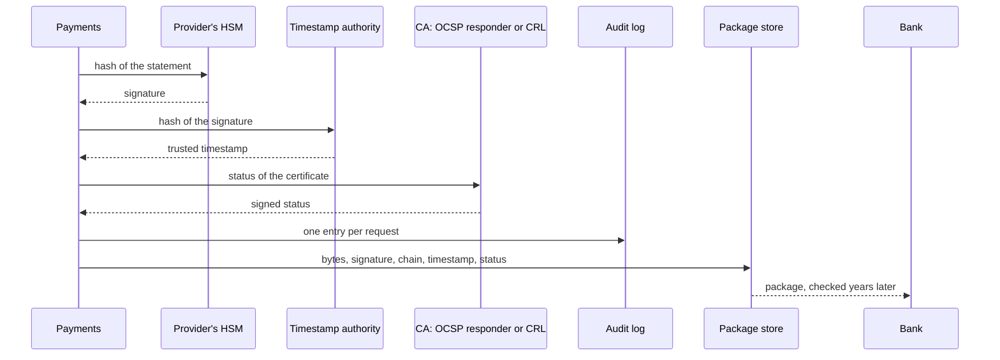

## Before you start

- [[sysdesign.l4.bank-signing-requirements]] — you have KS-1 to KS-5 and the ranked drivers: verifiable for years, a leaked key's damage limited in time, no key outside an HSM.
- [[sysdesign.l4.deep-dive]] — you know a deep dive details the one part where a top driver is hardest to meet, and asks what happens when each dependency fails.
- [[backend.l4.signing-key-custody]] — you know ADR `0015` keeps the invoice key in an HSM that signs on request and never hands the key out.
- [[backend.l4.audit-log]] — you know `audit-log.md` records who did what to which resource, hash-chained in a store the services cannot change unseen.

## The situation

A teammate's first sketch for the bank's statements is short: build the statement, write the server's current time into it, sign it in the provider's HSM, send it.

Picture the auditor in year 9. A statement says it was signed in month 14. Its certificate ended in month 24, and its CA revoked it in month 15 because the key may have leaked. Whoever copied the key could have written month 14 into any statement they signed later. And the CA's own services may no longer be running when the auditor asks.

What must Payments keep with each statement, at signing time, so the bank can still decide years later?

## Core concepts

- **CRL (certificate revocation list)** — a list of revoked certificates that a CA signs and publishes at intervals, so anyone can fetch it and keep a copy.
- **OCSP (Online Certificate Status Protocol)** — a way for a verifier to ask the CA's responder about one certificate and get a signed answer about its status.
- **trusted timestamp** — a statement signed by a timestamp authority that a given hash existed at a given time.
- **timestamp authority (TSA)** — a third party that signs trusted timestamps over hashes sent to it, without seeing the document they come from.
- the package — what ADR `0029` stores for each statement: its exact bytes, the signature, the certificate chain, the trusted timestamp and the revocation status.

## How it works



In the situation above, the server's time fails the second driver. Whoever holds a leaked key can sign on a machine whose clock they set, so they can date a new statement before the revocation. The time must come from a party that never holds the key.

That party is the timestamp authority. Payments sends the TSA only a hash, never the statement itself, so a private statement can be timestamped without handing its content to a third party. The TSA signs the hash with the time it makes the timestamp, from its own clock. The hash is of the signature, so the signature already existed at that time. Whatever a key holder does to their own clock, a signature made after the revocation cannot get a timestamp from before it.

ADR `0029` takes the revocation status from the CA in one of two ways: it asks the OCSP responder first and fetches the CRL when there is none.

Read the diagram top to bottom. Payments sends the statement's hash to the HSM and gets the signature back, then a trusted timestamp over the signature's hash, then the certificate's status. Each request becomes an entry in the audit log. Payments writes the package to its package store, with the statement's exact bytes, because serialising the statement again later may not give the same ones, and the signature covers only these.

Years later, the bank checks the package alone, in four steps that need neither Đơn Hàng nor the CA's services.

## In the Đơn Hàng system

ADR `0029`'s header says stage-4 has no code that signs statements; `InvoiceSigning.cs` and `InvoiceCertificates.cs` stay unchanged samples. Its decision picks the second of its four options; the first, the server's time and Đơn Hàng's own root, is rejected, as are the other two. Written in Vietnamese; the paragraphs after it say the same in English:

```markdown file=docs/adr/0029-ky-bang-ke-ngan-hang-kem-dau-thoi-gian.md tag=stage-4 lines=33-51
### Quyết định

Chọn phương án thứ hai.

- Payments ký mỗi bảng kê trong dịch vụ HSM của nhà cung cấp (ADR 0023), bằng
  một khóa chỉ dùng cho bảng kê của ngân hàng này. Khóa tạo trong HSM; chứng chỉ
  cho khóa đó do CA ngân hàng chỉ định cấp (giả định).
- Payments xin dấu thời gian từ một timestamp authority cho chữ ký: chỉ gửi
  hash, không gửi bảng kê.
- Payments lấy trạng thái thu hồi của chứng chỉ lúc ký: hỏi responder OCSP của
  CA; responder không có thì dùng CRL của CA.
- Lưu một gói: đúng các byte của bảng kê, chữ ký, chuỗi chứng chỉ, dấu thời
  gian, trạng thái thu hồi.
- Mỗi lần xin ký, xin dấu thời gian, lấy trạng thái ghi một entry vào nhật ký
  kiểm toán (`docs/design/audit-log.md`).
- HSM, timestamp authority hay CA lỗi: bảng kê chờ, thử lại trong vài giờ (giả
  định); nhận đơn và hoàn tiền không bị ảnh hưởng.
- Gói được đóng dấu thời gian lại trước khi chứng chỉ của timestamp authority
  hết hạn.
```

The first bullet keeps ADR `0023`'s provider HSM, with a key created there and used only for this bank's statements; its certificate comes from a CA the bank names (assumed). The next two add the timestamp, for which only a hash is sent, and the status: OCSP first, the CA's CRL when there is no responder. The fourth lists the package.

The fifth writes every signing request, timestamp request and status fetch to the audit log of `audit-log.md`. The bank's check never reads these entries; after a leak, they show which statements Payments really asked to sign, from a record kept outside Payments' own tables. The last two say a failure makes statements wait, not orders or refunds, and that packages get a new timestamp before the TSA's own certificate ends. The timestamp is itself signed by the TSA, and the TSA's certificate ends too; the review has the package timestamped again before then, as a recurring job. The next lesson weighs both costs.

The design review's deep dive, the check after ten years (the heading's step 4 is a step of the review, not of the bank's check):

```markdown file=docs/design/bank-signing-design-review.md tag=stage-4 lines=48-61
### Đi sâu: kiểm sau 10 năm (bước 4)

Ngân hàng kiểm một gói chỉ với gói đó, theo thứ tự:

1. Chữ ký đúng với public key trong chứng chỉ, trên đúng các byte của bảng kê.
2. Chuỗi chứng chỉ đi lên tới một root ngân hàng tin.
3. Dấu thời gian đúng, của một timestamp authority ngân hàng tin: lấy thời
   điểm ký từ đó.
4. Trạng thái thu hồi đã lưu cho thấy chứng chỉ còn hiệu lực ở thời điểm đó.

Giờ của server không dùng được: ai giữ khóa lộ cũng ký được với bất kỳ giờ nào
server cho thấy. `InvoiceCertificates.cs` chỉ là sample cho lab: nó tin một root
riêng của Đơn Hàng mà ngân hàng không tin, và đặt
`RevocationMode.NoCheck`, không kiểm thu hồi.
```

The four steps are the bank's check, in order: the signature against the public key in the certificate, over the statement's exact bytes; the chain up to a root the bank trusts; the timestamp, from a TSA the bank trusts, which gives the signing time; and the saved status, showing the certificate valid at that time. Steps 3 and 4 together are how a statement signed before a revocation is told from a later one.

The last paragraph says why the lab sample cannot serve. `InvoiceCertificates.cs` trusts only Đơn Hàng's own root, which the bank does not trust, and its chain check sets `RevocationMode.NoCheck`, so it checks no revocation.

## Trade-offs

| Choice | What it gives | What it costs | Right when |
|---|---|---|---|
| Server's time and Đơn Hàng's own root, as in the lab | no third party to wait on | the bank trusts neither; a leaked key can date a statement before the revocation | the check stays inside Đơn Hàng and no key is ever revoked |
| A trusted timestamp from a TSA (chosen) | a signing time no key holder can set | one more service signing waits on, and a new timestamp before the TSA's certificate ends | a third party checks long after signing |
| Ask the CA about the certificate at check time | a smaller package | the CA's services must still be running years later | checks happen only while the certificate is valid |
| Save the status at signing time (chosen) | the bank checks with no call to the CA | a larger package | checks happen years after the certificate ended |

## What would you choose if…

…the CA the bank names runs no OCSP responder? ADR `0029` already covers it: Payments fetches the CA's CRL at signing time and saves it in the package as the status. The bank's check does not change, but the status it saves can be up to one publication interval old; the next lesson weighs that against OCSP.

…accounting asks whether every old statement must be signed again when the certificate ends? ADR `0029` records the same question and answers no. The timestamp and the saved status show the certificate was valid at signing; only the timestamp must be renewed.

…a second bank asks for statements? The review leaves it open, owned by the team lead: one key per bank is the question, and ADR `0029` names a second bank as a reason to revisit the decision.

## Seniors often assume…

- **"The server's own clock is good enough to prove when a document was signed."** → Actually whoever holds a leaked key can sign on a machine whose clock they set, so a time from the signer's side proves nothing after a leak. ADR `0029` takes the time from a TSA, which never holds the key. You notice this when a revocation arrives and every suspicious statement carries a date before it.
- **"Revocation is checked once, when the bank receives the document, so nothing about it needs storing."** → Actually the bank checks again years later, after the certificate has ended, when the CA's services may no longer be running. ADR `0029` saves the status fetched at signing in the package, so the later check needs no call to the CA. You notice this when an auditor rechecks an old statement and the CA's address no longer answers.
- **"A timestamp authority must read the whole statement, so private documents cannot be timestamped."** → Actually Payments sends the TSA only a hash of the signature, and the trusted timestamp covers that hash; the statement never goes to the TSA. You notice this when you read the diagram above: the arrow to the timestamp authority carries the signature's hash, nothing more.

## Try it (3 minutes)

The statement key's certificate is valid from month 1 to month 24; its CA revokes it in month 15. In year 9 the bank checks four packages:

- P1 — timestamp from month 3; saved status, fetched in month 3, shows the certificate valid
- P2 — the statement says month 14; timestamp from month 17; saved status, fetched in month 17, lists the certificate as revoked
- P3 — timestamp from month 14; saved status, fetched in month 14, shows it valid
- P4 — the statement says month 10; no timestamp; saved status shows it valid

Run each through the review's four steps, assuming steps 1 and 2 pass for all. Say which are accepted, and at which step each refused one fails.

Expected result: two accepted, two refused, each refusal at a different step.

<details><summary>Suggested answer</summary>

P1 and P3 are accepted: step 3 gives months 3 and 14, before the revocation, and step 4's saved status shows the certificate valid then. P3 passes even if the key had already leaked in month 14: the second driver limits a leak's damage in time, and the audit log shows whether Payments really asked to sign it.

P2 fails at step 4. Step 3 takes month 17 from the timestamp and ignores the month 14 written in the statement; the saved status shows the certificate revoked by then. This is a statement signed with the leaked key.

P4 fails at step 3: with no timestamp, the bank has no signing time it can trust, so the month 10 inside the statement counts for nothing. The audit log can still show whether Payments really asked for P4, but the package alone cannot pass.

</details>

## Connections

- [[backend.l4.signing-documents]] — the signature itself; this lesson adds the evidence kept beside it.
- [[sysdesign.l4.high-level-design]] — the step the review's diagram applies to the bank's statements.
- [[k8s.l3.cert-manager]] — certificates renewed for live connections, where nothing signed has to be checked years later; the opposite time scale.
- [[backend.l4.data-ownership]] — Payments stores the packages it signs, as it owns the payment rows.
- [[sysdesign.l4.bank-signing-trade-offs]] — the next step: each piece of evidence adds a service that signing waits on.

## Five-line summary

1. A signature stays checkable for years when it is stored with a trusted timestamp and the certificate's revocation status from signing time.
2. A CRL is a CA's signed list of revoked certificates, published at intervals; with OCSP a verifier asks the CA's responder about one certificate.
3. A timestamp authority signs a hash with its own time, because whoever holds a leaked key can set the signer's clock.
4. ADR `0029` signs in the provider's HSM with a key for this bank, then stores bytes, signature, chain, timestamp and status together.
5. The bank checks the package alone in four steps; every signing, timestamp and status request goes to the audit log.
