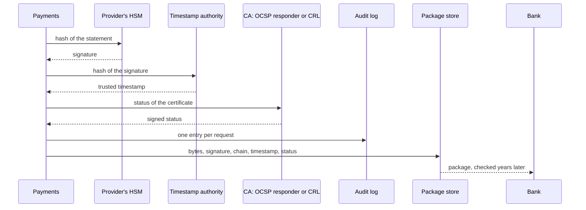

## Bạn cần biết trước

- [[sysdesign.l4.bank-signing-requirements]] — bạn đã có KS-1 tới KS-5 và các yếu tố định hình kiến trúc đã xếp hạng: kiểm được trong nhiều năm, thiệt hại từ một khóa bị lộ được giới hạn theo thời gian, không khóa nào nằm ngoài HSM.
- [[sysdesign.l4.deep-dive]] — bạn biết phần đi sâu thiết kế chi tiết đúng một bộ phận, nơi một yếu tố định hình kiến trúc hàng đầu khó đáp ứng nhất, và hỏi chuyện gì xảy ra khi từng phụ thuộc lỗi.
- [[backend.l4.signing-key-custody]] — bạn biết ADR `0015` giữ khóa ký hóa đơn trong một HSM, HSM ký theo yêu cầu và không bao giờ giao khóa ra ngoài.
- [[backend.l4.audit-log]] — bạn biết `audit-log.md` ghi ai làm gì với tài nguyên nào, nối các entry bằng hash, trong một kho mà các service không sửa được mà không bị phát hiện.

## Tình huống

Bản phác đầu tiên của một đồng nghiệp cho bảng kê của ngân hàng rất ngắn: dựng bảng kê, ghi giờ hiện tại của server vào đó, ký trong HSM của nhà cung cấp, rồi gửi đi.

Hãy hình dung kiểm toán viên ở năm thứ 9. Một bảng kê ghi rằng nó được ký ở tháng 14. Chứng chỉ của nó hết hạn ở tháng 24, và CA đã thu hồi nó ở tháng 15 vì khóa có thể đã lộ. Ai chép được khóa cũng có thể ghi "tháng 14" vào bất kỳ bảng kê nào họ ký về sau. Và lúc kiểm toán viên hỏi, các dịch vụ của chính CA có thể đã ngừng chạy.

Vậy ngay lúc ký, Payments phải giữ gì kèm mỗi bảng kê để nhiều năm sau ngân hàng vẫn quyết định được?

## Khái niệm cốt lõi

- **CRL (certificate revocation list)** (danh sách các chứng chỉ đã bị thu hồi, do CA ký và công bố theo chu kỳ) — CA ký danh sách này và công bố lại theo chu kỳ, nên ai cũng tải về và giữ một bản được.
- **OCSP (Online Certificate Status Protocol)** (cách bên kiểm hỏi responder của CA về trạng thái một chứng chỉ và nhận câu trả lời có chữ ký) — bên kiểm hỏi responder của CA về đúng một chứng chỉ và nhận về một câu trả lời có chữ ký về trạng thái của nó.
- **dấu thời gian tin cậy** (trusted timestamp) — lời xác nhận có chữ ký của một timestamp authority rằng một hash đã tồn tại ở một thời điểm.
- **timestamp authority (TSA)** (bên thứ ba ký dấu thời gian tin cậy cho hash người khác gửi tới, không cần xem tài liệu) — bên thứ ba ký dấu thời gian tin cậy trên các hash được gửi tới, mà không thấy tài liệu sinh ra hash đó.
- gói — thứ ADR `0029` lưu cho mỗi bảng kê: đúng các byte của bảng kê, chữ ký, chuỗi chứng chỉ, dấu thời gian tin cậy và trạng thái thu hồi.

## Cơ chế hoạt động



Trong tình huống trên, giờ của server không đáp ứng được yếu tố định hình kiến trúc thứ hai. Ai giữ khóa bị lộ cũng ký được trên một máy mà họ tự chỉnh đồng hồ, nên họ ghi được cho bảng kê mới một ngày trước lúc thu hồi. Thời gian phải đến từ một bên không bao giờ giữ khóa.

Bên đó là timestamp authority. Payments chỉ gửi cho TSA một hash, không bao giờ gửi bảng kê, nên một bảng kê riêng tư vẫn có dấu thời gian mà không phải giao nội dung cho bên thứ ba. TSA ký hash đó kèm thời điểm nó tạo dấu thời gian, theo đồng hồ của chính TSA. Hash được tính trên chữ ký, nên chữ ký chắc chắn đã có từ thời điểm đó. Người giữ khóa có chỉnh đồng hồ của mình thế nào đi nữa, một chữ ký tạo sau lúc thu hồi cũng không lấy được dấu thời gian trước lúc đó.

ADR `0029` lấy trạng thái thu hồi từ CA theo một trong hai cách: hỏi responder OCSP trước, và tải CRL khi không có responder.

Đọc sơ đồ từ trên xuống. Payments gửi hash của bảng kê tới HSM và nhận lại chữ ký, rồi xin dấu thời gian tin cậy trên hash của chữ ký, rồi lấy trạng thái của chứng chỉ. Mỗi lần xin thành một entry trong nhật ký kiểm toán. Payments ghi gói vào kho gói của mình, kèm đúng các byte của bảng kê. Lý do: serialize lại bảng kê về sau có thể không cho ra đúng các byte đó, mà chữ ký chỉ phủ đúng các byte này.

Nhiều năm sau, ngân hàng kiểm chỉ với gói đó, qua bốn bước, không cần Đơn Hàng lẫn dịch vụ của CA.

## Trong hệ thống Đơn Hàng

Phần đầu ADR `0029` ghi rằng stage-4 chưa có code ký bảng kê. `InvoiceSigning.cs` và `InvoiceCertificates.cs` vẫn là sample, không đổi. Phần quyết định chọn phương án thứ hai trong bốn phương án. Phương án thứ nhất, dùng giờ của server và root riêng của Đơn Hàng, bị loại, hai phương án còn lại cũng vậy. Đoạn trích viết bằng tiếng Việt, các đoạn sau nó giải thích lại:

```markdown file=docs/adr/0029-ky-bang-ke-ngan-hang-kem-dau-thoi-gian.md tag=stage-4 lines=33-51
### Quyết định

Chọn phương án thứ hai.

- Payments ký mỗi bảng kê trong dịch vụ HSM của nhà cung cấp (ADR 0023), bằng
  một khóa chỉ dùng cho bảng kê của ngân hàng này. Khóa tạo trong HSM; chứng chỉ
  cho khóa đó do CA ngân hàng chỉ định cấp (giả định).
- Payments xin dấu thời gian từ một timestamp authority cho chữ ký: chỉ gửi
  hash, không gửi bảng kê.
- Payments lấy trạng thái thu hồi của chứng chỉ lúc ký: hỏi responder OCSP của
  CA; responder không có thì dùng CRL của CA.
- Lưu một gói: đúng các byte của bảng kê, chữ ký, chuỗi chứng chỉ, dấu thời
  gian, trạng thái thu hồi.
- Mỗi lần xin ký, xin dấu thời gian, lấy trạng thái ghi một entry vào nhật ký
  kiểm toán (`docs/design/audit-log.md`).
- HSM, timestamp authority hay CA lỗi: bảng kê chờ, thử lại trong vài giờ (giả
  định); nhận đơn và hoàn tiền không bị ảnh hưởng.
- Gói được đóng dấu thời gian lại trước khi chứng chỉ của timestamp authority
  hết hạn.
```

Gạch đầu dòng thứ nhất giữ HSM của nhà cung cấp theo ADR `0023`, với một khóa tạo ngay trong đó và chỉ dùng cho bảng kê của ngân hàng này. Chứng chỉ của khóa do một CA ngân hàng chỉ định cấp (giả định). Hai gạch tiếp theo thêm dấu thời gian, chỉ gửi đi một hash, và trạng thái: OCSP trước, CRL của CA khi không có responder. Gạch thứ tư liệt kê nội dung gói.

Gạch thứ năm ghi mọi lần xin ký, xin dấu thời gian và lấy trạng thái vào nhật ký kiểm toán của `audit-log.md`. Lần kiểm của ngân hàng không bao giờ đọc các entry này. Nhưng sau khi khóa lộ, chúng cho thấy Payments thật sự đã xin ký những bảng kê nào, từ một bản ghi giữ ngoài các bảng của chính Payments. Hai gạch cuối nói rằng khi có lỗi thì bảng kê phải chờ, còn đơn hàng và hoàn tiền thì không, và gói được đóng dấu thời gian mới trước khi chứng chỉ của TSA hết hạn. Bản thân dấu thời gian cũng do TSA ký, và chứng chỉ của TSA cũng có ngày hết hạn. Vì thế buổi review cho đóng dấu thời gian lại cho gói trước ngày đó, thành một việc chạy định kỳ. Bài sau cân nhắc cả hai cái giá này.

Phần đi sâu của buổi review thiết kế, lần kiểm sau mười năm (bước 4 trong tiêu đề là một bước của buổi review, không phải của lần kiểm của ngân hàng):

```markdown file=docs/design/bank-signing-design-review.md tag=stage-4 lines=48-61
### Đi sâu: kiểm sau 10 năm (bước 4)

Ngân hàng kiểm một gói chỉ với gói đó, theo thứ tự:

1. Chữ ký đúng với public key trong chứng chỉ, trên đúng các byte của bảng kê.
2. Chuỗi chứng chỉ đi lên tới một root ngân hàng tin.
3. Dấu thời gian đúng, của một timestamp authority ngân hàng tin: lấy thời
   điểm ký từ đó.
4. Trạng thái thu hồi đã lưu cho thấy chứng chỉ còn hiệu lực ở thời điểm đó.

Giờ của server không dùng được: ai giữ khóa lộ cũng ký được với bất kỳ giờ nào
server cho thấy. `InvoiceCertificates.cs` chỉ là sample cho lab: nó tin một root
riêng của Đơn Hàng mà ngân hàng không tin, và đặt
`RevocationMode.NoCheck`, không kiểm thu hồi.
```

Bốn bước là lần kiểm của ngân hàng, theo thứ tự: chữ ký khớp với public key trong chứng chỉ, trên đúng các byte của bảng kê. Chuỗi chứng chỉ đi lên tới một root ngân hàng tin. Dấu thời gian đến từ một TSA ngân hàng tin, và cho biết thời điểm ký. Trạng thái đã lưu cho thấy chứng chỉ còn hiệu lực ở thời điểm đó. Bước 3 và bước 4 cùng nhau giúp phân biệt bảng kê ký trước lúc thu hồi với bảng kê ký sau.

Đoạn cuối nói vì sao sample của lab không dùng được. `InvoiceCertificates.cs` chỉ tin root riêng của Đơn Hàng, root mà ngân hàng không tin, và phần kiểm chuỗi của nó đặt `RevocationMode.NoCheck`, nên không kiểm thu hồi nào cả.

## Đánh đổi

| Lựa chọn | Được gì | Cái giá | Đúng khi |
|---|---|---|---|
| Giờ của server và root riêng của Đơn Hàng, như trong lab | không phải chờ bên thứ ba nào | ngân hàng không tin cái nào cả; khóa bị lộ ghi được cho bảng kê một ngày trước lúc thu hồi | lần kiểm chỉ diễn ra trong Đơn Hàng và không khóa nào bị thu hồi |
| Dấu thời gian tin cậy từ một TSA (đã chọn) | một thời điểm ký mà không người giữ khóa nào chỉnh được | thêm một dịch vụ mà việc ký phải chờ, và phải đóng dấu thời gian mới trước khi chứng chỉ của TSA hết hạn | một bên thứ ba kiểm rất lâu sau khi ký |
| Hỏi CA về chứng chỉ lúc kiểm | gói nhỏ hơn | dịch vụ của CA phải vẫn chạy sau nhiều năm | chỉ kiểm trong lúc chứng chỉ còn hiệu lực |
| Lưu trạng thái lúc ký (đã chọn) | ngân hàng kiểm mà không gọi CA | gói lớn hơn | kiểm nhiều năm sau khi chứng chỉ đã hết hạn |

## Bạn sẽ chọn gì nếu…

…CA mà ngân hàng chỉ định không chạy responder OCSP nào? ADR `0029` đã tính tới: Payments tải CRL của CA lúc ký và lưu nó vào gói làm trạng thái. Lần kiểm của ngân hàng không đổi, nhưng trạng thái được lưu có thể cũ tới một chu kỳ công bố. Bài sau cân nhắc điều này so với OCSP.

…kế toán hỏi có phải ký lại mọi bảng kê cũ khi chứng chỉ hết hạn không? ADR `0029` ghi lại đúng câu hỏi đó và trả lời là không. Dấu thời gian và trạng thái đã lưu cho thấy chứng chỉ còn hiệu lực lúc ký. Chỉ dấu thời gian là phải làm mới.

…một ngân hàng thứ hai cũng xin bảng kê? Buổi review để ngỏ chuyện này, giao cho trưởng nhóm: câu hỏi là mỗi ngân hàng một khóa hay không, và ADR `0029` ghi ngân hàng thứ hai là một lý do để xem lại quyết định.

## Senior hay nhầm rằng…

- **"Đồng hồ của chính server là đủ để chứng minh tài liệu được ký lúc nào."** → Thực ra ai giữ khóa bị lộ cũng ký được trên một máy mà họ tự chỉnh đồng hồ, nên thời gian lấy từ phía bên ký không chứng minh được gì sau khi khóa lộ. ADR `0029` lấy thời gian từ một TSA, bên không bao giờ giữ khóa. Bạn sẽ nhận ra khi có một lần thu hồi và mọi bảng kê đáng ngờ đều mang ngày trước lúc đó.
- **"Thu hồi chỉ cần kiểm một lần, lúc ngân hàng nhận tài liệu, nên không phải lưu gì về nó."** → Thực ra ngân hàng kiểm lại nhiều năm sau, khi chứng chỉ đã hết hạn và dịch vụ của CA có thể đã ngừng chạy. ADR `0029` lưu trạng thái lấy được lúc ký vào gói, nên lần kiểm về sau không cần gọi CA. Bạn sẽ nhận ra khi kiểm toán viên kiểm lại một bảng kê cũ và địa chỉ của CA không còn trả lời.
- **"Timestamp authority phải đọc cả bảng kê, nên tài liệu riêng tư không đóng dấu thời gian được."** → Thực ra Payments chỉ gửi cho TSA hash của chữ ký, và dấu thời gian tin cậy phủ đúng hash đó. Bảng kê không bao giờ tới TSA. Bạn sẽ nhận ra khi đọc sơ đồ ở trên: mũi tên tới timestamp authority chỉ mang hash của chữ ký, không gì khác.

## Thử ngay (3 phút)

Chứng chỉ của khóa ký bảng kê có hiệu lực từ tháng 1 tới tháng 24. CA cấp nó thu hồi nó ở tháng 15. Ở năm thứ 9, ngân hàng kiểm bốn gói:

- P1 — dấu thời gian ở tháng 3; trạng thái đã lưu, lấy ở tháng 3, cho thấy chứng chỉ còn hiệu lực
- P2 — bảng kê ghi tháng 14; dấu thời gian ở tháng 17; trạng thái đã lưu, lấy ở tháng 17, ghi chứng chỉ đã bị thu hồi
- P3 — dấu thời gian ở tháng 14; trạng thái đã lưu, lấy ở tháng 14, cho thấy chứng chỉ còn hiệu lực
- P4 — bảng kê ghi tháng 10; không có dấu thời gian; trạng thái đã lưu cho thấy chứng chỉ còn hiệu lực

Cho từng gói đi qua bốn bước của buổi review, giả sử bước 1 và bước 2 đều qua với cả bốn. Nêu gói nào được chấp nhận, và mỗi gói bị từ chối hỏng ở bước nào.

Kết quả mong đợi: hai gói được chấp nhận, hai bị từ chối, mỗi gói bị từ chối hỏng ở một bước khác nhau.

<details><summary>Gợi ý đáp án</summary>

P1 và P3 được chấp nhận: bước 3 cho tháng 3 và tháng 14, trước lúc thu hồi, và trạng thái đã lưu ở bước 4 cho thấy chứng chỉ còn hiệu lực khi đó. P3 vẫn qua dù khóa có thể đã lộ từ tháng 14: yếu tố định hình kiến trúc thứ hai giới hạn thiệt hại của một lần lộ khóa theo thời gian, và nhật ký kiểm toán cho thấy Payments có thật sự xin ký nó hay không.

P2 hỏng ở bước 4. Bước 3 lấy tháng 17 từ dấu thời gian và bỏ qua tháng 14 ghi trong bảng kê. Trạng thái đã lưu cho thấy tới lúc đó chứng chỉ đã bị thu hồi. Đây là một bảng kê ký bằng khóa bị lộ.

P4 hỏng ở bước 3: không có dấu thời gian, ngân hàng không có thời điểm ký nào để tin, nên tháng 10 ghi trong bảng kê không có giá trị gì. Nhật ký kiểm toán vẫn cho thấy được Payments có thật sự xin ký P4 hay không, nhưng chỉ riêng gói thì không qua được.

</details>

## Liên hệ

- [[backend.l4.signing-documents]] — bản thân chữ ký. Bài này thêm các bằng chứng giữ bên cạnh nó.
- [[sysdesign.l4.high-level-design]] — bước mà sơ đồ của buổi review áp dụng cho bảng kê của ngân hàng.
- [[k8s.l3.cert-manager]] — chứng chỉ được gia hạn cho các kết nối đang chạy, nơi không có gì đã ký phải kiểm lại nhiều năm sau. Thang thời gian ngược hẳn.
- [[backend.l4.data-ownership]] — Payments lưu các gói nó ký, như nó sở hữu các dòng thanh toán.
- [[sysdesign.l4.bank-signing-trade-offs]] — bước tiếp theo: mỗi bằng chứng thêm một dịch vụ mà việc ký phải chờ.

## Tóm tắt 5 dòng

1. Một chữ ký vẫn kiểm được trong nhiều năm khi được lưu cùng một dấu thời gian tin cậy và trạng thái thu hồi của chứng chỉ lấy lúc ký.
2. CRL là danh sách các chứng chỉ đã bị thu hồi, do CA ký và công bố theo chu kỳ. Với OCSP, bên kiểm hỏi responder của CA về đúng một chứng chỉ.
3. Timestamp authority ký một hash theo thời gian của chính nó, vì ai giữ khóa bị lộ cũng chỉnh được đồng hồ của bên ký.
4. ADR `0029` ký trong HSM của nhà cung cấp bằng một khóa riêng cho ngân hàng này, rồi lưu chung các byte, chữ ký, chuỗi chứng chỉ, dấu thời gian và trạng thái.
5. Ngân hàng kiểm chỉ với gói, qua bốn bước. Mọi lần xin ký, xin dấu thời gian và lấy trạng thái đều vào nhật ký kiểm toán.
