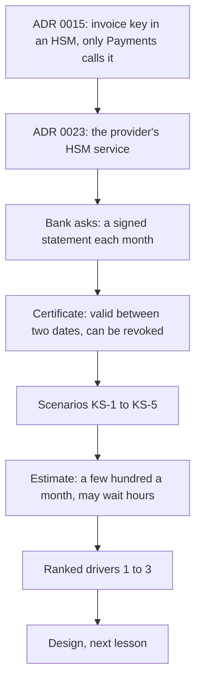

## Before you start

- [[sysdesign.l4.payment-reconciliation-challenges]] — you finished the payments problem; this lesson starts the second problem of the module, signing for a bank, at step 1.
- [[backend.l4.pki-and-signing]] — you know a verifier follows the certificate chain to a root it trusts, and that `InvoiceCertificates` trusts only Đơn Hàng's own root.
- [[management.l4.compliance-controls]] — you know `compliance-controls.md` maps each of the bank's seven requirements, TT-1 to TT-7, to a control, its evidence and its gap.
- [[k8s.l4.keys-stay-in-the-key-service]] — you know ADR `0023` puts the invoice key in the provider's HSM, and leaving the provider means a new key and certificate.

## The situation

The bank that owns a chain of shops on Đơn Hàng, the customer behind `compliance-controls.md`, sends one more request. Each month it wants a statement of its shops' payments and refunds, signed by Payments, and its auditors will check those statements for years. A teammate calls it a small job: ADR `0015` already keeps a signing key in an HSM, so Payments signs and the bank checks the signature.

Then someone points out that the certificate the bank checks against is valid only until a set date, and an auditor may open a statement long after it. What must the bank still be able to check about a statement once its certificate has ended or been withdrawn?

## Core concepts

- **certificate revocation** — a CA declaring a certificate invalid before its end date, for example because its private key may have leaked.
- validity period — the two dates written in a certificate; it is valid only between them, and after the second it has ended.
- the statement — one month's list of payments and refunds for one of the bank's shops, signed by Payments.
- KS-1 to KS-5 — the team's numbered scenarios for this problem (KS for ký số, the team's Vietnamese words for digital signing).
- ranked drivers — the few scenarios, in order, that the design must satisfy first when two of them pull in different directions.

## How it works

Read the diagram top to bottom as the order the requirements file is written in.



In the situation above, the teammate's plan stops at the signature, while the bank's request reaches far past it. ADR `0015` keeps the invoice signing key in an HSM that only Payments may call. ADR `0023` puts that HSM in the provider's key management service. The requirements file does not reopen either decision. Each ADR lists the events that would make the team decide again; ADR `0023`'s first is a contract demanding the key in an HSM on own machines, Đơn Hàng's or the customer's.

The bank checks each statement with public keys and certificates alone, without calling Đơn Hàng.

Two facts about certificates make that hard. A certificate is valid only between two dates. Certificate revocation can end it sooner, when its CA declares it invalid, for example because the private key may have leaked.

So the hardest requirement is time, not load. The bank must verify a statement years later, ten in the team's assumption, after the certificate has ended. It must also tell statements signed before a revocation from those signed after. Both need the bank to know when each statement was signed; how it learns that is the design's question, not this step's. A date Payments writes inside the statement is not enough, because whoever holds a leaked key can sign a statement with any date in it.

The estimate finds at most hundreds a month (assumed), so signing load is trivial and a statement may wait hours. Last, the bank's controls reuse `compliance-controls.md`, and the scenarios are ranked into three drivers.

## In the Đơn Hàng system

The start of the team's requirements, at this tag:

```markdown file=docs/team/bank-signing-requirements.md tag=stage-4 lines=8-20
### Xuất phát

Các quyết định đã có, tài liệu này không mở lại: khóa ký hóa đơn nằm trong HSM,
chỉ Payments được gọi (ADR 0015); HSM đó là dịch vụ HSM của nhà cung cấp (ADR
0023); production chạy trên Kubernetes managed (ADR 0022).

Ngân hàng sở hữu một chuỗi cửa hàng trên Đơn Hàng, khách hàng của
`compliance-controls.md`. Ngân hàng muốn nhận mỗi tháng một bảng kê các khoản
thanh toán và hoàn tiền của các cửa hàng thuộc họ, do Payments ký.

Một chứng chỉ chỉ có hiệu lực giữa hai ngày. Thu hồi chứng chỉ là việc CA cấp
nó tuyên bố chứng chỉ hết hiệu lực trước ngày cuối, ví dụ vì khóa riêng có thể
đã lộ.
```

The first paragraph lists the three decisions the file does not reopen, production on managed Kubernetes (ADR `0022`) among them. The second names the customer and its request. The third states the two certificate facts in the team's words.

The scenarios and the estimate, from the same file:

```markdown file=docs/team/bank-signing-requirements.md tag=stage-4 lines=22-44
### Kịch bản

| Số | Tình huống | Phản hồi | Đo |
|---|---|---|---|
| KS-1 | Ngân hàng nhận một bảng kê | Ngân hàng tự kiểm chữ ký, chỉ bằng public key và chứng chỉ, không gọi Đơn Hàng | Mọi bảng kê kiểm được |
| KS-2 | Ngân hàng kiểm lại một bảng kê sau nhiều năm, chứng chỉ đã hết hạn | Vẫn kiểm được, và biết bảng kê được ký lúc nào | Kiểm được trong 10 năm (giả định) |
| KS-3 | Chứng chỉ bị thu hồi vì khóa có thể đã lộ | Bảng kê ký trước lúc thu hồi vẫn hợp lệ; bảng kê ký sau thì không | Phân biệt được mọi bảng kê |
| KS-4 | Ai đó muốn lấy khóa ra khỏi HSM | Không làm được | Khóa không bao giờ rời HSM |
| KS-5 | Payments xin ký một bảng kê | Lần xin ký được ghi lại, ngoài bảng của Payments | Mọi lần ký có một entry |

Kiểm soát của ngân hàng dùng lại bảng của `compliance-controls.md`, không chép
lại: KS-4 là TT-3; KS-5 là TT-2; tách nhiệm vụ giữa người duyệt thay đổi và
người làm là TT-1; rà soát ai có quyền ký và quyền quản trị khóa là TT-7.

### Ước lượng

- Bảng kê mỗi tháng: nhiều nhất vài trăm (giả định, một bảng kê cho mỗi cửa
  hàng của ngân hàng).
- Tải ký không đáng kể. Một bảng kê được chờ ký vài giờ (giả định) mà không
  phá driver nào, miễn trước hạn của ngân hàng: ngày làm việc thứ năm của
  tháng sau (giả định).
- Thứ khó nhất là thời gian, không phải tải: kiểm được sau 10 năm, sau khi
  chứng chỉ đã hết hạn hoặc bị thu hồi.
```

KS-1 is the everyday check, with no call to Đơn Hàng. KS-2 is the same check after the certificate has ended, and asks when the statement was signed. KS-3 splits statements at a revocation. KS-4 keeps the key in the HSM; KS-5 records every signing request outside Payments' own tables.

The paragraph under the table reuses `compliance-controls.md`: KS-4 is TT-3, KS-5 is TT-2, separation of duties between approver and maker is TT-1, and a review of who may sign and administer keys is TT-7.

The estimate allows a few hundred statements a month at most (assumed, one per shop), each free to wait a few hours without breaking any driver, if ready by the bank's deadline, the fifth working day of the next month (assumed).

Below the excerpt, an assumptions table names who is to confirm each one; none is confirmed yet. The bank trusts only roots it names, so the certificate comes from a CA the bank names, not the Đơn Hàng root `InvoiceCertificates` uses; the product owner, the team member who speaks for what the product must do, asks the bank. Ten years is to be confirmed by the product owner with accounting. The product owner is to confirm that the contract does not demand an HSM on own machines, and asks the bank about the deadline.

The file ends with the ranked drivers, in order: verifiable for many years, even after the certificate has ended (KS-1, KS-2); a leaked key's damage limited in time (KS-3); no key outside an HSM (KS-4).

## Trade-offs

| How the team frames the request | What it gets | What it costs | Right when |
|---|---|---|---|
| Sign each statement as an invoice would be signed, and stop there | nothing new beyond ADR `0015` | the signature alone does not show when it was made, so KS-2 and KS-3 cannot be met | the reader checks only while the certificate is valid and never revoked |
| Let the bank ask Đơn Hàng whether a statement is genuine | an answer that is always current | breaks KS-1, and Đơn Hàng must answer for ten years | the reader is inside Đơn Hàng and trusts it |
| Time as the first driver, load a minor concern (chosen) | the design is judged on years-later checks and revocation | the design must give the bank proof of when each statement was signed | a third party checks documents long after signing |

Ranking time first has a cost too: because a statement may wait hours, the design is free to add signing steps that are slow or wait on another party. The price is that a whole month of statements depends on those steps working before the bank's deadline (assumed), a risk the later steps must name.

## What would you choose if…

…accounting says statements must stay checkable for twenty years, not ten? The product owner and accounting confirm the ten years. Change the measure of KS-2 before the design; the driver stays the same, only its horizon grows.

…the contract turns out to demand the key in an HSM on the bank's own machines? That is the third assumption failing, and it meets the first reopen condition of ADR `0023`. A new ADR replaces `0023` for that one key, and the other keys stay as they are. The requirements file updates the failed assumption, and the team checks ADR `0022`, whose reopen condition covers own machines. The scenarios and drivers do not change.

…a month's statements are ready on the fourth working day but signing is unavailable for a day? The estimate allows hours, not days. Record it as a risk against the bank's deadline (assumed) and give it an owner by role, rather than raising the load figures.

## Seniors often assume…

- **"Once a certificate has expired, nothing signed with it can be trusted any more."** → Actually the end date limits when the key may make signatures under that certificate, not whether older signatures still count. A signature made inside the period can still be accepted later, if the verifier can show when it was made; KS-2 asks exactly that. ADR `0015` already expects signed invoices to stay checkable with the old certificate after a new key replaces it. You notice this when a statement from years ago is checked against today's date and the certificate shows as ended, though the signature itself still matches.
- **"A bank as a customer means ADRs 0015 and 0023 must be decided again from the start."** → Actually the requirements file lists both as decisions it does not reopen. KS-4 is TT-3, which those ADRs already decide, although no HSM exists yet at stage-4. Of the bank's assumptions, only a contract demanding an HSM on own machines meets a reopen condition of ADR `0023`, and then a new ADR replaces it for that key alone. You notice this when a design review argues about HSM hardware before any scenario is written.
- **"A signature that checks today will check the same way in ten years, so nothing else needs keeping."** → Actually the check needs more than the signature: the certificate, a chain to a root the bank trusts, and proof that the certificate was neither ended nor revoked when the statement was signed. The signature alone says nothing about when it was made. You notice this when a revocation arrives and nobody can say which statements were signed before it.

## Try it (3 minutes)

A certificate for the statement key is valid from month 1 to month 24. In month 15 its CA revokes it, because the key may have leaked. Four statements carry a signature from the statement key: S1 in month 3, S2 in month 14, S3 in month 16, S4 in month 26. In year 9 the bank checks all four.

For each statement, decide whether KS-2 and KS-3 say it should be accepted, and name the one fact about it the bank needs to decide.

Expected result: two accepted, two refused, and the same missing fact for all four.

<details><summary>Suggested answer</summary>

S1 and S2 are accepted: both were signed while the certificate was valid and before the revocation, so KS-3 keeps them valid, and KS-2 keeps them checkable after month 24. S3 is refused: it was signed after the revocation. S4 is refused: it was signed after the certificate had ended, so no valid certificate covered that signature. Every verdict depends on when the statement was signed, which the signature alone does not show. Whether S2 was really asked for by Payments, and not by someone holding a leaked key, is what KS-5's entry for each signing request is for.

</details>

## Connections

- [[sysdesign.l4.clarifying-requirements]] — the general step this lesson applies to the bank's request.
- [[backend.l4.signing-key-custody]] — where ADR `0015` chose an HSM only Payments may call; this problem starts from that decision.
- [[backend.l4.audit-log]] — the design KS-5 relies on: each signing request becomes an entry kept outside Payments' own tables.
- [[k8s.l4.choosing-managed-kubernetes]] — where ADR `0022` was chosen; a contract demanding a customer's own machines is one of its reopen conditions, which the team checks if the third assumption fails.
- [[sysdesign.l4.bank-signing-design]] — the next step: a design judged against these ranked drivers.

## Five-line summary

1. The hardest requirement for signing a bank's statements is time: the bank must verify them years later, after the certificate has ended or been revoked.
2. The problem starts from ADR `0015` (invoice key in an HSM only Payments calls) and ADR `0023` (the provider's HSM service), not reopened.
3. A certificate is valid only between two dates; certificate revocation is its CA declaring it invalid sooner, for example after a possible key leak.
4. KS-1 to KS-5 ask for checks with public keys and certificates alone, ten years (assumed), revocation splitting statements, keys in HSMs, logged signing.
5. A few hundred statements a month (assumed) may wait hours; drivers rank years-later checks, limited damage from a leak, no key outside an HSM.
