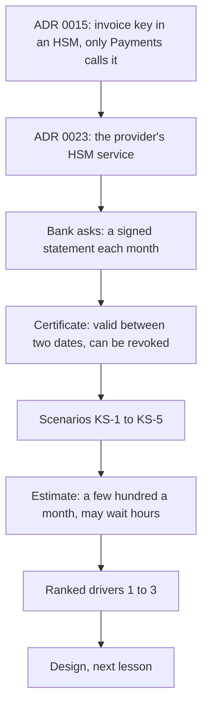

## Bạn cần biết trước

- [[sysdesign.l4.payment-reconciliation-challenges]] — bạn đã xong bài toán thanh toán. Bài này mở bài toán thứ hai của module, ký cho ngân hàng, từ bước 1.
- [[backend.l4.pki-and-signing]] — bạn biết bên kiểm chữ ký lần theo chuỗi chứng chỉ tới một root mà nó tin, và `InvoiceCertificates` chỉ tin root của chính Đơn Hàng.
- [[management.l4.compliance-controls]] — bạn biết `compliance-controls.md` gắn mỗi yêu cầu trong bảy yêu cầu của ngân hàng, TT-1 tới TT-7, với một biện pháp kiểm soát, bằng chứng của nó và chỗ còn thiếu.
- [[k8s.l4.keys-stay-in-the-key-service]] — bạn biết ADR `0023` đặt khóa ký hóa đơn trong HSM của nhà cung cấp, và rời nhà cung cấp nghĩa là phải có khóa và chứng chỉ mới.

## Tình huống

Ngân hàng sở hữu một chuỗi cửa hàng trên Đơn Hàng, chính là khách hàng đứng sau `compliance-controls.md`, gửi thêm một yêu cầu. Mỗi tháng, họ muốn một bảng kê các khoản thanh toán và hoàn tiền của các cửa hàng thuộc họ, do Payments ký, và kiểm toán viên của họ sẽ kiểm các bảng kê đó trong nhiều năm. Một đồng nghiệp bảo đây là việc nhỏ: ADR `0015` đã giữ một khóa ký trong HSM, vậy Payments ký, còn ngân hàng kiểm chữ ký.

Rồi có người chỉ ra rằng chứng chỉ mà ngân hàng dùng để kiểm chỉ có hiệu lực tới một ngày định sẵn, trong khi kiểm toán viên có thể mở một bảng kê rất lâu sau đó. Khi chứng chỉ đã hết hạn hoặc bị thu hồi, ngân hàng vẫn phải kiểm được những gì về một bảng kê?

## Khái niệm cốt lõi

- **thu hồi chứng chỉ** (certificate revocation) — CA tuyên bố một chứng chỉ hết hiệu lực trước ngày hết hạn, ví dụ vì private key của nó có thể đã lộ.
- thời hạn hiệu lực — hai ngày ghi trong chứng chỉ. Chứng chỉ chỉ có hiệu lực giữa hai ngày đó, và qua ngày thứ hai là hết hạn.
- bảng kê — danh sách các khoản thanh toán và hoàn tiền trong một tháng của một cửa hàng thuộc ngân hàng, do Payments ký.
- KS-1 tới KS-5 — các kịch bản được đánh số của đội cho bài toán này (KS là viết tắt của "ký số", từ đội dùng cho việc này).
- các yếu tố định hình kiến trúc đã xếp hạng — vài kịch bản, theo thứ tự, mà thiết kế phải ưu tiên đáp ứng khi hai kịch bản kéo về hai hướng khác nhau.

## Cơ chế hoạt động

Đọc sơ đồ từ trên xuống, theo đúng thứ tự tài liệu yêu cầu được viết.



Trong tình huống trên, kế hoạch của đồng nghiệp dừng ở chữ ký, còn yêu cầu của ngân hàng đi xa hơn nhiều. ADR `0015` giữ khóa ký hóa đơn trong một HSM chỉ Payments được gọi. ADR `0023` đặt HSM đó trong dịch vụ quản lý khóa của nhà cung cấp. Tài liệu yêu cầu không mở lại quyết định nào trong hai quyết định này. Mỗi ADR liệt kê các sự kiện sẽ buộc đội quyết lại. Sự kiện đầu tiên của ADR `0023` là một hợp đồng đòi khóa nằm trong HSM trên máy của chính mình, của Đơn Hàng hoặc của khách hàng.

Ngân hàng kiểm từng bảng kê chỉ bằng public key và chứng chỉ, không gọi Đơn Hàng.

Hai sự thật về chứng chỉ làm chuyện đó khó. Một chứng chỉ chỉ có hiệu lực giữa hai ngày. Thu hồi chứng chỉ có thể chấm dứt hiệu lực sớm hơn, khi CA cấp chứng chỉ tuyên bố nó không còn hiệu lực, ví dụ vì private key có thể đã lộ.

Vậy yêu cầu khó nhất là thời gian, không phải tải. Ngân hàng phải kiểm được một bảng kê nhiều năm sau, mười năm theo giả định của đội, khi chứng chỉ đã hết hạn. Ngân hàng cũng phải phân biệt được bảng kê ký trước lúc thu hồi với bảng kê ký sau. Cả hai đều cần ngân hàng biết từng bảng kê được ký lúc nào. Ngân hàng biết điều đó bằng cách nào là câu hỏi của thiết kế, không phải của bước này. Một ngày do Payments ghi bên trong bảng kê thì không đủ, vì ai giữ được khóa bị lộ cũng ký được một bảng kê với bất kỳ ngày nào ghi trong đó.

Bản ước lượng cho thấy nhiều nhất vài trăm bảng kê mỗi tháng (giả định), nên tải ký không đáng kể và một bảng kê có thể chờ vài giờ. Cuối cùng, các biện pháp kiểm soát của ngân hàng dùng lại `compliance-controls.md`, và các kịch bản được xếp hạng thành ba yếu tố định hình kiến trúc.

## Trong hệ thống Đơn Hàng

Phần đầu tài liệu yêu cầu của đội, ở tag này:

```markdown file=docs/team/bank-signing-requirements.md tag=stage-4 lines=8-20
### Xuất phát

Các quyết định đã có, tài liệu này không mở lại: khóa ký hóa đơn nằm trong HSM,
chỉ Payments được gọi (ADR 0015); HSM đó là dịch vụ HSM của nhà cung cấp (ADR
0023); production chạy trên Kubernetes managed (ADR 0022).

Ngân hàng sở hữu một chuỗi cửa hàng trên Đơn Hàng, khách hàng của
`compliance-controls.md`. Ngân hàng muốn nhận mỗi tháng một bảng kê các khoản
thanh toán và hoàn tiền của các cửa hàng thuộc họ, do Payments ký.

Một chứng chỉ chỉ có hiệu lực giữa hai ngày. Thu hồi chứng chỉ là việc CA cấp
nó tuyên bố chứng chỉ hết hiệu lực trước ngày cuối, ví dụ vì khóa riêng có thể
đã lộ.
```

Đoạn đầu liệt kê ba quyết định mà tài liệu không mở lại, trong đó có production chạy trên Kubernetes managed (ADR `0022`). Đoạn thứ hai nêu tên khách hàng và yêu cầu của họ. Đoạn thứ ba nêu hai sự thật về chứng chỉ bằng lời của đội.

Các kịch bản và bản ước lượng, cũng từ file đó:

```markdown file=docs/team/bank-signing-requirements.md tag=stage-4 lines=22-44
### Kịch bản

| Số | Tình huống | Phản hồi | Đo |
|---|---|---|---|
| KS-1 | Ngân hàng nhận một bảng kê | Ngân hàng tự kiểm chữ ký, chỉ bằng public key và chứng chỉ, không gọi Đơn Hàng | Mọi bảng kê kiểm được |
| KS-2 | Ngân hàng kiểm lại một bảng kê sau nhiều năm, chứng chỉ đã hết hạn | Vẫn kiểm được, và biết bảng kê được ký lúc nào | Kiểm được trong 10 năm (giả định) |
| KS-3 | Chứng chỉ bị thu hồi vì khóa có thể đã lộ | Bảng kê ký trước lúc thu hồi vẫn hợp lệ; bảng kê ký sau thì không | Phân biệt được mọi bảng kê |
| KS-4 | Ai đó muốn lấy khóa ra khỏi HSM | Không làm được | Khóa không bao giờ rời HSM |
| KS-5 | Payments xin ký một bảng kê | Lần xin ký được ghi lại, ngoài bảng của Payments | Mọi lần ký có một entry |

Kiểm soát của ngân hàng dùng lại bảng của `compliance-controls.md`, không chép
lại: KS-4 là TT-3; KS-5 là TT-2; tách nhiệm vụ giữa người duyệt thay đổi và
người làm là TT-1; rà soát ai có quyền ký và quyền quản trị khóa là TT-7.

### Ước lượng

- Bảng kê mỗi tháng: nhiều nhất vài trăm (giả định, một bảng kê cho mỗi cửa
  hàng của ngân hàng).
- Tải ký không đáng kể. Một bảng kê được chờ ký vài giờ (giả định) mà không
  phá driver nào, miễn trước hạn của ngân hàng: ngày làm việc thứ năm của
  tháng sau (giả định).
- Thứ khó nhất là thời gian, không phải tải: kiểm được sau 10 năm, sau khi
  chứng chỉ đã hết hạn hoặc bị thu hồi.
```

KS-1 là lần kiểm hằng ngày, không gọi Đơn Hàng. KS-2 là cùng lần kiểm đó khi chứng chỉ đã hết hạn, và hỏi bảng kê được ký lúc nào. KS-3 chia các bảng kê tại thời điểm thu hồi. KS-4 giữ khóa trong HSM. KS-5 ghi lại mọi lần xin ký, ở ngoài các bảng của chính Payments.

Đoạn bên dưới bảng dùng lại `compliance-controls.md`: KS-4 là TT-3, KS-5 là TT-2, tách biệt nhiệm vụ giữa người duyệt và người làm là TT-1, và rà soát ai được ký và quản trị khóa là TT-7.

Bản ước lượng cho phép nhiều nhất vài trăm bảng kê mỗi tháng (giả định, mỗi cửa hàng một bảng kê). Mỗi bảng kê được chờ vài giờ mà không phá yếu tố định hình kiến trúc nào, miễn là xong trước hạn của ngân hàng: ngày làm việc thứ năm của tháng sau (giả định).

Bên dưới đoạn trích, một bảng giả định ghi ai sẽ xác nhận từng giả định. Chưa giả định nào được xác nhận. Ngân hàng chỉ tin những root do chính họ chỉ định, nên chứng chỉ phải đến từ một CA ngân hàng chỉ định, không phải root của Đơn Hàng mà `InvoiceCertificates` dùng. Product owner, người trong đội nói thay cho những gì sản phẩm phải làm, sẽ hỏi ngân hàng chuyện này. Mười năm thì product owner xác nhận với kế toán. Product owner cũng xác nhận hợp đồng không đòi HSM trên máy của chính mình, và hỏi ngân hàng về hạn chót.

File kết thúc bằng các yếu tố định hình kiến trúc đã xếp hạng, theo thứ tự: kiểm được trong nhiều năm, kể cả khi chứng chỉ đã hết hạn (KS-1, KS-2), rồi thiệt hại từ một khóa bị lộ được giới hạn theo thời gian (KS-3), rồi không khóa nào nằm ngoài HSM (KS-4).

## Đánh đổi

| Cách đội đặt vấn đề | Được gì | Cái giá | Đúng khi |
|---|---|---|---|
| Ký từng bảng kê như ký một hóa đơn, rồi dừng ở đó | không có gì mới ngoài ADR `0015` | riêng chữ ký không cho biết nó được tạo lúc nào, nên không đáp ứng được KS-2 và KS-3 | bên đọc chỉ kiểm trong lúc chứng chỉ còn hiệu lực và chưa bao giờ bị thu hồi |
| Để ngân hàng hỏi Đơn Hàng xem một bảng kê có thật không | một câu trả lời luôn cập nhật | phá KS-1, và Đơn Hàng phải trả lời suốt mười năm | bên đọc ở trong Đơn Hàng và tin Đơn Hàng |
| Thời gian là yếu tố định hình kiến trúc thứ nhất, tải chỉ là chuyện nhỏ (đã chọn) | thiết kế được đánh giá theo lần kiểm nhiều năm sau và theo thu hồi | thiết kế phải cho ngân hàng bằng chứng bảng kê được ký lúc nào | một bên thứ ba kiểm tài liệu rất lâu sau khi ký |

Xếp thời gian lên đầu cũng có cái giá. Vì một bảng kê được phép chờ vài giờ, thiết kế có thể thêm các bước ký chậm hoặc phải chờ một bên khác. Đổi lại, cả tháng bảng kê phụ thuộc vào các bước đó chạy được trước hạn của ngân hàng (giả định), một rủi ro mà các bước sau phải nêu ra.

## Bạn sẽ chọn gì nếu…

…kế toán nói bảng kê phải kiểm được trong hai mươi năm, không phải mười? Product owner và kế toán là người xác nhận con số mười năm. Sửa cách đo của KS-2 trước khi thiết kế. Yếu tố định hình kiến trúc giữ nguyên, chỉ khoảng thời gian dài ra.

…hợp đồng hóa ra đòi khóa nằm trong một HSM trên máy của chính ngân hàng? Đó là giả định thứ ba bị sai, và nó khớp điều kiện mở lại đầu tiên của ADR `0023`. Một ADR mới thay `0023` cho riêng khóa đó, các khóa khác giữ nguyên. Tài liệu yêu cầu cập nhật giả định bị sai, và đội kiểm lại ADR `0022`, vì điều kiện mở lại của nó có nhắc tới máy của chính mình. Các kịch bản và yếu tố định hình kiến trúc không đổi.

…bảng kê của một tháng xong vào ngày làm việc thứ tư, nhưng phần ký ngừng hoạt động một ngày? Bản ước lượng cho phép chờ vài giờ, không phải vài ngày. Ghi nó thành một rủi ro đối với hạn của ngân hàng (giả định) và giao cho một người phụ trách theo vai trò, thay vì nâng các con số tải.

## Senior hay nhầm rằng…

- **"Chứng chỉ đã hết hạn thì không còn tin được thứ gì ký bằng nó nữa."** → Thực ra ngày hết hạn giới hạn lúc khóa được phép tạo chữ ký dưới chứng chỉ đó, chứ không quyết định chữ ký cũ còn giá trị hay không. Một chữ ký tạo trong thời hạn hiệu lực vẫn có thể được chấp nhận về sau, nếu bên kiểm chứng minh được nó được tạo lúc nào. KS-2 đòi đúng điều đó. ADR `0015` cũng đã tính tới chuyện hóa đơn đã ký vẫn kiểm được bằng chứng chỉ cũ sau khi một khóa mới thay khóa cũ. Bạn sẽ nhận ra khi một bảng kê từ nhiều năm trước được kiểm theo ngày hôm nay và chứng chỉ hiện là đã hết hạn, dù bản thân chữ ký vẫn khớp.
- **"Có ngân hàng làm khách hàng nghĩa là phải quyết lại ADR 0015 và 0023 từ đầu."** → Thực ra tài liệu yêu cầu ghi cả hai là quyết định nó không mở lại. KS-4 là TT-3, điều mà hai ADR đó đã quyết, dù ở stage-4 chưa có HSM nào. Trong các giả định về ngân hàng, chỉ một hợp đồng đòi HSM trên máy của chính mình mới khớp điều kiện mở lại của ADR `0023`, và khi đó một ADR mới thay nó cho riêng khóa đó. Bạn sẽ nhận ra khi một buổi review thiết kế tranh cãi về phần cứng HSM trước khi có kịch bản nào được viết.
- **"Chữ ký kiểm được hôm nay thì mười năm sau cũng kiểm được y như vậy, nên không cần giữ gì thêm."** → Thực ra lần kiểm cần nhiều hơn chữ ký: chứng chỉ, một chuỗi tới root ngân hàng tin, và bằng chứng rằng lúc ký bảng kê, chứng chỉ chưa hết hạn và chưa bị thu hồi. Riêng chữ ký không nói gì về lúc nó được tạo. Bạn sẽ nhận ra khi có một lần thu hồi và không ai nói được bảng kê nào đã ký trước đó.

## Thử ngay (3 phút)

Một chứng chỉ cho khóa ký bảng kê có hiệu lực từ tháng 1 tới tháng 24. Ở tháng 15, CA cấp chứng chỉ thu hồi nó, vì khóa có thể đã lộ. Bốn bảng kê mang chữ ký của khóa ký bảng kê: S1 ở tháng 3, S2 ở tháng 14, S3 ở tháng 16, S4 ở tháng 26. Ở năm thứ 9, ngân hàng kiểm cả bốn.

Với từng bảng kê, quyết định xem theo KS-2 và KS-3 nó có được chấp nhận không, và nêu tên một sự thật về nó mà ngân hàng cần để quyết định.

Kết quả mong đợi: hai bảng kê được chấp nhận, hai bị từ chối, và cả bốn thiếu cùng một sự thật.

<details><summary>Gợi ý đáp án</summary>

S1 và S2 được chấp nhận: cả hai được ký khi chứng chỉ còn hiệu lực và trước lúc thu hồi, nên KS-3 giữ chúng hợp lệ, và KS-2 giữ chúng kiểm được sau tháng 24. S3 bị từ chối: nó được ký sau lúc thu hồi. S4 bị từ chối: nó được ký khi chứng chỉ đã hết hạn, nên không có chứng chỉ còn hiệu lực nào cho chữ ký đó. Mọi kết luận đều phụ thuộc vào lúc bảng kê được ký, điều mà riêng chữ ký không cho thấy. Còn S2 có thật là do Payments xin ký, chứ không phải do ai đó giữ khóa bị lộ, thì đó là việc của entry mà KS-5 ghi cho mỗi lần xin ký.

</details>

## Liên hệ

- [[sysdesign.l4.clarifying-requirements]] — bước tổng quát mà bài này áp dụng cho yêu cầu của ngân hàng.
- [[backend.l4.signing-key-custody]] — nơi ADR `0015` chọn một HSM chỉ Payments được gọi. Bài toán này bắt đầu từ quyết định đó.
- [[backend.l4.audit-log]] — thiết kế mà KS-5 dựa vào: mỗi lần xin ký thành một entry, giữ ở ngoài các bảng của chính Payments.
- [[k8s.l4.choosing-managed-kubernetes]] — nơi ADR `0022` được chọn. Một hợp đồng đòi chạy trên máy của chính khách hàng là một trong các điều kiện mở lại của nó, điều đội kiểm nếu giả định thứ ba bị sai.
- [[sysdesign.l4.bank-signing-design]] — bước tiếp theo: một thiết kế được đánh giá theo các yếu tố định hình kiến trúc đã xếp hạng này.

## Tóm tắt 5 dòng

1. Yêu cầu khó nhất khi ký bảng kê cho ngân hàng là thời gian: ngân hàng phải kiểm được chúng nhiều năm sau, khi chứng chỉ đã hết hạn hoặc bị thu hồi.
2. Bài toán bắt đầu từ ADR `0015` (khóa ký hóa đơn trong HSM chỉ Payments được gọi) và ADR `0023` (dịch vụ HSM của nhà cung cấp), không mở lại.
3. Chứng chỉ chỉ có hiệu lực giữa hai ngày. Thu hồi chứng chỉ là CA cấp chứng chỉ tuyên bố nó hết hiệu lực sớm hơn, ví dụ sau khi khóa có thể đã lộ.
4. KS-1 tới KS-5 đòi kiểm chỉ bằng public key và chứng chỉ, trong mười năm (giả định), thu hồi chia tách các bảng kê, khóa nằm trong HSM, mọi lần ký đều được ghi lại.
5. Vài trăm bảng kê mỗi tháng (giả định) có thể chờ vài giờ. Các yếu tố định hình kiến trúc xếp theo thứ tự: kiểm được nhiều năm sau, thiệt hại từ khóa bị lộ được giới hạn, không khóa nào ngoài HSM.
