## Before you start

- [[sysdesign.l4.bank-signing-design]] — you know ADR `0029` signs each statement in the provider's HSM, gets a trusted timestamp and the revocation status, and stores them with the statement's exact bytes, for three ranked drivers: (1) checkable for years (10, assumed), even after the certificate ends; (2) a leaked key's damage limited in time; (3) no key outside an HSM.
- [[design.l4.trade-off-points]] — you know a trade-off point is a decision that moves two quality attributes in opposite directions.
- [[sysdesign.l4.finding-bottlenecks]] — you know step 5 lists single points of failure and says whether each key operation stops, waits or runs reduced.
- [[k8s.l4.choosing-managed-kubernetes]] — you know ADR `0022` chose managed Kubernetes and reopens on a contract that needs own machines.

## The situation

The design review for ADR `0029` reaches its high-level diagram. The team lead counts the arrows leaving Payments for services Đơn Hàng does not run: one to the provider's HSM, one to the timestamp authority, one to the CA. Signing now waits on all three.

The product owner asks whether an outage of the timestamp authority on signing day would stop checkout. A developer asks why the design does not simply ask the OCSP responder at every check, and why the bank gets a key of its own. Someone else says a bank is a demanding customer, so Đơn Hàng should buy its own HSM.

What does each piece of evidence buy, and what does it cost?

## Core concepts

- the three signing dependencies — the provider's HSM, the timestamp authority and the CA's status service (its OCSP responder or its CRL).
- the waiting window — a statement may wait a few hours to be signed (assumed), as long as it reaches the bank by the fifth working day of the next month (assumed).
- the saved status — the revocation status fetched at signing time and stored in the package.
- the new timestamp — a fresh trusted timestamp added to a stored package before the TSA's own certificate ends.
- the bank key — a key in ADR `0023`'s provider HSM that signs only this bank's statements; the invoice key, which signs shops' invoices, sits in the same HSM.
- an own HSM — rejected by ADR `0023`: it needs devices in two places, so one site failing does not stop signing, and people to run, upgrade and back them up.

## How it works

```mermaid
flowchart TD
  A["Payments builds the month's statement"] --> B["Provider's HSM signs with the bank key"]
  B --> C["TSA timestamps the signature"]
  C --> D["CA: OCSP answer, or the CRL"]
  D --> E["Package stored: bytes, signature, chain, timestamp, status"]
  B -.->|"down"| F["Statement waits, retried for a few hours (assumed)"]
  C -.->|"down"| F
  D -.->|"down"| F
```



Each of the three services after the statement is built is a single point of failure for signing: while one is down, no package is finished. The dotted arrows show what ADR `0029` does then: the statement waits and is retried. No arrow leads to orders or refunds, because ADR `0029` says they are not affected. Within the waiting window, a failure costs time, not orders.

Node D holds a trade-off point, which the review records: OCSP gives a fresh answer about one certificate but needs the responder up each time someone asks; a CRL can be fetched ahead and kept, but may be as old as one publishing interval. ADR `0029` asks the responder first, at signing time, and uses the CRL when there is no responder. It does not say whether a responder that is down counts as none; "down" on D means no status can be had.

Node E holds the next one. Saving the status makes each package larger than a bare signature. In return, the bank's check years later needs none of the CA's services to be still running.

The timestamp in E is signed by the TSA, and the TSA's own certificate also ends. ADR `0029` records the rule, not the mechanism behind it: before that certificate ends, the stored package gets a new timestamp, and the signature itself is not redone. That is a recurring job, which the review records as a cost.

The key in B is the last point. It signs only this bank's statements, so revoking it touches no invoice of other shops. The price is one more key and one more certificate to renew.

## In the Đơn Hàng system

Stage-4 has no code that signs statements; ADR `0029`'s header says so. The design review's step 5 and its rejected options and trade-off points, written in Vietnamese:

```markdown file=docs/design/bank-signing-design-review.md tag=stage-4 lines=63-84
### Nút cổ chai và điểm hỏng đơn lẻ (bước 5)

- Không nút cổ chai về tải.
- HSM, timestamp authority và dịch vụ trạng thái của CA, mỗi cái là điểm hỏng
  đơn lẻ cho việc ký, không cho việc nhận đơn hay hoàn tiền: bảng kê chờ vài
  giờ và được thử lại.

### Phương án bị loại và điểm đánh đổi (bước 3 và 4)

- Giờ server và root riêng: trái driver 1 và 2.
- HSM riêng của Đơn Hàng: lý do của ADR 0023; hợp đồng đòi máy riêng là điều
  kiện mở lại của ADR 0022.
- Dùng chung khóa hóa đơn: một lần thu hồi chạm hóa đơn của cửa hàng khác.
- Điểm đánh đổi, OCSP so với CRL: OCSP cho câu trả lời mới về một chứng chỉ
  nhưng cần responder chạy ở mỗi lần hỏi; CRL lấy trước và giữ được, nhưng có
  thể cũ tới một kỳ phát hành.
- Điểm đánh đổi, lưu trạng thái lúc ký: gói lớn hơn, nhưng kiểm sau nhiều năm
  không cần dịch vụ của CA còn chạy.
- Điểm đánh đổi, khóa riêng cho ngân hàng: thu hồi không chạm hóa đơn, thêm một
  khóa và một chứng chỉ phải gia hạn.
- Điểm đánh đổi, đóng dấu lại: chứng chỉ của timestamp authority cũng hết hạn,
  nên gói được đóng dấu thời gian lại trước đó; một job lặp lại là chi phí.
```

Step 5 finds no load bottleneck and limits each single point of failure to signing.

The next three bullets are rejected options. An own root means Đơn Hàng issuing its certificates itself; the bank trusts only a root it names, and a leaked key could set the server's time before its revocation, so both go against drivers 1 and 2. An own HSM stays rejected for ADR `0023`'s reason. Sharing the invoice key is rejected because one revocation would touch other shops' invoices.

The four "Điểm đánh đổi" bullets are the trade-off points from the diagram: OCSP against CRL, the saved status, the bank key and the new timestamp.

ADR `0029` states the same costs as consequences the team accepts, and when it looks again:

```markdown file=docs/adr/0029-ky-bang-ke-ngan-hang-kem-dau-thoi-gian.md tag=stage-4 lines=53-63
### Hệ quả

- Thêm một khóa và một chứng chỉ phải gia hạn; thu hồi nó không chạm hóa đơn.
- Ký phụ thuộc ba dịch vụ bên ngoài: HSM, timestamp authority, CA.
- Gói lớn hơn chữ ký đơn thuần, nhưng ngân hàng kiểm sau 10 năm không cần dịch
  vụ của CA còn chạy.
- Một job định kỳ đóng dấu thời gian lại: chi phí lặp lại.

Đội xem lại quyết định khi: hợp đồng đòi khóa trên máy riêng (điều kiện mở lại
của ADR 0022 và ADR 0023; một ADR mới thay ADR 0023 cho đúng khóa này); ngân
hàng đòi một định dạng chữ ký riêng; một ngân hàng thứ hai cần bảng kê.
```

Its last paragraph lists three reasons to revisit. The first is a contract demanding the key on own machines, the reopen condition of both ADR `0022` and ADR `0023`; a new ADR then replaces ADR `0023` for that key only. The others are a signature format of the bank's own and a second bank needing statements.

## Trade-offs

| Choice | Helps | Hurts | Deciding driver, or what reopens it |
|---|---|---|---|
| Sign with three outside services (ADR `0029`'s choice) | evidence the bank checks alone | each is a single point of failure for signing | the waiting window (assumed); orders and refunds are not affected |
| Ask the OCSP responder first, at signing time | a fresh answer about one certificate | the responder must be up at each check | ADR `0029`'s order: OCSP first |
| Use the CA's CRL when there is no responder | fetched ahead and kept | may be as old as one publishing interval | ADR `0029`'s fallback |
| Save the status at signing time | the bank's check years later needs no CA service | a larger package | driver 1 |
| Give packages a new timestamp before the TSA's certificate ends | packages stay checkable for the whole period | a recurring job | driver 1 |
| The bank key, used only for this bank | a revocation touches no invoice of other shops | one more key and certificate to renew | the blast radius of a revocation |
| Rejected: an HSM of Đơn Hàng's own | full control of the hardware | devices in two places, people to run them | ADR `0023`'s reason; a contract demanding own machines reopens ADR `0022` |

Every row rests on the waiting window. If signing ever had to finish within seconds, for example inside a request a customer waits on, the three services would sit on that path too. A team would then have to weigh each dependency again, and the answer could differ.

## What would you choose if…

…the bank's next contract demands that its key sit in an HSM on Đơn Hàng's own machines? The team writes a new ADR that replaces ADR `0023` for this one key; the other keys do not change. The same contract also meets ADR `0022`'s reopen condition, so the team looks at that decision again too. The cost ADR `0023` rejected comes back for that key: devices in two places and people to run them. Weighing it against the contract over several years is a total-cost question, not a signing one.

…the bank asks to verify statements for twenty years instead of ten? The 10-year assumption behind driver 1 changes its number, not driver 1's kind. The saved status still lets the bank check without the CA, so that line stands. What grows is the new-timestamp job, which runs again each time the TSA certificate in a package nears its end.

## Seniors often assume…

- **"OCSP is always better than a CRL, because its answer is fresh."** → Actually, as the review records, the fresh answer needs the responder up at every check, while a CRL fetched ahead can be kept, at the cost of being up to one publishing interval old. ADR `0029` asks OCSP first and uses the CRL when there is no responder. You notice this when no status can be had at signing time, from the responder or the CRL, and the statement waits.
- **"If the timestamp authority is down, taking orders must stop until signing works again."** → Actually the review's step 5 makes each signing service a single point of failure for signing only. A statement may wait a few hours (assumed) and is retried, and ADR `0029` says orders and refunds are not affected. You notice this in the diagram: every dotted arrow leads to a waiting statement.
- **"Having a bank as a customer always means buying our own HSM."** → Actually driver 3 asks only that no key sit outside an HSM, which ADR `0023`'s provider HSM already meets. An own HSM brings devices in two places and people to run them, and only a contract demanding own machines reopens that choice. You notice this when you read the bank-signing requirements' list of assumptions: the product owner is to confirm that the contract does not demand an HSM on own machines.

## Try it (3 minutes)

Three proposals arrive after the review. For each, name the trade-off point or rejected option it touches, what it helps and what it hurts.

1. Store no status in the package; the bank asks the CA's OCSP responder when it checks.
2. Sign the bank's statements with the invoice key, to avoid renewing one more certificate.
3. When the TSA is down, sign with the server's time, so no statement waits.

Expected result: three lines, each naming one line of the review and one driver or cost it breaks.

<details><summary>Suggested answer</summary>

1. The saved status. Packages get smaller, but a check years later needs the CA's responder still running, against driver 1.
2. The bank key. It saves one key and one certificate to renew, but one revocation would then touch other shops' invoices: the rejected option of sharing the invoice key.
3. The server's time, a rejected option. No statement waits, but a leaked key can date a statement before its revocation, against drivers 1 and 2. The waiting window already absorbs a TSA outage.

</details>

## Connections

- [[sysdesign.l4.bank-signing-design]] — the design whose costs this lesson weighs.
- [[design.l4.trade-off-points]] — the idea applied here, one review line at a time.
- [[sysdesign.l4.finding-bottlenecks]] — the step 5 walk behind "signing waits, orders do not".
- [[k8s.l4.choosing-managed-kubernetes]] — the reopen condition a contract demanding own machines would meet.
- [[backend.l3.graceful-degradation]] — the same decision for signing: decide in advance that statements wait while orders go on.
- [[backend.l4.shared-credentials]] — the same blast-radius reasoning, applied to a key shared by two uses.
- [[management.l3.total-cost-of-ownership]] — where the recurring job and the extra key are added up over years.
- [[sysdesign.l4.multi-shop-trade-offs]] — the same shape: one more dedicated thing limits damage and adds something to run.
- [[sysdesign.l4.bank-signing-challenges]] — the next step: answering the review's challenges from ADRs `0015`, `0023` and `0029`.

## Five-line summary

1. Each piece of evidence kept with a signature adds a service signing waits on, accepted because a statement may wait hours while orders go on.
2. The review records it: OCSP answers fresh but needs its responder up at every check; a kept CRL may be one publishing interval old.
3. Saving the status at signing makes packages larger, but the bank's check years later needs no CA service still running.
4. The TSA's certificate also ends, so stored packages get a new timestamp before it does: a recurring job the review records as a cost.
5. A key only for this bank keeps a revocation off other shops' invoices; an own HSM stays rejected unless a contract demands own machines.
