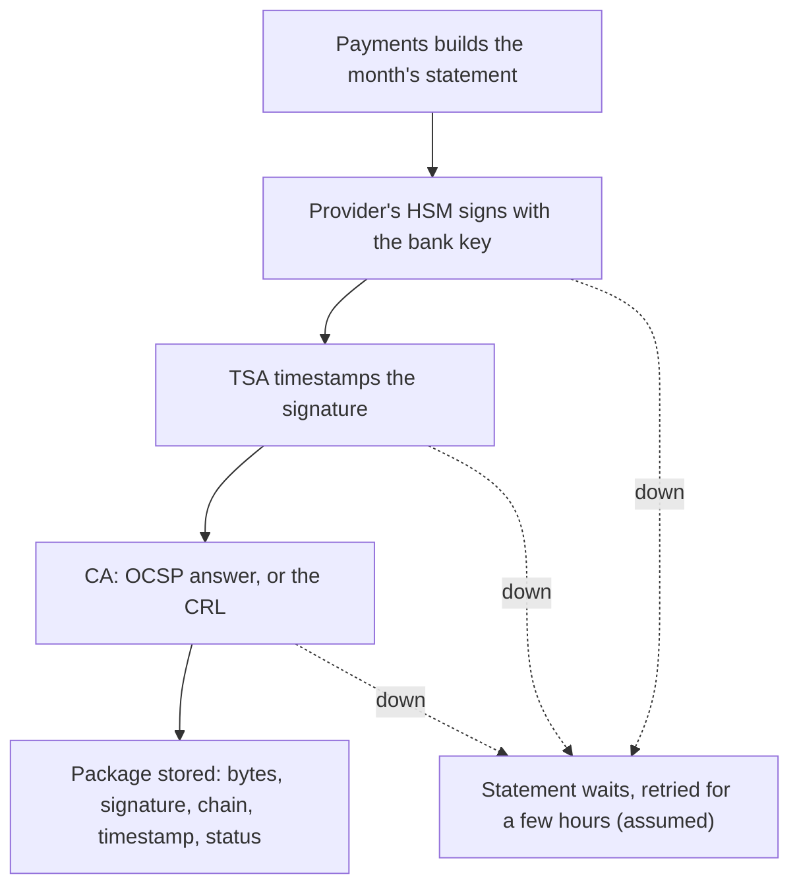

## Bạn cần biết trước

- [[sysdesign.l4.bank-signing-design]] — bạn biết ADR `0029` ký mỗi bảng kê trong HSM của nhà cung cấp, lấy dấu thời gian tin cậy và trạng thái thu hồi, rồi lưu chúng cùng đúng các byte của bảng kê, vì ba yếu tố định hình kiến trúc đã xếp hạng: (1) kiểm được trong nhiều năm (10 năm, giả định), kể cả khi chứng chỉ đã hết hạn, (2) thiệt hại từ một khóa bị lộ được giới hạn theo thời gian, (3) không khóa nào nằm ngoài HSM.
- [[design.l4.trade-off-points]] — bạn biết điểm đánh đổi là một quyết định đẩy hai thuộc tính chất lượng đi theo hai hướng ngược nhau.
- [[sysdesign.l4.finding-bottlenecks]] — bạn biết bước 5 liệt kê các điểm lỗi duy nhất và ghi rõ mỗi thao tác chính sẽ dừng, chờ hay chạy ở mức giảm.
- [[k8s.l4.choosing-managed-kubernetes]] — bạn biết ADR `0022` chọn Kubernetes managed và được mở lại khi có hợp đồng đòi máy riêng.

## Tình huống

Buổi review thiết kế cho ADR `0029` đến phần sơ đồ tổng thể. Trưởng nhóm đếm các mũi tên đi từ Payments ra những dịch vụ mà Đơn Hàng không vận hành: một tới HSM của nhà cung cấp, một tới timestamp authority, một tới CA. Giờ việc ký phải chờ cả ba.

Product owner hỏi: nếu timestamp authority sập đúng ngày ký thì checkout có dừng không? Một lập trình viên hỏi sao thiết kế không hỏi thẳng responder OCSP ở mỗi lần kiểm cho gọn, và sao ngân hàng lại có khóa riêng. Một người khác bảo ngân hàng là khách hàng khó tính, nên Đơn Hàng nên mua HSM của riêng mình.

Mỗi bằng chứng mua được gì, và tốn gì?

## Khái niệm cốt lõi

- ba phụ thuộc của việc ký — HSM của nhà cung cấp, timestamp authority và dịch vụ trạng thái của CA (responder OCSP hoặc CRL của CA).
- khoảng chờ — một bảng kê có thể chờ vài giờ mới được ký (giả định), miễn là tới tay ngân hàng trước ngày làm việc thứ năm của tháng sau (giả định).
- trạng thái đã lưu — trạng thái thu hồi lấy lúc ký và lưu vào gói.
- dấu thời gian mới — một dấu thời gian tin cậy mới, thêm vào gói đã lưu trước khi chứng chỉ của chính TSA hết hạn.
- khóa ngân hàng — một khóa trong HSM của nhà cung cấp theo ADR `0023`, chỉ ký bảng kê của ngân hàng này. Khóa hóa đơn, khóa ký hóa đơn của các cửa hàng, nằm cùng HSM đó.
- HSM riêng — bị ADR `0023` loại: nó cần thiết bị ở hai nơi, để một nơi hỏng không làm dừng việc ký, và cần người vận hành, nâng cấp, sao lưu chúng.

## Cơ chế hoạt động



Sau khi bảng kê được dựng, mỗi dịch vụ trong ba dịch vụ là một điểm lỗi duy nhất cho việc ký: khi một cái sập, không gói nào hoàn tất. Các mũi tên nét đứt cho thấy ADR `0029` làm gì lúc đó: bảng kê chờ và được thử lại. Không mũi tên nào dẫn tới đơn hàng hay hoàn tiền, vì ADR `0029` ghi rằng chúng không bị ảnh hưởng. Trong khoảng chờ, một lần lỗi chỉ tốn thời gian, không mất đơn.

Nút D chứa một điểm đánh đổi mà buổi review đã ghi lại. OCSP cho câu trả lời mới về một chứng chỉ, nhưng cần responder chạy mỗi khi có người hỏi. CRL lấy trước và giữ được, nhưng có thể cũ tới một chu kỳ công bố. ADR `0029` hỏi responder trước, lúc ký, và dùng CRL khi không có responder. ADR không nói responder đang sập có tính là "không có" hay không. Chữ "down" ở D nghĩa là không lấy được trạng thái nào.

Nút E chứa điểm tiếp theo. Lưu trạng thái làm mỗi gói lớn hơn một chữ ký đơn thuần. Đổi lại, lần kiểm của ngân hàng nhiều năm sau không cần dịch vụ nào của CA còn chạy.

Dấu thời gian trong E do TSA ký, và chứng chỉ của chính TSA cũng có ngày hết hạn. ADR `0029` ghi quy tắc, không ghi cơ chế đứng sau: trước khi chứng chỉ đó hết hạn, gói đã lưu được đóng một dấu thời gian mới, còn chữ ký thì không ký lại. Đó là một job lặp lại, và buổi review ghi nó là một chi phí.

Khóa ở B là điểm cuối cùng. Nó chỉ ký bảng kê của ngân hàng này, nên thu hồi nó không chạm hóa đơn nào của các cửa hàng khác. Cái giá là thêm một khóa và một chứng chỉ phải gia hạn.

## Trong hệ thống Đơn Hàng

Stage-4 chưa có code ký bảng kê, phần đầu ADR `0029` ghi rõ điều đó. Dưới đây là bước 5 của buổi review thiết kế cùng các phương án bị loại và điểm đánh đổi, viết bằng tiếng Việt:

```markdown file=docs/design/bank-signing-design-review.md tag=stage-4 lines=63-84
### Nút cổ chai và điểm hỏng đơn lẻ (bước 5)

- Không nút cổ chai về tải.
- HSM, timestamp authority và dịch vụ trạng thái của CA, mỗi cái là điểm hỏng
  đơn lẻ cho việc ký, không cho việc nhận đơn hay hoàn tiền: bảng kê chờ vài
  giờ và được thử lại.

### Phương án bị loại và điểm đánh đổi (bước 3 và 4)

- Giờ server và root riêng: trái driver 1 và 2.
- HSM riêng của Đơn Hàng: lý do của ADR 0023; hợp đồng đòi máy riêng là điều
  kiện mở lại của ADR 0022.
- Dùng chung khóa hóa đơn: một lần thu hồi chạm hóa đơn của cửa hàng khác.
- Điểm đánh đổi, OCSP so với CRL: OCSP cho câu trả lời mới về một chứng chỉ
  nhưng cần responder chạy ở mỗi lần hỏi; CRL lấy trước và giữ được, nhưng có
  thể cũ tới một kỳ phát hành.
- Điểm đánh đổi, lưu trạng thái lúc ký: gói lớn hơn, nhưng kiểm sau nhiều năm
  không cần dịch vụ của CA còn chạy.
- Điểm đánh đổi, khóa riêng cho ngân hàng: thu hồi không chạm hóa đơn, thêm một
  khóa và một chứng chỉ phải gia hạn.
- Điểm đánh đổi, đóng dấu lại: chứng chỉ của timestamp authority cũng hết hạn,
  nên gói được đóng dấu thời gian lại trước đó; một job lặp lại là chi phí.
```

Bước 5 không thấy nút cổ chai nào về tải, và giới hạn mỗi điểm lỗi duy nhất trong phạm vi việc ký.

Ba gạch đầu dòng tiếp theo là các phương án bị loại. Root riêng nghĩa là Đơn Hàng tự cấp chứng chỉ cho mình. Ngân hàng chỉ tin một root do họ chỉ định, còn ai giữ khóa bị lộ có thể chỉnh giờ server về trước lúc thu hồi, nên cả hai trái yếu tố định hình kiến trúc 1 và 2. HSM riêng vẫn bị loại vì lý do của ADR `0023`. Dùng chung khóa hóa đơn bị loại vì một lần thu hồi sẽ chạm hóa đơn của các cửa hàng khác.

Bốn gạch "Điểm đánh đổi" là các điểm đánh đổi trong sơ đồ: OCSP so với CRL, trạng thái đã lưu, khóa ngân hàng và dấu thời gian mới.

ADR `0029` ghi cùng những chi phí đó thành các hệ quả mà đội chấp nhận, kèm lúc nào thì xem lại:

```markdown file=docs/adr/0029-ky-bang-ke-ngan-hang-kem-dau-thoi-gian.md tag=stage-4 lines=53-63
### Hệ quả

- Thêm một khóa và một chứng chỉ phải gia hạn; thu hồi nó không chạm hóa đơn.
- Ký phụ thuộc ba dịch vụ bên ngoài: HSM, timestamp authority, CA.
- Gói lớn hơn chữ ký đơn thuần, nhưng ngân hàng kiểm sau 10 năm không cần dịch
  vụ của CA còn chạy.
- Một job định kỳ đóng dấu thời gian lại: chi phí lặp lại.

Đội xem lại quyết định khi: hợp đồng đòi khóa trên máy riêng (điều kiện mở lại
của ADR 0022 và ADR 0023; một ADR mới thay ADR 0023 cho đúng khóa này); ngân
hàng đòi một định dạng chữ ký riêng; một ngân hàng thứ hai cần bảng kê.
```

Đoạn cuối nêu ba lý do để xem lại. Lý do thứ nhất là một hợp đồng đòi đặt khóa trên máy riêng, đó là điều kiện mở lại của cả ADR `0022` lẫn ADR `0023`. Khi đó một ADR mới thay ADR `0023`, chỉ cho riêng khóa này. Hai lý do còn lại là ngân hàng đòi một định dạng chữ ký riêng, và một ngân hàng thứ hai cần bảng kê.

## Đánh đổi

| Lựa chọn | Được gì | Cái giá | Yếu tố quyết định, hoặc điều khiến xem lại |
|---|---|---|---|
| Ký với ba dịch vụ bên ngoài (ADR `0029` chọn) | bằng chứng mà ngân hàng tự kiểm được | mỗi dịch vụ là một điểm lỗi duy nhất cho việc ký | khoảng chờ (giả định), đơn hàng và hoàn tiền không bị ảnh hưởng |
| Hỏi responder OCSP trước, lúc ký | câu trả lời mới về một chứng chỉ | responder phải chạy ở mỗi lần kiểm | thứ tự của ADR `0029`: OCSP trước |
| Dùng CRL của CA khi không có responder | lấy trước và giữ được | có thể cũ tới một chu kỳ công bố | phương án dự phòng của ADR `0029` |
| Lưu trạng thái lúc ký | lần kiểm của ngân hàng nhiều năm sau không cần dịch vụ nào của CA | gói lớn hơn | yếu tố định hình kiến trúc 1 |
| Đóng dấu thời gian mới cho gói trước khi chứng chỉ của TSA hết hạn | gói kiểm được trong suốt thời hạn | một job lặp lại | yếu tố định hình kiến trúc 1 |
| Khóa ngân hàng, chỉ dùng cho ngân hàng này | một lần thu hồi không chạm hóa đơn nào của cửa hàng khác | thêm một khóa và một chứng chỉ phải gia hạn | phạm vi ảnh hưởng của một lần thu hồi |
| Bị loại: HSM riêng của Đơn Hàng | toàn quyền với phần cứng | thiết bị ở hai nơi, người vận hành chúng | lý do của ADR `0023`, và hợp đồng đòi máy riêng mở lại ADR `0022` |

Mọi dòng đều dựa vào khoảng chờ. Nếu có lúc việc ký phải xong trong vài giây, chẳng hạn bên trong một request mà khách hàng đang chờ, ba dịch vụ kia cũng sẽ nằm trên đường đó. Khi ấy đội phải cân lại từng phụ thuộc, và câu trả lời có thể khác.

## Bạn sẽ chọn gì nếu…

…hợp đồng tiếp theo của ngân hàng đòi khóa của họ nằm trong một HSM trên máy riêng của Đơn Hàng? Đội viết một ADR mới thay ADR `0023` cho riêng khóa này, các khóa khác giữ nguyên. Hợp đồng đó cũng chạm điều kiện mở lại của ADR `0022`, nên đội xem lại cả quyết định ấy. Cái giá mà ADR `0023` đã loại quay lại với khóa này: thiết bị ở hai nơi và người vận hành chúng. Cân nó với hợp đồng qua nhiều năm là câu hỏi về tổng chi phí, không phải câu hỏi về việc ký.

…ngân hàng đòi kiểm bảng kê trong hai mươi năm thay vì mười? Giả định 10 năm đứng sau yếu tố định hình kiến trúc 1 đổi con số, không đổi bản chất của yếu tố đó. Trạng thái đã lưu vẫn cho ngân hàng kiểm mà không cần CA, nên dòng đó giữ nguyên. Thứ lớn lên là job đóng dấu thời gian mới, chạy lại mỗi lần chứng chỉ của TSA trong một gói sắp hết hạn.

## Senior hay nhầm rằng…

- **"OCSP lúc nào cũng hơn CRL, vì câu trả lời của nó mới."** → Thực ra, như buổi review đã ghi, câu trả lời mới đó cần responder chạy ở mỗi lần kiểm, còn CRL lấy trước thì giữ được, với cái giá là có thể cũ tới một chu kỳ công bố. ADR `0029` hỏi OCSP trước và dùng CRL khi không có responder. Bạn sẽ nhận ra khi lúc ký không lấy được trạng thái nào, từ responder lẫn từ CRL, và bảng kê phải chờ.
- **"Timestamp authority sập thì phải ngừng nhận đơn cho tới khi ký lại được."** → Thực ra bước 5 của buổi review chỉ coi mỗi dịch vụ ký là điểm lỗi duy nhất cho việc ký. Một bảng kê có thể chờ vài giờ (giả định) và được thử lại, và ADR `0029` ghi rằng đơn hàng và hoàn tiền không bị ảnh hưởng. Bạn sẽ nhận ra khi nhìn sơ đồ: mũi tên nét đứt nào cũng dẫn tới một bảng kê đang chờ.
- **"Có ngân hàng làm khách hàng thì lúc nào cũng phải mua HSM riêng."** → Thực ra yếu tố định hình kiến trúc 3 chỉ đòi không khóa nào nằm ngoài HSM, và HSM của nhà cung cấp theo ADR `0023` đã đáp ứng điều đó. HSM riêng kéo theo thiết bị ở hai nơi và người vận hành chúng, và chỉ một hợp đồng đòi máy riêng mới mở lại lựa chọn này. Bạn sẽ nhận ra khi đọc danh sách giả định trong yêu cầu ký cho ngân hàng: product owner phải xác nhận hợp đồng không đòi HSM trên máy riêng.

## Thử ngay (3 phút)

Sau buổi review có ba đề xuất. Với mỗi đề xuất, nêu điểm đánh đổi hoặc phương án bị loại mà nó chạm tới, nó giúp gì và làm hại gì.

1. Không lưu trạng thái nào trong gói, ngân hàng hỏi responder OCSP của CA lúc kiểm.
2. Ký bảng kê của ngân hàng bằng khóa hóa đơn, khỏi phải gia hạn thêm một chứng chỉ.
3. Khi TSA sập, ký với giờ của server, để không bảng kê nào phải chờ.

Kết quả mong đợi: ba dòng, mỗi dòng nêu một dòng của buổi review và một yếu tố định hình kiến trúc hoặc chi phí mà đề xuất phá vỡ.

<details><summary>Gợi ý đáp án</summary>

1. Trạng thái đã lưu. Gói nhỏ đi, nhưng lần kiểm nhiều năm sau cần responder của CA vẫn còn chạy, trái yếu tố định hình kiến trúc 1.
2. Khóa ngân hàng. Bớt được một khóa và một chứng chỉ phải gia hạn, nhưng khi đó một lần thu hồi sẽ chạm hóa đơn của các cửa hàng khác: đúng phương án dùng chung khóa hóa đơn đã bị loại.
3. Giờ của server, một phương án bị loại. Không bảng kê nào phải chờ, nhưng ai giữ khóa bị lộ có thể ghi cho bảng kê một ngày trước lúc thu hồi, trái yếu tố định hình kiến trúc 1 và 2. Khoảng chờ vốn đã đủ để chịu một lần TSA sập.

</details>

## Liên hệ

- [[sysdesign.l4.bank-signing-design]] — thiết kế mà bài này cân các cái giá của nó.
- [[design.l4.trade-off-points]] — ý tưởng được áp dụng ở đây, lần lượt từng dòng của buổi review.
- [[sysdesign.l4.finding-bottlenecks]] — lượt đi qua bước 5 đứng sau câu "việc ký chờ, đơn hàng thì không".
- [[k8s.l4.choosing-managed-kubernetes]] — điều kiện mở lại mà một hợp đồng đòi máy riêng sẽ chạm tới.
- [[backend.l3.graceful-degradation]] — cùng quyết định đó cho việc ký: định trước rằng bảng kê chờ trong khi đơn hàng vẫn chạy.
- [[backend.l4.shared-credentials]] — cùng cách lập luận về phạm vi ảnh hưởng, áp cho một khóa dùng chung cho hai việc.
- [[management.l3.total-cost-of-ownership]] — nơi job lặp lại và khóa thêm được cộng dồn qua nhiều năm.
- [[sysdesign.l4.multi-shop-trade-offs]] — cùng hình dạng: thêm một thứ dành riêng giúp giới hạn thiệt hại, nhưng thêm một thứ phải vận hành.
- [[sysdesign.l4.bank-signing-challenges]] — bước tiếp theo: trả lời các câu phản biện của buổi review bằng ADR `0015`, `0023` và `0029`.

## Tóm tắt 5 dòng

1. Mỗi bằng chứng giữ kèm chữ ký thêm một dịch vụ mà việc ký phải chờ, và đội chấp nhận vì bảng kê chờ được vài giờ trong khi đơn hàng vẫn chạy.
2. Buổi review ghi rõ: OCSP trả lời mới nhưng cần responder chạy ở mỗi lần kiểm, còn CRL giữ sẵn có thể cũ tới một chu kỳ công bố.
3. Lưu trạng thái lúc ký làm gói lớn hơn, nhưng lần kiểm của ngân hàng nhiều năm sau không cần dịch vụ nào của CA còn chạy.
4. Chứng chỉ của TSA cũng hết hạn, nên gói đã lưu được đóng dấu thời gian mới trước ngày đó: một job lặp lại mà buổi review ghi là chi phí.
5. Một khóa chỉ cho ngân hàng này giữ cho lần thu hồi không chạm hóa đơn của cửa hàng khác. HSM riêng vẫn bị loại, trừ khi có hợp đồng đòi máy riêng.
