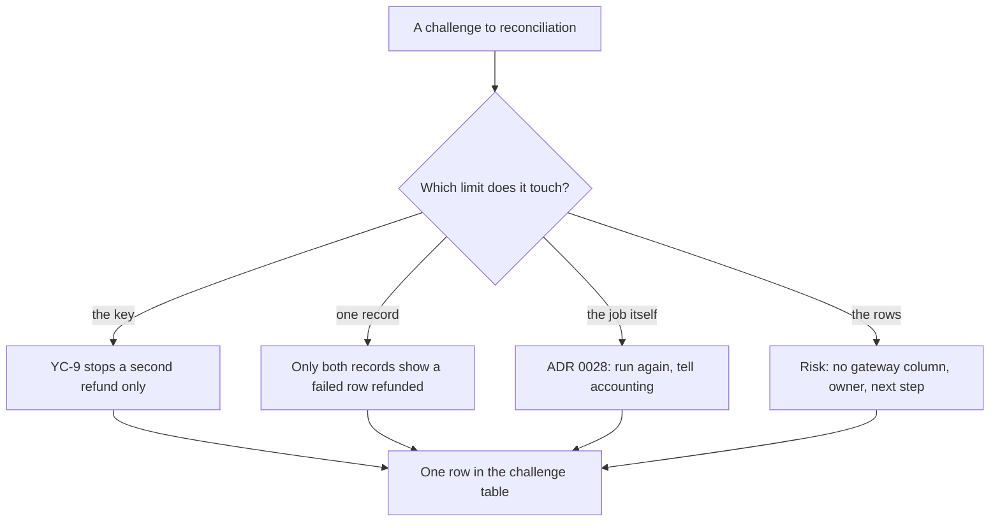

## Before you start

- [[sysdesign.l4.payment-reconciliation-trade-offs]] — you know why ADR `0028` reconciles once a day and leaves every correction to people, and why its review keeps YC-10's 24-hour window.
- [[sysdesign.l4.answering-challenges]] — you answer a challenge with the driver or decision behind it, named with its file, and turn an uncovered case into a risk or open question with an owner.

## The situation

The review of ADR `0028` reaches its challenges. A developer asks why reconcile at all, when every refund call already carries an idempotency key. Someone from accounting asks why the gateway's report is not enough on its own, since the gateway is the one that moved the money. An operator asks what happens when the report is late, or the gateway is down when the job runs. The team lead asks what changes once a second gateway is added under ADR `0010`'s exit plan.

Each question sounds like it wants reconciliation to do more.

Which limit of the refund saga does each one touch, and which answer leaves work behind?

## Core concepts

- the key's limit — `refund-<id>` makes repeated calls for one row refund only once, as YC-9 asks; it says nothing about an answer that never arrives or a refund Đơn Hàng never sent.
- one record's limit — Payments' rows hold what Đơn Hàng believes happened, the report holds what the gateway did; neither alone shows where the two disagree.
- the job's own failure — a run that cannot fetch the report, because it is late or the gateway is down; ADR `0028` has a rule for it.
- the rows' limit — a refund row does not record which gateway it went through, which matters only once there are two.
- a risk with an owner — a case the design does not yet cover, recorded with a role and a next step instead of a mechanism invented in the session.

## How it works



The first two questions touch limits the saga had from the start, and their answers are already written. The key stops the gateway from refunding one row twice. It cannot make an answer arrive: a call can refund the money while its answer is lost, and if every retry fails until YC-10's 24 hours run out, the row ends `failed`. And a refund customer care makes by hand on the gateway's admin page never passed through `RefundSender`, the Payments class that sends each refund row and retries it, so no call of ours exists for a key to protect. Those are the cases reconciliation is for. The report is the gateway's side only, so it cannot show that Payments marked the same refund `failed`.

The third branch is about the job, not the saga. ADR `0028` already wrote the rule: the run is tried again, and a missed day is reported to accounting (assumed). Nothing new is designed.

The fourth branch finds a limit nobody needed until now. With one gateway, a row never had to say where it went. A second gateway changes that, so the review records a risk with an owner and a next step, not a design for a gateway nobody has chosen.

Whatever the branch, the answer becomes one row of the review's challenge table: the question, the answer with the driver, ADR or risk it traces to, the next step, and an owner by role when something stays open.

## In the Đơn Hàng system

The challenge table closes `reconciliation-design-review.md`:

```markdown file=docs/design/reconciliation-design-review.md tag=stage-4 lines=97-105
### Câu hỏi phản biện trong buổi review

| Câu hỏi | Trả lời, trỏ driver, ADR hoặc rủi ro | Việc tiếp theo | Người phụ trách (vai trò) |
|---|---|---|---|
| Mọi lời gọi đã có idempotency key, sao còn đối soát? | Key chặn hoàn lần hai (YC-9), không chặn câu trả lời bị lạc hay khoản hoàn làm tay | Không | |
| Sao không chỉ dùng báo cáo của cổng? | Chỉ hai bản ghi cùng nhau mới cho thấy khoản cổng đã hoàn cho một dòng `failed` | Không | |
| Báo cáo trễ hay cổng lỗi lúc chạy thì sao? | ADR 0028: chạy lại; ngày bị lỡ báo kế toán | Không | |
| Thêm cổng thứ hai theo ADR 0010 thì sao? | Rủi ro: dòng hoàn tiền không ghi cổng nào | Thêm cột cổng | Lập trình viên backend |
| Ai sửa đơn kẹt ở `paid`? | Mở | Thiết kế bước sửa | Đội Đặt hàng (ADR 0025) |
```

The first three rows need no next step; only the last two leave work, each with an owner.

The first row answers the key question with YC-9: the key stops a second refund, not a lost answer or a refund made by hand on the gateway. The key itself is in `GatewayRefundClient.cs`, outside these excerpts: `IdempotencyKeyFor` returns `refund-{refund.Id}`, the same key on every call for one row. A call the timeout ends comes back as `TryAgainLater`, so `RefundSender` cannot tell a lost answer from a refund that never happened.

The second row says only the two records together show a refund the gateway made for a row Payments marked `failed`. That row's order is back at `paid`, and its customer was told the refund failed, facts the report cannot hold.

The third row quotes ADR `0028`. The review's section on single points of failure adds the scope: the report's API is a single point of failure for reconciliation, not for refunds.

The fourth row is a risk, owned by the backend developer, with "add a gateway column" as the next step. Step 4 of ADR `0010`'s exit plan already named the need:

```markdown file=docs/adr/0010-cong-thanh-toan-ben-ngoai.md tag=stage-4 lines=59-62
4. Chạy cả hai cổng trong một giai đoạn: khoản thanh toán qua Cổng A chỉ hoàn
   được qua Cổng A, nên mỗi dòng hoàn tiền phải biết khoản thanh toán của nó đi
   qua cổng nào, cho tới khi khoản cuối cùng của Cổng A hết hạn hoàn tiền (180
   ngày).
```

Gateway A is the one gateway Đơn Hàng uses today. During the switch, both gateways run, and a payment made through Gateway A can be refunded only through Gateway A. So each refund row must know its gateway until the last Gateway A payment can no longer be refunded, 180 days in the plan.

The review's risk table times the step: add the column before a second gateway exists. ADR `0028` lists the same event as a condition for reviewing its decision, with one report per gateway.

The last row, not in the situation, is the deep dive's open question: who fixes an order stuck at `paid`. Sending `payment.refunded` late does not help: the order's `CompleteRefund()` accepts only an order at `refunding`. The Ordering team owns it, and the review's risk table asks for the correction step to be designed before reconciliation is built.

## Trade-offs

| Way to answer | What it buys | What it pays | When it is the wrong choice |
|---|---|---|---|
| Name the saga limit the challenge touches | a short answer a reviewer can check against YC-9 and ADR `0028` | rests on the requirements staying as written | the challenge brings a case neither record can show |
| Quote ADR `0028`'s rule for its own failure | a missed day is known, not hidden | someone in accounting must read each report of a missed day | missed days repeat and nobody reads the reports |
| Record a risk timed to a later event | the design goes ahead for the one gateway there is | someone must remember the step when the event comes | the event is already decided, so the step is due now |
| Design a gateway switch in the session | the question closes at once | a change no driver asked for, for a gateway nobody chose | whenever the second gateway is not yet chosen, as at this review |

The risk fits because, with one gateway, every row's gateway is known without a column, so no driver is broken today.

## What would you choose if…

…the integration developer learns that Gateway A's report does not list the idempotency key? The job pairs each report line with a refund row by that key, and the review's risk table already holds this case: match by order and amount instead, with more differences for staff. The first two answers still stand, because they rest on comparing two records, not on how lines are paired.

…the team starts step 1 of ADR `0010`'s exit plan and evaluates a second gateway? The risk's event is now in sight, so its next step is due: the gateway column comes before the second gateway goes live. ADR `0028`'s review condition, a second gateway under step 4, is now in sight, so the team reviews the decision before step 4, for example one report per gateway, and records the outcome in an ADR rather than in a quick change to the job.

## Seniors often assume…

- **"The gateway moved the money, so its report is the only record worth trusting."** → Actually the report shows what the gateway did, not what Đơn Hàng told the order or the customer. Only comparing both records finds a `failed` row the gateway refunded. You notice this when a customer forwards a "refund failed" email while the gateway's admin page shows the money returned.
- **"If a reviewer asks about a second gateway, reconciliation must support it before it is built."** → Actually the review records a risk with an owner and a next step timed to the event: add the column before a second gateway exists. Building support now means code for a gateway nobody has chosen. You notice this when reconciliation code grows a choice between gateways that only ever sees one.
- **"An open question left in the review means reconciliation is not ready to build."** → Actually the review is marked reviewed and ADR `0028` accepted while its risk table still has open rows, each with its own owner and next step. Only the stuck order at `paid` must be designed before the job is built; the gateway column waits for a second gateway. You notice this when every open row gets the same deadline and the one that gates the build waits with the rest.

## Try it (3 minutes)

Three more challenges come up after the session. For each, name the limit it touches and where its answer is written.

1. "Why not let `RefundSender` retry until the gateway answers, so no answer is ever lost?"
2. "Customer care refunded an order on Gateway A's admin page. Who notices?"
3. "Can the job send `payment.refunded` for a `failed` row the gateway refunded, to fix the order?"

Expected result: one limit and one source for each, with the fact from that source that answers it.

<details><summary>Suggested answer</summary>

1. The key's limit, with the retry window as a trade-off point in the review. A longer window leaves fewer such rows but keeps orders `refunding` longer, the review kept 24 hours.
2. One record's limit, the challenge table's first row ("khoản hoàn làm tay"). The refund appears only in the gateway's report, with no row in Payments, so the daily run lists it as a gateway refund with no row.
3. The open question in the review. A late `payment.refunded` cannot fix the order, because `CompleteRefund()` accepts only a `refunding` order; the Ordering team owns the new correction step.

</details>

## Connections

- [[sysdesign.l4.payment-reconciliation-trade-offs]] — the step before, whose choices these challenges question.
- [[sysdesign.l4.answering-challenges]] — the method applied here, to answers that sit in the saga's own limits.
- [[management.l3.exit-plan]] — where ADR `0010`'s steps were written, the source of the second-gateway risk.
- [[management.l3.superseding-an-adr]] — what happens when ADR `0028`'s review condition, a second gateway, is met.
- [[sysdesign.l4.notification-challenges]] — the same kind of review for the notification design.
- [[sysdesign.l4.payment-reconciliation-design]] — the design whose deep dive left the stuck order at `paid` open.
- [[sysdesign.l4.bank-signing-requirements]] — the next problem in this module, signing statements for a bank.

## Five-line summary

1. Each challenge to reconciliation is answered from a limit of the refund saga, or of the job, written down before the session.
2. The idempotency key stops a second refund (YC-9), not a lost answer or a hand refund on the gateway; reconciliation is for those.
3. Only Payments' rows and the gateway's report together show a refund the gateway made for a row marked `failed`.
4. A late report or a gateway down at run time follows ADR `0028`'s rule: run again, report a missed day to accounting (assumed).
5. A second gateway is a recorded risk: rows do not record their gateway, a need step 4 of ADR `0010`'s exit plan names.
