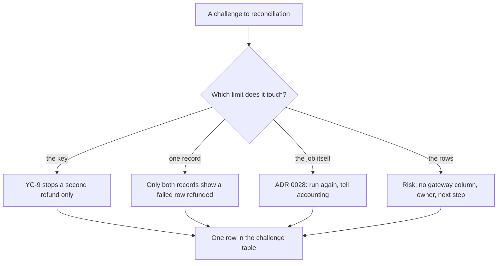

## Bạn cần biết trước

- [[sysdesign.l4.payment-reconciliation-trade-offs]] — bạn biết vì sao ADR `0028` đối soát mỗi ngày một lần và để mọi lần sửa cho con người, và vì sao review của nó giữ cửa sổ 24 giờ của YC-10.
- [[sysdesign.l4.answering-challenges]] — bạn trả lời một câu phản biện bằng yếu tố định hình kiến trúc hoặc quyết định đứng sau nó, nêu kèm tên file, và biến một trường hợp chưa được che phủ thành rủi ro hoặc câu hỏi mở có người phụ trách.

## Tình huống

Buổi review ADR `0028` tới phần phản biện. Một lập trình viên hỏi sao còn phải đối soát, khi mọi lần gọi hoàn tiền đã mang idempotency key. Một người bên kế toán hỏi sao chỉ báo cáo của cổng thôi lại chưa đủ, vì chính cổng là bên đã chuyển tiền. Một người vận hành hỏi chuyện gì xảy ra khi báo cáo về trễ, hay cổng đang sập đúng lúc job chạy. Trưởng nhóm hỏi điều gì thay đổi khi thêm cổng thứ hai theo kế hoạch rời đi của ADR `0010`.

Câu nào nghe cũng như muốn đối soát làm nhiều hơn.

Mỗi câu chạm vào giới hạn nào của saga hoàn tiền, và câu trả lời nào để lại việc phải làm?

## Khái niệm cốt lõi

- giới hạn của khóa — `refund-<id>` khiến các lần gọi lặp lại cho một dòng chỉ hoàn tiền một lần, đúng như YC-9 đòi. Khóa không nói gì về một câu trả lời không bao giờ tới, hay một khoản hoàn Đơn Hàng chưa từng gửi.
- giới hạn của một bản ghi — các dòng của Payments giữ điều Đơn Hàng tin là đã xảy ra, báo cáo giữ điều cổng đã làm. Riêng một bên không cho thấy hai bên lệch nhau ở đâu.
- lỗi của chính job — một lần chạy không lấy được báo cáo, vì báo cáo trễ hoặc cổng đang sập. ADR `0028` có quy tắc cho trường hợp này.
- giới hạn của các dòng — một dòng hoàn tiền không ghi nó đi qua cổng nào, điều chỉ quan trọng khi có hai cổng.
- rủi ro có người phụ trách — một trường hợp thiết kế chưa che phủ, được ghi lại với một vai trò và một việc tiếp theo, thay vì một cơ chế nghĩ ra ngay trong buổi họp.

## Cơ chế hoạt động



Hai câu hỏi đầu chạm vào những giới hạn saga có từ đầu, và câu trả lời đã được viết sẵn. Khóa ngăn cổng hoàn tiền hai lần cho một dòng. Khóa không thể làm câu trả lời tới nơi: một lần gọi có thể đã hoàn tiền trong khi câu trả lời bị lạc, và nếu mọi lần thử lại đều thất bại cho tới khi hết 24 giờ của YC-10, dòng kết thúc ở `failed`. Còn khoản hoàn mà chăm sóc khách hàng làm tay trên trang quản trị của cổng thì chưa từng đi qua `RefundSender`, class của Payments gửi từng dòng hoàn tiền và thử lại khi cần. Không có lần gọi nào của ta để khóa bảo vệ. Đối soát có mặt chính là cho những trường hợp đó. Báo cáo chỉ là phía cổng, nên không thể cho thấy Payments đã đánh dấu cùng khoản hoàn ấy là `failed`.

Nhánh thứ ba nói về job, không phải saga. ADR `0028` đã viết sẵn quy tắc: lần chạy được thử lại, và ngày bị lỡ được báo cho kế toán (giả định). Không có gì mới phải thiết kế.

Nhánh thứ tư tìm ra một giới hạn mà tới giờ chưa ai cần đến. Khi chỉ có một cổng, một dòng chưa bao giờ phải nói nó đã đi đâu. Cổng thứ hai thay đổi điều đó, nên review ghi lại một rủi ro có người phụ trách và việc tiếp theo, chứ không thiết kế cho một cổng chưa ai chọn.

Dù đi nhánh nào, câu trả lời cũng thành một dòng trong bảng phản biện của review: câu hỏi, câu trả lời kèm yếu tố định hình kiến trúc, ADR hoặc rủi ro mà nó dựa vào, việc tiếp theo, và người phụ trách theo vai trò khi còn điều gì để mở.

## Trong hệ thống Đơn Hàng

Bảng phản biện khép lại `reconciliation-design-review.md`:

```markdown file=docs/design/reconciliation-design-review.md tag=stage-4 lines=97-105
### Câu hỏi phản biện trong buổi review

| Câu hỏi | Trả lời, trỏ driver, ADR hoặc rủi ro | Việc tiếp theo | Người phụ trách (vai trò) |
|---|---|---|---|
| Mọi lời gọi đã có idempotency key, sao còn đối soát? | Key chặn hoàn lần hai (YC-9), không chặn câu trả lời bị lạc hay khoản hoàn làm tay | Không | |
| Sao không chỉ dùng báo cáo của cổng? | Chỉ hai bản ghi cùng nhau mới cho thấy khoản cổng đã hoàn cho một dòng `failed` | Không | |
| Báo cáo trễ hay cổng lỗi lúc chạy thì sao? | ADR 0028: chạy lại; ngày bị lỡ báo kế toán | Không | |
| Thêm cổng thứ hai theo ADR 0010 thì sao? | Rủi ro: dòng hoàn tiền không ghi cổng nào | Thêm cột cổng | Lập trình viên backend |
| Ai sửa đơn kẹt ở `paid`? | Mở | Thiết kế bước sửa | Đội Đặt hàng (ADR 0025) |
```

Ba dòng đầu không cần việc tiếp theo. Chỉ hai dòng cuối để lại việc, mỗi dòng có người phụ trách.

Dòng thứ nhất trả lời câu hỏi về khóa bằng YC-9: khóa chặn lần hoàn thứ hai, không chặn câu trả lời bị lạc hay khoản hoàn làm tay trên cổng. Bản thân khóa nằm trong `GatewayRefundClient.cs`, ngoài các đoạn trích này: `IdempotencyKeyFor` trả về `refund-{refund.Id}`, cùng một khóa cho mọi lần gọi của một dòng. Một lần gọi bị timeout cắt ngang sẽ trả về `TryAgainLater`, nên `RefundSender` không phân biệt được câu trả lời bị lạc với khoản hoàn chưa từng xảy ra.

Dòng thứ hai nói chỉ hai bản ghi cùng nhau mới cho thấy một khoản cổng đã hoàn cho dòng mà Payments đánh dấu `failed`. Đơn của dòng đó đã quay về `paid`, và khách đã được báo hoàn tiền thất bại. Báo cáo không thể chứa những điều này.

Dòng thứ ba dẫn ADR `0028`. Phần về điểm lỗi duy nhất trong review nói rõ phạm vi: API báo cáo là điểm lỗi duy nhất của đối soát, không phải của hoàn tiền.

Dòng thứ tư là một rủi ro, do lập trình viên backend phụ trách, với việc tiếp theo là "thêm cột cổng". Bước 4 trong kế hoạch rời đi của ADR `0010` đã nêu nhu cầu này:

```markdown file=docs/adr/0010-cong-thanh-toan-ben-ngoai.md tag=stage-4 lines=59-62
4. Chạy cả hai cổng trong một giai đoạn: khoản thanh toán qua Cổng A chỉ hoàn
   được qua Cổng A, nên mỗi dòng hoàn tiền phải biết khoản thanh toán của nó đi
   qua cổng nào, cho tới khi khoản cuối cùng của Cổng A hết hạn hoàn tiền (180
   ngày).
```

Cổng A là cổng duy nhất Đơn Hàng dùng hiện nay. Trong lúc chuyển, cả hai cổng cùng chạy, và một khoản thanh toán qua Cổng A chỉ hoàn được qua Cổng A. Vì thế mỗi dòng hoàn tiền phải biết cổng của mình, cho tới khi khoản thanh toán cuối cùng qua Cổng A không còn hoàn được nữa, 180 ngày theo kế hoạch.

Bảng rủi ro của review định thời điểm cho bước này: thêm cột trước khi có cổng thứ hai. ADR `0028` cũng ghi sự kiện ấy là một điều kiện để xem lại quyết định của mình, với mỗi cổng một báo cáo.

Dòng cuối, không có trong tình huống, là câu hỏi mở từ phần đi sâu: ai sửa một đơn kẹt ở `paid`. Gửi `payment.refunded` muộn không giúp được gì: `CompleteRefund()` của đơn chỉ nhận đơn đang ở `refunding`. Đội Đặt hàng phụ trách câu hỏi này, và bảng rủi ro của review đòi thiết kế bước sửa trước khi xây đối soát.

## Đánh đổi

| Cách trả lời | Được gì | Cái giá | Khi nào là lựa chọn sai |
|---|---|---|---|
| Nêu giới hạn của saga mà câu phản biện chạm vào | một câu trả lời ngắn, người review đối chiếu được với YC-9 và ADR `0028` | chỉ đứng vững khi các yêu cầu giữ nguyên như đã viết | câu phản biện đưa ra một trường hợp mà không bản ghi nào cho thấy |
| Dẫn quy tắc của ADR `0028` cho lỗi của chính job | ngày bị lỡ được biết đến, không bị giấu đi | ai đó bên kế toán phải đọc từng báo cáo về ngày bị lỡ | ngày bị lỡ lặp lại mà không ai đọc báo cáo |
| Ghi một rủi ro định thời theo một sự kiện sau này | thiết kế đi tiếp cho cổng duy nhất đang có | ai đó phải nhớ tới bước này khi sự kiện tới | sự kiện đã được quyết, nên bước này phải làm ngay |
| Thiết kế chuyển cổng ngay trong buổi họp | câu hỏi khép lại lập tức | một thay đổi không yếu tố nào đòi, cho một cổng chưa ai chọn | bất cứ khi nào cổng thứ hai chưa được chọn, như ở buổi review này |

Rủi ro là cách hợp ở đây, vì khi chỉ có một cổng, cổng của mọi dòng đều đã biết mà không cần cột, nên hôm nay không yếu tố nào bị vi phạm.

## Bạn sẽ chọn gì nếu…

…lập trình viên tích hợp phát hiện báo cáo của Cổng A không liệt kê idempotency key? Job ghép mỗi dòng báo cáo với một dòng hoàn tiền theo khóa đó, và bảng rủi ro của review đã có sẵn trường hợp này: ghép theo đơn và số tiền, đổi lại nhân viên phải xem nhiều chỗ lệch hơn. Hai câu trả lời đầu vẫn đứng vững, vì chúng dựa trên so sánh hai bản ghi, không dựa trên cách ghép các dòng.

…đội bắt đầu bước 1 trong kế hoạch rời đi của ADR `0010` và đánh giá một cổng thứ hai? Sự kiện của rủi ro giờ đã thấy trước, nên việc tiếp theo của nó tới hạn: cột cổng phải có trước khi cổng thứ hai chạy thật. Điều kiện xem lại của ADR `0028`, một cổng thứ hai theo bước 4, giờ cũng đã thấy trước, nên đội xem lại quyết định trước bước 4, ví dụ mỗi cổng một báo cáo, và ghi kết quả vào một ADR thay vì sửa nhanh job.

## Senior hay nhầm rằng…

- **"Cổng đã chuyển tiền, nên báo cáo của cổng là bản ghi duy nhất đáng tin."** → Thực ra báo cáo cho thấy điều cổng đã làm, không phải điều Đơn Hàng đã báo cho đơn hay cho khách. Chỉ so cả hai bản ghi mới tìm ra một dòng `failed` mà cổng đã hoàn. Bạn sẽ nhận ra khi một khách chuyển tiếp email "hoàn tiền thất bại" trong khi trang quản trị của cổng cho thấy tiền đã được trả lại.
- **"Nếu người review hỏi về cổng thứ hai, đối soát phải hỗ trợ nó trước khi được xây."** → Thực ra review ghi một rủi ro có người phụ trách và một việc tiếp theo định thời theo sự kiện: thêm cột trước khi có cổng thứ hai. Hỗ trợ ngay bây giờ nghĩa là viết code cho một cổng chưa ai chọn. Bạn sẽ nhận ra khi code đối soát mọc thêm nhánh chọn giữa các cổng mà xưa nay chỉ gặp đúng một cổng.
- **"Còn câu hỏi mở trong review nghĩa là đối soát chưa sẵn sàng để xây."** → Thực ra review được đánh dấu đã review và ADR `0028` được chấp nhận trong khi bảng rủi ro vẫn còn các dòng mở, mỗi dòng có người phụ trách và việc tiếp theo riêng. Chỉ đơn kẹt ở `paid` là phải thiết kế xong trước khi xây job, còn cột cổng thì chờ cổng thứ hai. Bạn sẽ nhận ra khi mọi dòng mở đều nhận cùng một hạn chót, và dòng mà job phải chờ lại nằm chờ cùng các dòng còn lại.

## Thử ngay (3 phút)

Sau buổi họp còn ba câu phản biện nữa. Với mỗi câu, nêu giới hạn mà nó chạm vào và câu trả lời đã được viết ở đâu.

1. "Sao không để `RefundSender` thử lại tới khi cổng trả lời, để không câu trả lời nào bị lạc?"
2. "Chăm sóc khách hàng đã hoàn tiền một đơn trên trang quản trị của Cổng A. Ai sẽ nhận ra?"
3. "Job gửi `payment.refunded` cho một dòng `failed` mà cổng đã hoàn, để sửa đơn, có được không?"

Kết quả mong đợi: mỗi câu một giới hạn và một nguồn, kèm điều trong nguồn đó trả lời câu hỏi.

<details><summary>Gợi ý đáp án</summary>

1. Giới hạn của khóa, với cửa sổ thử lại là một điểm đánh đổi trong review. Cửa sổ dài hơn để lại ít dòng như thế hơn nhưng giữ đơn ở `refunding` lâu hơn, và review đã giữ 24 giờ.
2. Giới hạn của một bản ghi, dòng đầu tiên trong bảng phản biện ("khoản hoàn làm tay"). Khoản hoàn chỉ xuất hiện trong báo cáo của cổng, không có dòng nào trong Payments, nên lần chạy hằng ngày liệt kê nó là một khoản hoàn của cổng không có dòng.
3. Câu hỏi mở trong review. Một `payment.refunded` muộn không sửa được đơn, vì `CompleteRefund()` chỉ nhận đơn đang `refunding`. Đội Đặt hàng phụ trách bước sửa mới.

</details>

## Liên hệ

- [[sysdesign.l4.payment-reconciliation-trade-offs]] — bước trước, nơi có các lựa chọn mà những câu phản biện này chất vấn.
- [[sysdesign.l4.answering-challenges]] — phương pháp được áp dụng ở đây, cho các câu trả lời nằm trong giới hạn của chính saga.
- [[management.l3.exit-plan]] — nơi các bước của ADR `0010` được viết ra, nguồn gốc của rủi ro về cổng thứ hai.
- [[management.l3.superseding-an-adr]] — điều xảy ra khi điều kiện xem lại của ADR `0028`, một cổng thứ hai, được đáp ứng.
- [[sysdesign.l4.notification-challenges]] — cùng kiểu review đó cho thiết kế thông báo.
- [[sysdesign.l4.payment-reconciliation-design]] — thiết kế mà phần đi sâu để ngỏ chuyện đơn kẹt ở `paid`.
- [[sysdesign.l4.bank-signing-requirements]] — bài toán kế tiếp trong module: ký sao kê cho ngân hàng.

## Tóm tắt 5 dòng

1. Mỗi câu phản biện về đối soát được trả lời từ một giới hạn của saga hoàn tiền, hoặc của job, đã viết ra trước buổi họp.
2. Idempotency key chặn lần hoàn thứ hai (YC-9), không chặn câu trả lời bị lạc hay khoản hoàn làm tay trên cổng. Đối soát dành cho những trường hợp đó.
3. Chỉ các dòng của Payments và báo cáo của cổng cùng nhau mới cho thấy một khoản cổng đã hoàn cho dòng bị đánh dấu `failed`.
4. Báo cáo trễ hay cổng sập lúc chạy thì theo quy tắc của ADR `0028`: chạy lại, báo ngày bị lỡ cho kế toán (giả định).
5. Cổng thứ hai là một rủi ro đã được ghi lại: các dòng không ghi cổng của mình, một nhu cầu mà bước 4 trong kế hoạch rời đi của ADR `0010` đã nêu.
