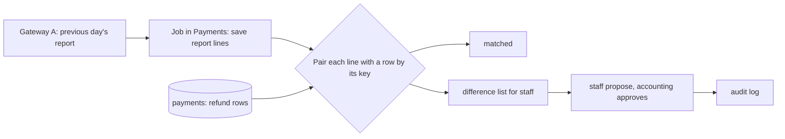

## Before you start

- [[sysdesign.l4.payment-reconciliation-requirements]] — you have the cases ĐS-1 to ĐS-4 and the ranked drivers: every difference explained, each found within a day, money corrected only by people.
- [[sysdesign.l4.deep-dive]] — you know a deep dive details the one part where a top driver is hardest to meet, and that `refund-design.md` gives every resend of a refund row the one key `refund-<id>`.
- [[backend.l4.data-ownership]] — you know each kind of data has one owner, the place that writes it, and that Payments owns the payment rows in `donhang_payments`.
- [[backend.l4.audit-log]] — you know an audit log records who did what to which resource, in a store the services cannot change unseen.

## The situation

As the lab's `fake-gateway` lists it, a gateway refund has its own refund id, an order, an amount and a key; Gateway A's report is assumed to carry the key too. A refund row in `payments` has an order, an amount and a status, but no gateway refund id.

A teammate proposes a shortcut: pair a line with a row by order and amount, and when they disagree, copy the gateway's value. Then you remember a refund the gateway made while its row ended `failed`. The order is back at `paid`, and the customer was emailed that the refund failed.

How should the check pair each line with a row, and what should it do when they disagree?

## Core concepts

- the reconciliation job — a background job in Payments that runs once a day, fetches the previous day's settlement report and saves its lines in Payments' own database.
- the matching key — the idempotency key `refund-<id>` that every call for one refund row carries, which pairs a report line with exactly one row.
- the outcome — the one category each comparison ends in: matched, or one of four kinds of difference.
- the waiting rule — a `refunded` row missing from the report counts as a difference only after one more run (assumed).
- the difference list — where the job puts every difference for staff; the job itself never changes a refund row.

## How it works



In the situation above, the job lives in Payments, because Payments owns both the refund rows and the key it sends to the gateway. Once a day it fetches the previous day's report and saves each line in Payments' database. The saved lines then belong to Payments too, like the rows.

The job pairs each line with a row by its key. `payments` keeps no refund id of the gateway's, so the key is the one value both sides share. In the lab, `GET /v1/refunds` on `fake-gateway` lists the key with each refund; the design assumes Gateway A's report does too, and the developer on the gateway integration is the one to confirm it.

Every comparison ends in one of five outcomes: the line and the row match; the gateway refunded but the row is `failed`; the gateway has a refund with no row; a `refunded` row is missing from the report; or the amounts differ. These are ĐS-1 to ĐS-4 from the requirements, plus the match.

A missing row needs care. A refund made near the end of a day may appear only in the next day's report. So the job waits one more run before it counts that row as a difference (assumed).

The job changes nothing. Each difference goes to a list for staff. A correction is a new change a person makes: staff propose it, accounting approves it (assumed roles), and the change is written to the audit log. The saga's compensation works the same way: it adds a step and keeps the history.

## In the Đơn Hàng system

ADR `0028`'s header says stage-4 has no reconciliation code, only the ADR and the design review. Its decision, written in Vietnamese; the paragraphs after it say the same in English:

```markdown file=docs/adr/0028-doi-soat-hoan-tien-hang-ngay-voi-bao-cao-cua-cong.md tag=stage-4 lines=32-53
### Quyết định

Chọn phương án thứ nhất, trong Payments, chủ của dòng hoàn tiền và của khóa
cổng.

- Mỗi ngày một job lấy báo cáo của ngày trước qua API của cổng và lưu từng
  dòng báo cáo vào database của Payments.
- Mỗi dòng báo cáo được ghép với một dòng hoàn tiền theo key `refund-<id>`.
- Mỗi lần so cho một trong năm kết quả: khớp; cổng đã hoàn nhưng dòng là
  `failed`; cổng có khoản hoàn không có dòng; dòng `refunded` không có trong
  báo cáo; số tiền khác.
- Dòng `refunded` không có trong báo cáo chỉ thành chỗ lệch sau thêm một lần
  chạy (giả định), vì khoản hoàn gần cuối ngày có thể chỉ có trong báo cáo hôm
  sau.
- Job không sửa dòng hoàn tiền nào. Mỗi chỗ lệch vào một danh sách cho nhân
  viên; sửa là một thay đổi mới do người làm và ghi vào nhật ký kiểm toán theo
  `docs/design/audit-log.md`. Nhân viên đề xuất, kế toán duyệt (vai trò giả
  định).
- Báo cáo trễ hay cổng lỗi lúc chạy: job chạy lại; ngày bị lỡ được báo cho kế
  toán (giả định).
- Dòng báo cáo và kết quả mỗi lần chạy được giữ bằng thời gian giữ dòng hoàn
  tiền (giả định).
```

The first line places the job in Payments, the owner of the refund rows and of the key `refund-<id>` it sends to the gateway. The bullets follow the diagram: fetch and save the report, pair by key, end in one of five outcomes, wait for a missing `refunded` row, and list every difference, with corrections in the audit log under `docs/design/audit-log.md`.

The last two bullets are assumed. A late report or a failing gateway means the job runs again and a missed day is reported to accounting. Report lines and results are kept as long as the refund rows.

The design review's pairing rule and its deep dive:

```markdown file=docs/design/reconciliation-design-review.md tag=stage-4 lines=42-59
Mỗi dòng báo cáo được ghép với dòng hoàn tiền theo key `refund-<id>`, vì
`payments` không giữ id hoàn tiền của cổng. Năm kết quả: khớp; cổng đã hoàn
nhưng dòng `failed`; khoản của cổng không có dòng; dòng `refunded` không có
trong báo cáo (chỉ thành chỗ lệch sau thêm một lần chạy); số tiền khác.

### Đi sâu: dòng `failed` mà cổng đã hoàn (bước 4)

1. `RefundSender` gọi cổng; cổng hoàn tiền, nhưng câu trả lời bị lạc (hết thời
   gian chờ). Kết quả là thử lại sau.
2. Cổng lỗi liên tục tới hết 24 giờ của YC-10; dòng thành `failed`,
   `payment.refund-failed` được gửi.
3. API nhận message đó: đơn quay về `paid`, khách nhận email báo hoàn tiền
   thất bại. Tiền thật ra đã hoàn.
4. Đối soát hôm sau thấy khoản của cổng với key `refund-<id>` của một dòng
   `failed`: một chỗ lệch.
5. Gửi muộn `payment.refunded` không sửa được: `Order.CompleteRefund()` chỉ nhận
   đơn `refunding`, ngoại lệ của nó thành poison message trong
   `PaymentEventsConsumer`, và message vào dead-letter queue.
```

The first paragraph gives the reason for the key; `Payment.cs`, outside these excerpts, has no field for the gateway's refund id.

The deep dive takes the case from the situation. The gateway refunds, the answer is lost to a timeout, and every retry fails until the 24 hours of YC-10 run out. The row ends `failed`, `payment.refund-failed` is sent, and the API moves the order from `refunding` back to `paid` and emails the customer that the refund failed. The next run finds the gateway's line with that row's key: a difference.

On the normal path, Payments sends `payment.refunded` when the gateway has refunded, and the API calls `Order.CompleteRefund()`, which moves a `refunding` order to `cancelled`. Step 5 is why nobody can just send it late: `CompleteRefund()` accepts only a `refunding` order. On a `paid` order its exception becomes a poison message in `PaymentEventsConsumer`, and the message goes to the dead-letter queue. Below the excerpt, the review records what is needed instead: a new correction step that moves a `paid` order to `cancelled` once reconciliation confirms the refund. It is an open question for the Ordering team, to design before reconciliation is built.

## Trade-offs

| Choice | What it gives | What it costs | Right when |
|---|---|---|---|
| Pair by the key `refund-<id>` (the design's choice) | each line meets exactly the row the gateway acted on; a different amount shows as one difference | depends on the report carrying the key, still an assumption | the gateway echoes Đơn Hàng's key `refund-<id>`, as the lab's `fake-gateway` does |
| Pair by order and amount | works with any report that lists orders and amounts | more differences, as the review's risk table, below the excerpt, says | the report carries no key |
| Count a missing `refunded` row at once | ĐS-3 shows a day sooner | a refund whose line arrives in the next day's report shows as a false difference | the report is known to be complete for its day |
| Wait one more run (the design's choice, assumed) | no false differences from late lines | ĐS-3 can take up to two days | late lines are possible, as assumed for Gateway A |
| The job overwrites the row with the gateway's value | a difference closes with no staff time | a change to money that nobody decided; the order of a `failed` row stays at `paid` | never, under driver 3 |
| A list for staff, accounting approves (the design's choice) | every correction is a decision someone made, in the audit log | staff time for each difference | only people may correct money, as driver 3 requires |

## What would you choose if…

…the developer on the gateway integration finds that Gateway A's report has no idempotency key? The review's risk table already answers: pair by order and amount, and expect more differences. A refund whose amounts differ, for example, matches no row at all.

…the team adds a second gateway, step 4 of ADR `0010`'s exit plan? A refund row records no gateway, so a key alone no longer says which report to look in. Searching both still pairs the lines it finds, but a `refunded` row missing from both cannot say which report should have listed it. ADR `0028` names this as a reason to revisit the decision, and the review asks the backend developer for a gateway column first.

## Seniors often assume…

- **"Reconciliation can match the two records by order and amount, so no key is needed."** → Actually pairing on the amount hides exactly the case where the amounts differ. A line and a row for one refund with different amounts pair with nothing, so they appear as two other differences, a refund with no row and a row missing from the report, instead of one different amount. You notice this when a single wrong amount produces two lines on the staff list.
- **"A row missing from today's report is always a refund that never happened."** → Actually a refund made near the end of a day may appear only in the next day's report, so the design waits one more run before counting the row (assumed). You notice this when rows refunded late in the evening show as missing and then match the next morning.
- **"When the job finds a difference, it should simply overwrite our row with the gateway's value."** → Actually driver 3 says only people correct money, so ADR `0028` keeps the job read-only. Overwriting would not even fix the deep dive's case: turning a `failed` row into `refunded` changes nothing in Ordering, so its order stays at `paid`, and a late `payment.refunded` would not help, because `CompleteRefund()` accepts only a `refunding` order. You notice this when a row says `refunded` but its order still shows `paid`.

## Try it (3 minutes)

Two refund rows, followed over two daily runs:

- row 51, `refunded` late on Monday evening, 300,000 VND; Monday's report has no line for it, Tuesday's report has `refund-51` for 300,000 VND
- row 52, first sent early on Monday, when the gateway refunded and the answer was lost; `failed` 24 hours later, before Tuesday's run; Monday's report has `refund-52` for 150,000 VND, as row 52 asked

Write what the job records for each row on the Tuesday run, which reads Monday's report, and the Wednesday run, which reads Tuesday's, and what the order of row 52 needs.

Expected result: one row with no difference on either run, one difference with a correction step that only a person can start.

<details><summary>Suggested answer</summary>

Row 51: on the Tuesday run it is missing from Monday's report, but the job waits one more run, so it records no difference. On the Wednesday run `refund-51` pairs with it, same amount: matched.

Row 52: on the Tuesday run `refund-52` pairs with a `failed` row, so the job lists a difference, gateway refunded but row `failed`. It changes nothing. Staff propose a correction, accounting approves it, and it goes to the audit log. The order is at `paid`, and a late `payment.refunded` would end in the dead-letter queue, so the order needs the new correction step from `paid` to `cancelled` that the review leaves open for the Ordering team.

</details>

## Connections

- [[sysdesign.l4.high-level-design]] — the step this diagram applies.
- [[backend.l3.dead-letter-queue]] — where a late `payment.refunded` for a `paid` order ends.
- [[backend.l3.saga-in-progress-status]] — the status `refunding` that `CompleteRefund()` requires, which an order of a `failed` row has already left.
- [[design.l3.anti-corruption-layer]] — `GatewayRefundClient` translates the gateway's language for the refund call; the report the job reads is the gateway's language too.
- [[sysdesign.l4.payment-reconciliation-trade-offs]] — the next step: running once a day trades a day's delay for one simple job.

## Five-line summary

1. A daily job in Payments pairs each line of the gateway's report with a refund row by the key `refund-<id>`.
2. Payments owns the refund rows and the key, so the job saves the report lines in Payments' own database.
3. Each comparison ends matched, `failed` but refunded, no row, row missing from the report, or different amount.
4. A missing `refunded` row counts only after one more run (assumed); the job never changes a row, people correct through the audit log.
5. A refunded `failed` row leaves its order at `paid`, which `CompleteRefund()` cannot fix, so the review records a new correction step.
