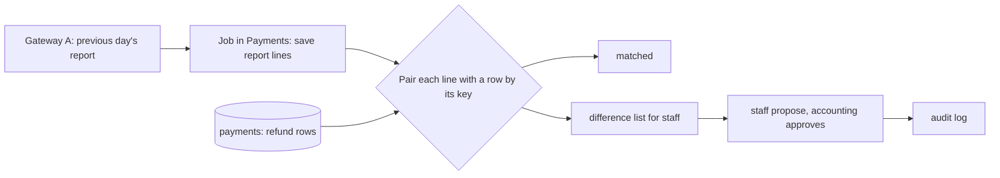

## Bạn cần biết trước

- [[sysdesign.l4.payment-reconciliation-requirements]] — bạn đã có các kịch bản ĐS-1 tới ĐS-4 và các yếu tố định hình kiến trúc đã xếp hạng: mọi chỗ lệch đều được giải thích, mỗi chỗ được tìm ra trong một ngày, tiền chỉ do con người sửa.
- [[sysdesign.l4.deep-dive]] — bạn biết phần đi sâu đi vào chi tiết đúng một phần, nơi khó đáp ứng một yếu tố hàng đầu nhất, và biết `refund-design.md` cho mọi lần gửi lại của một dòng hoàn tiền cùng một khóa `refund-<id>`.
- [[backend.l4.data-ownership]] — bạn biết mỗi loại dữ liệu có đúng một chủ, là nơi ghi nó, và Payments là chủ các dòng thanh toán trong `donhang_payments`.
- [[backend.l4.audit-log]] — bạn biết nhật ký kiểm toán ghi ai đã làm gì với tài nguyên nào, trong một kho mà các service không thể sửa mà không bị phát hiện.

## Tình huống

Theo cách `fake-gateway` của lab liệt kê, một khoản hoàn của cổng có id hoàn tiền riêng, một đơn, một số tiền và một khóa. Báo cáo của Cổng A được giả định cũng mang khóa đó. Một dòng hoàn tiền trong `payments` có đơn, số tiền và trạng thái, nhưng không có id hoàn tiền của cổng.

Một đồng nghiệp đề xuất đi tắt: ghép một dòng báo cáo với một dòng hoàn tiền theo đơn và số tiền, và khi hai bên không khớp thì chép giá trị của cổng sang. Rồi bạn nhớ ra một khoản cổng đã hoàn trong khi dòng của nó kết thúc ở `failed`. Đơn đã quay về `paid`, và khách đã nhận email báo hoàn tiền thất bại.

Lần kiểm tra nên ghép mỗi dòng báo cáo với dòng hoàn tiền nào, và nên làm gì khi hai bên không khớp?

## Khái niệm cốt lõi

- job đối soát — một background job trong Payments, chạy mỗi ngày một lần, lấy báo cáo quyết toán của ngày trước và lưu các dòng của nó vào database riêng của Payments.
- khóa ghép — idempotency key `refund-<id>` mà mọi lần gọi cho cùng một dòng hoàn tiền đều mang, dùng để ghép một dòng báo cáo với đúng một dòng hoàn tiền.
- kết quả — loại duy nhất mà mỗi lần so rơi vào: khớp, hoặc một trong bốn kiểu chỗ lệch.
- quy tắc chờ — một dòng `refunded` không có trong báo cáo chỉ tính là chỗ lệch sau thêm một lần chạy (giả định).
- danh sách chỗ lệch — nơi job đưa mọi chỗ lệch cho nhân viên. Bản thân job không bao giờ sửa dòng hoàn tiền nào.

## Cơ chế hoạt động



Trong tình huống trên, job nằm trong Payments, vì Payments là chủ của cả các dòng hoàn tiền lẫn khóa nó gửi cho cổng. Mỗi ngày một lần, job lấy báo cáo của ngày trước và lưu từng dòng vào database của Payments. Từ đó các dòng báo cáo đã lưu cũng thuộc về Payments, giống các dòng hoàn tiền.

Job ghép mỗi dòng báo cáo với một dòng hoàn tiền theo khóa. `payments` không giữ id hoàn tiền nào của cổng, nên khóa là giá trị duy nhất hai bên cùng có. Trong lab, `GET /v1/refunds` của `fake-gateway` liệt kê khóa kèm từng khoản hoàn. Thiết kế giả định báo cáo của Cổng A cũng vậy, và lập trình viên phụ trách tích hợp cổng là người xác nhận điều đó.

Mỗi lần so kết thúc ở một trong năm kết quả: dòng báo cáo và dòng hoàn tiền khớp nhau, cổng đã hoàn nhưng dòng là `failed`, cổng có khoản hoàn không có dòng nào, một dòng `refunded` không có trong báo cáo, hoặc số tiền khác nhau. Đó là ĐS-1 tới ĐS-4 của phần yêu cầu, cộng thêm trường hợp khớp.

Dòng bị thiếu cần cẩn thận. Một khoản hoàn làm gần cuối ngày có thể chỉ xuất hiện trong báo cáo của ngày hôm sau. Vì thế job chờ thêm một lần chạy rồi mới tính dòng đó là chỗ lệch (giả định).

Job không sửa gì cả. Mỗi chỗ lệch vào một danh sách cho nhân viên. Sửa là một thay đổi mới do người làm: nhân viên đề xuất, kế toán duyệt (vai trò giả định), và thay đổi được ghi vào nhật ký kiểm toán. Hành động bù của saga cũng theo cách đó: nó thêm một bước và giữ nguyên lịch sử.

## Trong hệ thống Đơn Hàng

Phần đầu của ADR `0028` ghi rằng stage-4 chưa có code đối soát, chỉ có ADR và review thiết kế. Phần quyết định của nó, viết bằng tiếng Việt:

```markdown file=docs/adr/0028-doi-soat-hoan-tien-hang-ngay-voi-bao-cao-cua-cong.md tag=stage-4 lines=32-53
### Quyết định

Chọn phương án thứ nhất, trong Payments, chủ của dòng hoàn tiền và của khóa
cổng.

- Mỗi ngày một job lấy báo cáo của ngày trước qua API của cổng và lưu từng
  dòng báo cáo vào database của Payments.
- Mỗi dòng báo cáo được ghép với một dòng hoàn tiền theo key `refund-<id>`.
- Mỗi lần so cho một trong năm kết quả: khớp; cổng đã hoàn nhưng dòng là
  `failed`; cổng có khoản hoàn không có dòng; dòng `refunded` không có trong
  báo cáo; số tiền khác.
- Dòng `refunded` không có trong báo cáo chỉ thành chỗ lệch sau thêm một lần
  chạy (giả định), vì khoản hoàn gần cuối ngày có thể chỉ có trong báo cáo hôm
  sau.
- Job không sửa dòng hoàn tiền nào. Mỗi chỗ lệch vào một danh sách cho nhân
  viên; sửa là một thay đổi mới do người làm và ghi vào nhật ký kiểm toán theo
  `docs/design/audit-log.md`. Nhân viên đề xuất, kế toán duyệt (vai trò giả
  định).
- Báo cáo trễ hay cổng lỗi lúc chạy: job chạy lại; ngày bị lỡ được báo cho kế
  toán (giả định).
- Dòng báo cáo và kết quả mỗi lần chạy được giữ bằng thời gian giữ dòng hoàn
  tiền (giả định).
```

Dòng đầu đặt job trong Payments, chủ của các dòng hoàn tiền và của khóa `refund-<id>` mà nó gửi cho cổng. Các gạch đầu dòng đi theo đúng sơ đồ: lấy và lưu báo cáo, ghép theo khóa, kết thúc ở một trong năm kết quả, chờ với dòng `refunded` bị thiếu, và liệt kê mọi chỗ lệch, còn việc sửa thì ghi vào nhật ký kiểm toán theo `docs/design/audit-log.md`.

Hai gạch đầu dòng cuối là giả định. Báo cáo trễ hay cổng lỗi thì job chạy lại, và ngày bị lỡ được báo cho kế toán. Dòng báo cáo và kết quả được giữ lâu bằng các dòng hoàn tiền.

Quy tắc ghép của review thiết kế và phần đi sâu của nó:

```markdown file=docs/design/reconciliation-design-review.md tag=stage-4 lines=42-59
Mỗi dòng báo cáo được ghép với dòng hoàn tiền theo key `refund-<id>`, vì
`payments` không giữ id hoàn tiền của cổng. Năm kết quả: khớp; cổng đã hoàn
nhưng dòng `failed`; khoản của cổng không có dòng; dòng `refunded` không có
trong báo cáo (chỉ thành chỗ lệch sau thêm một lần chạy); số tiền khác.

### Đi sâu: dòng `failed` mà cổng đã hoàn (bước 4)

1. `RefundSender` gọi cổng; cổng hoàn tiền, nhưng câu trả lời bị lạc (hết thời
   gian chờ). Kết quả là thử lại sau.
2. Cổng lỗi liên tục tới hết 24 giờ của YC-10; dòng thành `failed`,
   `payment.refund-failed` được gửi.
3. API nhận message đó: đơn quay về `paid`, khách nhận email báo hoàn tiền
   thất bại. Tiền thật ra đã hoàn.
4. Đối soát hôm sau thấy khoản của cổng với key `refund-<id>` của một dòng
   `failed`: một chỗ lệch.
5. Gửi muộn `payment.refunded` không sửa được: `Order.CompleteRefund()` chỉ nhận
   đơn `refunding`, ngoại lệ của nó thành poison message trong
   `PaymentEventsConsumer`, và message vào dead-letter queue.
```

Đoạn đầu nêu lý do dùng khóa. `Payment.cs`, nằm ngoài các đoạn trích này, không có trường nào cho id hoàn tiền của cổng.

Phần đi sâu lấy đúng trường hợp trong tình huống. Cổng hoàn tiền, câu trả lời bị lạc vì timeout, và mọi lần thử lại đều thất bại cho tới khi hết 24 giờ của YC-10. Dòng kết thúc ở `failed`, `payment.refund-failed` được gửi, API chuyển đơn từ `refunding` về lại `paid` và gửi email báo khách rằng hoàn tiền thất bại. Lần chạy kế tiếp thấy dòng của cổng mang khóa của dòng đó: một chỗ lệch.

Ở đường đi bình thường, Payments gửi `payment.refunded` khi cổng đã hoàn tiền, và API gọi `Order.CompleteRefund()`, hàm chuyển một đơn `refunding` sang `cancelled`. Bước 5 giải thích vì sao không ai có thể chỉ việc gửi muộn message đó: `CompleteRefund()` chỉ nhận đơn `refunding`. Với một đơn `paid`, ngoại lệ của nó thành poison message trong `PaymentEventsConsumer`, và message vào dead-letter queue. Bên dưới đoạn trích, review ghi lại thứ cần có thay vào đó: một bước sửa mới chuyển đơn `paid` sang `cancelled` khi đối soát đã xác nhận khoản hoàn. Đó là một câu hỏi mở cho đội Ordering, cần thiết kế trước khi xây đối soát.

## Đánh đổi

| Lựa chọn | Được gì | Cái giá | Đúng khi |
|---|---|---|---|
| Ghép theo khóa `refund-<id>` (thiết kế chọn) | mỗi dòng báo cáo gặp đúng dòng hoàn tiền mà cổng đã xử lý, số tiền khác hiện thành một chỗ lệch | phụ thuộc vào việc báo cáo mang khóa, vẫn là một giả định | cổng trả lại khóa `refund-<id>` của Đơn Hàng, như `fake-gateway` của lab |
| Ghép theo đơn và số tiền | dùng được với mọi báo cáo có liệt kê đơn và số tiền | nhiều chỗ lệch hơn, như bảng rủi ro của review, bên dưới đoạn trích, đã ghi | báo cáo không mang khóa |
| Tính ngay dòng `refunded` bị thiếu | ĐS-3 hiện ra sớm hơn một ngày | khoản hoàn có dòng báo cáo nằm trong báo cáo hôm sau sẽ hiện thành chỗ lệch giả | biết chắc báo cáo đã đủ cho ngày của nó |
| Chờ thêm một lần chạy (thiết kế chọn, giả định) | không có chỗ lệch giả do dòng báo cáo đến muộn | ĐS-3 có thể mất tới hai ngày | dòng báo cáo có thể đến muộn, như giả định với Cổng A |
| Job ghi đè dòng bằng giá trị của cổng | chỗ lệch đóng lại mà không tốn thời gian nhân viên | một thay đổi về tiền không ai quyết định, và đơn của dòng `failed` vẫn ở `paid` | không bao giờ, theo yếu tố định hình kiến trúc thứ 3 |
| Danh sách cho nhân viên, kế toán duyệt (thiết kế chọn) | mọi lần sửa là quyết định của một người, có trong nhật ký kiểm toán | thời gian nhân viên cho từng chỗ lệch | chỉ con người được sửa tiền, như yếu tố thứ 3 đòi hỏi |

## Bạn sẽ chọn gì nếu…

…lập trình viên phụ trách tích hợp cổng phát hiện báo cáo của Cổng A không có idempotency key? Bảng rủi ro của review đã có câu trả lời: ghép theo đơn và số tiền, và chấp nhận nhiều chỗ lệch hơn. Ví dụ, một khoản hoàn có số tiền khác nhau sẽ không khớp với dòng nào cả.

…đội thêm cổng thứ hai, tức bước 4 trong kế hoạch rời đi của ADR `0010`? Dòng hoàn tiền không ghi cổng nào, nên chỉ một khóa không còn cho biết phải tìm trong báo cáo nào. Tìm cả hai báo cáo vẫn ghép được những dòng tìm thấy, nhưng một dòng `refunded` không có trong cả hai thì không cho biết lẽ ra báo cáo nào phải liệt kê nó. ADR `0028` nêu điều này là một lý do để xem lại quyết định, và review đề nghị lập trình viên backend thêm cột cổng trước.

## Senior hay nhầm rằng…

- **"Đối soát có thể ghép hai bản ghi theo đơn và số tiền, nên không cần khóa."** → Thực ra ghép theo số tiền che mất đúng trường hợp số tiền khác nhau. Dòng báo cáo và dòng hoàn tiền của cùng một khoản hoàn mà số tiền khác nhau sẽ không ghép được với gì, nên chúng hiện thành hai chỗ lệch khác, một khoản hoàn không có dòng và một dòng không có trong báo cáo, thay vì một chỗ lệch số tiền. Bạn sẽ nhận ra khi một số tiền sai duy nhất sinh ra hai dòng trong danh sách của nhân viên.
- **"Dòng không có trong báo cáo hôm nay luôn là khoản hoàn chưa bao giờ xảy ra."** → Thực ra khoản hoàn làm gần cuối ngày có thể chỉ xuất hiện trong báo cáo hôm sau, nên thiết kế chờ thêm một lần chạy rồi mới tính dòng đó (giả định). Bạn sẽ nhận ra khi các dòng hoàn tiền lúc tối muộn hiện là bị thiếu, rồi sáng hôm sau lại khớp.
- **"Khi job thấy một chỗ lệch, nó chỉ cần ghi đè dòng của mình bằng giá trị của cổng."** → Thực ra yếu tố định hình kiến trúc thứ 3 nói chỉ con người được sửa tiền, nên ADR `0028` giữ job ở chế độ chỉ đọc. Ghi đè thậm chí không sửa được trường hợp trong phần đi sâu: đổi một dòng `failed` thành `refunded` không thay đổi gì trong Ordering, nên đơn của nó vẫn ở `paid`. Gửi muộn `payment.refunded` cũng không giúp được, vì `CompleteRefund()` chỉ nhận đơn `refunding`. Bạn sẽ nhận ra khi một dòng ghi `refunded` nhưng đơn của nó vẫn hiện `paid`.

## Thử ngay (3 phút)

Hai dòng hoàn tiền, theo dõi qua hai lần chạy hằng ngày:

- dòng 51, `refunded` lúc tối muộn thứ Hai, 300.000 VND. Báo cáo thứ Hai không có dòng nào cho nó, báo cáo thứ Ba có `refund-51` với 300.000 VND
- dòng 52, gửi lần đầu sáng sớm thứ Hai, khi cổng đã hoàn tiền nhưng câu trả lời bị lạc. Dòng thành `failed` 24 giờ sau, trước lần chạy thứ Ba. Báo cáo thứ Hai có `refund-52` với 150.000 VND, đúng như dòng 52 yêu cầu

Ghi lại job ghi nhận gì cho từng dòng ở lần chạy thứ Ba, đọc báo cáo thứ Hai, và lần chạy thứ Tư, đọc báo cáo thứ Ba, và đơn của dòng 52 cần gì.

Kết quả mong đợi: một dòng không có chỗ lệch ở cả hai lần chạy, một chỗ lệch kèm một bước sửa mà chỉ con người mới khởi động được.

<details><summary>Gợi ý đáp án</summary>

Dòng 51: ở lần chạy thứ Ba, nó không có trong báo cáo thứ Hai, nhưng job chờ thêm một lần chạy, nên không ghi chỗ lệch nào. Ở lần chạy thứ Tư, `refund-51` ghép với nó, cùng số tiền: khớp.

Dòng 52: ở lần chạy thứ Ba, `refund-52` ghép với một dòng `failed`, nên job đưa vào danh sách một chỗ lệch kiểu cổng đã hoàn nhưng dòng `failed`. Job không sửa gì. Nhân viên đề xuất một lần sửa, kế toán duyệt, và lần sửa đó vào nhật ký kiểm toán. Đơn đang ở `paid`, và một `payment.refunded` gửi muộn sẽ kết thúc trong dead-letter queue, nên đơn cần bước sửa mới từ `paid` sang `cancelled` mà review để mở cho đội Ordering.

</details>

## Liên hệ

- [[sysdesign.l4.high-level-design]] — bước mà sơ đồ này áp dụng.
- [[backend.l3.dead-letter-queue]] — nơi một `payment.refunded` gửi muộn cho đơn `paid` kết thúc.
- [[backend.l3.saga-in-progress-status]] — trạng thái `refunding` mà `CompleteRefund()` đòi hỏi, trạng thái mà đơn của một dòng `failed` đã rời khỏi.
- [[design.l3.anti-corruption-layer]] — `GatewayRefundClient` dịch ngôn ngữ của cổng cho lần gọi hoàn tiền. Báo cáo mà job đọc cũng là ngôn ngữ của cổng.
- [[sysdesign.l4.payment-reconciliation-trade-offs]] — bước tiếp theo: chạy mỗi ngày một lần đổi một ngày chậm trễ lấy một job đơn giản.

## Tóm tắt 5 dòng

1. Một job hằng ngày trong Payments ghép từng dòng báo cáo của cổng với một dòng hoàn tiền theo khóa `refund-<id>`.
2. Payments là chủ các dòng hoàn tiền và khóa, nên job lưu các dòng báo cáo vào database riêng của Payments.
3. Mỗi lần so kết thúc ở: khớp, `failed` nhưng đã hoàn, không có dòng, dòng không có trong báo cáo, hoặc số tiền khác.
4. Dòng `refunded` bị thiếu chỉ được tính sau thêm một lần chạy (giả định). Job không bao giờ sửa dòng, con người sửa qua nhật ký kiểm toán.
5. Dòng `failed` đã được hoàn tiền để đơn của nó ở `paid`, điều `CompleteRefund()` không sửa được, nên review ghi lại một bước sửa mới.
