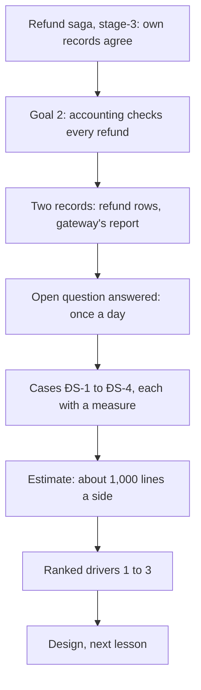

## Before you start

- [[sysdesign.l4.notification-challenges]] — you finished the notification problem; this lesson starts the payments problem at step 1.
- [[backend.l3.safe-to-repeat-saga-steps]] — you know `RefundSender` sends the key `refund-` plus the row's id on every call for one row, so a retry cannot refund twice.
- [[backend.l3.compensating-action]] — you know a refusal marks the refund row `failed` with the reason, and the saga then puts the order back to `paid`.
- [[management.l3.exit-plan]] — you know ADR `0010`'s exit plan exports Gateway A's refund history as CSV, so accounting can still check refunds after the contract ends.

## The situation

An accountant asks the team for one thing: proof that every refund Gateway A made last month is a refund Payments recorded, for the same amount. A teammate says this cannot go wrong. Every call sends an idempotency key, and the saga marks each row `refunded` or `failed`.

Then someone from customer care mentions a refund they made by hand last week, on the gateway's admin page, the way staff worked before refunds were built. Payments has no row for it, and nothing in Đơn Hàng would ever notice. What must a check of Payments' rows against the gateway's own records find, and how soon?

## Core concepts

- **reconciliation** — comparing two independent records of the same money, here Payments' refund rows and the gateway's records, and explaining every line on which they differ.
- **settlement report** — the gateway's own list of the money it moved for a merchant in a period; for Gateway A, the refund history it exports as CSV, a text file of rows with comma-separated values.
- a difference — one line found in only one record, or in both with different values, which a person must explain.
- the run schedule — how often the check runs and when its results are due; here once a day, by the next working morning (assumed).
- ranked drivers — the few scenarios, in order, that the design must satisfy first when two of them pull in different directions.

## How it works



In the situation above, the accountant is asking for reconciliation. The team does not start from a blank page. The stage-3 refund saga keeps Đơn Hàng's own records consistent: the order, the refund row in `donhang_payments`, the email. It never compares those rows with what Gateway A actually did. Goal 2 of `refund-requirements.md`, the stage-3 requirements document for refunds, accounting checks every refund without asking anyone, needs that comparison.

The second record already exists. The vendor evaluation tested that Gateway A exports its refund history as CSV at any time (criterion T7). That export is the settlement report. In the lab, `GET /v1/refunds` on `fake-gateway` stands in for it.

`refund-requirements.md` left an open question: what list accounting needs, and how often. The new requirements answer it with assumed figures: one run a day, results by the next working morning.

Clarifying questions then find the cases that matter. The gateway refunded while Payments marked the row `failed`. The gateway has a refund with no row, such as one made by hand. A row says `refunded` but the report lacks it. Both sides have the refund with different amounts. Each case becomes a scenario with a measure, numbered ĐS-1 to ĐS-4 (ĐS for đối soát, the team's Vietnamese word for reconciliation).

The estimate finds a day's refunds a small batch (assumed), so load does not shape this design. Last, the scenarios are ranked into drivers, and the design in the next lesson is judged against them in that order.

## In the Đơn Hàng system

The start of the team's requirements, at this tag:

```markdown file=docs/team/reconciliation-requirements.md tag=stage-4 lines=8-32
### Xuất phát

Saga hoàn tiền của stage-3 (`refund-design.md`, ADR 0003) giữ dữ liệu của chính
Đơn Hàng khớp nhau: đơn, dòng hoàn tiền trong `donhang_payments`, email. Nó
không bao giờ so các dòng đó với những gì Cổng A đã thực sự làm. Mục tiêu 2 của
`refund-requirements.md` (kế toán đối soát được mỗi khoản hoàn tiền) cần việc
so đó.

Đối soát là so hai bản ghi độc lập của cùng một khoản tiền, ở đây dòng hoàn
tiền của Payments và báo cáo của cổng, rồi giải thích mọi dòng hai bên khác
nhau. Báo cáo của cổng là lịch sử hoàn tiền Cổng A cho xuất dạng CSV mọi lúc,
qua trang quản trị và qua API (T7 của `payment-gateway-evaluation.md`); trong
lab, `GET /v1/refunds` của `fake-gateway` đóng vai báo cáo đó.

### Phạm vi

- Trong phạm vi: các khoản hoàn tiền qua Cổng A.
- Ngoài phạm vi: thu tiền (Payments không có luồng thu tiền); các khoản hoàn
  tay ngoài cổng, như đơn chuyển khoản (ADR 0010) và yêu cầu bị cổng từ chối
  mà chăm sóc khách hàng xử lý (R4 của `risk-register-example.md`).

Câu hỏi mở "kế toán cần danh sách hoàn tiền dạng nào, bao lâu một lần" của
`refund-requirements.md` được trả lời ở đây: đối soát mỗi ngày một lần, kết quả
có trước sáng ngày làm việc kế tiếp (giả định, kế toán xác nhận). File
`refund-requirements.md` không sửa.
```

The starting point repeats the gap the saga leaves. The next paragraph defines reconciliation in the team's words and names the report: Gateway A's CSV refund history, from its admin page or its API.

The scope is narrow on purpose. Only refunds through Gateway A are in. Charging is out, because Payments has no charging flow. Refunds made outside the gateway are out too: bank-transfer orders, which ADR `0010` sends to customer care, and refusals that customer care handles under risk R4. A refund customer care makes by hand on Gateway A's admin page still goes through the gateway, so it is in scope as ĐS-2.

The last paragraph answers the open question from `refund-requirements.md` with an assumption accounting confirms. The older file is not edited; the answer lives here.

The cases and the estimate, from the same file:

```markdown file=docs/team/reconciliation-requirements.md tag=stage-4 lines=34-51
### Kịch bản

| Số | Tình huống | Phản hồi | Đo |
|---|---|---|---|
| ĐS-1 | Cổng đã hoàn tiền, nhưng dòng của Payments là `failed` (câu trả lời bị lạc) | Hiện thành một chỗ lệch cho nhân viên | Phát hiện trong lần chạy kế tiếp, tức trong một ngày |
| ĐS-2 | Cổng có khoản hoàn không có dòng nào trong Payments (ví dụ hoàn tay trên trang quản trị của cổng) | Hiện thành một chỗ lệch | Như trên |
| ĐS-3 | Dòng `refunded` của Payments không có trong báo cáo | Hiện thành một chỗ lệch, sau thêm một lần chạy | Trong hai ngày |
| ĐS-4 | Hai bên cùng có khoản hoàn nhưng số tiền khác | Hiện thành một chỗ lệch | Trong một ngày |

Mọi chỗ lệch được nhân viên giải thích; không chỗ nào tự biến mất.

### Ước lượng

- Theo ví dụ của `system-design-method.md`: 1% số đơn bị yêu cầu hoàn tiền
  (giả định), khoảng 500 khoản mỗi ngày thường, khoảng 1.000 trong ngày đông
  nhất.
- Một lần chạy mỗi ngày so khoảng 1.000 dòng mỗi bên: một lô nhỏ. Tải không
  định hình thiết kế.
```

ĐS-1 is the gateway refunding while the row says `failed`, because no answer reached Payments before the 24-hour retry window ended; it must show within a day. ĐS-2 is a gateway refund with no row, such as a hand refund on the admin page. ĐS-3 is a `refunded` row missing from the report; it becomes a difference only after one more run, because a refund near the end of a day may appear only in the next day's report, so within two days. ĐS-4 is the same refund with different amounts. The line under the table is the rule behind all four: staff explain every difference, and none disappears by itself.

The estimate reuses the method's example (1% of orders, assumed): about 1,000 lines a side on the busiest day, a small batch.

Below the excerpt, an assumptions table names who confirms each one. The developer on the gateway integration confirms that Gateway A's report carries each refund's idempotency key, as the lab's `GET /v1/refunds` does. That key, `refund-` plus the row's id, is how a report line is paired with its row. The same developer confirms the late appearance behind ĐS-3. Accounting confirms that once a day is enough.

The file ends with the ranked drivers, in order: every difference explained; each difference found within a day (two for ĐS-3, as its measure says); money corrected only by people, never by a job.

## Trade-offs

| How the team frames the request | What it gets | What it costs | Right when |
|---|---|---|---|
| Trust the saga and the keys, check nothing | nothing to build | ĐS-1 and ĐS-2 are never found; accounting has no list | never, while another party moves the money |
| Check against the gateway after every refund | differences seen sooner | a call per refund, and a hand refund with no row is still never asked about | a late difference has a measurable cost |
| One run a day, results by next working morning (chosen, assumed) | a small batch, run once | a difference can stay unseen for up to a day, two for ĐS-3 | accounting reads the results the next morning |

The third driver is a trade-off too. A job that corrects a row by itself would close a difference sooner. It would also change a money record with nobody accountable for it. Keeping correction with people makes every change to money a decision someone made, at the price of staff time for each difference.

## What would you choose if…

…accounting says a difference must be seen within an hour, not a day? The assumptions table names accounting as the confirmer of "once a day". Change the measure in ĐS-1 to ĐS-4 before the design, and expect the design to cost more.

…the developer on the gateway integration finds the real report does not carry the idempotency key? That assumption has an owner because the check needs some way to pair a report line with a row. Record it as a risk and settle it against Gateway A's real report in its test environment before the design depends on it.

…a refund made just before midnight is missing from that day's report? That is the third assumption, and the reason ĐS-3 waits one more run.

## Seniors often assume…

- **"With an idempotency key on every call, the gateway and our records can never disagree."** → Actually the key stops one row from being refunded twice. It cannot stop a refund made with no row, such as a hand refund on the admin page (ĐS-2). And if no answer gets back to Payments before the 24-hour retry window ends, the row ends `failed` even though the gateway refunded (ĐS-1). You notice this when the gateway's report has more lines than Payments has `refunded` rows.
- **"Reconciliation is accounting's job; the system only has to record the refunds."** → Actually accounting can only explain the differences someone shows them. Goal 2 of `refund-requirements.md` asks that accounting check every refund without asking anyone, so the system must produce the list of differences. You notice this when an accountant asks a developer for an export every month.
- **"If a refund row says `refunded`, the customer has the money, so there is nothing to check."** → Actually `refunded` is what Payments recorded from one answer of the gateway. The report is the gateway's own record, and ĐS-3 and ĐS-4 are exactly the cases where a `refunded` row and the report disagree. You notice this when a customer says a refund marked `refunded` never arrived.

## Try it (3 minutes)

Payments has these refund rows for one day:

- row 41, order 10, `refunded`, 350,000 VND
- row 42, order 11, `failed`
- row 43, order 12, `refunded`, 200,000 VND
- row 44, order 7, `refunded`, 500,000 VND

The gateway's report for the same day has these lines:

- key `refund-41`, order 10, 350,000 VND
- key `refund-42`, order 11, 120,000 VND
- order 5, 90,000 VND, with a key that matches no row
- key `refund-44`, order 7, 50,000 VND

Classify each row and each line: matched, or one of ĐS-1 to ĐS-4. For each difference, say by when it must be found.

Expected result: one match, three differences now (ĐS-1, ĐS-2, ĐS-4, each within a day) and one row that becomes ĐS-3 if the next run still has no line.

<details><summary>Suggested answer</summary>

Row 41 and `refund-41` match: same key, same amount. Row 42 is `failed`, but the gateway refunded it: ĐS-1, found in the next run. The line for order 5 has no row: ĐS-2, found in the next run. Row 43 is `refunded` with no line: not a difference yet, because the refund may appear in the next day's report; it becomes ĐS-3 if the next run still has no line, within two days. Row 44 and `refund-44` disagree on the amount: ĐS-4, within a day. No difference is fixed by the check; each goes to staff to explain.

</details>

## Connections

- [[sysdesign.l4.clarifying-requirements]] — the general step this lesson applies: a request becomes scope, scenarios with measures and confirmed assumptions.
- [[management.l3.evaluating-a-vendor]] — where criterion T7, the export of refund history, was tested; that export is now the settlement report.
- [[backend.l4.data-ownership]] — why Payments' refund rows in `donhang_payments` are Đơn Hàng's one record of refunds, the side compared with the gateway.
- [[backend.l3.timeouts]] — a timeout ends the wait, not the work, so a call without an answer says nothing about whether the gateway refunded.
- [[sysdesign.l4.payment-reconciliation-design]] — the next step: a design judged against these ranked drivers.

## Five-line summary

1. Reconciliation compares two independent records of the same money, Payments' refund rows and the gateway's report, and explains every line on which they differ.
2. The stage-3 refund saga keeps Đơn Hàng's own records consistent but never checks them against what the gateway actually did.
3. The settlement report is Gateway A's own list of refunds, exported as CSV at any time; `GET /v1/refunds` on `fake-gateway` stands in for it.
4. `reconciliation-requirements.md` answers the open question from `refund-requirements.md`: one run a day, results by the next working morning (assumed).
5. ĐS-1 to ĐS-4 find lost answers, hand refunds, missing rows, wrong amounts; drivers: differences explained, found within a day (two for ĐS-3), corrected by people.
