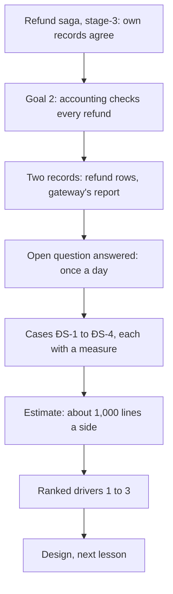

## Bạn cần biết trước

- [[sysdesign.l4.notification-challenges]] — bạn đã xong bài toán thông báo. Bài này mở bài toán thanh toán, từ bước 1.
- [[backend.l3.safe-to-repeat-saga-steps]] — bạn biết `RefundSender` gửi khóa `refund-` cộng id của dòng trong mọi lần gọi cho cùng một dòng, nên một lần thử lại không thể hoàn tiền hai lần.
- [[backend.l3.compensating-action]] — bạn biết khi cổng từ chối, dòng hoàn tiền được đánh dấu `failed` kèm lý do, rồi saga đưa đơn về lại `paid`.
- [[management.l3.exit-plan]] — bạn biết kế hoạch rời đi của ADR `0010` xuất lịch sử hoàn tiền của Cổng A dưới dạng CSV, để kế toán vẫn kiểm được các khoản hoàn sau khi hợp đồng kết thúc.

## Tình huống

Một kế toán nhờ đội đúng một việc: chứng minh rằng mọi khoản hoàn tiền Cổng A đã làm trong tháng trước đều là khoản Payments có ghi lại, với cùng số tiền. Một đồng nghiệp bảo chuyện này không thể sai. Mỗi lần gọi đều gửi idempotency key, và saga đánh dấu từng dòng là `refunded` hoặc `failed`.

Rồi một người bên chăm sóc khách hàng kể về một khoản họ hoàn tay tuần trước, trên trang quản trị của cổng, theo cách nhân viên vẫn làm trước khi có tính năng hoàn tiền. Payments không có dòng nào cho khoản đó, và không chỗ nào trong Đơn Hàng sẽ phát hiện ra. Một lần kiểm tra các dòng của Payments với chính bản ghi của cổng phải tìm ra những gì, và trong bao lâu?

## Khái niệm cốt lõi

- **đối soát** (reconciliation) — so hai bản ghi độc lập của cùng một khoản tiền, ở đây là các dòng hoàn tiền của Payments và bản ghi của cổng, rồi giải thích mọi dòng mà hai bên khác nhau.
- **báo cáo quyết toán của cổng** (settlement report) — danh sách do chính cổng thanh toán lập về số tiền nó đã chuyển cho một bên bán trong một kỳ. Với Cổng A, đó là lịch sử hoàn tiền nó xuất dạng CSV, một file văn bản gồm các dòng có giá trị ngăn bằng dấu phẩy.
- một chỗ lệch — một dòng chỉ có ở một bên, hoặc có ở cả hai bên nhưng giá trị khác nhau, mà một người phải giải thích.
- lịch chạy — lần kiểm tra chạy bao lâu một lần và khi nào phải có kết quả. Ở đây là mỗi ngày một lần, có trước sáng ngày làm việc kế tiếp (giả định).
- các yếu tố định hình kiến trúc đã xếp hạng — vài kịch bản, theo thứ tự, mà thiết kế phải ưu tiên đáp ứng khi hai kịch bản kéo về hai hướng khác nhau.

## Cơ chế hoạt động



Trong tình huống trên, kế toán đang đòi đối soát. Đội không bắt đầu từ trang trắng. Saga hoàn tiền của stage-3 giữ dữ liệu của chính Đơn Hàng khớp nhau: đơn, dòng hoàn tiền trong `donhang_payments`, email. Nó không bao giờ so các dòng đó với những gì Cổng A đã thực sự làm. Mục tiêu 2 của `refund-requirements.md`, tài liệu yêu cầu cho hoàn tiền ở stage-3, là kế toán kiểm được mọi khoản hoàn tiền mà không phải hỏi ai. Mục tiêu đó cần phép so này.

Bản ghi thứ hai đã có sẵn. Bản đánh giá nhà cung cấp đã kiểm rằng Cổng A cho xuất lịch sử hoàn tiền dạng CSV vào bất kỳ lúc nào (tiêu chí T7). File xuất đó chính là báo cáo quyết toán. Trong lab, `GET /v1/refunds` của `fake-gateway` đóng vai báo cáo đó.

`refund-requirements.md` còn để mở một câu hỏi: kế toán cần danh sách nào, và bao lâu một lần. Yêu cầu mới trả lời bằng các con số giả định: mỗi ngày chạy một lần, có kết quả trước sáng ngày làm việc kế tiếp.

Sau đó, các câu hỏi làm rõ yêu cầu tìm ra những trường hợp quan trọng. Cổng đã hoàn tiền trong khi Payments đánh dấu dòng là `failed`. Cổng có một khoản hoàn không có dòng nào, như một khoản hoàn tay. Một dòng ghi `refunded` nhưng báo cáo không có. Cả hai bên cùng có khoản hoàn nhưng số tiền khác nhau. Mỗi trường hợp thành một kịch bản có cách đo, đánh số từ ĐS-1 tới ĐS-4 (ĐS là viết tắt của "đối soát", từ đội dùng cho việc này).

Bản ước lượng cho thấy số khoản hoàn trong một ngày là một lô nhỏ (giả định), nên tải không định hình thiết kế này. Cuối cùng, các kịch bản được xếp hạng thành yếu tố định hình kiến trúc, và thiết kế ở bài sau được đánh giá theo đúng thứ tự đó.

## Trong hệ thống Đơn Hàng

Phần đầu tài liệu yêu cầu của đội, ở tag này:

```markdown file=docs/team/reconciliation-requirements.md tag=stage-4 lines=8-32
### Xuất phát

Saga hoàn tiền của stage-3 (`refund-design.md`, ADR 0003) giữ dữ liệu của chính
Đơn Hàng khớp nhau: đơn, dòng hoàn tiền trong `donhang_payments`, email. Nó
không bao giờ so các dòng đó với những gì Cổng A đã thực sự làm. Mục tiêu 2 của
`refund-requirements.md` (kế toán đối soát được mỗi khoản hoàn tiền) cần việc
so đó.

Đối soát là so hai bản ghi độc lập của cùng một khoản tiền, ở đây dòng hoàn
tiền của Payments và báo cáo của cổng, rồi giải thích mọi dòng hai bên khác
nhau. Báo cáo của cổng là lịch sử hoàn tiền Cổng A cho xuất dạng CSV mọi lúc,
qua trang quản trị và qua API (T7 của `payment-gateway-evaluation.md`); trong
lab, `GET /v1/refunds` của `fake-gateway` đóng vai báo cáo đó.

### Phạm vi

- Trong phạm vi: các khoản hoàn tiền qua Cổng A.
- Ngoài phạm vi: thu tiền (Payments không có luồng thu tiền); các khoản hoàn
  tay ngoài cổng, như đơn chuyển khoản (ADR 0010) và yêu cầu bị cổng từ chối
  mà chăm sóc khách hàng xử lý (R4 của `risk-register-example.md`).

Câu hỏi mở "kế toán cần danh sách hoàn tiền dạng nào, bao lâu một lần" của
`refund-requirements.md` được trả lời ở đây: đối soát mỗi ngày một lần, kết quả
có trước sáng ngày làm việc kế tiếp (giả định, kế toán xác nhận). File
`refund-requirements.md` không sửa.
```

Phần xuất phát nhắc lại khoảng trống mà saga để lại. Đoạn tiếp theo định nghĩa đối soát bằng lời của đội và nêu tên báo cáo: lịch sử hoàn tiền dạng CSV của Cổng A, lấy từ trang quản trị hoặc qua API.

Phạm vi được giữ hẹp có chủ ý. Chỉ các khoản hoàn qua Cổng A nằm trong phạm vi. Thu tiền nằm ngoài, vì Payments không có luồng thu tiền. Các khoản hoàn ngoài cổng cũng nằm ngoài: đơn chuyển khoản, mà ADR `0010` giao cho chăm sóc khách hàng, và các yêu cầu bị từ chối mà chăm sóc khách hàng xử lý theo rủi ro R4. Một khoản chăm sóc khách hàng hoàn tay trên trang quản trị của Cổng A thì vẫn đi qua cổng, nên nó nằm trong phạm vi, dưới tên ĐS-2.

Đoạn cuối trả lời câu hỏi mở từ `refund-requirements.md` bằng một giả định do kế toán xác nhận. File cũ không bị sửa. Câu trả lời nằm ở file mới.

Các kịch bản và bản ước lượng, cũng từ file đó:

```markdown file=docs/team/reconciliation-requirements.md tag=stage-4 lines=34-51
### Kịch bản

| Số | Tình huống | Phản hồi | Đo |
|---|---|---|---|
| ĐS-1 | Cổng đã hoàn tiền, nhưng dòng của Payments là `failed` (câu trả lời bị lạc) | Hiện thành một chỗ lệch cho nhân viên | Phát hiện trong lần chạy kế tiếp, tức trong một ngày |
| ĐS-2 | Cổng có khoản hoàn không có dòng nào trong Payments (ví dụ hoàn tay trên trang quản trị của cổng) | Hiện thành một chỗ lệch | Như trên |
| ĐS-3 | Dòng `refunded` của Payments không có trong báo cáo | Hiện thành một chỗ lệch, sau thêm một lần chạy | Trong hai ngày |
| ĐS-4 | Hai bên cùng có khoản hoàn nhưng số tiền khác | Hiện thành một chỗ lệch | Trong một ngày |

Mọi chỗ lệch được nhân viên giải thích; không chỗ nào tự biến mất.

### Ước lượng

- Theo ví dụ của `system-design-method.md`: 1% số đơn bị yêu cầu hoàn tiền
  (giả định), khoảng 500 khoản mỗi ngày thường, khoảng 1.000 trong ngày đông
  nhất.
- Một lần chạy mỗi ngày so khoảng 1.000 dòng mỗi bên: một lô nhỏ. Tải không
  định hình thiết kế.
```

ĐS-1 là khi cổng đã hoàn tiền nhưng dòng ghi `failed`, vì không có câu trả lời nào về tới Payments trước khi cửa sổ thử lại 24 giờ kết thúc. Nó phải hiện ra trong một ngày. ĐS-2 là một khoản hoàn của cổng không có dòng nào, như một khoản hoàn tay trên trang quản trị. ĐS-3 là một dòng `refunded` không có trong báo cáo. Nó chỉ thành chỗ lệch sau thêm một lần chạy, vì khoản hoàn gần cuối ngày có thể chỉ xuất hiện trong báo cáo của ngày hôm sau, nên hạn là trong hai ngày. ĐS-4 là cùng một khoản hoàn nhưng số tiền khác nhau. Dòng bên dưới bảng là quy tắc đứng sau cả bốn: nhân viên giải thích mọi chỗ lệch, và không chỗ nào tự biến mất.

Bản ước lượng dùng lại ví dụ của tài liệu phương pháp (1% số đơn, giả định): khoảng 1.000 dòng mỗi bên vào ngày đông nhất, một lô nhỏ.

Bên dưới đoạn trích, một bảng giả định ghi ai xác nhận từng giả định. Lập trình viên phụ trách tích hợp cổng xác nhận rằng báo cáo của Cổng A mang idempotency key của từng khoản hoàn, giống `GET /v1/refunds` trong lab. Khóa đó, `refund-` cộng id của dòng, là cách ghép một dòng báo cáo với dòng hoàn tiền của nó. Cũng lập trình viên đó xác nhận chuyện xuất hiện muộn đứng sau ĐS-3. Kế toán xác nhận mỗi ngày một lần là đủ.

File kết thúc bằng các yếu tố định hình kiến trúc đã xếp hạng, theo thứ tự: mọi chỗ lệch đều được giải thích, mỗi chỗ lệch được tìm ra trong một ngày (hai ngày với ĐS-3, như cách đo của nó ghi), tiền chỉ được sửa bởi con người, không bao giờ bởi một job.

## Đánh đổi

| Cách đội đặt vấn đề | Được gì | Cái giá | Đúng khi |
|---|---|---|---|
| Tin saga và các khóa, không kiểm gì | không phải xây gì | ĐS-1 và ĐS-2 không bao giờ bị phát hiện, kế toán không có danh sách | không bao giờ, khi còn một bên khác chuyển tiền |
| Kiểm với cổng sau mỗi khoản hoàn | thấy chỗ lệch sớm hơn | mỗi khoản hoàn tốn một lần gọi, và khoản hoàn tay không có dòng vẫn không bao giờ được hỏi tới | một chỗ lệch phát hiện muộn gây thiệt hại đo được |
| Mỗi ngày chạy một lần, kết quả trước sáng ngày làm việc kế tiếp (đã chọn, giả định) | một lô nhỏ, chạy một lần | một chỗ lệch có thể nằm im tới một ngày, hai ngày với ĐS-3 | kế toán đọc kết quả vào sáng hôm sau |

Yếu tố định hình kiến trúc thứ ba cũng là một đánh đổi. Một job tự sửa dòng sẽ đóng chỗ lệch sớm hơn. Nhưng nó cũng đổi một bản ghi về tiền mà không ai chịu trách nhiệm cho thay đổi đó. Giữ việc sửa trong tay con người khiến mọi thay đổi về tiền đều là quyết định của một người cụ thể, với cái giá là thời gian nhân viên bỏ ra cho từng chỗ lệch.

## Bạn sẽ chọn gì nếu…

…kế toán nói một chỗ lệch phải hiện ra trong một giờ, không phải một ngày? Bảng giả định ghi kế toán là người xác nhận "mỗi ngày một lần". Sửa cách đo trong ĐS-1 tới ĐS-4 trước khi thiết kế, và chuẩn bị cho một thiết kế tốn kém hơn.

…lập trình viên phụ trách tích hợp cổng phát hiện báo cáo thật không mang idempotency key? Giả định đó có người phụ trách chính vì lần kiểm tra phải có cách nào đó để ghép một dòng báo cáo với một dòng hoàn tiền. Ghi nó thành một rủi ro, và chốt nó với báo cáo thật của Cổng A trong môi trường thử nghiệm của cổng, trước khi thiết kế dựa vào nó.

…một khoản hoàn làm ngay trước nửa đêm không có trong báo cáo của ngày hôm đó? Đó là giả định thứ ba, và là lý do ĐS-3 chờ thêm một lần chạy.

## Senior hay nhầm rằng…

- **"Mỗi lần gọi đều có idempotency key, nên cổng và dữ liệu của mình không bao giờ lệch nhau."** → Thực ra khóa chỉ chặn một dòng bị hoàn tiền hai lần. Nó không chặn được khoản hoàn không có dòng nào, như khoản hoàn tay trên trang quản trị (ĐS-2). Và nếu không có câu trả lời nào về tới Payments trước khi cửa sổ thử lại 24 giờ kết thúc, dòng sẽ kết thúc ở `failed` dù cổng đã hoàn tiền (ĐS-1). Bạn sẽ nhận ra khi báo cáo của cổng có nhiều dòng hơn số dòng `refunded` của Payments.
- **"Đối soát là việc của kế toán, hệ thống chỉ cần ghi lại các khoản hoàn."** → Thực ra kế toán chỉ giải thích được những chỗ lệch có người chỉ ra cho họ. Mục tiêu 2 của `refund-requirements.md` đòi kế toán kiểm được mọi khoản hoàn mà không phải hỏi ai, nên hệ thống phải tạo ra danh sách chỗ lệch. Bạn sẽ nhận ra khi tháng nào kế toán cũng nhờ một lập trình viên xuất dữ liệu.
- **"Dòng hoàn tiền ghi `refunded` nghĩa là khách đã nhận tiền, nên chẳng có gì phải kiểm."** → Thực ra `refunded` là điều Payments ghi lại từ một câu trả lời của cổng. Báo cáo mới là bản ghi của chính cổng, và ĐS-3, ĐS-4 đúng là những trường hợp dòng `refunded` và báo cáo không khớp nhau. Bạn sẽ nhận ra khi một khách hàng nói khoản hoàn đã ghi `refunded` chưa bao giờ về tới họ.

## Thử ngay (3 phút)

Payments có các dòng hoàn tiền sau trong một ngày:

- dòng 41, đơn 10, `refunded`, 350.000 VND
- dòng 42, đơn 11, `failed`
- dòng 43, đơn 12, `refunded`, 200.000 VND
- dòng 44, đơn 7, `refunded`, 500.000 VND

Báo cáo của cổng cho cùng ngày có các dòng sau:

- khóa `refund-41`, đơn 10, 350.000 VND
- khóa `refund-42`, đơn 11, 120.000 VND
- đơn 5, 90.000 VND, với một khóa không khớp dòng nào
- khóa `refund-44`, đơn 7, 50.000 VND

Phân loại từng dòng của mỗi bên: khớp, hay là một trong ĐS-1 tới ĐS-4. Với mỗi chỗ lệch, nói hạn chót phải tìm ra nó.

Kết quả mong đợi: một cặp khớp, ba chỗ lệch ngay bây giờ (ĐS-1, ĐS-2, ĐS-4, mỗi chỗ trong một ngày) và một dòng sẽ thành ĐS-3 nếu lần chạy kế tiếp vẫn không có dòng báo cáo tương ứng.

<details><summary>Gợi ý đáp án</summary>

Dòng 41 và `refund-41` khớp: cùng khóa, cùng số tiền. Dòng 42 là `failed`, nhưng cổng đã hoàn tiền: ĐS-1, tìm ra trong lần chạy kế tiếp. Dòng báo cáo cho đơn 5 không có dòng hoàn tiền nào: ĐS-2, tìm ra trong lần chạy kế tiếp. Dòng 43 là `refunded` nhưng không có dòng báo cáo: chưa phải chỗ lệch, vì khoản hoàn có thể xuất hiện trong báo cáo ngày hôm sau. Nó thành ĐS-3 nếu lần chạy kế tiếp vẫn không có dòng báo cáo, trong hai ngày. Dòng 44 và `refund-44` lệch nhau về số tiền: ĐS-4, trong một ngày. Lần kiểm tra không sửa chỗ lệch nào. Mỗi chỗ được chuyển cho nhân viên giải thích.

</details>

## Liên hệ

- [[sysdesign.l4.clarifying-requirements]] — bước tổng quát mà bài này áp dụng: một yêu cầu trở thành phạm vi, các kịch bản có cách đo và các giả định đã được xác nhận.
- [[management.l3.evaluating-a-vendor]] — nơi tiêu chí T7, xuất lịch sử hoàn tiền, được kiểm. File xuất đó giờ là báo cáo quyết toán.
- [[backend.l4.data-ownership]] — vì sao các dòng hoàn tiền của Payments trong `donhang_payments` là bản ghi duy nhất của Đơn Hàng về hoàn tiền, phía được đem so với cổng.
- [[backend.l3.timeouts]] — timeout kết thúc việc chờ, không kết thúc công việc, nên một lần gọi không có câu trả lời không cho biết cổng đã hoàn tiền hay chưa.
- [[sysdesign.l4.payment-reconciliation-design]] — bước tiếp theo: một thiết kế được đánh giá theo các yếu tố định hình kiến trúc đã xếp hạng này.

## Tóm tắt 5 dòng

1. Đối soát so hai bản ghi độc lập của cùng một khoản tiền, các dòng hoàn tiền của Payments và báo cáo của cổng, rồi giải thích mọi dòng hai bên khác nhau.
2. Saga hoàn tiền của stage-3 giữ dữ liệu của chính Đơn Hàng khớp nhau, nhưng không bao giờ kiểm chúng với những gì cổng đã thực sự làm.
3. Báo cáo quyết toán của cổng là danh sách hoàn tiền do chính Cổng A lập, xuất dạng CSV vào bất kỳ lúc nào, và `GET /v1/refunds` của `fake-gateway` đóng vai nó.
4. `reconciliation-requirements.md` trả lời câu hỏi mở từ `refund-requirements.md`: mỗi ngày chạy một lần, kết quả trước sáng ngày làm việc kế tiếp (giả định).
5. ĐS-1 tới ĐS-4 tìm câu trả lời bị lạc, khoản hoàn tay, dòng bị thiếu, số tiền sai. Các yếu tố định hình kiến trúc: chỗ lệch được giải thích, tìm ra trong một ngày (hai ngày với ĐS-3), do con người sửa.
