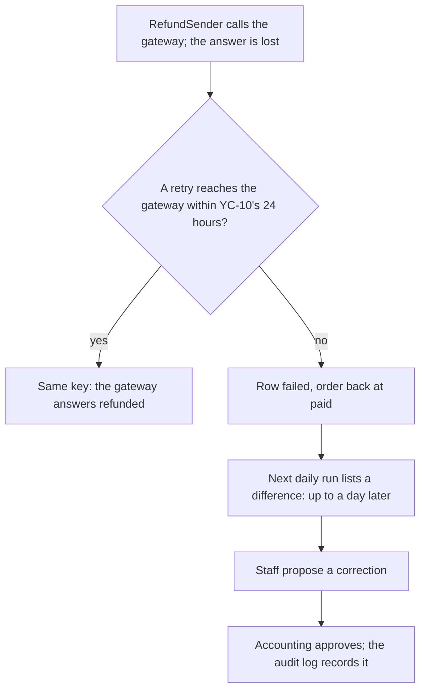

## Before you start

- [[sysdesign.l4.payment-reconciliation-design]] — you know ADR `0028`'s daily job pairs each report line with a refund row by the key `refund-<id>`, never changes a row, and lists every difference for staff.
- [[design.l4.trade-off-points]] — you know a trade-off point is a decision that moves two quality attributes in opposite directions, and a sensitivity point is one that a single attribute depends on strongly.
- [[backend.l3.eventual-consistency]] — you know records joined by messages agree only after every message is handled, with no time limit promised.
- [[management.l4.compliance-controls]] — you know separation of duties means no one both makes and approves the same change, and that a control needs evidence someone else can inspect.

## The situation

The design review for ADR `0028` reaches its last section. Someone from accounting reads the line on frequency and objects: a refund the gateway made while its row ended `failed` can sit unnoticed until the next morning. Why not ask the gateway about every refund right after it is sent?

A developer adds another question: why stop retrying after 24 hours, if a longer window would leave fewer such rows? Then accounting repeats what it asked about ADR `0028`: could the job fix the obvious differences itself, without waiting for a person?

What does each of these choices buy, and what does it cost?

## Core concepts

- the run's frequency — how often the reconciliation job runs; ADR `0028` sets once a day, with results before the next working morning (assumed).
- the per-refund check — the rejected option of asking the gateway about each refund right after `RefundSender` sends it.
- the retry window — the time during which `RefundSender` keeps resending a refund before its row becomes `failed`; YC-10 asks for at least 24 hours, and Đơn Hàng uses exactly 24.
- hand correction — a fix to a refund row that staff propose and accounting approves (assumed roles), written to the audit log.
- the kept evidence — the saved report lines and each run's result, kept as long as the refund rows (assumed).

## How it works



The diagram follows one refund whose answer from the gateway is lost. The paragraphs below take its nodes in order: B–C the retry window, D–E the frequency, F–G hand correction.

`RefundSender` keeps resending the refund with the same key. If one attempt arrives within the 24 hours, the gateway, as the design assumes and the lab's fake gateway does, recognises the key and answers with the refund it already made, so the row ends `refunded`. When the window ends, the row becomes `failed` and its order goes back to `paid`, even if the gateway did refund. A longer window leaves fewer such rows. But orders stay `refunding` longer, and staff, who take over only once a row is `failed`, wait longer too.

A `failed` row the gateway refunded waits for the next daily run. Once a day is one job and one report fetched, and the report also lists refunds made outside Đơn Hàng. The cost is that a difference can sit unnoticed for up to a day. Driver 2 asks that each difference be found within a day, so once a day just meets it. The batch is small, about 1,000 refunds on the busiest day (assumed). The per-refund check would find a lost answer sooner, but adds one call per refund and cannot see a refund made by hand on the gateway's side.

Hand correction is slower than a job fixing rows, but no one person both makes and approves a change to money, as driver 3 requires.

Outside the diagram, the kept evidence takes storage for as long as the refund rows are kept.

## In the Đơn Hàng system

Stage-4 has no reconciliation code, but the retry window is already code. These are the settings `RefundSender` reads:

```csharp file=DonHang.Payments/RefundSender.cs tag=stage-4 lines=7-14
// How long RefundSender waits between tries, and when it gives up. The
// defaults are refund-design.md's; the lab sets them to seconds (Compose).
public sealed class RefundSettings
{
    public TimeSpan FirstRetryDelay { get; set; } = TimeSpan.FromMinutes(1);
    public TimeSpan MaxRetryDelay { get; set; } = TimeSpan.FromHours(1);
    public TimeSpan GiveUpAfter { get; set; } = TimeSpan.FromHours(24);
}
```

`GiveUpAfter` is YC-10's 24 hours, the retry window. Below the excerpt, `RecordResult` marks a row `failed` when the gateway refuses it or once `GiveUpAfter` has passed since the request. The comment is loose: the lab's Compose file shortens only the two delays, to 2 and 10 seconds. `GiveUpAfter` stays 24 hours in the lab too. This lesson weighs the window; it changes neither the settings nor YC-10.

The design review records the rejected options and the trade-off points:

```markdown file=docs/design/reconciliation-design-review.md tag=stage-4 lines=70-82
### Phương án bị loại và điểm đánh đổi (bước 3 và 4)

- Hỏi cổng sau mỗi khoản: thêm một lời gọi mỗi khoản, vẫn không thấy khoản
  hoàn làm ngoài Đơn Hàng; không thay được báo cáo.
- Chỉ tin câu trả lời của cổng: không có bản ghi thứ hai, trái driver 1.
- Điểm đánh đổi, tần suất: mỗi ngày một lần là một job và một báo cáo, nhưng
  một chỗ lệch nằm im tới một ngày (driver 2 vừa đủ).
- Điểm đánh đổi, cửa sổ 24 giờ của YC-10: dài hơn thì ít dòng `failed` mà cổng
  đã hoàn, nhưng đơn ở `refunding` lâu hơn và nhân viên chờ lâu hơn. Giữ 24 giờ.
- Điểm đánh đổi, sửa tay so với tự sửa: chậm hơn, nhưng không ai vừa làm vừa
  duyệt một thay đổi về tiền (driver 3).
- Điểm đánh đổi, lưu trữ: dòng báo cáo và kết quả giữ bằng thời gian giữ dòng
  hoàn tiền, làm bằng chứng cho kế toán, tốn chỗ lưu.
```

The first two bullets are the rejected options with their reasons. Trusting only the gateway's answer, as stage-3 does, leaves no second record, against driver 1, which asks that every difference be explained.

The four "Điểm đánh đổi" bullets are the trade-off points from the diagram and the storage cost, each with what it helps and what it hurts. Two name their driver: the frequency line calls driver 2 "vừa đủ", just met, and the hand-correction line names driver 3, no one both makes and approves a change to money. The window line ends with the decision, keep 24 hours. The storage line names the evidence's reader, accounting, and its cost.

ADR `0028`, outside these excerpts, records accounting's question from the situation and its answer: the job does not correct differences, for that same reason. The decision did not change.

## Trade-offs

| Choice | Helps | Hurts | Deciding driver, or what reopens it |
|---|---|---|---|
| Once a day (ADR `0028`'s choice) | one job, one report fetched; refunds made outside Đơn Hàng are seen | a difference can sit unnoticed for up to a day | driver 2, just met; ADR `0028` is reviewed again if refunds a day grow far beyond a small batch |
| Rejected: the per-refund check | a lost answer is found sooner | one more gateway call per refund; refunds made by hand stay invisible | cannot replace the report |
| Rejected: trust only the gateway's answer, as stage-3 does | nothing to build | no second record to compare | against driver 1 |
| Keep the 24-hour window (the review's choice) | orders leave `refunding` and staff take over within a day | some `failed` rows the gateway in fact refunded | YC-10, kept as it is |
| Hand correction, staff propose and accounting approves (assumed roles) | no one both makes and approves a change to money | slower; staff time for each difference | driver 3 |
| Keep report lines and results as long as refund rows (assumed) | evidence for accounting of how each difference was explained | storage | the refund rows' retention |

Every row rests on assumptions: the batch size, results by the next working morning, and the roles of staff and accounting. Where a day's unnoticed difference costs more than one extra call per refund, for example with large refunds, a team could add the per-refund check beside the report. It would still keep the report, because only the report shows a refund made by hand.

## What would you choose if…

…accounting decides that a difference must be found within an hour, not a day? That changes driver 2, and the frequency line names driver 2 as the one it just meets, so that line is reopened, not the whole design. `reconciliation-requirements.md` says Gateway A exports its refund history at any time, so more frequent runs are possible. Each run then fetches a report, and the rule of waiting one more run for a missing row needs weighing again, since one run would then mean an hour. The per-refund check might return beside the report, but the report stays the only place a refund made by hand appears.

…a developer proposes raising `GiveUpAfter` to 72 hours, so that a long outage leaves fewer `failed` rows the gateway in fact refunded? YC-10 asks for at least 24 hours, so the change is allowed. But orders would stay `refunding` for up to three days, staff would wait as long before taking over, and the report would still be needed for refunds made by hand and for amounts that differ. The review weighed this and kept 24 hours, so the change means reopening that line of the review, not editing a setting.

## Seniors often assume…

- **"Checking every refund the moment it happens is always better than a daily run."** → Actually the per-refund check finds only lost answers for refunds Đơn Hàng sent. It adds a gateway call per refund and never sees a refund made by hand on the gateway's side, so the daily report is needed anyway. You notice this when a refund made on the gateway's admin page appears on no list until the next report.
- **"Retrying the gateway for longer would remove the need to reconcile."** → Actually a longer window only lowers the number of `failed` rows the gateway refunded: an outage longer than any window still leaves some. It does nothing for refunds made by hand or amounts that differ. You notice this when a team doubles the window and the staff list still shows refunds with no row.
- **"Letting the job correct differences itself is safer, because a program makes no mistakes."** → Actually the job knows only that two records differ, not which one is right or why. A rule that rewrites money rows is a change nobody approved case by case, which separation of duties forbids under driver 3. You notice this when accounting asks who approved a correction and the only answer is a job's name.

## Try it (3 minutes)

Three proposals arrive after the review. For each, name the trade-off point it moves, what it helps and what it hurts.

1. Run the reconciliation job twice a day.
2. Set `GiveUpAfter` to 12 hours, so customers hear sooner when a refund fails.
3. Let the job mark a `failed` row `refunded` when the report has its key with the same amount.

Expected result: three lines, each naming one trade-off point, one gain and one cost; one proposal also breaks YC-10.

<details><summary>Suggested answer</summary>

1. Frequency. A difference sits unnoticed for at most about half a day, more margin on driver 2, at the cost of two runs and two report fetches a day.
2. The retry window. Orders leave `refunding` sooner and staff take over sooner, but more `failed` rows end up refunded by the gateway. It also breaks YC-10, which asks for at least 24 hours, so the review cannot choose it alone.
3. Hand correction against the job correcting. It saves staff time, but it is a change to money that nobody approved, against driver 3.

</details>

## Connections

- [[sysdesign.l4.payment-reconciliation-design]] — the design whose choices this lesson weighs.
- [[design.l4.trade-off-points]] — the idea applied here, one review line at a time.
- [[backend.l3.eventual-consistency]] — the same idea one step further out: the retry window is how long the row and the gateway may disagree before a person takes over.
- [[management.l4.compliance-controls]] — separation of duties, applied here to corrections of money rows, with the kept report lines as evidence.
- [[sysdesign.l4.finding-bottlenecks]] — the step that found no load bottleneck here, which is why one small daily batch is enough.
- [[management.l3.weighing-options-in-an-adr]] — how ADR `0028` keeps its rejected options and their reasons.
- [[backend.l3.safe-to-repeat-saga-steps]] — why a retry with the same key is safe, which a longer window relies on.
- [[sysdesign.l4.payment-reconciliation-challenges]] — the next step: answering the review's challenges from the refund saga's limits.

## Five-line summary

1. Reconciling once a day trades up to a day's unnoticed difference for one simple job that also sees refunds made outside Đơn Hàng.
2. Asking the gateway after each refund finds a lost answer sooner, but adds a call per refund and misses refunds made by hand.
3. A retry window longer than YC-10's 24 hours leaves fewer `failed` rows the gateway refunded, but keeps orders `refunding` and staff waiting longer.
4. Corrections by hand are slower, but staff propose and accounting approves (assumed), so no one both makes and approves a change to money.
5. Saved report lines and each run's result are kept as long as the refund rows (assumed): evidence for accounting, at the cost of storage.
