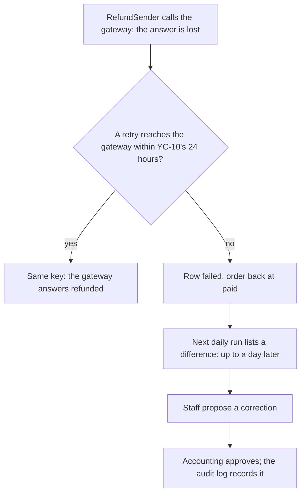

## Bạn cần biết trước

- [[sysdesign.l4.payment-reconciliation-design]] — bạn biết job hằng ngày của ADR `0028` ghép mỗi dòng báo cáo với một dòng hoàn tiền theo khóa `refund-<id>`, không bao giờ sửa dòng nào, và liệt kê mọi chỗ lệch cho nhân viên.
- [[design.l4.trade-off-points]] — bạn biết điểm đánh đổi là một quyết định kéo hai thuộc tính chất lượng về hai phía ngược nhau, còn điểm nhạy là quyết định mà một thuộc tính phụ thuộc mạnh vào.
- [[backend.l3.eventual-consistency]] — bạn biết các bản ghi nối với nhau qua message chỉ khớp sau khi mọi message đã được xử lý, và không có thời hạn nào được hứa.
- [[management.l4.compliance-controls]] — bạn biết tách biệt nhiệm vụ nghĩa là không ai vừa làm vừa duyệt cùng một thay đổi, và một biện pháp kiểm soát cần bằng chứng mà người khác kiểm tra được.

## Tình huống

Buổi review thiết kế cho ADR `0028` đi tới phần cuối. Một người bên kế toán đọc dòng về tần suất và phản đối: một khoản cổng đã hoàn trong khi dòng của nó kết thúc ở `failed` có thể nằm đó không ai thấy tới tận sáng hôm sau. Sao không hỏi cổng về từng khoản hoàn ngay sau khi gửi?

Một lập trình viên hỏi thêm: sao lại ngừng thử lại sau 24 giờ, nếu cửa sổ dài hơn sẽ để lại ít dòng như thế hơn? Rồi kế toán nhắc lại câu đã hỏi về ADR `0028`: job có thể tự sửa những chỗ lệch hiển nhiên, khỏi chờ người, được không?

Mỗi lựa chọn này được gì, và phải trả giá gì?

## Khái niệm cốt lõi

- tần suất chạy — job đối soát chạy bao lâu một lần. ADR `0028` chọn mỗi ngày một lần, có kết quả trước sáng ngày làm việc kế tiếp (giả định).
- kiểm tra từng khoản — phương án bị loại: hỏi cổng về mỗi khoản hoàn ngay sau khi `RefundSender` gửi nó.
- cửa sổ thử lại — khoảng thời gian `RefundSender` còn gửi lại một khoản hoàn trước khi dòng của nó thành `failed`. YC-10 đòi ít nhất 24 giờ, và Đơn Hàng dùng đúng 24 giờ.
- sửa tay — một lần sửa dòng hoàn tiền do nhân viên đề xuất và kế toán duyệt (vai trò giả định), ghi vào nhật ký kiểm toán.
- bằng chứng được giữ — các dòng báo cáo đã lưu và kết quả của mỗi lần chạy, giữ lâu bằng các dòng hoàn tiền (giả định).

## Cơ chế hoạt động



Sơ đồ đi theo một khoản hoàn mà câu trả lời từ cổng bị lạc. Các đoạn dưới đây lần lượt đi qua các nút: B–C là cửa sổ thử lại, D–E là tần suất, F–G là sửa tay.

`RefundSender` cứ gửi lại khoản hoàn với cùng một khóa. Nếu một lần gửi tới được cổng trong 24 giờ, cổng nhận ra khóa và trả lời bằng khoản hoàn nó đã làm, như thiết kế giả định và như cổng giả của lab vẫn làm, nên dòng kết thúc ở `refunded`. Khi hết cửa sổ, dòng thành `failed` và đơn của nó quay về `paid`, kể cả khi cổng đã hoàn tiền. Cửa sổ dài hơn để lại ít dòng như thế hơn. Nhưng đơn nằm ở `refunding` lâu hơn, và nhân viên, những người chỉ nhận việc khi dòng đã `failed`, cũng phải chờ lâu hơn.

Một dòng `failed` mà cổng đã hoàn sẽ chờ lần chạy hằng ngày kế tiếp. Mỗi ngày một lần là một job và một lần lấy báo cáo, và báo cáo còn liệt kê cả các khoản hoàn làm ngoài Đơn Hàng. Cái giá là một chỗ lệch có thể nằm im không ai thấy tới một ngày. Yếu tố định hình kiến trúc thứ 2 đòi mỗi chỗ lệch được tìm ra trong một ngày, nên mỗi ngày một lần vừa đủ đáp ứng. Lô việc nhỏ, khoảng 1.000 khoản hoàn vào ngày đông nhất (giả định). Kiểm tra từng khoản sẽ tìm ra câu trả lời bị lạc sớm hơn, nhưng thêm một lần gọi cho mỗi khoản hoàn và không thấy được khoản hoàn làm tay phía cổng.

Sửa tay chậm hơn để job tự sửa dòng, nhưng không ai vừa làm vừa duyệt một thay đổi về tiền, đúng như yếu tố thứ 3 đòi hỏi.

Ngoài sơ đồ, bằng chứng được giữ tốn chỗ lưu suốt thời gian các dòng hoàn tiền còn được giữ.

## Trong hệ thống Đơn Hàng

Stage-4 chưa có code đối soát, nhưng cửa sổ thử lại thì đã là code. Đây là các thiết lập mà `RefundSender` đọc:

```csharp file=DonHang.Payments/RefundSender.cs tag=stage-4 lines=7-14
// How long RefundSender waits between tries, and when it gives up. The
// defaults are refund-design.md's; the lab sets them to seconds (Compose).
public sealed class RefundSettings
{
    public TimeSpan FirstRetryDelay { get; set; } = TimeSpan.FromMinutes(1);
    public TimeSpan MaxRetryDelay { get; set; } = TimeSpan.FromHours(1);
    public TimeSpan GiveUpAfter { get; set; } = TimeSpan.FromHours(24);
}
```

`GiveUpAfter` là 24 giờ của YC-10, tức cửa sổ thử lại. Bên dưới đoạn trích, `RecordResult` đánh dấu một dòng là `failed` khi cổng từ chối nó, hoặc khi đã qua `GiveUpAfter` kể từ lúc có yêu cầu. Comment viết hơi lỏng: file Compose của lab chỉ rút ngắn hai khoảng chờ, còn 2 và 10 giây. `GiveUpAfter` vẫn là 24 giờ, kể cả trong lab. Bài này cân nhắc cửa sổ, không đổi các thiết lập cũng như YC-10.

Review thiết kế ghi lại các phương án bị loại và các điểm đánh đổi:

```markdown file=docs/design/reconciliation-design-review.md tag=stage-4 lines=70-82
### Phương án bị loại và điểm đánh đổi (bước 3 và 4)

- Hỏi cổng sau mỗi khoản: thêm một lời gọi mỗi khoản, vẫn không thấy khoản
  hoàn làm ngoài Đơn Hàng; không thay được báo cáo.
- Chỉ tin câu trả lời của cổng: không có bản ghi thứ hai, trái driver 1.
- Điểm đánh đổi, tần suất: mỗi ngày một lần là một job và một báo cáo, nhưng
  một chỗ lệch nằm im tới một ngày (driver 2 vừa đủ).
- Điểm đánh đổi, cửa sổ 24 giờ của YC-10: dài hơn thì ít dòng `failed` mà cổng
  đã hoàn, nhưng đơn ở `refunding` lâu hơn và nhân viên chờ lâu hơn. Giữ 24 giờ.
- Điểm đánh đổi, sửa tay so với tự sửa: chậm hơn, nhưng không ai vừa làm vừa
  duyệt một thay đổi về tiền (driver 3).
- Điểm đánh đổi, lưu trữ: dòng báo cáo và kết quả giữ bằng thời gian giữ dòng
  hoàn tiền, làm bằng chứng cho kế toán, tốn chỗ lưu.
```

Hai gạch đầu dòng đầu là các phương án bị loại cùng lý do. Chỉ tin câu trả lời của cổng, như stage-3 đang làm, thì không có bản ghi thứ hai, trái với yếu tố thứ 1, vốn đòi mọi chỗ lệch đều được giải thích.

Bốn gạch đầu dòng "Điểm đánh đổi" là các điểm đánh đổi trong sơ đồ cùng chi phí lưu trữ, mỗi dòng ghi nó giúp gì và làm hại gì. Hai dòng nêu tên yếu tố của mình: dòng tần suất ghi yếu tố thứ 2 là "vừa đủ", tức vừa đáp ứng được, còn dòng sửa tay nêu yếu tố thứ 3, không ai vừa làm vừa duyệt một thay đổi về tiền. Dòng cửa sổ kết thúc bằng quyết định: giữ 24 giờ. Dòng lưu trữ nêu người đọc bằng chứng là kế toán, và cái giá của nó.

ADR `0028`, ngoài các đoạn trích này, ghi lại câu hỏi của kế toán trong tình huống và câu trả lời: job không sửa chỗ lệch, cũng vì lý do đó. Quyết định không thay đổi.

## Đánh đổi

| Lựa chọn | Được gì | Cái giá | Yếu tố quyết định, hoặc điều khiến xem lại |
|---|---|---|---|
| Mỗi ngày một lần (ADR `0028` chọn) | một job, một lần lấy báo cáo; thấy được khoản hoàn làm ngoài Đơn Hàng | một chỗ lệch có thể nằm im tới một ngày | yếu tố thứ 2, vừa đủ; ADR `0028` được xem lại nếu số khoản hoàn mỗi ngày tăng vượt xa một lô nhỏ |
| Bị loại: kiểm tra từng khoản | câu trả lời bị lạc được tìm ra sớm hơn | thêm một lần gọi cổng cho mỗi khoản hoàn; khoản hoàn làm tay vẫn không thấy | không thay được báo cáo |
| Bị loại: chỉ tin câu trả lời của cổng, như stage-3 | không phải xây gì | không có bản ghi thứ hai để so | trái yếu tố thứ 1 |
| Giữ cửa sổ 24 giờ (review chọn) | đơn rời `refunding` và nhân viên nhận việc trong một ngày | vài dòng `failed` mà cổng thực ra đã hoàn | YC-10, giữ nguyên |
| Sửa tay, nhân viên đề xuất và kế toán duyệt (vai trò giả định) | không ai vừa làm vừa duyệt một thay đổi về tiền | chậm hơn; tốn thời gian nhân viên cho từng chỗ lệch | yếu tố thứ 3 |
| Giữ dòng báo cáo và kết quả lâu bằng dòng hoàn tiền (giả định) | bằng chứng cho kế toán về cách từng chỗ lệch được giải thích | chỗ lưu | thời gian giữ các dòng hoàn tiền |

Mọi dòng đều dựa trên giả định: cỡ lô, có kết quả trước sáng ngày làm việc kế tiếp, và vai trò của nhân viên và kế toán. Khi một chỗ lệch nằm im một ngày tốn kém hơn một lần gọi thêm cho mỗi khoản hoàn, ví dụ với các khoản hoàn lớn, đội có thể thêm kiểm tra từng khoản bên cạnh báo cáo. Đội vẫn giữ báo cáo, vì chỉ báo cáo mới cho thấy khoản hoàn làm tay.

## Bạn sẽ chọn gì nếu…

…kế toán quyết định một chỗ lệch phải được tìm ra trong một giờ, không phải một ngày? Điều đó đổi yếu tố thứ 2, và dòng tần suất nêu yếu tố thứ 2 là yếu tố nó vừa đáp ứng, nên chỉ dòng đó được mở lại, không phải cả thiết kế. `reconciliation-requirements.md` ghi rằng Cổng A xuất lịch sử hoàn tiền lúc nào cũng được, nên chạy dày hơn là làm được. Khi đó mỗi lần chạy đều lấy một báo cáo, và quy tắc chờ thêm một lần chạy với dòng bị thiếu cần cân nhắc lại, vì một lần chạy lúc ấy chỉ còn là một giờ. Kiểm tra từng khoản có thể quay lại bên cạnh báo cáo, nhưng báo cáo vẫn là nơi duy nhất khoản hoàn làm tay xuất hiện.

…một lập trình viên đề xuất nâng `GiveUpAfter` lên 72 giờ, để một lần cổng sập lâu để lại ít dòng `failed` mà cổng thực ra đã hoàn? YC-10 đòi ít nhất 24 giờ, nên thay đổi này được phép. Nhưng đơn sẽ nằm ở `refunding` tới ba ngày, nhân viên cũng chờ chừng ấy mới nhận việc, và vẫn cần báo cáo cho khoản hoàn làm tay và cho số tiền khác nhau. Review đã cân nhắc điều này và giữ 24 giờ, nên thay đổi nghĩa là mở lại dòng đó của review, không phải sửa một thiết lập.

## Senior hay nhầm rằng…

- **"Kiểm tra từng khoản hoàn ngay khi nó xảy ra luôn tốt hơn chạy hằng ngày."** → Thực ra kiểm tra từng khoản chỉ tìm ra câu trả lời bị lạc của những khoản hoàn Đơn Hàng đã gửi. Nó thêm một lần gọi cổng cho mỗi khoản hoàn và không bao giờ thấy khoản hoàn làm tay phía cổng, nên đằng nào cũng cần báo cáo hằng ngày. Bạn sẽ nhận ra khi một khoản hoàn làm trên trang quản trị của cổng không hiện trong danh sách nào cho tới báo cáo kế tiếp.
- **"Thử lại với cổng lâu hơn thì không cần đối soát nữa."** → Thực ra cửa sổ dài hơn chỉ giảm số dòng `failed` mà cổng đã hoàn: một lần cổng sập lâu hơn mọi cửa sổ vẫn để lại vài dòng. Nó không giúp gì cho khoản hoàn làm tay hay số tiền khác nhau. Bạn sẽ nhận ra khi đội tăng gấp đôi cửa sổ mà danh sách của nhân viên vẫn có khoản hoàn không có dòng.
- **"Để job tự sửa chỗ lệch thì an toàn hơn, vì chương trình không mắc lỗi."** → Thực ra job chỉ biết hai bản ghi khác nhau, không biết bên nào đúng hay vì sao. Một quy tắc ghi lại các dòng tiền là một thay đổi không ai duyệt từng trường hợp, điều mà tách biệt nhiệm vụ cấm theo yếu tố thứ 3. Bạn sẽ nhận ra khi kế toán hỏi ai đã duyệt một lần sửa và câu trả lời duy nhất là tên một job.

## Thử ngay (3 phút)

Sau buổi review có ba đề xuất. Với mỗi đề xuất, nêu điểm đánh đổi mà nó dịch chuyển, nó giúp gì và làm hại gì.

1. Chạy job đối soát hai lần mỗi ngày.
2. Đặt `GiveUpAfter` là 12 giờ, để khách biết sớm hơn khi hoàn tiền thất bại.
3. Cho job đánh dấu một dòng `failed` là `refunded` khi báo cáo có khóa của nó với cùng số tiền.

Kết quả mong đợi: ba dòng, mỗi dòng nêu một điểm đánh đổi, một cái được và một cái giá. Một đề xuất còn vi phạm YC-10.

<details><summary>Gợi ý đáp án</summary>

1. Tần suất. Một chỗ lệch nằm im nhiều nhất khoảng nửa ngày, dư hơn cho yếu tố thứ 2, đổi lại là hai lần chạy và hai lần lấy báo cáo mỗi ngày.
2. Cửa sổ thử lại. Đơn rời `refunding` sớm hơn và nhân viên nhận việc sớm hơn, nhưng có thêm dòng `failed` mà cổng thực ra đã hoàn. Nó còn vi phạm YC-10, vốn đòi ít nhất 24 giờ, nên review không thể tự chọn nó.
3. Sửa tay so với job tự sửa. Nó tiết kiệm thời gian nhân viên, nhưng là một thay đổi về tiền không ai duyệt, trái yếu tố thứ 3.

</details>

## Liên hệ

- [[sysdesign.l4.payment-reconciliation-design]] — thiết kế mà bài này cân nhắc các lựa chọn.
- [[design.l4.trade-off-points]] — ý tưởng được áp dụng ở đây, từng dòng review một.
- [[backend.l3.eventual-consistency]] — cùng ý tưởng đó, xa thêm một bước: cửa sổ thử lại là khoảng thời gian dòng hoàn tiền và cổng được phép lệch nhau trước khi con người vào cuộc.
- [[management.l4.compliance-controls]] — tách biệt nhiệm vụ, áp dụng ở đây cho việc sửa dòng tiền, với các dòng báo cáo được giữ làm bằng chứng.
- [[sysdesign.l4.finding-bottlenecks]] — bước không tìm thấy nút cổ chai tải nào ở đây, nên một lô nhỏ mỗi ngày là đủ.
- [[management.l3.weighing-options-in-an-adr]] — cách ADR `0028` giữ các phương án bị loại cùng lý do.
- [[backend.l3.safe-to-repeat-saga-steps]] — vì sao thử lại với cùng khóa là an toàn, điều mà cửa sổ dài hơn dựa vào.
- [[sysdesign.l4.payment-reconciliation-challenges]] — bước tiếp theo: trả lời các phản biện của review từ giới hạn của saga hoàn tiền.

## Tóm tắt 5 dòng

1. Đối soát mỗi ngày một lần đổi một chỗ lệch nằm im tới một ngày lấy một job đơn giản, thấy được cả khoản hoàn làm ngoài Đơn Hàng.
2. Hỏi cổng sau mỗi khoản hoàn tìm ra câu trả lời bị lạc sớm hơn, nhưng thêm một lần gọi mỗi khoản và bỏ sót khoản hoàn làm tay.
3. Cửa sổ thử lại dài hơn 24 giờ của YC-10 để lại ít dòng `failed` mà cổng đã hoàn hơn, nhưng giữ đơn ở `refunding` và nhân viên chờ lâu hơn.
4. Sửa tay chậm hơn, nhưng nhân viên đề xuất và kế toán duyệt (giả định), nên không ai vừa làm vừa duyệt một thay đổi về tiền.
5. Dòng báo cáo đã lưu và kết quả mỗi lần chạy được giữ lâu bằng dòng hoàn tiền (giả định): bằng chứng cho kế toán, đổi bằng chỗ lưu.
