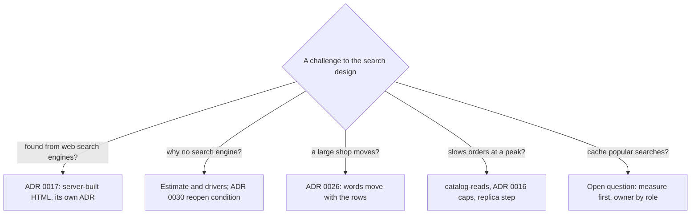

## Before you start

- [[sysdesign.l4.product-search-trade-offs]] — you know what search inside PostgreSQL gives up, and that ADR `0030` names a reopen condition for the rejected search engine.
- [[sysdesign.l4.answering-challenges]] — you know a good answer names the driver or trade-off behind a decision, and an uncovered case becomes an open question with an owner.
- [[sysdesign.l4.multi-shop-design]] — you know ADR `0026` lets one large shop move to its own database, found through a shard map keyed by shop, when it holds more than 10% of the busiest day's orders (assumed).

## The situation

The review session for ADR `0030` starts, and you proposed the design. The questions come fast.

Why can customers not find our products from a web search engine? Why does Đơn Hàng not run a separate search engine? What happens to search when a large shop moves to its own database? Can search slow ordering at a sales peak? Each sounds like a gap. None of them is about the full-text search details you rehearsed.

How do you answer all four without inventing a new argument in the room?

## Core concepts

- challenge answered by the record — a question whose answer already sits in an accepted ADR, a ranked driver or the estimate, so the answer points there instead of being built on the spot.
- open question with an owner — a challenge the design cannot answer yet, written down with the role that will answer it and the next step.
- reopen condition — a measured signal written in an ADR that brings a rejected option back, so "not now" is a decision with an exit, not a refusal.
- searchable words on the product row — ADR `0030`'s choice that the words a search matches are built from the product's own row, so they go wherever that row goes.

## How it works



In the situation above, each of the four questions is a challenge answered by the record. You do not need a new argument, because each answer was written before the session.

The first question mixes two meanings of search. In-shop search is this design. Being found from a web search engine is a different problem: the app's own HTML for a product page does not contain the product's name, so ADR `0017` put public product pages elsewhere, as HTML built on the server and decided in an ADR of their own. Such pages would read the same Catalog, so they would not change this design.

The second question is answered by the estimate and the drivers, not by a preference. The estimate is at most 5,000 products per shop and about 27 searches per second at the busiest hour (assumed), a size that fits in PostgreSQL, while a separate engine adds a copy that lags and must be rebuilt. ADR `0030` did not rule the engine out; its reopen condition says what count would bring it back.

The third question is answered by the searchable words on the product row. ADR `0026` moves a shop's rows of `donhang`, and its products are among them, words included.

The fourth points to limits already planned: search load is held by `catalog-reads`, ADR `0016`'s per-shop caps, and a move to the read replica when `capacity-plan.md` allows it. The fifth branch, caching popular searches, has no answer yet, so it stays open with a role and a next step.

## In the Đơn Hàng system

The design review keeps every challenge from the session, each with its answer, the next step and an owner when one is needed:

```markdown file=docs/design/product-search-design-review.md tag=stage-4 lines=90-98
### Câu hỏi phản biện trong buổi review

| Câu hỏi | Trả lời, trỏ driver, ADR hoặc rủi ro | Việc tiếp theo | Người phụ trách (vai trò) |
|---|---|---|---|
| Sao khách không tìm thấy sản phẩm của ta từ máy tìm kiếm? | ADR 0017: trang công khai là HTML từ server, quyết riêng; nếu làm, nó đọc cùng Catalog | Không | |
| Sao không dùng một công cụ tìm kiếm? | Ước lượng và driver; ADR 0030 ghi điều kiện mở lại, không loại hẳn | Không | |
| Cửa hàng lớn chuyển database theo ADR 0026 thì tìm kiếm ra sao? | Từ tìm được nằm trên dòng sản phẩm của cửa hàng, chuyển cùng dòng | Không | |
| Tìm kiếm có làm chậm đặt đơn lúc khuyến mãi? | `catalog-reads`, trần theo cửa hàng của ADR 0016, điều kiện chuyển sang replica trong `capacity-plan.md` | Không | |
| Có nên cache kết quả của các câu tìm phổ biến? | Mở: chưa có số đo câu tìm lặp lại | Đo sau khi có | Đội Cửa hàng |
```

Read the second column first: each of the four answered rows points to something recorded before the session, an ADR, the estimate and drivers, the searchable words on the product row, or a planned limit. Their next step is "none" and their owner is empty, because nothing is left to do. Only the last row, with no measurement behind it, gets a next step ("measure once built") and an owner by role, the Shop team. The review also lists that public-pages ADR as one still to write.

The third and fourth answers are not new either. They are consequences ADR `0030` wrote when it was accepted:

```markdown file=docs/adr/0030-tim-san-pham-bang-full-text-search-cua-postgresql.md tag=stage-4 lines=43-54
### Hệ quả

- Không bản sao mới: đổi tên sản phẩm là đổi luôn từ tìm được trong cùng dòng.
- Tìm kiếm dùng chung database với đặt đơn; tải được giữ bởi `catalog-reads`,
  trần theo cửa hàng của ADR 0016, và chuyển sang replica khi
  `capacity-plan.md` cho phép.
- Không tìm ra từ gõ sai, không biết từ đồng nghĩa.
- Cửa hàng chuyển database theo ADR 0026 mang theo từ tìm được của nó.

Đội xem lại quyết định khi: khiếu nại về gõ sai hay từ đồng nghĩa vượt 5% số
phản hồi về tìm kiếm trong một tháng (giả định); tải tìm kiếm vượt khoảng dư cả
khi đã chuyển sang replica.
```

The last bullet answers the large-shop question: a shop that moves under ADR `0026` takes its searchable words with it. Search also stays simple after the move, because driver 3 keeps results within the caller's shop. One search reads one shop's rows, and after the move those rows sit in one database, the one the shard map names. The second bullet is the peak answer, and the closing paragraph is the reopen condition behind "why no search engine": misspelling or synonym complaints above 5% of search feedback in a month (assumed), or search load above the headroom even on the replica. The review's risks table assigns the monthly count of search feedback to the role that sets product priorities, and lists how names with `đ` normalise as unchecked, for the tester to cover with a test case once search is built.

## Trade-offs

| Way to answer a challenge | When it is right | What it costs |
|---|---|---|
| Point to an accepted ADR, driver or estimate | the ADR already weighed this question and its reopen condition is not met | nothing new; the asker must accept a reason given before the session |
| Record an open question with an owner | nothing measured or decided can answer it yet | the review ends with work outstanding and someone named to do it |
| Reopen with a new ADR | a driver has changed, or a reopen condition is met by a count | a new decision cycle; the old ADR is replaced, not quietly edited |
| Build an answer on the spot | not in this review: every question had a recorded answer or became open | an answer with no estimate behind it that may contradict an accepted ADR |

Pointing to an ADR has a fair opposing view: it can look like refusing to listen. That view is right when the challenge brings new information, such as a shop's contract that needs public pages, or a monthly count above the 5% line. Then the ADR's answer is out of date, and pointing back at it defends an old context. The test is whether the question changes a driver or meets a reopen condition. If it does not, the recorded answer is the honest one.

## What would you choose if…

…a shop signs a contract that requires its product pages to appear in web search engines? Nothing in ADR `0030` changes. ADR `0017` already says those pages need their own ADR, built as HTML on the server, and they would read the same Catalog. Writing that ADR is the next step; in-shop search stays as designed.

…the monthly count shows misspelling complaints at 7% of search feedback? ADR `0030`'s reopen condition is met, so the separate engine is weighed again in a new ADR, with its copy, lag and rebuild path against the measured gain. You stop answering "not needed yet", because the count now says otherwise.

…a reviewer asks for one search across every shop's products? Driver 3 says results stay within the caller's shop, so this is a new requirement, not a gap. It goes back to requirements as a changed driver, and any design for it comes after.

## Seniors often assume…

- **"If a reviewer asks for a feature the design lacks, such as typo tolerance, the design is wrong."** → Actually missing typo tolerance is a trade-off ADR `0030` accepted on purpose, with a counted reopen condition and a monthly count of search feedback set up in the review's risks table. You notice this when a review turns into a feature list, and nobody asks which driver the missing feature would serve.
- **"Once a shop has its own database, searching its products needs a different design."** → Actually the searchable words are built on the shop's own product rows, so they move with the rows under ADR `0026`. Since every search stays within one shop, it reads one database, the one the shard map names. You notice this when someone plans a second search path for moved shops and cannot name a query that needs it.
- **"A challenge about search engines means ADR `0017` must be decided again now."** → Actually ADR `0017` already says public pages for web search engines are server-built HTML in a separate ADR, outside the app. The challenge is answered by pointing there; a real need from a shop starts that separate ADR without reopening `0017`. You notice this when a search review drifts into arguing again what the whole app is built with.

## Try it (3 minutes)

Four more challenges arrive after the session. For each, say which kind it is: answered by the record (name the source), an open question (name an owner by role), or a reason to reopen ADR `0030`.

1. "Will search find a product whose name contains `đ` when the customer types `d`?"
2. "After the replica step, could search show a renamed product's old name?"
3. "Our biggest shop now holds 12% of the busiest day's orders. Does search need changing?"
4. "Search load stays above the headroom even after moving to the replica."

Expected result: one kind and one source or owner per challenge, with exactly one reason to reopen.

<details><summary>Suggested answer</summary>

1. Open question: the review's risks table already lists how names with `đ` normalise, owned by the tester, with a test case to add once search is built.
2. Answered by the record: `consistency-per-operation.md` lets search be as old as the product list (new names found within minutes, assumed), which is why `capacity-plan.md` allows the product list on the replica. A briefly old name is accepted.
3. Answered by the record: this meets ADR `0026`'s move condition (above 10%, assumed), and ADR `0030` says a moved shop takes its searchable words along. Search needs no change.
4. Reopen: this is the second half of ADR `0030`'s reopen condition, so the separate engine is weighed again in a new ADR.

</details>

## Connections

- [[sysdesign.l4.product-search-trade-offs]] — the costs that the second and fourth challenges probe; this lesson answers them from the same ADR.
- [[sysdesign.l4.answering-challenges]] — the method applied here: trace each answer to a driver or ADR, record what stays open.
- [[sysdesign.l4.multi-shop-design]] — the shop move behind the third challenge, and the shard map that picks the database a search reads.
- [[sysdesign.l4.multi-shop-challenges]] — the same exercise one problem earlier: most challenges answered by an ADR already accepted.
- [[frontend.l4.client-technology-drivers]] — where ADR `0017` was weighed, including the cost that the app's HTML for a product page does not contain the product's name.
- [[management.l3.superseding-an-adr]] — what happens when a reopen condition is met: a new ADR replaces the old one.
- [[sysdesign.l4.reporting-requirements]] — the next problem in this module: reports that read many orders.

## Five-line summary

1. A challenge to the search design is answered by pointing to the ADR, driver or estimate that already decided it, not by a new argument.
2. Being found from web search engines is ADR `0017`'s separate decision: server-built public pages, which would read the same Catalog.
3. "Why no search engine" is answered by the estimate and drivers; ADR `0030`'s reopen condition says what count brings it back.
4. A shop moving under ADR `0026` takes its searchable words along, and a search within one shop reads one database.
5. The design review records every challenge with its answer and source, and gives an owner by role only to those still open.
