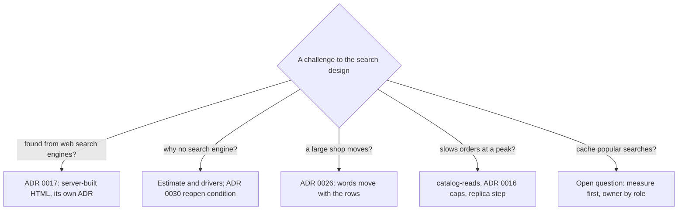

## Bạn cần biết trước

- [[sysdesign.l4.product-search-trade-offs]] — bạn biết tìm kiếm ngay trong PostgreSQL bỏ ra những gì, và ADR `0030` ghi một điều kiện xem lại cho công cụ tìm kiếm đã bị loại.
- [[sysdesign.l4.answering-challenges]] — bạn biết một câu trả lời tốt nêu tên yếu tố định hình kiến trúc hoặc điểm đánh đổi đứng sau quyết định, còn trường hợp chưa được tính tới thì thành câu hỏi mở có người phụ trách.
- [[sysdesign.l4.multi-shop-design]] — bạn biết ADR `0026` cho một cửa hàng lớn chuyển sang database riêng, tìm tới qua shard map có key là cửa hàng, khi cửa hàng đó giữ hơn 10% số đơn của ngày bận nhất (giả định).

## Tình huống

Buổi review cho ADR `0030` bắt đầu, và bạn là người đề xuất thiết kế. Câu hỏi tới dồn dập.

Sao khách không tìm thấy sản phẩm của ta từ máy tìm kiếm trên web? Sao Đơn Hàng không chạy một công cụ tìm kiếm riêng? Một cửa hàng lớn chuyển sang database riêng thì tìm kiếm ra sao? Tìm kiếm có làm chậm đặt đơn lúc cao điểm bán hàng không? Câu nào nghe cũng như một lỗ hổng. Không câu nào hỏi về chi tiết full-text search mà bạn đã chuẩn bị.

Làm sao trả lời cả bốn câu mà không phải nghĩ ra lý lẽ mới ngay trong phòng họp?

## Khái niệm cốt lõi

- câu phản biện đã có câu trả lời trong hồ sơ — một câu hỏi mà câu trả lời đã nằm sẵn trong một ADR đã chấp nhận, một yếu tố định hình kiến trúc đã xếp hạng hoặc bản ước lượng, nên câu trả lời chỉ tới đó thay vì dựng tại chỗ.
- câu hỏi mở có người phụ trách — một câu phản biện mà thiết kế chưa trả lời được, được ghi lại cùng vai trò sẽ trả lời nó và việc tiếp theo.
- điều kiện xem lại — một tín hiệu đo được ghi trong ADR, đưa một phương án đã loại trở lại bàn. Nhờ đó "chưa phải lúc này" là một quyết định có lối ra, không phải một lời từ chối.
- từ tìm được nằm trên dòng sản phẩm — lựa chọn của ADR `0030`: các từ mà lượt tìm so khớp được dựng từ chính dòng của sản phẩm, nên dòng đi đâu thì chúng đi theo đó.

## Cơ chế hoạt động



Trong tình huống trên, cả bốn câu hỏi đều là câu phản biện đã có câu trả lời trong hồ sơ. Bạn không cần lý lẽ mới, vì câu trả lời nào cũng đã được viết ra trước buổi review.

Câu đầu tiên trộn hai nghĩa của tìm kiếm. Tìm trong cửa hàng là thiết kế này. Được tìm thấy từ máy tìm kiếm trên web là một bài toán khác: HTML mà app tự tạo cho trang sản phẩm không chứa tên sản phẩm, nên ADR `0017` để trang sản phẩm công khai ở chỗ khác, là HTML dựng trên server và được quyết trong một ADR riêng. Các trang đó sẽ đọc cùng Catalog, nên chúng không làm thay đổi thiết kế này.

Câu thứ hai được trả lời bằng bản ước lượng và các yếu tố định hình kiến trúc, không phải bằng sở thích. Bản ước lượng là tối đa 5.000 sản phẩm mỗi cửa hàng và khoảng 27 lượt tìm mỗi giây vào giờ bận nhất (giả định), một cỡ vừa với PostgreSQL. Còn một công cụ riêng thì thêm một bản sao bị trễ và phải dựng lại. ADR `0030` không loại hẳn công cụ đó: điều kiện xem lại của nó nói con số đếm nào sẽ đưa công cụ trở lại.

Câu thứ ba được trả lời bằng chuyện từ tìm được nằm trên dòng sản phẩm. ADR `0026` chuyển các dòng của một cửa hàng trong `donhang`, và sản phẩm của cửa hàng nằm trong số đó, kèm luôn các từ.

Câu thứ tư chỉ tới các giới hạn đã có trong kế hoạch: tải tìm kiếm được giữ bởi `catalog-reads`, giới hạn theo cửa hàng của ADR `0016`, và bước chuyển sang read replica khi `capacity-plan.md` cho phép. Nhánh thứ năm, cache các câu tìm phổ biến, chưa có câu trả lời, nên nó để mở cùng một vai trò và một việc tiếp theo.

## Trong hệ thống Đơn Hàng

Review thiết kế giữ lại mọi câu phản biện của buổi họp, mỗi câu kèm câu trả lời, việc tiếp theo và người phụ trách khi cần:

```markdown file=docs/design/product-search-design-review.md tag=stage-4 lines=90-98
### Câu hỏi phản biện trong buổi review

| Câu hỏi | Trả lời, trỏ driver, ADR hoặc rủi ro | Việc tiếp theo | Người phụ trách (vai trò) |
|---|---|---|---|
| Sao khách không tìm thấy sản phẩm của ta từ máy tìm kiếm? | ADR 0017: trang công khai là HTML từ server, quyết riêng; nếu làm, nó đọc cùng Catalog | Không | |
| Sao không dùng một công cụ tìm kiếm? | Ước lượng và driver; ADR 0030 ghi điều kiện mở lại, không loại hẳn | Không | |
| Cửa hàng lớn chuyển database theo ADR 0026 thì tìm kiếm ra sao? | Từ tìm được nằm trên dòng sản phẩm của cửa hàng, chuyển cùng dòng | Không | |
| Tìm kiếm có làm chậm đặt đơn lúc khuyến mãi? | `catalog-reads`, trần theo cửa hàng của ADR 0016, điều kiện chuyển sang replica trong `capacity-plan.md` | Không | |
| Có nên cache kết quả của các câu tìm phổ biến? | Mở: chưa có số đo câu tìm lặp lại | Đo sau khi có | Đội Cửa hàng |
```

Đọc cột thứ hai trước: mỗi hàng trong bốn hàng đã trả lời đều chỉ tới thứ được ghi lại trước buổi họp, là một ADR, bản ước lượng và các yếu tố định hình kiến trúc, chuyện từ tìm được nằm trên dòng sản phẩm, hoặc một giới hạn đã có trong kế hoạch. Việc tiếp theo của chúng là "Không" và người phụ trách để trống, vì không còn gì phải làm. Chỉ hàng cuối, không có số đo nào đứng sau, mới có việc tiếp theo ("Đo sau khi có") và người phụ trách theo vai trò là Đội Cửa hàng. Review cũng ghi ADR về trang công khai kia vào danh sách ADR còn phải viết.

Câu trả lời thứ ba và thứ tư cũng không mới. Chúng là hệ quả mà ADR `0030` đã viết ra khi được chấp nhận:

```markdown file=docs/adr/0030-tim-san-pham-bang-full-text-search-cua-postgresql.md tag=stage-4 lines=43-54
### Hệ quả

- Không bản sao mới: đổi tên sản phẩm là đổi luôn từ tìm được trong cùng dòng.
- Tìm kiếm dùng chung database với đặt đơn; tải được giữ bởi `catalog-reads`,
  trần theo cửa hàng của ADR 0016, và chuyển sang replica khi
  `capacity-plan.md` cho phép.
- Không tìm ra từ gõ sai, không biết từ đồng nghĩa.
- Cửa hàng chuyển database theo ADR 0026 mang theo từ tìm được của nó.

Đội xem lại quyết định khi: khiếu nại về gõ sai hay từ đồng nghĩa vượt 5% số
phản hồi về tìm kiếm trong một tháng (giả định); tải tìm kiếm vượt khoảng dư cả
khi đã chuyển sang replica.
```

Gạch đầu dòng cuối trả lời câu hỏi về cửa hàng lớn: cửa hàng chuyển đi theo ADR `0026` mang theo từ tìm được của nó. Sau khi chuyển, tìm kiếm vẫn đơn giản, vì yếu tố 3 giữ kết quả trong phạm vi cửa hàng của người gọi. Một lượt tìm đọc các dòng của một cửa hàng, và sau khi chuyển, các dòng đó nằm trong một database, database mà shard map chỉ tới. Gạch đầu dòng thứ hai là câu trả lời cho lúc cao điểm, còn đoạn cuối là điều kiện xem lại đứng sau "sao không dùng công cụ tìm kiếm": khiếu nại về gõ sai hay từ đồng nghĩa vượt 5% phản hồi về tìm kiếm trong một tháng (giả định), hoặc tải tìm kiếm vượt khoảng dư ngay cả trên replica. Bảng rủi ro của review giao số đếm phản hồi về tìm kiếm hằng tháng cho vai trò đặt thứ tự ưu tiên sản phẩm. Bảng đó cũng ghi cách chuẩn hóa tên có `đ` là chưa kiểm, để tester bổ sung một test case khi tìm kiếm được xây.

## Đánh đổi

| Cách trả lời một câu phản biện | Khi nào đúng | Cái giá |
|---|---|---|
| Chỉ tới một ADR đã chấp nhận, một yếu tố định hình kiến trúc hoặc bản ước lượng | ADR đã cân nhắc đúng câu hỏi này và điều kiện xem lại của nó chưa đạt | không có gì mới. Người hỏi phải chấp nhận một lý do đã có trước buổi họp |
| Ghi một câu hỏi mở có người phụ trách | chưa có số đo hay quyết định nào trả lời được | buổi review kết thúc với việc còn tồn, và có người được giao làm |
| Mở lại bằng một ADR mới | một yếu tố định hình kiến trúc đã đổi, hoặc một con số đếm làm đạt điều kiện xem lại | thêm một vòng quyết định. ADR cũ bị thay thế, không bị sửa lặng lẽ |
| Dựng câu trả lời tại chỗ | không dùng trong buổi review này: câu nào cũng có câu trả lời trong hồ sơ hoặc đã thành câu hỏi mở | một câu trả lời không có ước lượng nào đứng sau, có thể trái với một ADR đã chấp nhận |

Chỉ tới ADR có một quan điểm phản bác chính đáng: nó dễ trông như từ chối lắng nghe. Quan điểm đó đúng khi câu phản biện mang theo thông tin mới, như hợp đồng của một cửa hàng đòi có trang công khai, hoặc số đếm một tháng vượt ngưỡng 5%. Khi đó câu trả lời của ADR đã lỗi thời, và chỉ ngược về nó là bảo vệ một bối cảnh cũ. Phép thử là câu hỏi có làm đổi một yếu tố định hình kiến trúc hay làm đạt một điều kiện xem lại không. Nếu không, câu trả lời đã ghi là câu trả lời trung thực.

## Bạn sẽ chọn gì nếu…

…một cửa hàng ký hợp đồng đòi trang sản phẩm của họ phải hiện trên máy tìm kiếm trên web? ADR `0030` không đổi gì. ADR `0017` đã nói các trang đó cần ADR riêng, dựng thành HTML trên server, và chúng sẽ đọc cùng Catalog. Viết ADR đó là việc tiếp theo. Tìm kiếm trong cửa hàng giữ nguyên như đã thiết kế.

…số đếm hằng tháng cho thấy khiếu nại về gõ sai ở mức 7% phản hồi về tìm kiếm? Điều kiện xem lại của ADR `0030` đã đạt, nên công cụ riêng được cân lại trong một ADR mới, đặt bản sao, độ trễ và đường dựng lại của nó cạnh lợi ích đã đo được. Bạn thôi trả lời "chưa cần", vì giờ con số nói khác.

…một người review đòi một lượt tìm trên sản phẩm của mọi cửa hàng? Yếu tố 3 nói kết quả nằm trong phạm vi cửa hàng của người gọi, nên đây là một yêu cầu mới, không phải lỗ hổng. Nó quay về bước yêu cầu như một yếu tố định hình kiến trúc đã đổi, và thiết kế nào cho nó cũng đi sau.

## Senior hay nhầm rằng…

- **"Nếu người review đòi một tính năng thiết kế không có, như chịu được gõ sai, thì thiết kế sai."** → Thực ra thiếu khả năng chịu gõ sai là một đánh đổi mà ADR `0030` cố ý chấp nhận, kèm một điều kiện xem lại có đếm số và số đếm phản hồi về tìm kiếm hằng tháng đã ghi trong bảng rủi ro của review. Bạn sẽ nhận ra khi một buổi review biến thành danh sách tính năng, và không ai hỏi tính năng còn thiếu sẽ phục vụ yếu tố định hình kiến trúc nào.
- **"Một khi cửa hàng có database riêng, tìm sản phẩm của nó cần một thiết kế khác."** → Thực ra từ tìm được dựng trên chính các dòng sản phẩm của cửa hàng, nên chúng chuyển cùng các dòng theo ADR `0026`. Vì lượt tìm nào cũng nằm trong một cửa hàng, nó đọc một database, database mà shard map chỉ tới. Bạn sẽ nhận ra khi ai đó lên kế hoạch một đường tìm kiếm thứ hai cho các cửa hàng đã chuyển mà không kể ra được truy vấn nào cần nó.
- **"Một câu phản biện về máy tìm kiếm nghĩa là ADR `0017` phải được quyết lại ngay."** → Thực ra ADR `0017` đã nói trang công khai cho máy tìm kiếm trên web là HTML dựng trên server, nằm trong một ADR riêng, ngoài app. Câu phản biện được trả lời bằng cách chỉ tới đó. Một nhu cầu thật từ một cửa hàng sẽ khởi động ADR riêng ấy mà không mở lại `0017`. Bạn sẽ nhận ra khi một buổi review về tìm kiếm trôi sang cãi lại chuyện cả app được xây bằng gì.

## Thử ngay (3 phút)

Sau buổi họp có thêm bốn câu phản biện. Với mỗi câu, nói nó thuộc loại nào: đã có câu trả lời trong hồ sơ (nêu nguồn), câu hỏi mở (nêu người phụ trách theo vai trò), hay lý do để mở lại ADR `0030`.

1. "Tìm kiếm có ra sản phẩm có `đ` trong tên khi khách gõ `d` không?"
2. "Sau bước chuyển sang replica, tìm kiếm có thể hiện tên cũ của một sản phẩm vừa đổi tên không?"
3. "Cửa hàng lớn nhất của ta giờ giữ 12% số đơn của ngày bận nhất. Tìm kiếm có cần đổi không?"
4. "Tải tìm kiếm vẫn vượt khoảng dư ngay cả sau khi đã chuyển sang replica."

Kết quả mong đợi: mỗi câu phản biện có một loại và một nguồn hoặc người phụ trách, với đúng một lý do để mở lại.

<details><summary>Gợi ý đáp án</summary>

1. Câu hỏi mở: bảng rủi ro của review đã ghi cách chuẩn hóa tên có `đ`, giao cho tester, với một test case cần thêm khi tìm kiếm được xây.
2. Đã có câu trả lời trong hồ sơ: `consistency-per-operation.md` cho tìm kiếm cũ ngang danh sách sản phẩm (tên mới tìm ra được trong vòng vài phút, giả định), và đó là lý do `capacity-plan.md` cho danh sách sản phẩm chạy trên replica. Tên cũ hiện trong chốc lát là điều đã được chấp nhận.
3. Đã có câu trả lời trong hồ sơ: con số này đạt điều kiện chuyển của ADR `0026` (trên 10%, giả định), và ADR `0030` nói cửa hàng đã chuyển mang theo từ tìm được của nó. Tìm kiếm không cần đổi.
4. Mở lại: đây là nửa sau của điều kiện xem lại trong ADR `0030`, nên công cụ riêng được cân lại trong một ADR mới.

</details>

## Liên hệ

- [[sysdesign.l4.product-search-trade-offs]] — các cái giá mà câu phản biện thứ hai và thứ tư thăm dò. Bài này trả lời chúng từ cùng ADR đó.
- [[sysdesign.l4.answering-challenges]] — phương pháp được áp ở đây: lần mỗi câu trả lời về một yếu tố định hình kiến trúc hoặc một ADR, ghi lại những gì còn mở.
- [[sysdesign.l4.multi-shop-design]] — bước chuyển cửa hàng đứng sau câu phản biện thứ ba, và shard map chọn database mà lượt tìm đọc.
- [[sysdesign.l4.multi-shop-challenges]] — cùng bài tập ở bài toán trước: phần lớn câu phản biện được trả lời bằng một ADR đã chấp nhận.
- [[frontend.l4.client-technology-drivers]] — nơi ADR `0017` được cân nhắc, kể cả cái giá là HTML của app cho trang sản phẩm không chứa tên sản phẩm.
- [[management.l3.superseding-an-adr]] — chuyện gì xảy ra khi điều kiện xem lại đạt: một ADR mới thay thế ADR cũ.
- [[sysdesign.l4.reporting-requirements]] — bài toán tiếp theo trong module này: báo cáo đọc rất nhiều đơn.

## Tóm tắt 5 dòng

1. Một câu phản biện về thiết kế tìm kiếm được trả lời bằng cách chỉ tới ADR, yếu tố định hình kiến trúc hoặc bản ước lượng đã quyết chuyện đó, không phải bằng lý lẽ mới.
2. Được tìm thấy từ máy tìm kiếm trên web là quyết định riêng của ADR `0017`: trang công khai dựng trên server, đọc cùng Catalog.
3. "Sao không dùng công cụ tìm kiếm" được trả lời bằng bản ước lượng và các yếu tố định hình kiến trúc. Điều kiện xem lại của ADR `0030` nói con số đếm nào đưa nó trở lại.
4. Cửa hàng chuyển đi theo ADR `0026` mang theo từ tìm được của nó, và lượt tìm trong một cửa hàng đọc một database.
5. Review thiết kế ghi mọi câu phản biện cùng câu trả lời và nguồn, và chỉ giao người phụ trách theo vai trò cho những câu còn mở.
