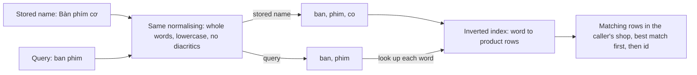

## Before you start

- [[sysdesign.l4.product-search-requirements]] — you know the three ranked drivers: words typed without diacritics find the product, search never takes the capacity orders need, and results stay within the caller's shop.
- [[sysdesign.l4.deep-dive]] — you know a deep dive works out one part of a design in detail, chosen where a top driver is hardest to meet.
- [[backend.l2.indexes-and-plans]] — you know `EXPLAIN` shows whether the planner reads every row or uses an index.
- [[backend.l4.data-ownership]] — you know Catalog owns `products`, and every other place holding product data holds a copy.

## The situation

The requirements are agreed, and the team meets to pick a design. One teammate proposes the smallest change: match names with `LIKE '%phím%'`. On the eight seed products it works, and `Bàn phím cơ` comes back. Then you type what the shop's customer typed, `ban phim`, and nothing comes back. A second teammate says real search needs a separate search product, fed with every change to `products`. That is one more service to run for a few thousand products per shop.

Between a pattern that misses the first driver and a new service, how can the database you already run find `Bàn phím cơ` from `ban phim`?

## Core concepts

- **full-text search** — finding rows by the words in their text, normalised the same way for the stored text and for the query, and returning the matching rows ordered by how well they match.
- normalising — the fixed steps that turn text into words for matching; in this design, split into whole words, lowercase them and strip diacritics.
- **inverted index** — an index that maps each word to the rows containing it, so a search by word reads only those rows instead of every row.
- searchable words — the normalised words built from a product's `name`, stored with that same row in `products`.

## How it works



In the situation above, `%` is a wildcard: it stands for any characters, so `'%phím%'` means `phím` anywhere in the name. `LIKE` compares characters, and `a` is not `à`, so `ban phim` misses. Full-text search compares words instead, after both sides pass through the same normalising. In the design's worked example, the stored name `Bàn phím cơ` becomes `ban`, `phim`, `co`, and the query `ban phim` becomes `ban`, `phim`. Both query words are among the product's words, so it matches. A query typed with diacritics matches too, because both sides have lost them.

The words for every product go into an inverted index. A search looks up each query word in it and reads only the rows listed there. The ordinary index you already know keeps whole names sorted from their first character. A pattern that starts with `%` gives it no first characters to look up, so the planner reads every row, as `EXPLAIN` would show.

Matching rows are limited to the caller's shop and ordered by a match score the database computes, then by `id`; how the score is computed is beyond this lesson.

Where the words live is the design's other half. Catalog owns `products`, so the searchable words are built from the product's own row. Renaming a product changes its searchable words in the same row. There is no second copy to keep in sync, which is what the separate search product would have been.

## In the Đơn Hàng system

The ADR records the three options and the decision, at the tag where nothing is built yet:

```markdown file=docs/adr/0030-tim-san-pham-bang-full-text-search-cua-postgresql.md tag=stage-4 lines=18-41
### Các phương án

- `LIKE '%...%'` trên `name`: không thêm gì. Một index B-tree thường không phục
  vụ được mẫu bắt đầu bằng wildcard, nên mỗi lần tìm đọc mọi dòng; không sắp
  theo mức khớp, không bỏ dấu.
- Full-text search của PostgreSQL trong Catalog: từ tìm được dựng từ chính dòng
  sản phẩm, có inverted index, không bản sao nào phải giữ cho khớp.
- Một công cụ tìm kiếm riêng, chạy như một service khác: khớp phong phú hơn
  (gõ sai, đồng nghĩa) và sức chứa riêng. Nhưng nó là một bản sao của sản phẩm,
  nuôi từ thay đổi của Catalog qua outbox, nên trễ sau `products`, cần cách
  dựng lại, và thêm một service phải chạy.

### Quyết định

Chọn full-text search của PostgreSQL, trong Catalog, chủ của `products`.

- Từ tìm được dựng từ tên sản phẩm trên chính dòng đó: chữ thường, bỏ dấu bằng
  extension `unaccent` đi kèm PostgreSQL, rồi tách từ bằng một cấu hình không
  cắt đuôi từ, vì PostgreSQL không có cấu hình tìm kiếm cho tiếng Việt.
- Câu tìm được chuẩn hóa đúng cùng cách.
- Một inverted index trên từ tìm được; mỗi lần tìm chỉ đọc dòng khớp.
- Tìm là một tham số tùy chọn của danh sách sản phẩm qua `ICatalog`, dưới cùng
  giới hạn `catalog-reads`; giới hạn theo cửa hàng của người gọi; sắp theo mức
  khớp rồi theo `id`.
```

The options keep their reasons. `LIKE '%...%'` adds nothing to run, but an ordinary index (the kind PostgreSQL calls B-tree, which the ADR names), even one on `name`, cannot serve a pattern that starts with `%`, so every search reads every row; it also neither ranks nor strips diacritics. The separate search tool is rejected for what it adds: a copy fed from Catalog's changes through the outbox, which lags behind `products`, needs a way to be rebuilt, and is one more service to run.

The decision fixes the normalising. Diacritics are stripped with `unaccent`, an extension: an optional add-on supplied with PostgreSQL that runs inside the database once enabled, so nothing new runs beside it. Words are split by a text search configuration, the set of language rules for splitting. A configuration for a language such as English also cuts word endings, turning `keyboards` into `keyboard`; rules like that are not meant for Vietnamese words. So the ADR picks one that cuts nothing, because, as it notes, PostgreSQL has no configuration for Vietnamese.

The last bullet places search behind the contract other modules already use: an optional parameter of the product list through `ICatalog`. It runs under `catalog-reads`, the existing limit on how many product reads one process runs at once, limited to the caller's shop, ordered by match, then `id`. Today `ICatalog.ListAsync` still takes only `limit`, `offset` and `maxPriceVnd`; a line above this excerpt notes that search is not built at this tag and the list still filters only by `maxPriceVnd`.

The design review spends its deep dive on the first driver:

```markdown file=docs/design/product-search-design-review.md tag=stage-4 lines=45-54
### Đi sâu: gõ không dấu (bước 4)

- Tên lưu và câu tìm đi qua cùng một cách chuẩn hóa: chữ thường, bỏ dấu bằng
  `unaccent` đi kèm PostgreSQL, tách từ bằng một cấu hình không cắt đuôi từ
  (PostgreSQL không có cấu hình cho tiếng Việt).
- `Bàn phím cơ` trong `db/seed.sql` thành các từ `ban`, `phim`, `co`; câu
  `ban phim` thành `ban`, `phim`; hai từ khớp, sản phẩm được trả.
- Cùng cách đó, chữ gõ có dấu cũng khớp, vì cả hai bên đều đã bỏ dấu.
- Từ tìm được dựng trên chính dòng sản phẩm, nên đổi tên là đổi luôn từ tìm
  được; không bản sao nào phải đồng bộ.
```

The dive goes where driver 1 is hardest to meet, and it works one real row through: product `1`, `Bàn phím cơ`, from `db/seed.sql`. The last bullet ties the dive back to ownership. Further down, the review leaves one case open: how a name with `đ` normalises is a separate check for the tester when search is built, because `đ` is its own letter, not `d` with a mark, so stripping marks may not turn it into `d`.

## Trade-offs

| Option | Driver 1: `ban phim` finds `Bàn phím cơ` | Driver 2: load per search | Copy to keep in sync | New things to run | Right when |
|---|---|---|---|---|---|
| `LIKE '%...%'` on `name` | no: no diacritics stripped, no ranking | reads every row | none | none | tables are tiny and customers copy exact text |
| Full-text search in PostgreSQL, inside Catalog (chosen) | yes, through the same normalising on both sides | reads only matching rows, through the inverted index | none: words live on the product row | no new service; an extension and an index to add | data is small enough to share the database, as estimated |
| Separate search engine | yes, with richer matching such as misspellings | its own capacity | a copy fed through the outbox, lagging behind `products`, needing a rebuild path | one more service | matching needs or load exceed what the database can give |

The chosen row trades richer matching for having no copy. Matching whole normalised words finds nothing for a misspelt word, and the ADR accepts that until its reopen condition, a share of misspelling complaints (next section), is met. It also keeps search in the same database as order placement, so load is held by `catalog-reads` and the limits the next lesson examines.

## What would you choose if…

…product feedback shows customers often misspell names? ADR `0030` names the condition for revisiting: complaints about misspellings or synonyms above 5% of search feedback in a month (assumed). Count first. Below the line, the decision stands; above it, the separate engine and its copy come back to the table.

…a teammate proposes caching the results of each search text in Redis? The design review keeps this as an open question: there is no measurement of how often searches repeat yet. If most search texts differ, the cache rarely hits and adds a copy to clear on every rename. Measure repeats before building it.

…a large shop moves to a database of its own, as ADR `0026` allows for large shops? The searchable words sit on that shop's product rows, so they move with the rows. Nothing separate is moved or rebuilt.

## Seniors often assume…

- **"Full-text search needs a separate search engine; a SQL database cannot do it."** → Actually PostgreSQL has full-text search: it normalises words, keeps an inverted index and ranks matches, which meets driver 1 and keeps each search to the matching rows; the shop filter and the `catalog-reads` limit cover the other two drivers at a few thousand products per shop. You notice this when a design adds a service and a sync path for a problem the database already solves at the estimated size.
- **"An index on `name` makes `LIKE '%phím%'` fast."** → Actually an ordinary index is sorted by whole names from their first character, and a pattern starting with `%` has no first characters to look up, so every row is read. You notice this when `EXPLAIN` shows a scan of the whole table even though `name` has an index.
- **"Searching for `ban phim` can only find names written exactly without diacritics."** → Actually both the stored name and the query are lowercased and stripped of diacritics before matching, so `ban phim` and `bàn phím` both reach `Bàn phím cơ`. You notice this when a test types a query with diacritics and a query without them and gets the same product back.

## Try it (3 minutes)

Use the eight product names in `db/seed.sql`: `Bàn phím cơ`, `Chuột không dây`, `Tai nghe`, `Màn hình 24 inch`, `Giá đỡ laptop`, `Ổ cứng SSD 512GB`, `Webcam 720p`, `Đèn bàn LED`. Apply the design's normalising as the ADR states it (whole words, lowercase, every diacritic stripped) to each name and to each query: `CHUỘT`, `ban`, `phi`. For each query, list the products whose words contain every query word.

Expected result: one product for `CHUỘT`, two for `ban`, none for `phi`, each with a reason.

<details><summary>Suggested answer</summary>

`CHUỘT` becomes `chuot`, which is one of the words of `Chuột không dây`, so that product matches. `ban` matches `Bàn phím cơ` and also `Đèn bàn LED`, whose second word becomes `ban`; you did not need to decide what `Đèn` becomes, the case the review leaves for the tester. `phi` matches nothing: `phim` is a different word, and this design matches whole words, which is why a misspelt or half-typed word finds no product.

</details>

## Connections

- [[sysdesign.l4.product-search-requirements]] — the ranked drivers this design is judged against.
- [[sysdesign.l4.high-level-design]] — the same step of the framework, applied here: the path a search takes from the app through the API and `ICatalog` to `products`.
- [[design.l3.module-contracts]] — why search arrives as a parameter of `ICatalog` and not as a new way for other modules to reach `products`.
- [[backend.l4.shop-data-layout]] — the table layout that holds every shop's products; a search limited to the caller's shop runs inside it.
- [[foundation.l1.sql-index-intro]] — the ordinary index that cannot serve a pattern starting with `%`, and the opposite direction of an inverted index.
- [[sysdesign.l4.product-search-trade-offs]] — the next step: what this design gives up by staying inside PostgreSQL.

## Five-line summary

1. Full-text search finds products by normalised words in their names, so the database already running can find `Bàn phím cơ` from `ban phim`.
2. The stored name and the query are both split into whole words, lowercased and stripped of diacritics, then matched and ranked.
3. An inverted index maps each word to its rows; an ordinary index cannot serve `LIKE '%phím%'`, so that pattern reads every row.
4. ADR `0030` keeps search in Catalog, the owner of `products`, building words on the product's own row, so no copy needs syncing.
5. Search is an optional parameter of the product list behind `ICatalog`, limited to the caller's shop, under the same `catalog-reads` limit.
