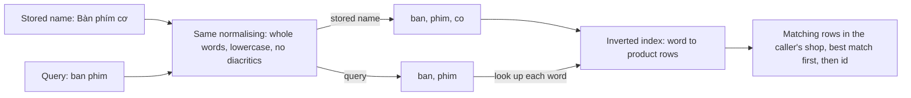

## Bạn cần biết trước

- [[sysdesign.l4.product-search-requirements]] — bạn biết ba yếu tố định hình kiến trúc đã xếp hạng: chữ gõ không dấu tìm ra sản phẩm, tìm kiếm không bao giờ lấy phần sức chứa đặt đơn cần, và kết quả nằm trong cửa hàng của người gọi.
- [[sysdesign.l4.deep-dive]] — bạn biết phần đi sâu làm chi tiết một bộ phận của thiết kế, chọn ở chỗ yếu tố đứng đầu khó đáp ứng nhất.
- [[backend.l2.indexes-and-plans]] — bạn biết `EXPLAIN` cho thấy planner đọc mọi dòng hay dùng một index.
- [[backend.l4.data-ownership]] — bạn biết Catalog là chủ của `products`, và mọi nơi khác giữ dữ liệu sản phẩm đều chỉ giữ bản sao.

## Tình huống

Phần yêu cầu đã thống nhất, nhóm họp để chọn thiết kế. Một đồng đội đề xuất thay đổi nhỏ nhất: so tên bằng `LIKE '%phím%'`. Với tám sản phẩm trong dữ liệu mẫu thì chạy được, `Bàn phím cơ` hiện ra. Rồi bạn gõ đúng chữ khách của cửa hàng đã gõ, `ban phim`, và không có gì trả về. Một đồng đội khác nói tìm kiếm thật thì cần một sản phẩm tìm kiếm riêng, được nuôi bằng mọi thay đổi của `products`. Tức là thêm một service phải chạy, cho vài nghìn sản phẩm mỗi cửa hàng.

Giữa một mẫu so khớp trượt ngay yếu tố đầu tiên và một service mới, làm sao database bạn đang chạy tìm được `Bàn phím cơ` từ `ban phim`?

## Khái niệm cốt lõi

- **full-text search** (Tìm dòng theo các từ trong một đoạn chữ, chuẩn hóa từ như nhau ở cả dữ liệu lẫn câu tìm, rồi xếp kết quả theo mức khớp) — tìm các dòng theo những từ trong chữ của chúng, chuẩn hóa như nhau cho chữ đã lưu và cho câu tìm, rồi trả các dòng khớp theo thứ tự khớp nhiều tới ít.
- chuẩn hóa — các bước cố định biến chữ thành từ để so khớp. Trong thiết kế này: tách thành từ nguyên vẹn, viết thường, bỏ dấu.
- **inverted index** (Index ánh xạ mỗi từ tới các dòng chứa từ đó, để tìm theo từ mà không phải đọc mọi dòng) — một index ghi mỗi từ nằm ở những dòng nào, nên lượt tìm theo từ chỉ đọc đúng các dòng đó thay vì đọc mọi dòng.
- từ tìm được — các từ đã chuẩn hóa dựng từ `name` của sản phẩm, lưu ngay trên dòng đó trong `products`.

## Cơ chế hoạt động



Trong tình huống trên, `%` là wildcard: nó đứng thay cho ký tự bất kỳ, nên `'%phím%'` nghĩa là có `phím` ở đâu đó trong tên. `LIKE` so từng ký tự, mà `a` không phải `à`, nên `ban phim` trượt. Full-text search thì so từ, sau khi cả hai bên được chuẩn hóa như nhau. Trong ví dụ của thiết kế, tên đã lưu `Bàn phím cơ` thành `ban`, `phim`, `co`, còn câu tìm `ban phim` thành `ban`, `phim`. Cả hai từ của câu tìm đều nằm trong các từ của sản phẩm, nên khớp. Câu tìm gõ có dấu cũng khớp, vì cả hai bên đều đã mất dấu.

Từ của mọi sản phẩm được đưa vào một inverted index. Mỗi lượt tìm tra từng từ của câu tìm trong đó và chỉ đọc những dòng được ghi ở đấy. Index thường mà bạn đã biết giữ nguyên cả tên, sắp theo ký tự đầu. Một mẫu bắt đầu bằng `%` không cho index đó ký tự đầu nào để tra, nên planner đọc mọi dòng, đúng như `EXPLAIN` sẽ cho thấy.

Các dòng khớp được giới hạn trong cửa hàng của người gọi, sắp theo điểm khớp mà database tính, rồi theo `id`. Điểm đó tính thế nào thì nằm ngoài bài này.

Nửa còn lại của thiết kế là từ tìm được nằm ở đâu. Catalog là chủ của `products`, nên từ tìm được dựng từ chính dòng của sản phẩm. Đổi tên sản phẩm là đổi luôn từ tìm được trên cùng dòng đó. Không có bản sao thứ hai nào phải giữ cho khớp, mà bản sao ấy chính là thứ sản phẩm tìm kiếm riêng kia sẽ là.

## Trong hệ thống Đơn Hàng

ADR ghi lại ba phương án và quyết định, ở tag mà chưa có gì được xây:

```markdown file=docs/adr/0030-tim-san-pham-bang-full-text-search-cua-postgresql.md tag=stage-4 lines=18-41
### Các phương án

- `LIKE '%...%'` trên `name`: không thêm gì. Một index B-tree thường không phục
  vụ được mẫu bắt đầu bằng wildcard, nên mỗi lần tìm đọc mọi dòng; không sắp
  theo mức khớp, không bỏ dấu.
- Full-text search của PostgreSQL trong Catalog: từ tìm được dựng từ chính dòng
  sản phẩm, có inverted index, không bản sao nào phải giữ cho khớp.
- Một công cụ tìm kiếm riêng, chạy như một service khác: khớp phong phú hơn
  (gõ sai, đồng nghĩa) và sức chứa riêng. Nhưng nó là một bản sao của sản phẩm,
  nuôi từ thay đổi của Catalog qua outbox, nên trễ sau `products`, cần cách
  dựng lại, và thêm một service phải chạy.

### Quyết định

Chọn full-text search của PostgreSQL, trong Catalog, chủ của `products`.

- Từ tìm được dựng từ tên sản phẩm trên chính dòng đó: chữ thường, bỏ dấu bằng
  extension `unaccent` đi kèm PostgreSQL, rồi tách từ bằng một cấu hình không
  cắt đuôi từ, vì PostgreSQL không có cấu hình tìm kiếm cho tiếng Việt.
- Câu tìm được chuẩn hóa đúng cùng cách.
- Một inverted index trên từ tìm được; mỗi lần tìm chỉ đọc dòng khớp.
- Tìm là một tham số tùy chọn của danh sách sản phẩm qua `ICatalog`, dưới cùng
  giới hạn `catalog-reads`; giới hạn theo cửa hàng của người gọi; sắp theo mức
  khớp rồi theo `id`.
```

Các phương án giữ nguyên lý do của chúng. `LIKE '%...%'` không thêm gì phải chạy, nhưng một index thường (loại PostgreSQL gọi là B-tree, cái tên ADR dùng), kể cả index trên `name`, không phục vụ được mẫu bắt đầu bằng `%`, nên lượt tìm nào cũng đọc mọi dòng. Nó cũng không xếp hạng và không bỏ dấu. Công cụ tìm kiếm riêng bị loại vì những gì nó thêm vào: một bản sao nuôi từ thay đổi của Catalog qua outbox, trễ sau `products`, cần cách dựng lại, và thêm một service phải chạy.

Phần quyết định chốt cách chuẩn hóa. Dấu được bỏ bằng `unaccent`, một extension: phần bổ sung tùy chọn đi kèm PostgreSQL, bật lên là chạy ngay trong database, nên không có thứ gì mới chạy bên cạnh. Từ được tách bằng một cấu hình tìm kiếm, tức bộ quy tắc ngôn ngữ dùng để tách từ. Cấu hình cho một ngôn ngữ như tiếng Anh còn cắt đuôi từ, biến `keyboards` thành `keyboard`. Những quy tắc như vậy không dành cho từ tiếng Việt. Vì thế ADR chọn một cấu hình không cắt gì, bởi như nó ghi, PostgreSQL không có cấu hình cho tiếng Việt.

Gạch đầu dòng cuối đặt tìm kiếm sau hợp đồng mà các module khác đang dùng: một tham số tùy chọn của danh sách sản phẩm qua `ICatalog`. Nó chạy dưới `catalog-reads`, giới hạn đã có về số lượt đọc sản phẩm một tiến trình chạy cùng lúc, giới hạn trong cửa hàng của người gọi, sắp theo mức khớp rồi theo `id`. Hôm nay `ICatalog.ListAsync` vẫn chỉ nhận `limit`, `offset` và `maxPriceVnd`. Một dòng phía trên đoạn trích ghi rằng tìm kiếm chưa được xây ở tag này, và danh sách vẫn chỉ lọc theo `maxPriceVnd`.

Buổi review thiết kế dành phần đi sâu cho yếu tố đầu tiên:

```markdown file=docs/design/product-search-design-review.md tag=stage-4 lines=45-54
### Đi sâu: gõ không dấu (bước 4)

- Tên lưu và câu tìm đi qua cùng một cách chuẩn hóa: chữ thường, bỏ dấu bằng
  `unaccent` đi kèm PostgreSQL, tách từ bằng một cấu hình không cắt đuôi từ
  (PostgreSQL không có cấu hình cho tiếng Việt).
- `Bàn phím cơ` trong `db/seed.sql` thành các từ `ban`, `phim`, `co`; câu
  `ban phim` thành `ban`, `phim`; hai từ khớp, sản phẩm được trả.
- Cùng cách đó, chữ gõ có dấu cũng khớp, vì cả hai bên đều đã bỏ dấu.
- Từ tìm được dựng trên chính dòng sản phẩm, nên đổi tên là đổi luôn từ tìm
  được; không bản sao nào phải đồng bộ.
```

Phần đi sâu nhắm vào chỗ yếu tố 1 khó đáp ứng nhất, và đưa một dòng thật đi hết các bước: sản phẩm `1`, `Bàn phím cơ`, trong `db/seed.sql`. Gạch đầu dòng cuối nối phần đi sâu trở lại với quyền sở hữu dữ liệu. Xa hơn bên dưới, buổi review để ngỏ một trường hợp: tên có `đ` được chuẩn hóa thế nào là một phép kiểm riêng cho người kiểm thử khi tìm kiếm được xây. Lý do là `đ` là một chữ cái riêng, không phải `d` thêm dấu, nên bỏ dấu chưa chắc biến nó thành `d`.

## Đánh đổi

| Phương án | Yếu tố 1: `ban phim` tìm ra `Bàn phím cơ` | Yếu tố 2: tải mỗi lượt tìm | Bản sao phải giữ cho khớp | Thứ mới phải chạy | Đúng khi |
|---|---|---|---|---|---|
| `LIKE '%...%'` trên `name` | không: không bỏ dấu, không xếp hạng | đọc mọi dòng | không có | không có | bảng rất nhỏ và khách chép đúng nguyên chữ |
| Full-text search trong PostgreSQL, bên trong Catalog (đã chọn) | có, nhờ hai bên được chuẩn hóa như nhau | chỉ đọc dòng khớp, qua inverted index | không có: từ nằm trên dòng sản phẩm | không thêm service; thêm một extension và một index | dữ liệu đủ nhỏ để dùng chung database, như đã ước lượng |
| Công cụ tìm kiếm riêng | có, khớp phong phú hơn, như chịu được gõ sai | sức chứa riêng | một bản sao nuôi qua outbox, trễ sau `products`, cần đường dựng lại | thêm một service | nhu cầu so khớp hay tải vượt quá những gì database đáp ứng được |

Phương án được chọn đổi khả năng so khớp phong phú lấy việc không có bản sao. So khớp nguyên từ đã chuẩn hóa thì từ gõ sai không tìm ra gì, và ADR chấp nhận điều đó cho tới khi điều kiện xem lại của nó, một tỷ lệ phàn nàn về gõ sai (mục sau), xảy ra. Nó cũng giữ tìm kiếm trong cùng database với đặt đơn, nên tải được chặn bởi `catalog-reads` và các giới hạn mà bài sau xem xét.

## Bạn sẽ chọn gì nếu…

…phản hồi về sản phẩm cho thấy khách hay gõ sai tên? ADR `0030` ghi điều kiện để xem lại: phàn nàn về gõ sai hay từ đồng nghĩa vượt 5% phản hồi về tìm kiếm trong một tháng (giả định). Đếm trước. Dưới ngưỡng, quyết định giữ nguyên. Vượt ngưỡng, công cụ riêng cùng bản sao của nó quay lại bàn.

…một đồng đội đề xuất cache kết quả của từng câu tìm trong Redis? Buổi review thiết kế giữ đây là câu hỏi mở: chưa có phép đo nào cho biết các câu tìm lặp lại thường tới mức nào. Nếu phần lớn câu tìm khác nhau, cache hiếm khi trúng mà còn thêm một bản sao phải xóa mỗi lần đổi tên. Đo độ lặp trước khi xây.

…một cửa hàng lớn chuyển sang database riêng, như ADR `0026` cho phép với cửa hàng lớn? Từ tìm được nằm trên các dòng sản phẩm của cửa hàng đó, nên chúng đi theo các dòng. Không có gì riêng phải chuyển hay dựng lại.

## Senior hay nhầm rằng…

- **"Full-text search cần một công cụ tìm kiếm riêng, database SQL không làm được."** → Thực ra PostgreSQL có full-text search: nó chuẩn hóa từ, giữ một inverted index và xếp hạng kết quả khớp, đáp ứng yếu tố 1 và giữ mỗi lượt tìm trong phạm vi các dòng khớp. Bộ lọc theo cửa hàng và giới hạn `catalog-reads` lo hai yếu tố còn lại, ở mức vài nghìn sản phẩm mỗi cửa hàng. Bạn sẽ nhận ra khi một thiết kế thêm một service và một đường đồng bộ cho bài toán mà database đã giải được ở quy mô ước lượng.
- **"Có index trên `name` thì `LIKE '%phím%'` sẽ nhanh."** → Thực ra index thường sắp theo nguyên cả tên từ ký tự đầu, còn mẫu bắt đầu bằng `%` không có ký tự đầu nào để tra, nên mọi dòng đều bị đọc. Bạn sẽ nhận ra khi `EXPLAIN` cho thấy quét cả bảng dù `name` có index.
- **"Tìm `ban phim` thì chỉ ra được những tên viết đúng y không dấu."** → Thực ra cả tên đã lưu lẫn câu tìm đều được viết thường và bỏ dấu trước khi so khớp, nên `ban phim` và `bàn phím` đều tới được `Bàn phím cơ`. Bạn sẽ nhận ra khi một bài test gõ câu tìm có dấu và câu tìm không dấu rồi nhận về cùng một sản phẩm.

## Thử ngay (3 phút)

Dùng tám tên sản phẩm trong `db/seed.sql`: `Bàn phím cơ`, `Chuột không dây`, `Tai nghe`, `Màn hình 24 inch`, `Giá đỡ laptop`, `Ổ cứng SSD 512GB`, `Webcam 720p`, `Đèn bàn LED`. Áp cách chuẩn hóa của thiết kế đúng như ADR ghi (nguyên từ, viết thường, bỏ mọi dấu) cho từng tên và từng câu tìm: `CHUỘT`, `ban`, `phi`. Với mỗi câu tìm, liệt kê các sản phẩm có đủ mọi từ của câu tìm.

Kết quả mong đợi: một sản phẩm cho `CHUỘT`, hai cho `ban`, không có cho `phi`, mỗi kết quả kèm lý do.

<details><summary>Gợi ý đáp án</summary>

`CHUỘT` thành `chuot`, là một trong các từ của `Chuột không dây`, nên sản phẩm đó khớp. `ban` khớp `Bàn phím cơ` và cả `Đèn bàn LED`, vì từ thứ hai của nó thành `ban`. Bạn không cần quyết `Đèn` thành gì, đó là trường hợp buổi review để lại cho người kiểm thử. `phi` không khớp gì: `phim` là một từ khác, và thiết kế này so nguyên từ, nên từ gõ sai hay gõ dở không tìm ra sản phẩm nào.

</details>

## Liên hệ

- [[sysdesign.l4.product-search-requirements]] — các yếu tố định hình kiến trúc đã xếp hạng mà thiết kế này được chấm theo.
- [[sysdesign.l4.high-level-design]] — cùng bước đó của quy trình, áp vào đây: đường đi của một lượt tìm từ app qua API và `ICatalog` tới `products`.
- [[design.l3.module-contracts]] — vì sao tìm kiếm tới dưới dạng một tham số của `ICatalog`, chứ không thành một lối mới để module khác chạm vào `products`.
- [[backend.l4.shop-data-layout]] — cách bố trí bảng giữ sản phẩm của mọi cửa hàng; lượt tìm giới hạn trong cửa hàng của người gọi chạy bên trong nó.
- [[foundation.l1.sql-index-intro]] — index thường không phục vụ được mẫu bắt đầu bằng `%`, và là chiều ngược lại của một inverted index.
- [[sysdesign.l4.product-search-trade-offs]] — bước tiếp theo: thiết kế này bỏ lại gì khi ở yên trong PostgreSQL.

## Tóm tắt 5 dòng

1. Full-text search tìm sản phẩm theo các từ đã chuẩn hóa trong tên, nên chính database đang chạy tìm được `Bàn phím cơ` từ `ban phim`.
2. Tên đã lưu và câu tìm đều được tách thành nguyên từ, viết thường và bỏ dấu, rồi mới so khớp và xếp hạng.
3. Inverted index ghi mỗi từ nằm ở dòng nào; index thường không phục vụ được `LIKE '%phím%'`, nên mẫu đó đọc mọi dòng.
4. ADR `0030` giữ tìm kiếm trong Catalog, chủ của `products`, dựng từ trên chính dòng sản phẩm, nên không bản sao nào phải đồng bộ.
5. Tìm kiếm là một tham số tùy chọn của danh sách sản phẩm sau `ICatalog`, giới hạn trong cửa hàng của người gọi, dưới cùng giới hạn `catalog-reads`.
