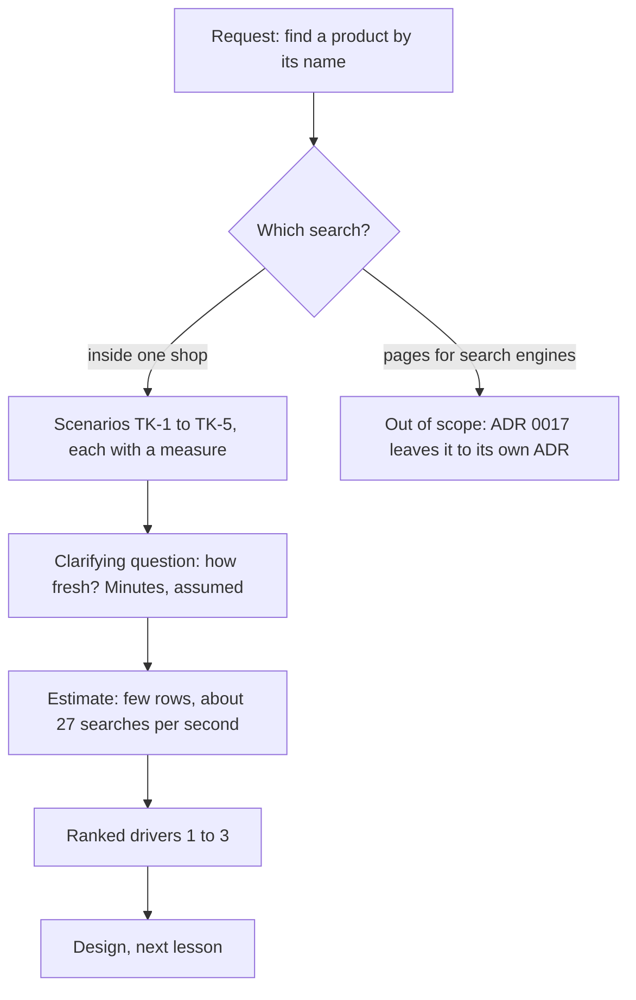

## Before you start

- [[sysdesign.l4.bank-signing-challenges]] — you have taken one problem through the whole framework, ending with a design review that answers each challenge from a driver, an ADR or a risk with an owner; this module starts the framework again at step 1.
- [[frontend.l4.pages-for-search]] — you know ADR `0017` keeps ordering in the Flutter app and leaves public product pages for search engines to a separate ADR.
- [[backend.l2.filtering-with-query-parameters]] — you know a filter is a query parameter on the collection's URL, added with `Where` before the query runs.
- [[backend.l4.capacity-planning]] — you know `capacity-plan.md` expects about 133 product reads per second at the busiest hour.

## The situation

The product owner, who decides what the product must do, forwards a message from a shop. A customer wanted the mechanical keyboard, looked for a box to type `ban phim` into, found none and left. You check what the app can ask the API for. `GET /api/v1/products` returns pages of at most 100 products in `id` order, and its only filter is `maxPriceVnd`. A customer who knows a product's name but not its price has to page through the list.

One teammate says: add `?name=` and we are done. Another says search should also make products show up on the web. Before anyone builds anything, what exactly must "search" do, and for whom?

## Core concepts

- in-shop search — a customer of one shop, inside the app, typing words to find one of that shop's products; the problem this module solves.
- pages found from outside — public product pages that a search engine reads and lists, so people who never opened the app reach a product; a different reader and a different problem.
- a scenario with a measure — a quality attribute scenario for search: what the customer does, what the system answers, and a test that says whether it did, such as "every name with diacritics is found by the same words typed without them".
- freshness of results — how long after a product is added or renamed it may take before search finds it; a choice the requirements make, not something the design discovers later.
- ranked drivers — the few scenarios, in order, that the design must satisfy first when two of them pull in different directions.

## How it works



In the situation above, the request is one sentence: let customers find a product by its name. Step 1 of the framework, clarifying requirements, turns it into a written target before anything is drawn.

The first split is between two meanings of search. In-shop search serves a customer who is already in the app. Pages found from outside serve a search engine that reads HTML, and you already know the Flutter app's HTML holds no product name. ADR `0017` leaves those pages to a separate decision, so the requirements name them as out of scope instead of quietly reopening that ADR.

Next, each need for in-shop search becomes a scenario with a measure, numbered TK-1 to TK-5. "Search should handle Vietnamese" cannot be tested; "every name with diacritics is found by the same words typed without them" can.

One clarifying question changes the shape of the design: how fresh must results be? The answer recorded is that a new or renamed product may appear a few minutes later (assumed), as the product list already accepts. "Within minutes" lets search read a copy of the products updated a little later; "at once" ties it to the products table itself.

The estimate then sizes the problem: few rows, and about 27 searches per second at peak. The data is not the risk. Load is: every search is a query to the database, because `ProductCache`, the Redis cache for products, keeps products only one at a time, by `id`. A search starts from words, not from an `id`, so it has no key to ask the cache for.

Last, the scenarios are ranked into drivers. The design in the next lesson is judged against them, in that order.

## In the Đơn Hàng system

The whole public surface of the product list at this tag:

```csharp file=DonHang.Api/Controllers/ProductsController.cs tag=stage-4 lines=18-32
    private const int MaxPageSize = 100;

    // lesson: backend.l2.offset-pagination
    // GET /api/v1/products?limit=20&offset=40. A `limit` outside 1..100 is
    // refused with 400, so no request can ask for the whole table at once.
    [HttpGet]
    [EnableRateLimiting("catalog-reads")]
    public async Task<ActionResult<List<ProductDto>>> List(
        [FromQuery, Range(1, MaxPageSize)] int limit = 20,
        [FromQuery, Range(0, int.MaxValue)] int offset = 0,
        [FromQuery] int? maxPriceVnd = null)
    {
        var page = await catalog.ListAsync(limit, offset, maxPriceVnd);
        return Ok(page.Select(ToDto).ToList());
    }
```

Look at the three parameters: a page size from 1 to 100, an offset, and a maximum price. Nothing takes a word. `CatalogService.ListAsync`, outside this excerpt, sorts by `id` and filters only by `maxPriceVnd`. So a customer looking for `Bàn phím cơ` by name can only page through the list.

The team's requirements for search, at the same tag:

```markdown file=docs/team/product-search-requirements.md tag=stage-4 lines=17-36
### Phạm vi

"Tìm kiếm" có hai nghĩa, tách riêng ở đây:

- Trong phạm vi: khách tìm một sản phẩm bên trong một cửa hàng, trên app và web.
- Ngoài phạm vi: trang sản phẩm công khai để máy tìm kiếm tìm thấy từ bên ngoài.
  ADR 0017 để việc đó cho một quyết định riêng; tài liệu này không quyết lại.

### Kịch bản

| Số | Tình huống | Phản hồi | Đo |
|---|---|---|---|
| TK-1 | Khách gõ tên không dấu, ví dụ `ban phim` | Ra sản phẩm có tên có dấu, `Bàn phím cơ` trong `db/seed.sql` | Mọi tên có dấu tìm được bằng chữ không dấu |
| TK-2 | Khách gõ vài từ | Sản phẩm khớp nhất lên trước | Sản phẩm chứa đủ mọi từ đứng trước sản phẩm chỉ chứa một phần |
| TK-3 | Khách của cửa hàng A tìm | Chỉ sản phẩm của cửa hàng A | Không kết quả nào của cửa hàng khác |
| TK-4 | Nhân viên thêm hay đổi tên sản phẩm | Kết quả tìm thấy sản phẩm mới, tên mới | Trong vài phút (giả định) |
| TK-5 | Giờ đông, nhiều người tìm cùng lúc | Đặt đơn vẫn trả lời như ngày thường | Tìm kiếm không lấy sức chứa của đặt đơn |

TK-4 là cùng lựa chọn mà danh sách sản phẩm đã có trong
`consistency-per-operation.md`: được phép hơi cũ.
```

The scope section keeps in-shop search, on app and web, and puts public pages for search engines out of scope, pointing to ADR `0017`. Each scenario has a measure you can test: TK-2 says a product containing every typed word comes before one containing only some. TK-5 has no number; it is checked through its response: at the busy hour, with searches running, ordering answers as on a normal day. TK-4 answers the freshness question with "within a few minutes (assumed)" and ties it to `consistency-per-operation.md`, the team's file that sets how stale each operation's reads may be: the product list may be slightly stale.

Below the excerpt, the same file estimates at most a few thousand products per shop (assumed 5,000) and a few hundred on average (assumed 200), so about 200,000 rows across 1,000 shops, which the team judges PostgreSQL holds easily. Searches are assumed to be 20% of product reads, about 27 per second at the plan's peak. They are a share of the planned reads, not extra ones. The risk is that each is a query on the primary PostgreSQL, where every order is also written, so TK-5 guards capacity that orders share.

An assumptions table then names who confirms each number: the product owner, for 5,000 products per shop and for "a few minutes". Its last section ranks the drivers: words typed without diacritics find the product (TK-1); search never takes the capacity orders need (TK-5); results stay within the caller's shop (TK-3).

## Trade-offs

| How the team frames the request | What the design gets | What it costs | Right when |
|---|---|---|---|
| Add `?name=` to the list, no requirements step | a filter shipped this sprint | fails TK-1 and TK-2; nobody asked about load or freshness | names are exact codes that customers copy, and lists stay short |
| One "search" covering the shop and search engines | one project | reopens ADR `0017`; mixes a reader in the app with a reader of HTML | the separate ADR `0017` promises has been written |
| In-shop search as scenarios with measures, ranked (chosen) | a target the design can be checked against | a requirements step, and assumptions the product owner must confirm | customers type real words, with or without diacritics |

The freshness answer is a trade-off too. "Found the moment it is saved" leaves the design fewer options than "found within minutes", so it is worth asking for only when a late result costs something. Writing "minutes, assumed" next to the person who confirms it keeps the choice visible and cheap to revisit.

## What would you choose if…

…a shop sells spare parts that customers look up by the code printed on the box? Ask before you copy TK-1 and TK-2. If customers type the code exactly, a scenario for an exact match may be the whole requirement, and ranking matters little.

…the product owner insists a new product must be found the second it is saved? Ask what is lost when it appears a few minutes later. If the answer is "nothing measurable", keep TK-4. If a real loss exists, write it as a new measure and expect the design to cost more.

…a shop expects 500,000 products, a hundred times the assumed 5,000? The assumptions table names the product owner as the person who confirms that number. Redo the estimate before the design, because "the data fits easily" was a conclusion of the old number.

## Seniors often assume…

- **"Search is just a `WHERE name = ...` added to the product list."** → Actually `=` matches only a name equal to the whole typed text, so `ban phim` never matches `Bàn phím cơ`, and the list's `id` order puts no best match first. It fails TK-1 and TK-2 before load is even considered. You notice this when customers report "no results" for products they can see on the shelf.
- **"Making products searchable in our shop also makes them show up on search engines."** → Actually these are two readers: a customer inside the app, and a search engine reading HTML that, for the Flutter app, holds no product name. The requirements put the second out of scope, and ADR `0017` leaves it to its own ADR. You notice this when in-shop search ships and a shop still asks why its products never appear on the web.
- **"Product reads are already cached in Redis, so search adds no load to the database."** → Actually `ProductCache` keeps products one at a time, by `id`; the product list reads the database directly, and so would every search. You notice this when database load at the busiest hour grows with the number of searches, not with the number of orders.

## Try it (3 minutes)

A teammate proposes: add `?name=` to `GET /api/v1/products`, return only rows whose `name` equals the typed text (`WHERE name = ...`), keep the `id` order. Check the proposal against TK-1 to TK-5 from the excerpt above. Which scenarios does it fail, which does it pass, and which can it not answer?

Expected result: each of TK-1 to TK-5 marked fails, passes or not answered, with one reason each.

<details><summary>Suggested answer</summary>

It fails TK-1: `ban phim` is not equal to `Bàn phím cơ`. It fails TK-2: equality returns only whole-name matches, and the `id` order ranks nothing. It passes TK-4: like the list, it reads the table on the primary on every call, with no cache, so a renamed product is found at once. It cannot answer TK-3 or TK-5 on its own: the list shown takes no shop, so which shop the caller belongs to and whether searches leave orders their capacity are questions for the design.

</details>

## Connections

- [[sysdesign.l4.clarifying-requirements]] — the general step this lesson applies: a request becomes scope, scenarios, constraints and answers to the questions that change a design's shape.
- [[design.l4.quality-attribute-scenarios]] — the form TK-1 to TK-5 follow: situation, response and a measure.
- [[frontend.l4.pages-for-search]] — the other meaning of search, which this lesson puts out of scope.
- [[backend.l2.offset-pagination]] — the paged, `id`-ordered list that customers must walk through today.
- [[backend.l2.cache-aside]] — why the cache does not help here: it keeps one product by `id`, not lists or searches.
- [[backend.l4.capacity-planning]] — the source of the 133 product reads per second that the search estimate builds on.
- [[sysdesign.l4.product-search-design]] — the next step: a design judged against these ranked drivers.

## Five-line summary

1. The stage-4 list filters only by `maxPriceVnd` in `id` order, and a plain `?name=` fails real scenarios, so product search starts as requirements.
2. "Search" has two meanings: customers finding a product inside one shop, and public pages for search engines, which ADR `0017` leaves to a separate decision.
3. `product-search-requirements.md` writes in-shop search as scenarios with measures: no-diacritic words find the product, best matches first, one shop only.
4. Results may lag a new or renamed product by minutes (assumed), and the risk is load, not data, because `ProductCache` keeps products only by `id`.
5. The ranked drivers are: no-diacritic words find the product, search never takes the capacity orders need, and results stay in the caller's shop.
