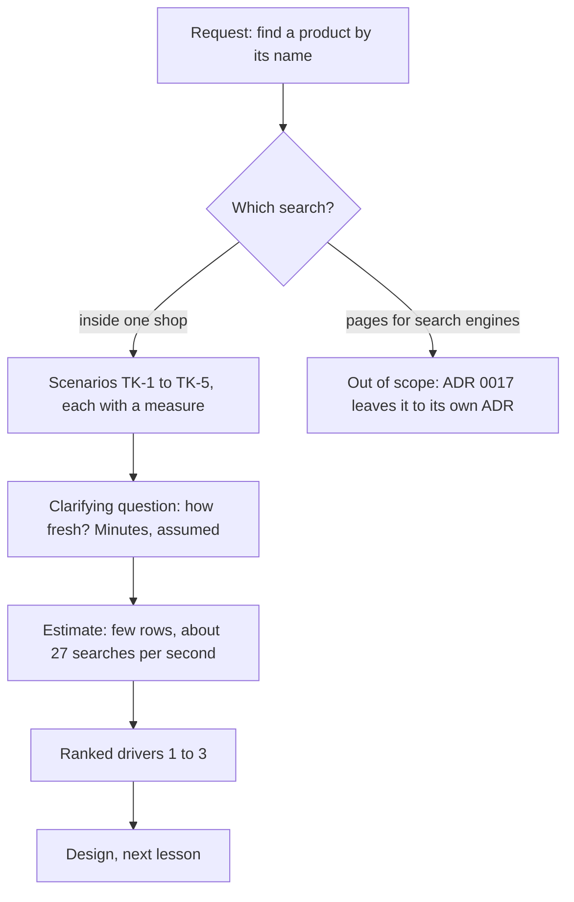

## Bạn cần biết trước

- [[sysdesign.l4.bank-signing-challenges]] — bạn đã đưa một bài toán đi hết quy trình, kết thúc bằng một buổi review thiết kế trả lời từng câu chất vấn bằng một yếu tố định hình kiến trúc hoặc một ADR. Module này bắt đầu lại quy trình từ bước 1.
- [[frontend.l4.pages-for-search]] — bạn biết ADR `0017` giữ việc đặt hàng trong app Flutter, còn trang sản phẩm công khai cho máy tìm kiếm thì để cho một ADR riêng.
- [[backend.l2.filtering-with-query-parameters]] — bạn biết bộ lọc là một query parameter trên URL của collection, thêm bằng `Where` trước khi câu truy vấn chạy.
- [[backend.l4.capacity-planning]] — bạn biết `capacity-plan.md` dự kiến khoảng 133 lượt đọc sản phẩm mỗi giây vào giờ đông nhất.

## Tình huống

Product owner, người quyết định sản phẩm phải làm gì, chuyển tiếp tin nhắn của một cửa hàng. Một khách muốn mua bàn phím cơ, tìm ô để gõ `ban phim` mà không thấy, rồi bỏ đi. Bạn kiểm tra xem app hỏi API được những gì. `GET /api/v1/products` trả về từng trang tối đa 100 sản phẩm, xếp theo `id`, và bộ lọc duy nhất là `maxPriceVnd`. Khách biết tên sản phẩm mà không biết giá thì phải lật từng trang.

Một đồng đội nói: thêm `?name=` là xong. Người khác bảo tìm kiếm còn phải giúp sản phẩm hiện lên trên web. Trước khi ai bắt tay xây, "tìm kiếm" chính xác phải làm gì, và cho ai?

## Khái niệm cốt lõi

- tìm trong cửa hàng — khách của một cửa hàng, ngay trong app, gõ chữ để tìm một sản phẩm của cửa hàng đó. Đây là bài toán module này giải.
- trang được tìm thấy từ bên ngoài — trang sản phẩm công khai mà máy tìm kiếm đọc và liệt kê, để người chưa từng mở app vẫn tới được sản phẩm. Người đọc khác, bài toán khác.
- kịch bản có phép đo — một kịch bản thuộc tính chất lượng cho tìm kiếm: khách làm gì, hệ thống trả lời gì, và một phép kiểm cho biết hệ thống có làm được không, ví dụ "mọi tên có dấu đều tìm được bằng chính những chữ đó gõ không dấu".
- độ mới của kết quả — sau khi thêm hay đổi tên một sản phẩm, tìm kiếm được phép chậm bao lâu mới thấy nó. Đây là lựa chọn của phần yêu cầu, không phải thứ để thiết kế phát hiện ra sau.
- yếu tố định hình kiến trúc xếp hạng — vài kịch bản, theo thứ tự, mà thiết kế phải ưu tiên đáp ứng khi hai kịch bản kéo về hai hướng khác nhau.

## Cơ chế hoạt động



Trong tình huống trên, yêu cầu chỉ có một câu: cho khách tìm sản phẩm theo tên. Bước 1 của quy trình, làm rõ yêu cầu, biến câu đó thành một mục tiêu viết ra giấy trước khi vẽ bất cứ thứ gì.

Chỗ tách đầu tiên là giữa hai nghĩa của tìm kiếm. Tìm trong cửa hàng phục vụ khách đã ở trong app. Trang được tìm thấy từ bên ngoài phục vụ máy tìm kiếm đọc HTML, và bạn đã biết HTML của app Flutter không chứa tên sản phẩm nào. ADR `0017` để những trang đó cho một quyết định riêng, nên phần yêu cầu ghi rõ chúng nằm ngoài phạm vi, thay vì lặng lẽ mở lại ADR đó.

Tiếp theo, mỗi nhu cầu của tìm trong cửa hàng thành một kịch bản có phép đo, đánh số TK-1 tới TK-5. "Tìm kiếm phải xử lý được tiếng Việt" thì không kiểm được. "Mọi tên có dấu đều tìm được bằng chính những chữ đó gõ không dấu" thì kiểm được.

Một câu hỏi làm rõ đổi cả hình dạng của thiết kế: kết quả phải mới tới mức nào? Câu trả lời được ghi lại là sản phẩm mới hay vừa đổi tên có thể vài phút sau mới hiện (giả định), đúng như danh sách sản phẩm đã chấp nhận. "Trong vài phút" cho phép tìm kiếm đọc một bản sao của sản phẩm được cập nhật trễ hơn một chút. "Ngay lập tức" thì buộc nó vào chính bảng sản phẩm.

Sau đó, phần ước lượng cho biết bài toán lớn cỡ nào: ít dòng, và khoảng 27 lượt tìm mỗi giây lúc cao điểm. Dữ liệu không phải rủi ro. Tải mới là rủi ro: mỗi lượt tìm là một câu truy vấn vào database, vì `ProductCache`, cache Redis cho sản phẩm, chỉ giữ từng sản phẩm một, theo `id`. Lượt tìm bắt đầu từ chữ, không từ `id`, nên không có khóa nào để hỏi cache.

Cuối cùng, các kịch bản được xếp hạng thành yếu tố định hình kiến trúc. Thiết kế ở bài sau được chấm theo chúng, đúng thứ tự đó.

## Trong hệ thống Đơn Hàng

Toàn bộ mặt công khai của danh sách sản phẩm ở tag này:

```csharp file=DonHang.Api/Controllers/ProductsController.cs tag=stage-4 lines=18-32
    private const int MaxPageSize = 100;

    // lesson: backend.l2.offset-pagination
    // GET /api/v1/products?limit=20&offset=40. A `limit` outside 1..100 is
    // refused with 400, so no request can ask for the whole table at once.
    [HttpGet]
    [EnableRateLimiting("catalog-reads")]
    public async Task<ActionResult<List<ProductDto>>> List(
        [FromQuery, Range(1, MaxPageSize)] int limit = 20,
        [FromQuery, Range(0, int.MaxValue)] int offset = 0,
        [FromQuery] int? maxPriceVnd = null)
    {
        var page = await catalog.ListAsync(limit, offset, maxPriceVnd);
        return Ok(page.Select(ToDto).ToList());
    }
```

Nhìn ba tham số: kích thước trang từ 1 tới 100, một offset, và một mức giá tối đa. Không tham số nào nhận chữ. `CatalogService.ListAsync`, nằm ngoài đoạn trích, sắp theo `id` và chỉ lọc theo `maxPriceVnd`. Vì vậy khách muốn tìm `Bàn phím cơ` theo tên chỉ có cách lật qua danh sách.

Phần yêu cầu cho tìm kiếm của nhóm, cùng tag:

```markdown file=docs/team/product-search-requirements.md tag=stage-4 lines=17-36
### Phạm vi

"Tìm kiếm" có hai nghĩa, tách riêng ở đây:

- Trong phạm vi: khách tìm một sản phẩm bên trong một cửa hàng, trên app và web.
- Ngoài phạm vi: trang sản phẩm công khai để máy tìm kiếm tìm thấy từ bên ngoài.
  ADR 0017 để việc đó cho một quyết định riêng; tài liệu này không quyết lại.

### Kịch bản

| Số | Tình huống | Phản hồi | Đo |
|---|---|---|---|
| TK-1 | Khách gõ tên không dấu, ví dụ `ban phim` | Ra sản phẩm có tên có dấu, `Bàn phím cơ` trong `db/seed.sql` | Mọi tên có dấu tìm được bằng chữ không dấu |
| TK-2 | Khách gõ vài từ | Sản phẩm khớp nhất lên trước | Sản phẩm chứa đủ mọi từ đứng trước sản phẩm chỉ chứa một phần |
| TK-3 | Khách của cửa hàng A tìm | Chỉ sản phẩm của cửa hàng A | Không kết quả nào của cửa hàng khác |
| TK-4 | Nhân viên thêm hay đổi tên sản phẩm | Kết quả tìm thấy sản phẩm mới, tên mới | Trong vài phút (giả định) |
| TK-5 | Giờ đông, nhiều người tìm cùng lúc | Đặt đơn vẫn trả lời như ngày thường | Tìm kiếm không lấy sức chứa của đặt đơn |

TK-4 là cùng lựa chọn mà danh sách sản phẩm đã có trong
`consistency-per-operation.md`: được phép hơi cũ.
```

Phần phạm vi giữ tìm trong cửa hàng, trên app và web, và đưa trang công khai cho máy tìm kiếm ra ngoài phạm vi, trỏ tới ADR `0017`. Kịch bản nào cũng có phép đo kiểm được: TK-2 nói sản phẩm chứa mọi từ đã gõ đứng trước sản phẩm chỉ chứa một phần. TK-5 không có con số, nó được kiểm qua phản hồi: vào giờ đông, khi các lượt tìm đang chạy, đặt đơn vẫn trả lời như ngày thường. TK-4 trả lời câu hỏi về độ mới bằng "trong vài phút (giả định)" và nối nó với `consistency-per-operation.md`, file của nhóm quy định mỗi thao tác được phép đọc dữ liệu cũ tới mức nào: danh sách sản phẩm được phép hơi cũ.

Bên dưới đoạn trích, cùng file ước lượng mỗi cửa hàng có nhiều nhất vài nghìn sản phẩm (giả định 5.000) và trung bình vài trăm (giả định 200), tức khoảng 200.000 dòng trên 1.000 cửa hàng, mức mà nhóm đánh giá PostgreSQL chứa thoải mái. Lượt tìm được giả định chiếm 20% lượt đọc sản phẩm, khoảng 27 lượt mỗi giây lúc cao điểm của kế hoạch. Chúng là một phần của lượt đọc đã tính, không phải lượt đọc thêm. Rủi ro là mỗi lượt là một câu truy vấn vào PostgreSQL chính, nơi mọi đơn hàng cũng được ghi, nên TK-5 bảo vệ phần sức chứa mà đơn hàng dùng chung.

Tiếp đó, một bảng giả định ghi tên người xác nhận từng con số: product owner, cho 5.000 sản phẩm mỗi cửa hàng và cho "vài phút". Mục cuối xếp hạng các yếu tố định hình kiến trúc: chữ gõ không dấu tìm ra sản phẩm (TK-1), tìm kiếm không bao giờ lấy phần sức chứa đặt đơn cần (TK-5), kết quả nằm trong cửa hàng của người gọi (TK-3).

## Đánh đổi

| Nhóm hiểu yêu cầu thế nào | Thiết kế nhận được gì | Cái giá | Đúng khi |
|---|---|---|---|
| Thêm `?name=` vào danh sách, bỏ qua bước yêu cầu | một bộ lọc xong trong sprint này | trượt TK-1 và TK-2, không ai hỏi về tải hay độ mới | tên là mã chính xác khách chép lại, và danh sách luôn ngắn |
| Một "tìm kiếm" gộp cả cửa hàng lẫn máy tìm kiếm | một dự án | mở lại ADR `0017`, trộn người đọc trong app với người đọc HTML | ADR riêng mà ADR `0017` hứa đã được viết |
| Tìm trong cửa hàng thành các kịch bản có phép đo, xếp hạng (đã chọn) | một mục tiêu để kiểm thiết kế | thêm một bước yêu cầu, và các giả định product owner phải xác nhận | khách gõ chữ thật, có dấu hay không dấu |

Câu trả lời về độ mới cũng là một đánh đổi. "Tìm thấy ngay khi vừa lưu" để lại cho thiết kế ít lựa chọn hơn "tìm thấy trong vài phút", nên chỉ đáng đòi khi kết quả trễ gây thiệt hại thật. Ghi "vài phút, giả định" cạnh tên người xác nhận giúp lựa chọn đó luôn hiện ra và xem lại không tốn bao nhiêu.

## Bạn sẽ chọn gì nếu…

…một cửa hàng bán phụ tùng, khách tra theo mã in trên hộp? Hỏi trước khi chép TK-1 và TK-2. Nếu khách gõ đúng mã, một kịch bản khớp chính xác có thể là toàn bộ yêu cầu, và xếp hạng không mấy quan trọng.

…product owner nhất quyết sản phẩm mới phải tìm thấy ngay giây nó được lưu? Hỏi xem mất gì khi nó hiện ra trễ vài phút. Nếu câu trả lời là "không có gì đo được", giữ TK-4. Nếu có thiệt hại thật, viết nó thành một phép đo mới và chuẩn bị cho một thiết kế tốn hơn.

…một cửa hàng dự kiến 500.000 sản phẩm, gấp trăm lần mức giả định 5.000? Bảng giả định ghi product owner là người xác nhận con số đó. Làm lại phần ước lượng trước khi thiết kế, vì "dữ liệu chứa thoải mái" là kết luận rút từ con số cũ.

## Senior hay nhầm rằng…

- **"Tìm kiếm chỉ là thêm `WHERE name = ...` vào danh sách sản phẩm."** → Thực ra `=` chỉ khớp tên bằng đúng toàn bộ chữ đã gõ, nên `ban phim` không bao giờ khớp `Bàn phím cơ`, còn thứ tự theo `id` của danh sách không đưa kết quả khớp nhất lên đầu. Nó trượt TK-1 và TK-2 trước cả khi tính tới tải. Bạn sẽ nhận ra khi khách báo "không có kết quả" cho những sản phẩm họ thấy ngay trên kệ.
- **"Cho sản phẩm tìm được trong cửa hàng thì chúng cũng hiện lên trên máy tìm kiếm."** → Thực ra đây là hai người đọc: khách trong app, và máy tìm kiếm đọc HTML, mà với app Flutter thì HTML không chứa tên sản phẩm nào. Phần yêu cầu đưa người đọc thứ hai ra ngoài phạm vi, và ADR `0017` để nó cho một ADR riêng. Bạn sẽ nhận ra khi tìm trong cửa hàng đã chạy mà một cửa hàng vẫn hỏi sao sản phẩm của họ không bao giờ hiện trên web.
- **"Lượt đọc sản phẩm đã có cache Redis, nên tìm kiếm không thêm tải cho database."** → Thực ra `ProductCache` giữ từng sản phẩm một, theo `id`. Danh sách sản phẩm đọc thẳng database, và mọi lượt tìm cũng sẽ như vậy. Bạn sẽ nhận ra khi tải database vào giờ đông nhất tăng theo số lượt tìm, không theo số đơn hàng.

## Thử ngay (3 phút)

Một đồng đội đề xuất: thêm `?name=` vào `GET /api/v1/products`, chỉ trả các dòng có `name` bằng đúng chữ đã gõ (`WHERE name = ...`), giữ thứ tự theo `id`. Đối chiếu đề xuất với TK-1 tới TK-5 trong đoạn trích trên. Nó trượt kịch bản nào, đạt kịch bản nào, và không trả lời được kịch bản nào?

Kết quả mong đợi: mỗi kịch bản từ TK-1 tới TK-5 được đánh dấu trượt, đạt hoặc không trả lời được, kèm một lý do.

<details><summary>Gợi ý đáp án</summary>

Trượt TK-1: `ban phim` không bằng `Bàn phím cơ`. Trượt TK-2: so bằng chỉ trả về tên khớp trọn, còn thứ tự theo `id` không xếp hạng gì. Đạt TK-4: giống danh sách, nó đọc bảng trên database chính ở mỗi lần gọi, không qua cache, nên sản phẩm vừa đổi tên được tìm thấy ngay. Tự nó không trả lời được TK-3 hay TK-5: danh sách trong bài không nhận cửa hàng nào, nên người gọi thuộc cửa hàng nào, và lượt tìm có chừa đủ sức chứa cho đặt đơn không, là câu hỏi của phần thiết kế.

</details>

## Liên hệ

- [[sysdesign.l4.clarifying-requirements]] — bước chung mà bài này áp dụng: một yêu cầu thành phạm vi, kịch bản, ràng buộc và câu trả lời cho những câu hỏi đổi hình dạng thiết kế.
- [[design.l4.quality-attribute-scenarios]] — khuôn mà TK-1 tới TK-5 theo: tình huống, phản hồi và một phép đo.
- [[frontend.l4.pages-for-search]] — nghĩa còn lại của tìm kiếm, bài này đưa nó ra ngoài phạm vi.
- [[backend.l2.offset-pagination]] — danh sách phân trang, xếp theo `id`, mà hôm nay khách phải lật qua.
- [[backend.l2.cache-aside]] — vì sao cache không giúp được ở đây: nó giữ một sản phẩm theo `id`, không giữ danh sách hay kết quả tìm.
- [[backend.l4.capacity-planning]] — nguồn của con số 133 lượt đọc sản phẩm mỗi giây mà ước lượng cho tìm kiếm dựa vào.
- [[sysdesign.l4.product-search-design]] — bước tiếp theo: một thiết kế được chấm theo các yếu tố định hình kiến trúc đã xếp hạng này.

## Tóm tắt 5 dòng

1. Danh sách ở stage-4 chỉ lọc theo `maxPriceVnd`, xếp theo `id`, còn một `?name=` đơn giản trượt các kịch bản thật, nên tìm kiếm sản phẩm bắt đầu từ phần yêu cầu.
2. "Tìm kiếm" có hai nghĩa: khách tìm sản phẩm trong một cửa hàng, và trang công khai cho máy tìm kiếm, thứ ADR `0017` để cho một quyết định riêng.
3. `product-search-requirements.md` viết tìm trong cửa hàng thành các kịch bản có phép đo: chữ không dấu tìm ra sản phẩm, khớp nhất lên trước, chỉ trong một cửa hàng.
4. Kết quả được phép trễ vài phút so với sản phẩm mới hay vừa đổi tên (giả định), và rủi ro là tải chứ không phải dữ liệu, vì `ProductCache` chỉ giữ sản phẩm theo `id`.
5. Các yếu tố định hình kiến trúc theo thứ tự: chữ không dấu tìm ra sản phẩm, tìm kiếm không bao giờ lấy phần sức chứa đặt đơn cần, và kết quả nằm trong cửa hàng của người gọi.
