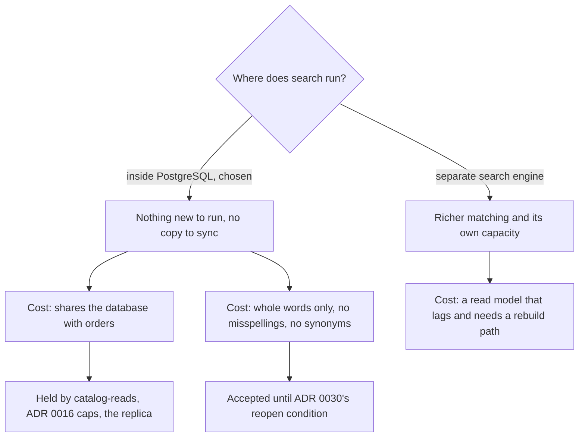

## Before you start

- [[sysdesign.l4.product-search-design]] — you know ADR `0030` keeps search in PostgreSQL, inside Catalog, building normalised words on the product's own row, under the same `catalog-reads` limit.
- [[design.l4.trade-off-points]] — you know a trade-off point is one decision that moves two quality attributes in opposite directions.
- [[backend.l4.read-routing]] — you know a read moves to the replica only when its operation can answer with slightly old data, and every routed read needs a way back to the primary.
- [[backend.l4.per-shop-limits]] — you know ADR `0016` adds a cap per shop on top of the shared limit, arriving once requests carry the shop.

## The situation

ADR `0030` is accepted, and the design review goes out before the meeting. Three replies arrive. A developer from another team writes that staying in PostgreSQL is a shortcut: a proper search product would forgive a customer who types `ban phm`. The product owner worries about a sales peak, when every search is a query on the same database that takes the orders. A third person suggests keeping each search's results in Redis, as is already done for single products.

Each reply points at something the design really gives up. What exactly does search inside PostgreSQL give up, and what keeps each loss acceptable at the estimated size?

## Core concepts

- where search runs — the decision this lesson examines as a trade-off point: running inside PostgreSQL buys "nothing new to run, no copy" and costs a database shared with orders.
- whole-word matching — what the chosen design matches: a query word finds a product only when it equals one of the normalised words of its name.
- reopen condition — a measured signal written in an ADR that brings a rejected option back to the table, so a loss is accepted until a count says otherwise.
- tolerance for stale data — how old an answer an operation may give; for the product list and for search, minutes (assumed).

## How it works



In the situation above, the first two replies point at two costs of one decision: where search runs. Inside PostgreSQL nothing new runs and the searchable words stay on the product row, so no copy needs syncing. The price: every search is a query on the database that also takes orders.

That shared database is protected by limits already planned. Search is not built at stage-4 (ADR `0030`), and ADR `0016`'s caps wait for requests to carry the shop. Each search will take a place in `catalog-reads`, which limits product reads, not orders, so a burst is refused with `503` while orders keep being placed. ADR `0016`'s caps will keep one busy shop from filling those places. If peak product reads cross the primary's headroom, the product list and search move to the read replica, as their tolerance for stale data allows. That replica is a copy PostgreSQL keeps itself, not a store the team feeds, and its lag is one the product list already accepts.

The second cost comes from the matching, and it follows from staying: ADR `0030` uses only PostgreSQL's own normalisation, while misspellings and synonyms are what the rejected engine offered. Under its rule a query word matches only a whole normalised word of the name, and the design review's example needs every query word to match. `phm` is not `phim`, so `ban phm` finds nothing; a synonym with different letters finds nothing either. The review accepts this until ADR `0030`'s counted reopen condition.

A separate search engine would remove both costs and bring its own: a read model of the products, fed by Catalog's changes through the outbox, so it lags behind `products` and needs a rebuild path the team must keep working.

## In the Đơn Hàng system

The design review records the rejected options and three trade-off points side by side, filed under steps 3 and 4 of the design framework the review follows:

```markdown file=docs/design/product-search-design-review.md tag=stage-4 lines=65-75
### Phương án bị loại và điểm đánh đổi (bước 3 và 4)

- `LIKE '%...%'`: đọc mọi dòng mỗi lần tìm, không bỏ dấu (trái driver 1, 2).
- Công cụ tìm kiếm riêng: một bản sao nuôi từ Catalog qua outbox, trễ, cần dựng
  lại, thêm một service; chưa cần ở cỡ đã ước lượng.
- Điểm đánh đổi, nơi chạy: trong PostgreSQL thì không gì mới phải chạy, không
  bản sao, nhưng câu tìm dùng chung database với đặt đơn.
- Điểm đánh đổi, khớp nguyên từ: không tìm ra từ gõ sai, không đồng nghĩa; chấp
  nhận tới điều kiện xem lại của ADR 0030.
- Điểm đánh đổi, không cache kết quả theo từ tìm: giả định phần lớn câu tìm
  khác nhau, nên cache ít trúng mà thêm một bản sao phải xóa khi đổi tên.
```

The search engine is rejected as "not needed yet at the estimated size", not as "never". The matching point ties its loss to ADR `0030`'s reopen condition: complaints about misspellings or synonyms above 5% of search feedback in a month (assumed), which the product owner counts monthly, or search load above the headroom even after moving to the replica.

The third point answers the Redis suggestion. Here is the cache it has in mind; `redis` is its Redis connection, and the `Locks` line does not matter here:

```csharp file=DonHang.Catalog/ProductCache.cs tag=stage-4 lines=13-29
internal sealed class ProductCache(IProductRepository inner, IConnectionMultiplexer redis, ILogger<ProductCache> logger)
    : IProductRepository
{
    // lesson: backend.l2.cache-invalidation
    // The longest a stale copy can live, even if a delete below is missed.
    private static readonly TimeSpan Ttl = TimeSpan.FromMinutes(5);

    // One SemaphoreSlim per key, shared by every request in this api process.
    private static readonly ConcurrentDictionary<string, SemaphoreSlim> Locks = new();

    // lesson: backend.l2.cache-aside
    // Redis first; only on a miss ask the repository inside, then keep its answer.
    public async Task<Product?> FindAsync(int id)
    {
        var key = $"product:{id}";
        var cached = await GetAsync(key);
        if (cached is not null) return cached; // cache hit: no query
```

`ProductCache` keeps one product per key, `product:{id}`, for at most 5 minutes (`Ttl`). Its only read, `FindAsync`, starts from an `id`. A search starts from words, so it has no key to ask for, and the cache cannot answer it. Caching results by search text would need a new key per text. The review leaves it out on an assumption: most searches differ, so such a cache would rarely hit, and renaming a product would have to clear every cached result it appears in. Whether searches repeat is not measured yet; the review keeps it as an open question for the team that proposed the design.

## Trade-offs

| Trade-off point | What the design buys | What it pays | What holds the cost, or reopens it |
|---|---|---|---|
| Where search runs: inside PostgreSQL | nothing new to run; no copy to feed, no lag on the primary, no rebuild path | searches share the database with order placement | `catalog-reads`, ADR `0016` caps, then the replica per `capacity-plan.md` |
| Whole-word matching | unaccented typing finds products (driver 1) with PostgreSQL's own normalisation | no product for a misspelt word; no synonyms | ADR `0030`'s reopen condition, counted monthly |
| No cache of results by search text | no second copy to clear on rename | every search is a query | the open question: measure how often searches repeat |

Each row is a cost accepted under an assumption: few thousand products per shop, about 27 searches per second at peak, most searches different (all assumed, from the design review's estimate). The opposite choice, a separate engine from the start, is right in a different context. When customers rarely know exact names, misspellings and synonyms are the driver, not a side effect. When search load already exceeds the database's headroom, the engine's own capacity is the reason to pay for its copy. Neither is true at the estimated size, and the reopen condition says how the team would find out.

## What would you choose if…

…search has moved to the replica and the replica falls behind by more than the product list tolerates? The plan already answers: every read routed to the replica must go back to the primary when the replica lags beyond that tolerance or stops answering. Search goes back too, still under `catalog-reads`. The fallback is part of moving, not a later fix.

…the monthly count shows misspelling complaints above the 5% line? The reopen condition is met, so the separate engine is weighed again, with its copy, its lag and its rebuild path, against the measured gain. Meeting the condition reopens the decision; it does not decide it.

…measurements show that a handful of search texts make up most searches? The assumption behind leaving out a result cache no longer holds. The open question can now be answered with numbers, and the cost of clearing results on rename is weighed against the hits.

## Seniors often assume…

- **"A dedicated search engine is always better, so staying in PostgreSQL is only a shortcut."** → Actually the engine buys richer matching and its own capacity by adding a read model that lags behind `products`, needs a rebuild path and is one more service; at the estimated size the drivers ask for neither of its gains. You notice this when a design names the engine's features but not the copy it creates or the reopen condition that would justify it.
- **"If search runs on the replica, a product changed a second ago must still show its new name."** → Actually the replica receives changes from the primary after a delay, and search inherits the product list's tolerance for answers minutes old (assumed). You notice this when, once search is built, a test renames a product and searches the replica at once, and the old name comes back for a moment.
- **"Caching each search's results will remove the load, just as `ProductCache` does for product pages."** → Actually `ProductCache` works because each product has one key, its `id`; search results are keyed by free text, and if most texts differ, the cache rarely hits while every rename must clear the results it appears in. You notice this when a result cache shows a low share of cache hits and stale names after renames.

## Try it (3 minutes)

For each event below, name the trade-off point it touches and say whether ADR `0030` should be reopened:

1. A customer types `tai ngh` and finds nothing.
2. Search runs on the replica; a shop renames a product, and for a moment a search still shows the old name.
3. At a sales peak, some product reads get `503` while orders keep being placed.
4. The monthly count shows misspelling complaints at 2% of search feedback.

Expected result: four answers, each naming one trade-off point, with "reopen" for none of them.

<details><summary>Suggested answer</summary>

1. Whole-word matching: `ngh` is not the whole word `nghe`, so the query does not match. One event is not a count; it goes into the monthly feedback count, no reopening.
2. Where search runs, through the replica: the answer is within the tolerance for stale data the product list already accepts. Reopening is not needed; going back to the primary is for when the lag exceeds that tolerance.
3. Where search runs: the shared database is protected as designed, since `catalog-reads` refuses product reads, not orders. It feeds `capacity-plan.md`'s steps; the ADR reopens only if search load stays above the headroom even on the replica.
4. Whole-word matching: 2% is below the 5% line (assumed), so the decision stands.

</details>

## Connections

- [[sysdesign.l4.product-search-design]] — the design whose costs this lesson lists; read its options table next to the trade-off table here.
- [[design.l4.trade-off-points]] — the idea applied here three times: each point buys one quality attribute and pays with another.
- [[backend.l4.read-routing]] — the rule that lets search move to the replica, and the way back to the primary that every routed read needs.
- [[backend.l4.per-shop-limits]] — the caps that will keep one busy shop's searches from filling `catalog-reads`.
- [[design.l3.read-model]] — what a separate search engine would be: a copy in the shape one query needs, fed from the write side.
- [[backend.l3.outbox-relay]] — the path that would feed that copy, and the reason it lags.
- [[management.l3.total-cost-of-ownership]] — the same reasoning one level up: the engine's cost is everything it adds to run, not only the feature it brings.
- [[sysdesign.l4.finding-bottlenecks]] — the framework step where `catalog-reads` is found to run out first for product reads, the limit each search will also take a place in.
- [[sysdesign.l4.product-search-challenges]] — the next step: answering the review's challenges from ADRs `0017`, `0026` and `0030`.

## Five-line summary

1. Search inside PostgreSQL gives up richer matching and its own capacity so that nothing new runs and no product copy needs syncing.
2. Whole-word matching finds nothing for a misspelt word and knows no synonyms; the review accepts this until ADR `0030`'s counted reopen condition.
3. A separate engine would be a read model fed from Catalog through the outbox, lagging behind `products` and needing a rebuild path.
4. Search load is held by `catalog-reads`, ADR `0016`'s per-shop caps and a move to the replica, which the product list's tolerance for stale data allows.
5. `ProductCache` keeps products by `id` for 5 minutes, so it cannot answer searches; a result cache is left out, assuming most searches differ.
