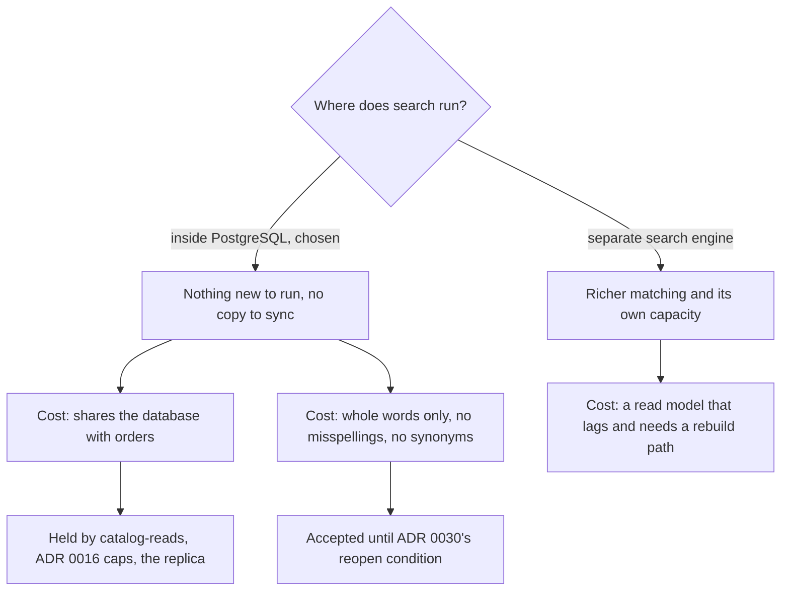

## Bạn cần biết trước

- [[sysdesign.l4.product-search-design]] — bạn biết ADR `0030` giữ tìm kiếm trong PostgreSQL, bên trong Catalog, dựng các từ đã chuẩn hóa ngay trên dòng của sản phẩm, dưới cùng giới hạn `catalog-reads`.
- [[design.l4.trade-off-points]] — bạn biết điểm đánh đổi là một quyết định đẩy hai thuộc tính chất lượng đi theo hai hướng ngược nhau.
- [[backend.l4.read-routing]] — bạn biết một lượt đọc chỉ chuyển sang replica khi thao tác của nó trả lời bằng dữ liệu hơi cũ cũng được, và lượt đọc nào đã chuyển cũng cần đường quay về primary.
- [[backend.l4.per-shop-limits]] — bạn biết ADR `0016` thêm giới hạn cho từng cửa hàng chồng lên giới hạn dùng chung, có hiệu lực khi request mang theo cửa hàng.

## Tình huống

ADR `0030` đã được chấp nhận, và tài liệu review thiết kế được gửi đi trước buổi họp. Ba phản hồi tới. Một developer ở nhóm khác viết rằng ở lại PostgreSQL là đi tắt: một sản phẩm tìm kiếm đúng nghĩa sẽ bỏ qua lỗi cho khách gõ `ban phm`. Product owner lo về một đợt cao điểm bán hàng, khi mỗi lượt tìm là một truy vấn trên chính database đang nhận đơn. Người thứ ba đề xuất giữ kết quả của từng lượt tìm trong Redis, như đang làm với từng sản phẩm.

Phản hồi nào cũng chỉ vào một thứ thiết kế thật sự bỏ ra. Tìm kiếm ngay trong PostgreSQL bỏ ra chính xác những gì, và điều gì giữ cho từng thứ mất đó chấp nhận được ở quy mô đã ước lượng?

## Khái niệm cốt lõi

- nơi tìm kiếm chạy — quyết định mà bài này xem như một điểm đánh đổi: chạy trong PostgreSQL thì được "không thêm gì phải chạy, không bản sao", và trả bằng một database dùng chung với đặt đơn.
- so khớp nguyên từ — cách thiết kế đã chọn so khớp: một từ trong câu tìm chỉ tìm ra sản phẩm khi nó trùng với một trong các từ đã chuẩn hóa của tên.
- điều kiện xem lại — một tín hiệu đo được, ghi trong ADR, đưa một phương án đã loại trở lại bàn. Nhờ đó một thứ mất được chấp nhận cho tới khi một con số đếm được nói khác.
- mức chịu dữ liệu cũ — một thao tác được phép trả câu trả lời cũ tới đâu. Với danh sách sản phẩm và với tìm kiếm là vài phút (giả định).

## Cơ chế hoạt động



Trong tình huống trên, hai phản hồi đầu chỉ vào hai cái giá của cùng một quyết định: tìm kiếm chạy ở đâu. Trong PostgreSQL thì không có gì mới phải chạy, và các từ tìm được nằm yên trên dòng sản phẩm, nên không có bản sao nào cần đồng bộ. Cái giá là mỗi lượt tìm là một truy vấn trên database cũng đang nhận đơn.

Database dùng chung đó được bảo vệ bằng các giới hạn đã có trong kế hoạch. Tìm kiếm chưa được xây ở stage-4 (ADR `0030`), còn giới hạn của ADR `0016` chờ request mang theo cửa hàng. Mỗi lượt tìm sẽ chiếm một chỗ trong `catalog-reads`, giới hạn dành cho lượt đọc sản phẩm chứ không phải đặt đơn, nên một đợt dồn dập bị từ chối bằng `503` trong khi đơn vẫn được đặt. Giới hạn của ADR `0016` sẽ giữ cho một cửa hàng bận rộn không chiếm hết các chỗ đó. Nếu lượt đọc sản phẩm lúc cao điểm vượt khoảng dư của primary, danh sách sản phẩm và tìm kiếm chuyển sang read replica, vì mức chịu dữ liệu cũ của chúng cho phép. Replica đó là bản sao do PostgreSQL tự giữ, không phải một kho mà nhóm phải nuôi, và độ trễ của nó là độ trễ danh sách sản phẩm đã chấp nhận.

Cái giá thứ hai đến từ cách so khớp, và nó là hệ quả của quyết định ở lại: ADR `0030` chỉ dùng cách chuẩn hóa có sẵn của PostgreSQL, còn chịu được gõ sai và hiểu từ đồng nghĩa là thứ công cụ bị loại kia mang lại. Theo quy tắc của nó, một từ trong câu tìm chỉ khớp với nguyên một từ đã chuẩn hóa của tên, và ví dụ trong review thiết kế đòi mọi từ của câu tìm đều phải khớp. `phm` không phải `phim`, nên `ban phm` không tìm ra gì. Một từ đồng nghĩa viết bằng chữ khác cũng không tìm ra gì. Review chấp nhận điều này cho tới điều kiện xem lại có đếm số của ADR `0030`.

Một công cụ tìm kiếm riêng sẽ gỡ cả hai cái giá và mang theo cái giá của chính nó: một read model của sản phẩm, nuôi bằng các thay đổi của Catalog qua outbox, nên trễ sau `products` và cần một đường dựng lại mà nhóm phải giữ cho chạy được.

## Trong hệ thống Đơn Hàng

Review thiết kế ghi các phương án bị loại và ba điểm đánh đổi cạnh nhau, xếp dưới bước 3 và 4 của quy trình thiết kế mà buổi review theo:

```markdown file=docs/design/product-search-design-review.md tag=stage-4 lines=65-75
### Phương án bị loại và điểm đánh đổi (bước 3 và 4)

- `LIKE '%...%'`: đọc mọi dòng mỗi lần tìm, không bỏ dấu (trái driver 1, 2).
- Công cụ tìm kiếm riêng: một bản sao nuôi từ Catalog qua outbox, trễ, cần dựng
  lại, thêm một service; chưa cần ở cỡ đã ước lượng.
- Điểm đánh đổi, nơi chạy: trong PostgreSQL thì không gì mới phải chạy, không
  bản sao, nhưng câu tìm dùng chung database với đặt đơn.
- Điểm đánh đổi, khớp nguyên từ: không tìm ra từ gõ sai, không đồng nghĩa; chấp
  nhận tới điều kiện xem lại của ADR 0030.
- Điểm đánh đổi, không cache kết quả theo từ tìm: giả định phần lớn câu tìm
  khác nhau, nên cache ít trúng mà thêm một bản sao phải xóa khi đổi tên.
```

Công cụ tìm kiếm bị loại vì "chưa cần ở cỡ đã ước lượng", chứ không phải "không bao giờ". Điểm về so khớp buộc thứ mất của nó vào điều kiện xem lại của ADR `0030`: phàn nàn về gõ sai hay từ đồng nghĩa vượt 5% phản hồi về tìm kiếm trong một tháng (giả định), do product owner đếm mỗi tháng, hoặc tải tìm kiếm vượt khoảng dư ngay cả khi đã chuyển sang replica.

Điểm thứ ba trả lời đề xuất về Redis. Đây là cache mà đề xuất đó nghĩ tới. `redis` là kết nối Redis của nó, còn dòng `Locks` không liên quan ở đây:

```csharp file=DonHang.Catalog/ProductCache.cs tag=stage-4 lines=13-29
internal sealed class ProductCache(IProductRepository inner, IConnectionMultiplexer redis, ILogger<ProductCache> logger)
    : IProductRepository
{
    // lesson: backend.l2.cache-invalidation
    // The longest a stale copy can live, even if a delete below is missed.
    private static readonly TimeSpan Ttl = TimeSpan.FromMinutes(5);

    // One SemaphoreSlim per key, shared by every request in this api process.
    private static readonly ConcurrentDictionary<string, SemaphoreSlim> Locks = new();

    // lesson: backend.l2.cache-aside
    // Redis first; only on a miss ask the repository inside, then keep its answer.
    public async Task<Product?> FindAsync(int id)
    {
        var key = $"product:{id}";
        var cached = await GetAsync(key);
        if (cached is not null) return cached; // cache hit: no query
```

`ProductCache` giữ mỗi key một sản phẩm, `product:{id}`, lâu nhất 5 phút (`Ttl`). Lượt đọc duy nhất của nó, `FindAsync`, bắt đầu từ một `id`. Lượt tìm bắt đầu từ các từ, nên không có key nào để hỏi, và cache này không trả lời được. Cache kết quả theo chữ tìm thì cần một key mới cho mỗi chữ tìm. Review bỏ nó ra dựa trên một giả định: phần lớn câu tìm khác nhau, nên cache như vậy hiếm khi trúng, mà đổi tên một sản phẩm lại phải xóa mọi kết quả đã cache có sản phẩm đó. Các câu tìm có lặp lại hay không thì chưa được đo. Review giữ nó làm câu hỏi mở cho nhóm đề xuất thiết kế.

## Đánh đổi

| Điểm đánh đổi | Thiết kế được gì | Thiết kế trả gì | Điều gì chặn cái giá, hoặc mở lại quyết định |
|---|---|---|---|
| Tìm kiếm chạy ở đâu: trong PostgreSQL | không thêm gì phải chạy, không bản sao phải nuôi, không trễ trên primary, không cần đường dựng lại | lượt tìm dùng chung database với đặt đơn | `catalog-reads`, giới hạn của ADR `0016`, rồi tới replica theo `capacity-plan.md` |
| So khớp nguyên từ | gõ không dấu vẫn tìm ra sản phẩm (yếu tố 1) bằng cách chuẩn hóa có sẵn của PostgreSQL | từ gõ sai không ra sản phẩm nào, không hiểu từ đồng nghĩa | điều kiện xem lại của ADR `0030`, đếm mỗi tháng |
| Không cache kết quả theo chữ tìm | không có bản sao thứ hai phải xóa khi đổi tên | lượt tìm nào cũng là một truy vấn | câu hỏi mở: đo xem các câu tìm lặp lại thường tới mức nào |

Mỗi hàng là một cái giá được chấp nhận dưới một giả định: vài nghìn sản phẩm mỗi cửa hàng, khoảng 27 lượt tìm mỗi giây lúc cao điểm, phần lớn câu tìm khác nhau (đều là giả định, lấy từ ước lượng của review thiết kế). Lựa chọn ngược lại, dùng công cụ riêng ngay từ đầu, đúng trong một bối cảnh khác. Khi khách hiếm khi biết đúng tên, chịu được gõ sai và hiểu từ đồng nghĩa chính là yếu tố định hình kiến trúc, không phải tác dụng phụ. Khi tải tìm kiếm đã vượt khoảng dư của database, sức chứa riêng của công cụ là lý do đáng trả cho bản sao của nó. Ở quy mô đã ước lượng thì không điều nào đúng, và điều kiện xem lại cho biết nhóm sẽ phát hiện ra bằng cách nào.

## Bạn sẽ chọn gì nếu…

…tìm kiếm đã chuyển sang replica và replica trễ quá mức danh sách sản phẩm chịu được? Kế hoạch đã có câu trả lời: mọi lượt đọc đã chuyển sang replica phải quay về primary khi replica trễ quá mức chịu đó hoặc ngừng trả lời. Tìm kiếm cũng quay về, vẫn dưới `catalog-reads`. Đường quay về là một phần của bước chuyển, không phải chỗ sửa sau.

…số đếm hằng tháng cho thấy phàn nàn về gõ sai vượt ngưỡng 5%? Điều kiện xem lại đã đạt, nên công cụ riêng được cân lại, cùng bản sao, độ trễ và đường dựng lại của nó, với lợi ích đã đo được. Đạt điều kiện là mở lại quyết định, không phải đã quyết xong.

…số đo cho thấy chỉ một nhúm chữ tìm chiếm phần lớn lượt tìm? Giả định đứng sau chuyện bỏ cache kết quả không còn đúng. Câu hỏi mở giờ trả lời được bằng con số, và cái giá xóa kết quả khi đổi tên được cân với số lần trúng.

## Senior hay nhầm rằng…

- **"Công cụ tìm kiếm riêng lúc nào cũng tốt hơn, nên ở lại PostgreSQL chỉ là đi tắt."** → Thực ra công cụ đó mua được so khớp phong phú hơn và sức chứa riêng bằng cách thêm một read model trễ sau `products`, cần đường dựng lại và là thêm một service. Ở quy mô đã ước lượng, các yếu tố định hình kiến trúc không đòi cái lợi nào trong hai cái đó. Bạn sẽ nhận ra khi một thiết kế kể tên các tính năng của công cụ mà không nhắc bản sao nó tạo ra hay điều kiện xem lại nào sẽ biện minh cho nó.
- **"Nếu tìm kiếm chạy trên replica, sản phẩm vừa đổi một giây trước vẫn phải hiện tên mới."** → Thực ra replica nhận thay đổi từ primary sau một độ trễ, và tìm kiếm thừa hưởng mức chịu của danh sách sản phẩm với câu trả lời cũ vài phút (giả định). Bạn sẽ nhận ra khi, lúc tìm kiếm đã được xây, một bài test đổi tên sản phẩm rồi tìm ngay trên replica, và tên cũ hiện lại trong chốc lát.
- **"Cache kết quả của từng lượt tìm sẽ gỡ được tải, giống `ProductCache` làm với trang sản phẩm."** → Thực ra `ProductCache` chạy được vì mỗi sản phẩm có một key, chính `id` của nó. Kết quả tìm kiếm lại có key là chữ tự do, và nếu phần lớn chữ tìm khác nhau thì cache hiếm khi trúng, trong khi lần đổi tên nào cũng phải xóa các kết quả có sản phẩm đó. Bạn sẽ nhận ra khi một cache kết quả cho thấy tỷ lệ cache hit thấp và tên cũ còn sót sau khi đổi tên.

## Thử ngay (3 phút)

Với mỗi sự kiện dưới đây, nói tên điểm đánh đổi mà nó chạm tới và cho biết ADR `0030` có nên được mở lại không:

1. Một khách gõ `tai ngh` và không tìm ra gì.
2. Tìm kiếm chạy trên replica. Một cửa hàng đổi tên một sản phẩm, và trong chốc lát lượt tìm vẫn hiện tên cũ.
3. Lúc cao điểm bán hàng, một số lượt đọc sản phẩm nhận `503` trong khi đơn vẫn được đặt.
4. Số đếm hằng tháng cho thấy phàn nàn về gõ sai ở mức 2% phản hồi về tìm kiếm.

Kết quả mong đợi: bốn câu trả lời, mỗi câu nêu một điểm đánh đổi, và không câu nào là "mở lại".

<details><summary>Gợi ý đáp án</summary>

1. So khớp nguyên từ: `ngh` không phải nguyên từ `nghe`, nên câu tìm không khớp. Một sự kiện chưa phải một số đếm. Nó được tính vào số đếm phản hồi hằng tháng, không mở lại.
2. Tìm kiếm chạy ở đâu, qua replica: câu trả lời nằm trong mức chịu dữ liệu cũ mà danh sách sản phẩm đã chấp nhận. Không cần mở lại. Quay về primary là dành cho lúc độ trễ vượt mức chịu đó.
3. Tìm kiếm chạy ở đâu: database dùng chung được bảo vệ đúng như thiết kế, vì `catalog-reads` từ chối lượt đọc sản phẩm chứ không từ chối đơn. Sự kiện này đi vào các bước của `capacity-plan.md`. ADR chỉ mở lại nếu tải tìm kiếm vẫn vượt khoảng dư ngay cả trên replica.
4. So khớp nguyên từ: 2% dưới ngưỡng 5% (giả định), nên quyết định giữ nguyên.

</details>

## Liên hệ

- [[sysdesign.l4.product-search-design]] — thiết kế mà bài này liệt kê cái giá. Đọc bảng phương án của nó cạnh bảng đánh đổi ở đây.
- [[design.l4.trade-off-points]] — ý tưởng được áp ba lần ở đây: mỗi điểm mua một thuộc tính chất lượng và trả bằng một thuộc tính khác.
- [[backend.l4.read-routing]] — quy tắc cho phép tìm kiếm chuyển sang replica, và đường quay về primary mà lượt đọc nào đã chuyển cũng cần.
- [[backend.l4.per-shop-limits]] — các giới hạn sẽ giữ cho lượt tìm của một cửa hàng bận rộn không chiếm hết `catalog-reads`.
- [[design.l3.read-model]] — thứ mà một công cụ tìm kiếm riêng sẽ là: một bản sao theo đúng hình dạng một truy vấn cần, nuôi từ phía ghi.
- [[backend.l3.outbox-relay]] — đường sẽ nuôi bản sao đó, và lý do nó trễ.
- [[management.l3.total-cost-of-ownership]] — cùng lối suy nghĩ ở một tầng cao hơn: cái giá của công cụ là mọi thứ nó thêm vào phải vận hành, không chỉ tính năng nó mang tới.
- [[sysdesign.l4.finding-bottlenecks]] — bước của quy trình nơi `catalog-reads` được xác định là giới hạn mà lượt tìm chạm tới đầu tiên.
- [[sysdesign.l4.product-search-challenges]] — bước tiếp theo: trả lời các phản biện của buổi review từ ADR `0017`, `0026` và `0030`.

## Tóm tắt 5 dòng

1. Tìm kiếm ngay trong PostgreSQL bỏ bớt khả năng so khớp phong phú và sức chứa riêng, để không thêm gì phải chạy và không bản sao sản phẩm nào cần đồng bộ.
2. So khớp nguyên từ không tìm ra gì cho từ gõ sai và không hiểu từ đồng nghĩa. Review chấp nhận điều này cho tới điều kiện xem lại có đếm số của ADR `0030`.
3. Một công cụ riêng sẽ là một read model nuôi từ Catalog qua outbox, trễ sau `products` và cần đường dựng lại.
4. Tải tìm kiếm được chặn bởi `catalog-reads`, giới hạn theo cửa hàng của ADR `0016`, và bước chuyển sang replica mà mức chịu dữ liệu cũ của danh sách sản phẩm cho phép.
5. `ProductCache` giữ sản phẩm theo `id` trong 5 phút nên không trả lời được lượt tìm. Cache kết quả bị bỏ ra, với giả định phần lớn câu tìm khác nhau.
