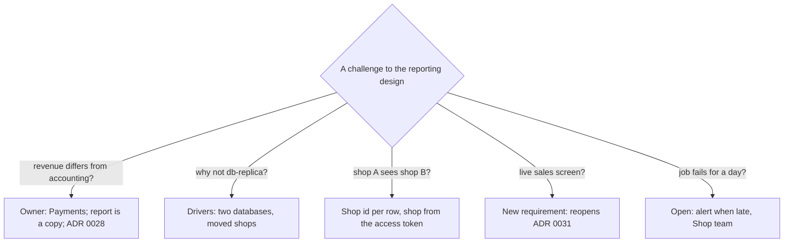

## Before you start

- [[sysdesign.l4.reporting-trade-offs]] — you know ADR `0031`'s job copies daily totals per shop every hour (assumed), recomputes the last 3 days (assumed), and leaves figures that are never live.
- [[sysdesign.l4.answering-challenges]] — you know a good answer names the driver or trade-off behind a decision, an uncovered case becomes an open question with an owner, and a changed driver reopens the decision with a new ADR.
- [[sysdesign.l4.payment-reconciliation-design]] — you know ADR `0028`'s daily job in Payments matches each line of the gateway's report to a refund row, and lists every difference for staff instead of changing the row.

## The situation

The review session for ADR `0031` starts, and you proposed the reporting design. Four questions arrive in the first ten minutes.

The accountant asks why last week's revenue in the report differs from the figure accounting holds. A backend developer asks why reports do not simply read `db-replica`, which already exists (Compose profile `replica`). Someone speaking for the shops asks whether one shop's staff could see another shop's totals. The product owner asks for a live sales screen.

Each sounds as if it could undo the design. Where does each answer come from, and should any of them change ADR `0031`?

## Core concepts

- owner of a figure — the module or service that writes it; when copies disagree, its value is the right one, as `data-ownership.md` defines it.
- copy — any other place that holds the figure, such as the reporting database; it needs a way to stay fresh, or a stated reason why not.
- answer from ownership — a reply to a disagreement between two figures that names the owner whose value decides, instead of comparing which copy is newer.
- new requirement — a challenge that asks for something the agreed requirements never included; it meets the ADR's revisit condition instead of showing the design wrong.

## How it works



In the situation above, three questions are answered from ownership and the drivers; the fourth is a new requirement.

The accountant compares a copy with an owner's figure. Payments owns the money in `donhang_payments`, and accounting reconciles against it. The report lags by up to an hour plus the run time. Each run recomputes 3 days (assumed), and the review plans a full recompute once a week (assumed) for older changes. When report and Payments disagree, Payments is right; when Payments and the gateway disagree, ADR `0028`'s daily job lists the difference for a person to correct.

The replica question is answered by driver 3: reports across shops include shops that ADR `0026` moved to databases of their own. Revenue needs `donhang` and `donhang_payments`, which cannot be joined in one query. `db-replica` copies the whole `db` server with both databases still separate, so it cannot join them either, and it holds no moved shop's database. The job instead reads, on every run, ADR `0026`'s table of which database holds each shop.

The privacy question is answered by driver 2: each shop sees only its own figures. Each summary row carries its shop's id, and from release 2 staff read with the shop taken from their access token, under row-level security as in ADR `0013` (assumed).

The live screen asks for something never agreed: the requirements accept figures up to two hours old (assumed). ADR `0031` names live figures as a revisit condition, so the review records a new requirement with an owner.

A fifth question, a job that fails for a day, has no full answer yet; the review keeps it open, owned by the Shop team.

## In the Đơn Hàng system

The last section of the design review keeps every challenge from the session:

```markdown file=docs/design/reporting-design-review.md tag=stage-4 lines=101-109
### Câu hỏi phản biện trong buổi review

| Câu hỏi | Trả lời, trỏ driver, ADR hoặc rủi ro | Việc tiếp theo | Người phụ trách (vai trò) |
|---|---|---|---|
| Sao doanh thu báo cáo khác số kế toán? | `data-ownership.md`: database báo cáo giữ bản sao, Payments là chủ tiền; đối soát của ADR 0028 giải thích chỗ lệch | Không | |
| Sao không đọc thẳng `db-replica`? | Doanh thu join hai database; cửa hàng chuyển theo ADR 0026 nằm ở database riêng | Không | |
| Nhân viên cửa hàng A có thấy số cửa hàng B? | Mỗi dòng tổng mang shop id, đọc theo cửa hàng trong access token, như ADR 0013 | Không | |
| Cho một màn hình doanh số trực tiếp được không? | Yêu cầu mới, mở lại ADR 0031: message đơn phải mang số tiền | Ghi yêu cầu | Product owner |
| Job hỏng một ngày thì sao? | Số cũ dần, thời điểm chốt số cho người đọc thấy; chạy lại tính lại 3 ngày | Cảnh báo khi job trễ | Đội Cửa hàng |
```

Read the second column first. The first three rows point to something written before the session: `data-ownership.md`, the drivers with ADR `0026`, and ADR `0013`'s guard. Their next step is "none" and their owner is empty. The fourth row is different in kind: it is not a gap in the design but a request the requirements lack, so its next step is to record the requirement, owned by the product owner. The fifth row stays open: a failed job leaves figures ageing, each report shows when its figures were last computed, and a rerun recomputes 3 days; the Shop team owns the next step, an alert when the job is late.

The first and fourth answers were written into ADR `0031` when it was accepted:

```markdown file=docs/adr/0031-bao-cao-tu-database-bao-cao-rieng.md tag=stage-4 lines=48-60
### Hệ quả

- Số báo cáo cũ tới một giờ, cộng thời gian job chạy.
- Thêm một database, một server và một job phải chạy; đội Cửa hàng phụ trách
  (ADR 0025, giả định).
- Câu hỏi mới mà tổng theo ngày không trả lời (ví dụ doanh số theo giờ) cần một
  bảng tổng mới, nạp lại từ nguồn.
- Số tiền trong báo cáo là bản sao; chủ của mỗi con số vẫn là Ordering hay
  Payments (`data-ownership.md`).

Đội xem lại quyết định khi: có yêu cầu số liệu trực tiếp (khi đó message đơn
phải mang số tiền); có câu hỏi mà tổng theo ngày không trả lời kịp, khi đó cần
một nơi lưu dành riêng cho truy vấn phân tích trên dữ liệu chi tiết.
```

The last bullet is the accountant's answer before it was asked: amounts in a report are copies, and each figure is still owned by Ordering or Payments. The closing paragraph has two revisit conditions. The first is the live-screen answer: live figures reopen the decision, and order messages would then have to carry amounts, a change every reader must accept.

The second is a question daily totals cannot answer in time, which would need a store for analytic queries on detailed data. A new question alone does not meet it: the third bullet answers one, such as sales per hour, with a new summary table. The review's risks table lists best-selling products per hour that way, open and owned by the product owner.

The replica question also had a written answer before the session; the ADR's comments section records it raised by a backend developer and answered with the same reasons, decision unchanged.

## Trade-offs

| Way to answer a reporting challenge | When it is right | What it costs |
|---|---|---|
| Name the owner whose figure decides | two figures disagree and one of them is a copy | the asker must check the owner's data, not the report they trust |
| Point to a ranked driver | the challenge proposes an option the drivers already rejected | nothing new; the drivers must have been agreed before the session |
| Record a new requirement that meets a revisit condition | the challenge asks for something outside the agreed requirements | the request waits for a new ADR, and someone is named to write it up |
| Record an open question with an owner | the design has no answer yet, such as a job that fails for a day | the review ends with work outstanding |

Answering from ownership has a fair opposing view: it can sound like sending every disagreement to Payments. That view is right when the copy stays wrong after the weekly full recompute (assumed). The owner's figure is still right, but the copy has a defect, and the Shop team runs the job, as ADR `0031` records. Ownership says which value to trust; it does not excuse the copy's keeper from explaining the drift.

## What would you choose if…

…the accountant finds a day's revenue that still differs from `donhang_payments` after the weekly full recompute? The owner's figure is right, so nobody corrects Payments. The copy should have caught up, so this is a defect in the job, and the Shop team investigates why the copy drifted and, once the job is fixed, runs the full recompute so that day is rebuilt from the owners.

…Payments shows a refund as `refunded` that the gateway's report lacks for two runs in a row? That is a difference between the owner and the gateway, not a reporting question. ADR `0028`'s job lists it for staff, a person corrects the refund row, and the next run that covers that day carries the corrected figure into reports.

…Đơn Hàng's own team asks for a report on a shop that moved to its own database yesterday? Nothing in the design changes. The job reads ADR `0026`'s table on every run, so the shop's figures now come from its new database, and reports across shops stay complete.

## Seniors often assume…

- **"When two reports disagree, the newer one is right."** → Actually the owner's figure is right whichever report was made later, because a report is a copy that can miss a change, such as a refund older than the 3-day window (assumed). You notice this when two people argue over two exports and nobody opens `donhang_payments`.
- **"A request for live figures means the batch design was a mistake."** → Actually the batch design met the agreed requirements, figures up to two hours old (assumed), and ADR `0031` names live figures as one of the conditions that reopen it. You notice this when a new request is filed as a defect, though no agreed requirement was ever broken.
- **"Hiding other shops' totals in the report screen is enough to keep them private."** → Actually a screen that hides rows still receives them; the review's answer filters rows where they are read, by the shop in the caller's access token. You notice this when someone asks what a caller who skips the screen would receive, and a screen-only design has no answer.

## Try it (3 minutes)

Four more challenges arrive after the session. For each, say which kind it is: answered from ownership or a driver (name the source), an open question (name an owner by role), or a new requirement that reopens ADR `0031`.

1. "The report shows a refund that the gateway says never happened."
2. "Could shop A's staff read shop B's totals by putting shop B's id in the request?"
3. "We want each order's total on a screen the moment the order is placed."
4. "Which products sell best in each hour of the day?"

Expected result: one kind and one source or owner per challenge, with exactly one new requirement that reopens ADR `0031`.

<details><summary>Suggested answer</summary>

1. Answered from ownership: Payments owns the refund row, and ADR `0028`'s daily job lists the difference for staff; once a person corrects the row, the next run covering that day corrects the report.
2. Answered by driver 2: from release 2 the shop comes from the caller's access token, not from the request, and each summary row carries its shop's id.
3. New requirement: these are live figures, ADR `0031`'s first revisit condition, so order messages would have to carry amounts under a new ADR.
4. Open question: the review's risks table lists it, owned by the product owner. ADR `0031` answers a new question daily totals cannot answer with a new summary table; only if they cannot answer it in time does its second revisit condition reopen the decision.

</details>

## Connections

- [[sysdesign.l4.reporting-trade-offs]] — the costs these challenges probe: the lag and the missing live figures, answered here from the same ADR.
- [[sysdesign.l4.answering-challenges]] — the method applied here: trace each answer to a driver or ADR, record what stays open.
- [[sysdesign.l4.payment-reconciliation-design]] — the job that lists differences between Payments and the gateway, behind the accountant's question.
- [[backend.l4.data-ownership]] — the rule behind the first answer: one owner per figure, every other place a copy.
- [[sysdesign.l4.multi-shop-challenges]] — the same exercise one problem earlier, with the shop moves this design must include.
- [[management.l3.superseding-an-adr]] — what follows if the live screen is approved: a new ADR replaces ADR `0031`.
- [[backend.l4.pacelc]] — the choice between latency and consistency in normal running, which a request for live figures reopens at report scale.
- [[sysdesign.l4.support-chat-requirements]] — the next problem: messages that must reach a screen nobody reloads.

## Five-line summary

1. A challenge to the reporting design is answered from who owns each figure and from the ranked drivers, not by a new argument.
2. When a report differs from accounting, Payments is right; the report is a copy, and ADR `0028`'s job lists Payments–gateway differences for a person.
3. Reports skip `db-replica` because revenue needs two databases that cannot be joined in one query, and moved shops sit elsewhere.
4. Each summary row carries its shop's id and, from release 2, is read by the shop in the caller's access token.
5. A live sales screen is a new requirement that reopens ADR `0031`; the review records it with an owner, beside the open questions.
