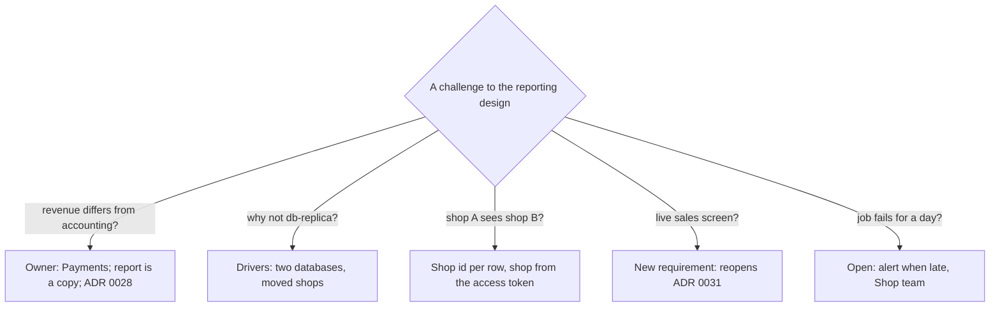

## Bạn cần biết trước

- [[sysdesign.l4.reporting-trade-offs]] — bạn biết job của ADR `0031` chép tổng theo ngày của từng cửa hàng mỗi giờ (giả định), tính lại 3 ngày gần nhất (giả định), và để lại những con số không bao giờ là số trực tiếp.
- [[sysdesign.l4.answering-challenges]] — bạn biết một câu trả lời tốt gọi tên yếu tố định hình kiến trúc hay điểm đánh đổi đứng sau quyết định, một trường hợp chưa được phủ thành câu hỏi mở có người phụ trách, và một yếu tố định hình kiến trúc thay đổi sẽ mở lại quyết định bằng một ADR mới.
- [[sysdesign.l4.payment-reconciliation-design]] — bạn biết job hằng ngày của ADR `0028` trong Payments khớp từng dòng trong báo cáo của cổng thanh toán với một dòng hoàn tiền, và liệt kê mọi chỗ lệch cho nhân viên thay vì sửa dòng đó.

## Tình huống

Buổi review cho ADR `0031` bắt đầu, và bạn là người đề xuất thiết kế báo cáo. Bốn câu hỏi tới trong mười phút đầu.

Kế toán hỏi vì sao doanh thu tuần trước trong báo cáo khác con số kế toán đang giữ. Một developer backend hỏi sao báo cáo không đọc luôn `db-replica`, thứ đã có sẵn (Compose profile `replica`). Người nói thay cho các cửa hàng hỏi nhân viên cửa hàng này có thấy được tổng của cửa hàng khác không. Product owner xin một màn hình doanh số trực tiếp.

Câu nào nghe cũng như có thể lật đổ thiết kế. Mỗi câu trả lời lấy từ đâu, và có câu nào nên làm ADR `0031` thay đổi không?

## Khái niệm cốt lõi

- chủ của một con số — module hay service ghi ra con số đó. Khi các bản sao lệch nhau, giá trị của chủ là giá trị đúng, theo định nghĩa trong `data-ownership.md`.
- bản sao — mọi nơi khác giữ con số đó, như database báo cáo. Nó cần có cách để luôn mới, hoặc một lý do được nói rõ vì sao không cần.
- trả lời bằng quyền sở hữu — câu trả lời cho chuyện hai con số lệch nhau bằng cách gọi tên chủ có giá trị quyết định, thay vì so xem bản sao nào mới hơn.
- yêu cầu mới — một câu phản biện đòi thứ mà các yêu cầu đã thỏa thuận chưa từng có. Nó chạm điều kiện xem lại của ADR chứ không chứng minh thiết kế sai.

## Cơ chế hoạt động



Trong tình huống trên, ba câu hỏi được trả lời bằng quyền sở hữu và các yếu tố định hình kiến trúc. Câu thứ tư là một yêu cầu mới.

Kế toán đang so một bản sao với con số của chủ. Payments sở hữu tiền trong `donhang_payments`, và kế toán đối soát với chính nó. Báo cáo trễ tối đa một giờ cộng thời gian job chạy. Mỗi lần chạy tính lại 3 ngày (giả định), và buổi review lên kế hoạch tính lại toàn bộ mỗi tuần một lần (giả định) cho các thay đổi cũ hơn. Khi báo cáo và Payments lệch nhau, Payments đúng. Khi Payments và cổng thanh toán lệch nhau, job hằng ngày của ADR `0028` liệt kê chỗ lệch để một người sửa.

Câu hỏi về replica được trả lời bằng yếu tố 3: báo cáo trên nhiều cửa hàng gồm cả những cửa hàng mà ADR `0026` đã chuyển sang database riêng. Doanh thu cần `donhang` và `donhang_payments`, hai database không join được trong một truy vấn. `db-replica` chép cả server `db` mà hai database vẫn tách riêng, nên nó cũng không join được, và nó không giữ database của cửa hàng nào đã chuyển đi. Thay vào đó, mỗi lần chạy, job đọc bảng của ADR `0026` cho biết database nào giữ cửa hàng nào.

Câu hỏi về quyền riêng tư được trả lời bằng yếu tố 2: mỗi cửa hàng chỉ thấy số của chính mình. Mỗi dòng tổng mang shop id của cửa hàng, và từ release 2, nhân viên đọc theo cửa hàng lấy từ access token, có row-level security như ADR `0013` (giả định).

Màn hình trực tiếp đòi thứ chưa từng được thỏa thuận: yêu cầu chấp nhận số cũ tới hai giờ (giả định). ADR `0031` ghi số liệu trực tiếp là một điều kiện xem lại, nên buổi review ghi nhận một yêu cầu mới có người phụ trách.

Câu hỏi thứ năm, job hỏng một ngày, chưa có câu trả lời đầy đủ. Buổi review để nó mở, do đội Cửa hàng phụ trách.

## Trong hệ thống Đơn Hàng

Phần cuối của buổi review thiết kế giữ lại mọi câu phản biện trong buổi họp:

```markdown file=docs/design/reporting-design-review.md tag=stage-4 lines=101-109
### Câu hỏi phản biện trong buổi review

| Câu hỏi | Trả lời, trỏ driver, ADR hoặc rủi ro | Việc tiếp theo | Người phụ trách (vai trò) |
|---|---|---|---|
| Sao doanh thu báo cáo khác số kế toán? | `data-ownership.md`: database báo cáo giữ bản sao, Payments là chủ tiền; đối soát của ADR 0028 giải thích chỗ lệch | Không | |
| Sao không đọc thẳng `db-replica`? | Doanh thu join hai database; cửa hàng chuyển theo ADR 0026 nằm ở database riêng | Không | |
| Nhân viên cửa hàng A có thấy số cửa hàng B? | Mỗi dòng tổng mang shop id, đọc theo cửa hàng trong access token, như ADR 0013 | Không | |
| Cho một màn hình doanh số trực tiếp được không? | Yêu cầu mới, mở lại ADR 0031: message đơn phải mang số tiền | Ghi yêu cầu | Product owner |
| Job hỏng một ngày thì sao? | Số cũ dần, thời điểm chốt số cho người đọc thấy; chạy lại tính lại 3 ngày | Cảnh báo khi job trễ | Đội Cửa hàng |
```

Đọc cột thứ hai trước. Ba dòng đầu trỏ tới thứ đã được viết từ trước buổi họp: `data-ownership.md`, các yếu tố định hình kiến trúc cùng ADR `0026`, và lớp chặn của ADR `0013`. Việc tiếp theo của chúng là "không" và cột người phụ trách để trống. Dòng thứ tư khác loại: nó không phải lỗ hổng của thiết kế mà là một đòi hỏi mà yêu cầu chưa có, nên việc tiếp theo là ghi lại yêu cầu, do product owner phụ trách. Dòng thứ năm vẫn mở: job hỏng thì số cũ dần, mỗi báo cáo hiện thời điểm số được tính gần nhất, và một lần chạy lại sẽ tính lại 3 ngày. Đội Cửa hàng phụ trách bước tiếp theo, cảnh báo khi job trễ.

Câu trả lời thứ nhất và thứ tư đã được viết vào ADR `0031` lúc nó được chấp nhận:

```markdown file=docs/adr/0031-bao-cao-tu-database-bao-cao-rieng.md tag=stage-4 lines=48-60
### Hệ quả

- Số báo cáo cũ tới một giờ, cộng thời gian job chạy.
- Thêm một database, một server và một job phải chạy; đội Cửa hàng phụ trách
  (ADR 0025, giả định).
- Câu hỏi mới mà tổng theo ngày không trả lời (ví dụ doanh số theo giờ) cần một
  bảng tổng mới, nạp lại từ nguồn.
- Số tiền trong báo cáo là bản sao; chủ của mỗi con số vẫn là Ordering hay
  Payments (`data-ownership.md`).

Đội xem lại quyết định khi: có yêu cầu số liệu trực tiếp (khi đó message đơn
phải mang số tiền); có câu hỏi mà tổng theo ngày không trả lời kịp, khi đó cần
một nơi lưu dành riêng cho truy vấn phân tích trên dữ liệu chi tiết.
```

Gạch đầu dòng cuối là câu trả lời cho kế toán từ trước khi câu hỏi được đặt ra: số tiền trong báo cáo là bản sao, và mỗi con số vẫn do Ordering hay Payments sở hữu. Đoạn kết có hai điều kiện xem lại. Điều kiện đầu là câu trả lời cho màn hình trực tiếp: số liệu trực tiếp mở lại quyết định, và khi đó message đơn hàng phải mang số tiền, một thay đổi mà mọi bên đọc phải chấp nhận.

Điều kiện thứ hai là một câu hỏi mà tổng theo ngày không trả lời kịp, thứ sẽ cần một nơi lưu cho truy vấn phân tích trên dữ liệu chi tiết. Chỉ một câu hỏi mới thôi thì chưa chạm điều kiện này: gạch đầu dòng thứ ba trả lời một câu như vậy, ví dụ doanh số theo giờ, bằng một bảng tổng mới. Bảng rủi ro của buổi review ghi câu hỏi sản phẩm bán chạy nhất theo giờ đúng theo cách đó, để mở và do product owner phụ trách.

Câu hỏi về replica cũng đã có câu trả lời viết sẵn trước buổi họp. Phần bình luận của ADR ghi lại nó, do một developer backend nêu và được trả lời bằng chính các lý do trên, quyết định giữ nguyên.

## Đánh đổi

| Cách trả lời một câu phản biện về báo cáo | Khi nào đúng | Cái giá |
|---|---|---|
| Gọi tên chủ có con số quyết định | hai con số lệch nhau và một trong hai là bản sao | người hỏi phải kiểm tra dữ liệu của chủ, không phải bản báo cáo họ tin |
| Trỏ tới một yếu tố định hình kiến trúc đã xếp hạng | câu phản biện đề xuất một phương án mà các yếu tố định hình kiến trúc đã loại | không có gì mới, nhưng các yếu tố đó phải được thỏa thuận trước buổi họp |
| Ghi nhận một yêu cầu mới chạm điều kiện xem lại | câu phản biện đòi thứ nằm ngoài yêu cầu đã thỏa thuận | đòi hỏi phải chờ một ADR mới, và phải có người được giao viết nó |
| Ghi nhận một câu hỏi mở có người phụ trách | thiết kế chưa có câu trả lời, như job hỏng một ngày | buổi review kết thúc mà còn việc chưa xong |

Trả lời bằng quyền sở hữu có một quan điểm ngược lại đáng nghe: nghe như thể mọi chỗ lệch đều bị đẩy sang Payments. Quan điểm đó đúng khi bản sao vẫn sai sau lần tính lại toàn bộ hằng tuần (giả định). Con số của chủ vẫn đúng, nhưng bản sao có lỗi, và đội Cửa hàng chạy job, như ADR `0031` ghi. Quyền sở hữu cho biết nên tin giá trị nào. Nó không miễn cho bên giữ bản sao khỏi trách nhiệm giải thích vì sao bản sao lệch.

## Bạn sẽ chọn gì nếu…

…kế toán tìm ra một ngày mà doanh thu vẫn lệch với `donhang_payments` sau lần tính lại toàn bộ hằng tuần? Con số của chủ đúng, nên không ai sửa Payments. Lẽ ra bản sao đã phải theo kịp, nên đây là lỗi của job. Đội Cửa hàng tìm hiểu vì sao bản sao lệch, và khi job đã được sửa, chạy lần tính lại toàn bộ để ngày đó được dựng lại từ các bên sở hữu.

…Payments hiện một khoản hoàn tiền là `refunded` mà báo cáo của cổng thanh toán không có, hai lần chạy liên tiếp? Đó là chỗ lệch giữa chủ và cổng thanh toán, không phải câu hỏi về báo cáo. Job của ADR `0028` liệt kê nó cho nhân viên, một người sửa dòng hoàn tiền, và lần chạy kế tiếp phủ ngày đó sẽ đưa con số đã sửa vào báo cáo.

…chính đội Đơn Hàng xin báo cáo về một cửa hàng vừa chuyển sang database riêng hôm qua? Thiết kế không đổi gì. Mỗi lần chạy, job đọc bảng của ADR `0026`, nên số của cửa hàng đó giờ đến từ database mới của nó, và báo cáo trên nhiều cửa hàng vẫn đầy đủ.

## Senior hay nhầm rằng…

- **"Khi hai báo cáo lệch nhau, báo cáo mới hơn là đúng."** → Thực ra con số của chủ mới đúng, bất kể báo cáo nào được làm sau, vì báo cáo là bản sao và có thể bỏ sót một thay đổi, như một khoản hoàn tiền cũ hơn khoảng 3 ngày (giả định). Bạn sẽ nhận ra khi hai người cãi nhau về hai bản xuất mà không ai mở `donhang_payments`.
- **"Đòi số liệu trực tiếp nghĩa là thiết kế theo lô đã sai."** → Thực ra thiết kế theo lô đáp ứng yêu cầu đã thỏa thuận, số cũ tới hai giờ (giả định), và ADR `0031` ghi số liệu trực tiếp là một trong các điều kiện mở lại nó. Bạn sẽ nhận ra khi một đòi hỏi mới bị ghi thành lỗi, dù chưa yêu cầu đã thỏa thuận nào bị vi phạm.
- **"Ẩn tổng của các cửa hàng khác trên màn hình báo cáo là đủ để giữ riêng tư."** → Thực ra màn hình ẩn dòng thì vẫn nhận các dòng đó, vì vậy câu trả lời của buổi review lọc dòng ngay tại chỗ đọc, theo cửa hàng trong access token của bên gọi. Bạn sẽ nhận ra khi có người hỏi một bên gọi bỏ qua màn hình sẽ nhận được gì, và thiết kế chỉ dựa vào màn hình không có câu trả lời.

## Thử ngay (3 phút)

Bốn câu phản biện nữa tới sau buổi họp. Với mỗi câu, nói nó thuộc loại nào: trả lời bằng quyền sở hữu hay một yếu tố định hình kiến trúc (gọi tên nguồn), câu hỏi mở (gọi tên người phụ trách theo vai trò), hay một yêu cầu mới mở lại ADR `0031`.

1. "Báo cáo hiện một khoản hoàn tiền mà cổng thanh toán nói chưa từng xảy ra."
2. "Nhân viên cửa hàng A có đọc được tổng của cửa hàng B bằng cách đưa id của cửa hàng B vào request không?"
3. "Chúng tôi muốn tổng của mỗi đơn hiện trên màn hình ngay lúc đơn được đặt."
4. "Sản phẩm nào bán chạy nhất trong từng giờ của ngày?"

Kết quả mong đợi: mỗi câu phản biện có một loại và một nguồn hoặc người phụ trách, với đúng một yêu cầu mới mở lại ADR `0031`.

<details><summary>Gợi ý đáp án</summary>

1. Trả lời bằng quyền sở hữu: Payments sở hữu dòng hoàn tiền, và job hằng ngày của ADR `0028` liệt kê chỗ lệch cho nhân viên. Khi một người đã sửa dòng đó, lần chạy kế tiếp phủ ngày đó sẽ sửa báo cáo.
2. Trả lời bằng yếu tố 2: từ release 2, cửa hàng lấy từ access token của bên gọi, không lấy từ request, và mỗi dòng tổng mang shop id của cửa hàng.
3. Yêu cầu mới: đây là số liệu trực tiếp, điều kiện xem lại thứ nhất của ADR `0031`, nên message đơn hàng sẽ phải mang số tiền theo một ADR mới.
4. Câu hỏi mở: bảng rủi ro của buổi review ghi nó, do product owner phụ trách. ADR `0031` trả lời một câu hỏi mới mà tổng theo ngày không trả lời được bằng một bảng tổng mới. Chỉ khi tổng theo ngày không trả lời kịp thì điều kiện xem lại thứ hai mới mở lại quyết định.

</details>

## Liên hệ

- [[sysdesign.l4.reporting-trade-offs]] — những cái giá mà các câu phản biện này dò tới: độ trễ và việc thiếu số trực tiếp, ở đây được trả lời từ cùng ADR đó.
- [[sysdesign.l4.answering-challenges]] — phương pháp được áp dụng ở đây: lần mỗi câu trả lời về một yếu tố định hình kiến trúc hay ADR, ghi lại những gì còn mở.
- [[sysdesign.l4.payment-reconciliation-design]] — job liệt kê chỗ lệch giữa Payments và cổng thanh toán, đứng sau câu hỏi của kế toán.
- [[backend.l4.data-ownership]] — quy tắc đứng sau câu trả lời đầu tiên: mỗi con số một chủ, mọi nơi khác là bản sao.
- [[sysdesign.l4.multi-shop-challenges]] — cùng bài tập ở bài toán trước, với các lần chuyển cửa hàng mà thiết kế này phải tính tới.
- [[management.l3.superseding-an-adr]] — điều xảy ra nếu màn hình trực tiếp được duyệt: một ADR mới thay thế ADR `0031`.
- [[backend.l4.pacelc]] — lựa chọn giữa độ trễ và nhất quán khi chạy bình thường, thứ mà đòi hỏi số liệu trực tiếp mở lại ở quy mô báo cáo.
- [[sysdesign.l4.support-chat-requirements]] — bài toán tiếp theo: tin nhắn phải tới một màn hình không ai tải lại.

## Tóm tắt 5 dòng

1. Câu phản biện về thiết kế báo cáo được trả lời bằng việc ai là chủ mỗi con số và bằng các yếu tố định hình kiến trúc đã xếp hạng, không bằng một lập luận mới.
2. Khi báo cáo lệch với kế toán, Payments đúng. Báo cáo là bản sao, và job của ADR `0028` liệt kê chỗ lệch giữa Payments và cổng thanh toán cho một người xử lý.
3. Báo cáo không dùng `db-replica` vì doanh thu cần hai database không join được trong một truy vấn, và các cửa hàng đã chuyển đi nằm ở nơi khác.
4. Mỗi dòng tổng mang shop id của cửa hàng và, từ release 2, được đọc theo cửa hàng trong access token của bên gọi.
5. Màn hình doanh số trực tiếp là yêu cầu mới mở lại ADR `0031`. Buổi review ghi nó kèm người phụ trách, cạnh các câu hỏi mở.
