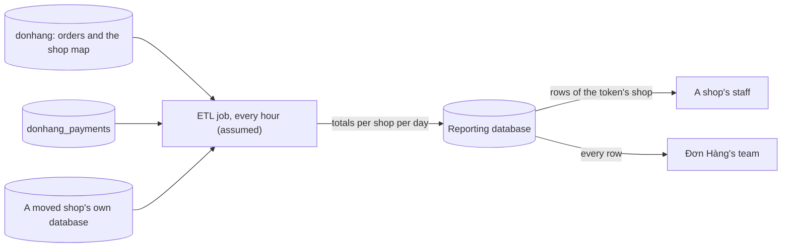

## Before you start

- [[sysdesign.l4.reporting-requirements]] — you know the three ranked drivers: reports never take the capacity ordering needs, each shop sees only its own figures, and reports across shops include shops in their own databases.
- [[design.l3.read-model]] — you know a read model stores data in the shape one query needs, filled from the write side's changes.
- [[backend.l3.cross-shard-queries]] — you know a query that cannot name one shard asks every shard and merges the answers.
- [[sysdesign.l4.multi-shop-design]] — you know ADR `0026` adds a shop map: each row of `shops` records which database holds that shop's data, and a large shop can move out.

## The situation

The requirements for reports are ranked, and the team meets to pick a design. One teammate points at `db-replica`: it already runs in the lab, holds a copy of everything on `db`, and reports run there take no connection from the primary. Another says the API already publishes a message for every order, so a reporting table could listen to those.

You try the first idea on paper with BC-1, revenue per day. Orders sit in `donhang`, payments in `donhang_payments`, and a large shop may soon sit in a database of its own. Where can reports read from that takes nothing from ordering and still sees every shop's orders and payments?

## Core concepts

- **ETL (extract, transform, load)** — a scheduled job that extracts data from its sources, transforms it into the shape the readers need, and loads it into a separate store.
- reporting database — a database used only by reports, on a server of its own (assumed), holding nothing but what the job writes into it.
- daily total per shop — totals per shop per day, in Vietnam time; it is the shape the job writes and the reports read.
- as-of time — the moment the job last computed a figure; a report shows it, so staff can see how old each figure is.

## How it works



In the situation above, the job is the ETL. Every hour (assumed) it first reads the shop map in `donhang` to learn which databases hold shop data today. Then it reads each source on its own connection: orders from `donhang` and from every database the map lists, payments from `donhang_payments`. No query ever joins two databases. The job combines the answers itself and writes one row per shop per day into the reporting database.

This is the scatter-gather you already know, but it runs once per hour instead of once per report. The job's reads are short queries for recent days only: each run reads the last 3 days (assumed), about 150,000 orders when those are normal days, by the estimate in the design review shown below.

Report queries read only the reporting database. A yearly report may run for seconds (assumed), yet it holds no connection on the primary, so ordering does not notice it. That is driver 1.

Every summary row carries its shop's id. A shop's staff read with the shop taken from their access token, and row-level security filters the rows, as ADR `0013`, the decision that keeps every shop in shared tables, guards them (assumed). That is driver 2. Đơn Hàng's own team reads every row.

Driver 3 follows from the shop map. A shop that moved is listed there, so its database is one of the sources, and reports across shops stay complete.

The design is like a read model in that it stores the shape one query needs. It differs in how it is filled: the job reads the owners' tables on a schedule instead of reacting to each change.

## In the Đơn Hàng system

Nothing of this is built at `stage-4`: ADR `0031` notes there is no reporting database or job in the repository. The ADR records the options and the decision:

```markdown file=docs/adr/0031-bao-cao-tu-database-bao-cao-rieng.md tag=stage-4 lines=21-45
- Báo cáo chạy trên primary: không thêm gì, nhưng truy vấn dài giữ kết nối mà
  đặt đơn cần (trái driver 1), và vẫn không join được hai database.
- Báo cáo chạy trên `db-replica`: không lấy kết nối của primary, nhưng replica
  là bản sao cả server `db`: vẫn không join hai database trong một truy vấn, và
  không có database riêng của cửa hàng đã chuyển.
- Read model nuôi từ message: số mới hơn, nhưng `OrderMessage` không có số tiền
  hay dòng hàng; thêm vào là đổi schema mà mọi bên đọc phải nhận, và đơn cũ
  không đọc lại được từ broker.
- Database báo cáo riêng, nạp bằng job theo lịch (ETL): job đọc từng nguồn, ghi
  tổng vào một chỗ riêng; báo cáo chỉ đọc chỗ đó.

### Quyết định

Chọn database báo cáo riêng.

- Database báo cáo nằm trên server riêng (giả định).
- Mỗi giờ (giả định), một job đọc `donhang`, `donhang_payments` và mọi database
  mà bảng ánh xạ cửa hàng của ADR 0026 liệt kê, rồi ghi tổng theo cửa hàng theo
  ngày (giờ Việt Nam).
- Mỗi lần chạy tính lại 3 ngày gần nhất (giả định) và thay các dòng của những
  ngày đó: chạy lặp lại cho cùng kết quả; hủy hay hoàn tiền muộn vẫn tới đúng
  ngày.
- Mỗi dòng tổng mang shop id. Nhân viên cửa hàng đọc theo cửa hàng lấy từ
  access token (từ release 2), có row-level security như ADR 0013 (giả định).
- Truy vấn báo cáo chỉ đọc database báo cáo.
```

Read the rejected options first; each fails for a reason you can check.

- Reports on the primary hold connections that ordering needs, and still cannot join two databases.
- Reports on `db-replica` take no primary connection, but `db/replica/start.sh` copies the whole `db` server, so the replica has the same two separate databases and no moved shop.
- A read model fed from messages would be fresher, but `DonHang.Domain/OrderMessage.cs` defines only `OrderId`, `CustomerEmail`, `CustomerName` and `OccurredAt`: no amount, no line items. Adding them changes a schema every reader must accept, and orders placed before the change cannot be read again from the broker.

The decision bullets match the diagram. The bullet on recomputing the last 3 days says a repeated run gives the same result; why that matters is the subject of the next lesson.

The design review spends its deep dive on the hardest case for driver 3:

```markdown file=docs/design/reporting-design-review.md tag=stage-4 lines=50-61
### Đi sâu: cửa hàng chuyển database (bước 4)

- Job đọc bảng ánh xạ của ADR 0026 ở mỗi lần chạy, không giữ danh sách database
  cố định.
- Cửa hàng chuyển giữa hai lần chạy: lần sau đọc số của nó từ database mới; tổng
  của những ngày đã tính lại được thay bằng số từ chỗ mới.
- Trong khoảng dừng ghi lúc chuyển, không đơn mới nào của cửa hàng đó; số của
  nó không bị đếm hai lần, vì dòng cũ chỉ bị xóa sau khoảng kiểm tra và job đọc
  đúng một chỗ theo bảng ánh xạ.
- Đây là câu trả lời cho câu hỏi mở "báo cáo gộp mọi cửa hàng" của
  `multi-shop-design-review.md`: job đọc từng database rồi gộp, không cần một
  truy vấn join hai database.
```

The first bullet is the whole trick: the job keeps no fixed list of databases, so a move needs no change to the job. The multi-shop review describes the move itself: the shop's writes pause, its rows are copied to the new database, and the old rows stay in `donhang` for a check period (assumed one week) before they are deleted. If a shop moves between two runs, the next run reads it from its new database and replaces the recomputed days with figures from there. Its figures are not counted twice, even though its old rows still exist for a check period, because the job reads exactly one place per shop, the one the map names. The last bullet closes the question the multi-shop review left open.

## Trade-offs

| Option | Driver 1: no capacity from ordering | Revenue from two databases | Driver 3: moved shops included | Freshness | New things to run |
|---|---|---|---|---|---|
| Reports on the primary | no: long queries hold connections ordering needs | no: one database per query | no | live | nothing |
| Reports on `db-replica` | yes | no: same two databases, no join | no: copies only `db` | behind by replication lag | nothing new in the lab |
| Read model fed from order messages | yes | no: messages carry no amounts | not covered by the ADR | fresher | a schema change every reader accepts |
| Reporting database filled by ETL (chosen) | yes: the job's reads are short | yes: the job reads each database and combines | yes: the map is read every run | up to an hour plus the run time | a database, a server and a job (assumed) |

The chosen row trades freshness and one more thing to run for meeting all three drivers without touching `OrderMessage`. The requirements accept figures up to two hours old (assumed), so an hourly run fits inside that limit.

## What would you choose if…

…the product owner asks for sales per hour? Daily totals cannot answer it. ADR `0031` says a new question like this needs a new summary filled again from the sources. The ADR ends with the conditions under which the team reopens the decision. If questions arrive faster than new daily summaries can answer them, the ADR's revisit condition is met: a store kept for analytical queries on detailed data.

…a shop asks for a live sales screen? That is a new requirement, not a tweak. The ADR names it as a reason to revisit: order messages would then have to carry amounts.

…every report read one database and no shop had moved? Then both reasons ADR `0031` gives against `db-replica` would no longer apply, and the team would have to weigh it again against the drivers. Đơn Hàng is not in that case, which is why the ADR records the replica's reasons.

## Seniors often assume…

- **"A read replica is already a reporting database, so nothing else is needed."** → Actually `db-replica` copies the whole `db` server, so it keeps `donhang` and `donhang_payments` as two databases that one query cannot join, and it holds no shop that moved to its own database. It removes load from the primary, which is only driver 1. You notice this when a revenue query on the replica that names a table in the other database fails with an error that cross-database references are not implemented.
- **"The reporting tables become the place where revenue is decided."** → Actually they hold copies; Ordering and Payments still own every figure, as the repository's data-ownership document assigns them. Each run recomputes recent days from the owners' rows and replaces them. You notice this when someone corrects today's total by hand in the reporting database and the next run puts the computed figure back.
- **"The cleanest way to fill a reporting database is from the messages we already publish."** → Actually `OrderMessage` carries an order id, an email, a name and a time, nothing to sum. Adding amounts and items is a schema change for every reader, and past orders cannot be replayed from the broker. You notice this when you open `OrderMessage.cs` looking for a total and find four fields.

## Try it (3 minutes)

Shop `12` moves to its own database between the 10:00 and 11:00 runs of the job. Using the deep dive above, answer three questions. Where does the 11:00 run read shop `12`'s orders? Are shop `12`'s orders of the last 3 days counted once or twice in Đơn Hàng's total? What do shop `12`'s staff see between the move and 11:00?

Expected result: one source, one count, and one answer about the as-of time, each with a reason from the deep dive or from the as-of time in Core concepts.

<details><summary>Suggested answer</summary>

The 11:00 run reads shop `12`'s orders from its new database, because the job reads the shop map on every run and the map now names that database. They are counted once: the old rows in `donhang` remain for a check period, but the job reads exactly one place per shop, the one the map names. Between the move and 11:00, staff see the figures the 10:00 run wrote, shown with a 10:00 as-of time. Orders placed since 10:00, in either database, appear only after the 11:00 run.

</details>

## Connections

- [[sysdesign.l4.reporting-requirements]] — the ranked drivers this design is judged against.
- [[design.l3.read-model]] — the same idea of storing a query's shape, filled here by a scheduled job instead of by each change.
- [[backend.l3.cross-shard-queries]] — the scatter-gather this job performs, moved from every report to once per run.
- [[backend.l3.read-replicas]] — the option rejected here: a replica copies one server, so it cannot join its two databases.
- [[backend.l4.data-ownership]] — why the reporting database holds copies and the owners keep every figure.
- [[k8s.l2.scheduled-backups]] — another job run on a schedule; ADR `0031` does not say how its job will be scheduled.
- [[sysdesign.l4.deep-dive]] — the framework step applied here to a shop moving databases.
- [[sysdesign.l4.reporting-trade-offs]] — the next step: what running in batches gives up.

## Five-line summary

1. An ETL job reads the owners' databases on a schedule and loads daily totals per shop into a reporting database that reports alone read.
2. ADR `0031` runs it every hour (assumed), reading `donhang`, `donhang_payments` and every database the shop map lists.
3. Long report queries touch only the reporting database; the job's own reads are short queries for the last few days.
4. Each row carries its shop's id, so staff read their shop's rows under row-level security while Đơn Hàng's team reads all.
5. Reading the shop map every run keeps moved shops in the totals; the replica and order messages were rejected for missing joins and amounts.
