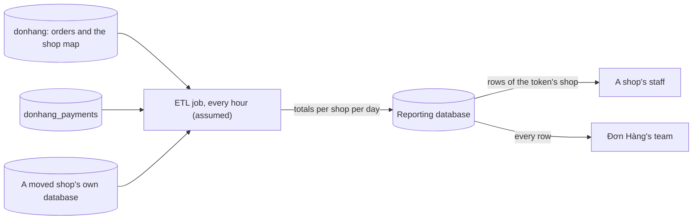

## Bạn cần biết trước

- [[sysdesign.l4.reporting-requirements]] — bạn biết ba yếu tố định hình kiến trúc đã xếp hạng: báo cáo không bao giờ lấy phần dung lượng mà đặt đơn cần, mỗi cửa hàng chỉ thấy số của mình, và báo cáo trên nhiều cửa hàng gồm cả cửa hàng có database riêng.
- [[design.l3.read-model]] — bạn biết read model lưu dữ liệu theo đúng hình dạng một truy vấn cần, được nạp từ các thay đổi của phía ghi.
- [[backend.l3.cross-shard-queries]] — bạn biết một truy vấn không chỉ ra được một shard thì phải hỏi mọi shard rồi gộp các câu trả lời.
- [[sysdesign.l4.multi-shop-design]] — bạn biết ADR `0026` thêm một bảng ánh xạ cửa hàng: mỗi dòng của `shops` ghi database nào giữ dữ liệu của cửa hàng đó, và một cửa hàng lớn có thể chuyển ra ngoài.

## Tình huống

Yêu cầu cho báo cáo đã được xếp hạng, và cả đội họp để chọn thiết kế. Một đồng đội chỉ vào `db-replica`: nó đã chạy trong lab, giữ bản sao mọi thứ trên `db`, và báo cáo chạy ở đó không lấy kết nối nào của primary. Một người khác nói API đã publish một message cho mỗi đơn, nên một bảng báo cáo có thể nghe các message đó.

Bạn thử ý đầu tiên trên giấy với BC-1, doanh thu theo ngày. Orders nằm trong `donhang`, payments nằm trong `donhang_payments`, và một cửa hàng lớn có thể sắp nằm trong database riêng. Báo cáo đọc từ đâu để không lấy gì của đặt đơn mà vẫn thấy orders và payments của mọi cửa hàng?

## Khái niệm cốt lõi

- **ETL (extract, transform, load)** (Job định kỳ lấy dữ liệu từ các nguồn, đổi sang hình dạng người đọc cần, rồi ghi vào một nơi lưu riêng) — một job chạy theo lịch, lấy (extract) dữ liệu từ các nguồn, đổi (transform) nó sang hình dạng người đọc cần, rồi nạp (load) vào một nơi lưu riêng.
- database báo cáo — database chỉ báo cáo dùng, trên một server riêng (giả định), không chứa gì ngoài những gì job ghi vào.
- tổng theo ngày của từng cửa hàng — tổng của mỗi cửa hàng cho mỗi ngày, theo giờ Việt Nam. Đây là hình dạng job ghi ra và báo cáo đọc vào.
- thời điểm chốt số — lúc job tính một con số gần nhất. Báo cáo hiện nó, để nhân viên biết mỗi con số đã cũ tới đâu.

## Cơ chế hoạt động



Trong tình huống trên, job chính là ETL. Mỗi giờ (giả định), trước hết nó đọc bảng ánh xạ cửa hàng trong `donhang` để biết hôm nay những database nào giữ dữ liệu cửa hàng. Sau đó nó đọc từng nguồn trên kết nối riêng: orders từ `donhang` và từ mọi database mà bảng ánh xạ liệt kê, payments từ `donhang_payments`. Không truy vấn nào join hai database. Job tự gộp các câu trả lời rồi ghi vào database báo cáo một dòng cho mỗi cửa hàng mỗi ngày.

Đây là scatter-gather bạn đã biết, nhưng chạy mỗi giờ một lần thay vì mỗi báo cáo một lần. Các lượt đọc của job là truy vấn ngắn, chỉ cho những ngày gần đây: mỗi lần chạy đọc 3 ngày gần nhất (giả định), khoảng 150.000 đơn nếu đó là ngày thường, theo ước lượng trong buổi review thiết kế trích ở dưới.

Truy vấn báo cáo chỉ đọc database báo cáo. Một báo cáo cả năm có thể chạy vài giây (giả định), nhưng nó không giữ kết nối nào trên primary, nên đặt đơn không hề hay biết. Đó là yếu tố 1.

Mỗi dòng tổng mang id của cửa hàng. Nhân viên cửa hàng đọc theo cửa hàng lấy từ access token, và row-level security lọc dòng, như ADR `0013`, quyết định giữ mọi cửa hàng trong bảng chung, bảo vệ các bảng đó (giả định). Đó là yếu tố 2. Đội Đơn Hàng đọc mọi dòng.

Yếu tố 3 đến từ bảng ánh xạ cửa hàng. Cửa hàng đã chuyển đi có tên trong đó, nên database của nó là một trong các nguồn, và báo cáo trên nhiều cửa hàng vẫn đủ.

Thiết kế này giống read model ở chỗ nó lưu đúng hình dạng một truy vấn cần. Nó khác ở cách nạp: job đọc bảng của bên sở hữu theo lịch, thay vì phản ứng với từng thay đổi.

## Trong hệ thống Đơn Hàng

Ở `stage-4` chưa có gì trong số này được xây: ADR `0031` ghi rằng repository chưa có database báo cáo hay job nào. ADR ghi lại các phương án và quyết định:

```markdown file=docs/adr/0031-bao-cao-tu-database-bao-cao-rieng.md tag=stage-4 lines=21-45
- Báo cáo chạy trên primary: không thêm gì, nhưng truy vấn dài giữ kết nối mà
  đặt đơn cần (trái driver 1), và vẫn không join được hai database.
- Báo cáo chạy trên `db-replica`: không lấy kết nối của primary, nhưng replica
  là bản sao cả server `db`: vẫn không join hai database trong một truy vấn, và
  không có database riêng của cửa hàng đã chuyển.
- Read model nuôi từ message: số mới hơn, nhưng `OrderMessage` không có số tiền
  hay dòng hàng; thêm vào là đổi schema mà mọi bên đọc phải nhận, và đơn cũ
  không đọc lại được từ broker.
- Database báo cáo riêng, nạp bằng job theo lịch (ETL): job đọc từng nguồn, ghi
  tổng vào một chỗ riêng; báo cáo chỉ đọc chỗ đó.

### Quyết định

Chọn database báo cáo riêng.

- Database báo cáo nằm trên server riêng (giả định).
- Mỗi giờ (giả định), một job đọc `donhang`, `donhang_payments` và mọi database
  mà bảng ánh xạ cửa hàng của ADR 0026 liệt kê, rồi ghi tổng theo cửa hàng theo
  ngày (giờ Việt Nam).
- Mỗi lần chạy tính lại 3 ngày gần nhất (giả định) và thay các dòng của những
  ngày đó: chạy lặp lại cho cùng kết quả; hủy hay hoàn tiền muộn vẫn tới đúng
  ngày.
- Mỗi dòng tổng mang shop id. Nhân viên cửa hàng đọc theo cửa hàng lấy từ
  access token (từ release 2), có row-level security như ADR 0013 (giả định).
- Truy vấn báo cáo chỉ đọc database báo cáo.
```

Đọc các phương án bị loại trước. Mỗi phương án trượt vì một lý do bạn kiểm tra được.

- Báo cáo trên primary giữ những kết nối mà đặt đơn cần, và vẫn không join được hai database.
- Báo cáo trên `db-replica` không lấy kết nối của primary, nhưng `db/replica/start.sh` chép nguyên server `db`, nên replica có đúng hai database tách rời như cũ và không có cửa hàng nào đã chuyển đi.
- Read model nuôi từ message sẽ có số mới hơn, nhưng `DonHang.Domain/OrderMessage.cs` chỉ định nghĩa `OrderId`, `CustomerEmail`, `CustomerName` và `OccurredAt`: không có số tiền, không có dòng hàng. Thêm chúng vào là đổi một schema mà mọi bên đọc phải chấp nhận, và đơn đặt trước lần đổi đó không đọc lại được từ broker.

Các gạch đầu dòng của phần quyết định khớp với sơ đồ. Gạch đầu dòng về tính lại 3 ngày gần nhất nói chạy lặp lại cho cùng kết quả. Vì sao điều đó quan trọng là chủ đề của bài sau.

Buổi review thiết kế dành phần đi sâu cho trường hợp khó nhất của yếu tố 3:

```markdown file=docs/design/reporting-design-review.md tag=stage-4 lines=50-61
### Đi sâu: cửa hàng chuyển database (bước 4)

- Job đọc bảng ánh xạ của ADR 0026 ở mỗi lần chạy, không giữ danh sách database
  cố định.
- Cửa hàng chuyển giữa hai lần chạy: lần sau đọc số của nó từ database mới; tổng
  của những ngày đã tính lại được thay bằng số từ chỗ mới.
- Trong khoảng dừng ghi lúc chuyển, không đơn mới nào của cửa hàng đó; số của
  nó không bị đếm hai lần, vì dòng cũ chỉ bị xóa sau khoảng kiểm tra và job đọc
  đúng một chỗ theo bảng ánh xạ.
- Đây là câu trả lời cho câu hỏi mở "báo cáo gộp mọi cửa hàng" của
  `multi-shop-design-review.md`: job đọc từng database rồi gộp, không cần một
  truy vấn join hai database.
```

Gạch đầu dòng đầu tiên là toàn bộ mấu chốt: job không giữ danh sách database cố định, nên một lần chuyển không đòi sửa gì ở job. Buổi review cho nhiều cửa hàng mô tả chính lần chuyển: cửa hàng tạm dừng ghi, các dòng của nó được chép sang database mới, và dòng cũ ở lại `donhang` trong một khoảng kiểm tra (giả định một tuần) rồi mới bị xóa. Nếu một cửa hàng chuyển giữa hai lần chạy, lần chạy sau đọc nó từ database mới và thay những ngày được tính lại bằng số từ đó. Số của nó không bị đếm hai lần, dù dòng cũ vẫn còn trong khoảng kiểm tra, vì job đọc đúng một chỗ cho mỗi cửa hàng, chỗ mà bảng ánh xạ chỉ ra. Gạch đầu dòng cuối khép lại câu hỏi mà buổi review cho nhiều cửa hàng còn để mở.

## Đánh đổi

| Phương án | Yếu tố 1: không lấy dung lượng của đặt đơn | Doanh thu từ hai database | Yếu tố 3: gồm cả cửa hàng đã chuyển | Độ mới | Thứ mới phải chạy |
|---|---|---|---|---|---|
| Báo cáo trên primary | không: truy vấn dài giữ kết nối đặt đơn cần | không: mỗi truy vấn một database | không | trực tiếp | không có |
| Báo cáo trên `db-replica` | có | không: vẫn hai database đó, không join được | không: chỉ chép `db` | trễ theo replication lag | không có gì mới trong lab |
| Read model nuôi từ message đơn hàng | có | không: message không mang số tiền | ADR không đề cập | mới hơn | một lần đổi schema mà mọi bên đọc chấp nhận |
| Database báo cáo nạp bằng ETL (đã chọn) | có: các lượt đọc của job đều ngắn | có: job đọc từng database rồi gộp | có: bảng ánh xạ được đọc mỗi lần chạy | cũ tối đa một giờ cộng thời gian chạy | một database, một server và một job (giả định) |

Dòng được chọn đổi độ mới và thêm một thứ phải vận hành lấy việc đáp ứng cả ba yếu tố mà không động tới `OrderMessage`. Yêu cầu chấp nhận số cũ tới hai giờ (giả định), nên chạy mỗi giờ nằm gọn trong giới hạn đó.

## Bạn sẽ chọn gì nếu…

…product owner muốn doanh số theo giờ? Tổng theo ngày không trả lời được. ADR `0031` nói một câu hỏi mới kiểu này cần một bảng tổng mới, nạp lại từ các nguồn. ADR kết thúc bằng các điều kiện để đội mở lại quyết định. Nếu câu hỏi mới đến nhanh hơn tốc độ làm thêm bảng tổng theo ngày để trả lời, điều kiện xem lại của ADR đã tới: một nơi lưu dành cho truy vấn phân tích trên dữ liệu chi tiết.

…một cửa hàng muốn màn hình doanh số trực tiếp? Đó là một yêu cầu mới, không phải chỉnh nhỏ. ADR gọi tên nó là một lý do để xem lại: khi đó message đơn hàng sẽ phải mang số tiền.

…mọi báo cáo chỉ đọc một database và chưa cửa hàng nào chuyển đi? Khi đó cả hai lý do ADR `0031` đưa ra để loại `db-replica` không còn đúng, và đội phải cân lại nó theo các yếu tố. Đơn Hàng không ở trường hợp đó, vì vậy ADR mới ghi lại lý do loại replica.

## Senior hay nhầm rằng…

- **"Read replica vốn đã là database báo cáo, nên không cần gì thêm."** → Thực ra `db-replica` chép nguyên server `db`, nên nó vẫn giữ `donhang` và `donhang_payments` là hai database mà một truy vấn không join được, và không có cửa hàng nào đã chuyển sang database riêng. Nó chỉ bớt tải cho primary, tức là chỉ yếu tố 1. Bạn sẽ nhận ra khi một truy vấn doanh thu trên replica gọi tới một bảng ở database kia và báo lỗi rằng tham chiếu giữa các database chưa được hỗ trợ.
- **"Bảng báo cáo trở thành nơi quyết định doanh thu."** → Thực ra chúng chỉ giữ bản sao. Ordering và Payments vẫn sở hữu mọi con số, như tài liệu quyền sở hữu dữ liệu của repository đã phân. Mỗi lần chạy tính lại những ngày gần đây từ dòng của bên sở hữu rồi thay vào. Bạn sẽ nhận ra khi ai đó sửa tay tổng hôm nay trong database báo cáo và lần chạy sau đặt lại con số đã tính.
- **"Cách gọn nhất để nạp database báo cáo là từ các message đã publish sẵn."** → Thực ra `OrderMessage` chỉ mang id đơn, email, tên và thời điểm, không có gì để cộng. Thêm số tiền và dòng hàng là đổi schema cho mọi bên đọc, và đơn cũ không phát lại được từ broker. Bạn sẽ nhận ra khi mở `OrderMessage.cs` tìm tổng tiền và chỉ thấy bốn field.

## Thử ngay (3 phút)

Cửa hàng `12` chuyển sang database riêng giữa hai lần chạy 10:00 và 11:00 của job. Dựa vào phần đi sâu ở trên, trả lời ba câu hỏi. Lần chạy 11:00 đọc orders của cửa hàng `12` ở đâu? Orders 3 ngày gần nhất của cửa hàng `12` được đếm một hay hai lần trong tổng của đội Đơn Hàng? Nhân viên cửa hàng `12` thấy gì từ lúc chuyển tới 11:00?

Kết quả mong đợi: một nguồn, một số lần đếm, và một câu trả lời về thời điểm chốt số, mỗi câu kèm lý do lấy từ phần đi sâu hoặc từ thời điểm chốt số trong Khái niệm cốt lõi.

<details><summary>Gợi ý đáp án</summary>

Lần chạy 11:00 đọc orders của cửa hàng `12` từ database mới, vì job đọc bảng ánh xạ cửa hàng ở mỗi lần chạy và bảng giờ chỉ tới database đó. Chúng được đếm một lần: dòng cũ trong `donhang` còn ở lại trong khoảng kiểm tra, nhưng job đọc đúng một chỗ cho mỗi cửa hàng, chỗ mà bảng ánh xạ chỉ ra. Từ lúc chuyển tới 11:00, nhân viên thấy các con số lần chạy 10:00 đã ghi, hiện kèm thời điểm chốt số 10:00. Đơn đặt từ sau 10:00, ở database nào cũng vậy, chỉ xuất hiện sau lần chạy 11:00.

</details>

## Liên hệ

- [[sysdesign.l4.reporting-requirements]] — các yếu tố định hình kiến trúc đã xếp hạng mà thiết kế này được đánh giá theo.
- [[design.l3.read-model]] — cùng ý tưởng lưu sẵn hình dạng của một truy vấn, ở đây được nạp bằng job theo lịch thay vì theo từng thay đổi.
- [[backend.l3.cross-shard-queries]] — scatter-gather mà job này thực hiện, chuyển từ mỗi báo cáo sang mỗi lần chạy.
- [[backend.l3.read-replicas]] — phương án bị loại ở đây: replica chép một server, nên không join được hai database của nó.
- [[backend.l4.data-ownership]] — vì sao database báo cáo chỉ giữ bản sao còn bên sở hữu giữ mọi con số.
- [[k8s.l2.scheduled-backups]] — một job khác chạy theo lịch. ADR `0031` không nói job của nó sẽ được lên lịch thế nào.
- [[sysdesign.l4.deep-dive]] — bước trong khung làm bài được áp dụng ở đây cho một cửa hàng chuyển database.
- [[sysdesign.l4.reporting-trade-offs]] — bước tiếp theo: chạy theo lô phải từ bỏ những gì.

## Tóm tắt 5 dòng

1. Job ETL đọc database của bên sở hữu theo lịch và nạp tổng theo ngày của từng cửa hàng vào một database báo cáo mà chỉ báo cáo đọc.
2. ADR `0031` chạy nó mỗi giờ (giả định), đọc `donhang`, `donhang_payments` và mọi database mà bảng ánh xạ cửa hàng liệt kê.
3. Truy vấn báo cáo dài chỉ chạm database báo cáo. Lượt đọc của chính job là truy vấn ngắn cho vài ngày gần nhất.
4. Mỗi dòng mang id cửa hàng, nên nhân viên đọc dòng của cửa hàng mình dưới row-level security, còn đội Đơn Hàng đọc tất cả.
5. Đọc bảng ánh xạ mỗi lần chạy giữ cửa hàng đã chuyển trong tổng. Replica và message đơn hàng bị loại vì thiếu join và thiếu số tiền.
