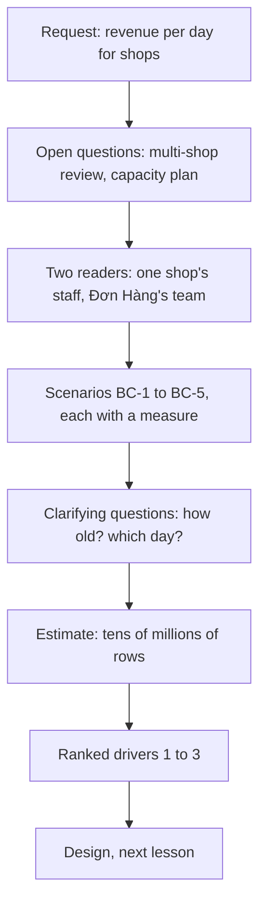

## Before you start

- [[sysdesign.l4.product-search-challenges]] — you finished the first problem of this module with a design review that answers each challenge from an ADR; this lesson starts the second problem at step 1.
- [[sysdesign.l4.multi-shop-challenges]] — you know the multi-shop design review left one question open with an owner: how a report across all shops reads a shop that has its own database.
- [[backend.l4.read-routing]] — you know every read at stage-4 goes to the primary, and a read moves to a replica only when its operation accepts slightly old data.
- [[backend.l3.row-level-security]] — you know PostgreSQL can add a shop condition to the queries a role runs on a table, so one shop's staff see only their rows.

## The situation

A shop owner asks the person who decides what the team builds next, the product owner, for one thing: revenue per day for their shop, for the whole year. A teammate says the query already exists. They open `db/queries/revenue-by-customer.sql`, change the grouping to days, and plan to run it from the staff screen against the primary database.

You run the original file first. It answers without an error, with plausible numbers. Then you remember that payments moved to their own database at stage-3, and you wonder where this query found any payments at all. Before anyone writes a report, what must it answer, for whom, and from which data?

## Core concepts

- **analytical query** — a query that turns many rows into a few figures about a period, such as revenue per day, while placing an order reads and writes a few rows of one order.
- the readers of a report — who looks at the figures and which rows they may see: a shop's staff see only their shop, Đơn Hàng's own team sees every shop.
- the as-of time — the moment a figure was last computed, shown next to it, so a figure two hours old is labelled old instead of looking current.
- the reporting day — which hours count as "one day"; the requirements fix it, because the same order can fall on different days in UTC, the shared reference clock that Vietnam time runs ahead of, and in Vietnam time.
- ranked drivers — the few scenarios, in order, that the design must satisfy first when two of them pull in different directions.

## How it works



In the situation above, the shop owner wants an analytical query: a year of orders and payments turned into about 365 figures. Placing an order touches a few rows of one order. The two kinds of work share the primary today, because `capacity-plan.md` keeps every read there.

The team does not start from a blank page. Two questions are already open. The multi-shop design review asks how a report across all shops reads a shop that has its own database. The capacity plan sends every read, long or short, to the primary.

Next come the readers. A shop's staff must see only their own shop. Đơn Hàng's team must see every shop, including those that move to their own database. Each need becomes a scenario with a measure, numbered BC-1 to BC-5.

Two clarifying questions change the shape of the design. How old may a figure be? The answer recorded is up to two hours (assumed), each figure shown with its as-of time. What is a day? The answer is a day in Vietnam time (assumed), because UTC days split some orders differently.

The estimate then sizes the work: a year of orders is tens of millions of rows. Last, the scenarios are ranked into drivers, and the design in the next lesson is judged against them in that order.

## In the Đơn Hàng system

The query the teammate wants to reuse, at this tag:

```sql file=db/queries/revenue-by-customer.sql tag=stage-4 lines=5-14
SELECT c.id,
       c.full_name,
       count(*)      AS rows_in_group,
       count(p.id)   AS payments_made,
       coalesce(sum(p.amount_vnd), 0) AS paid_vnd
FROM customers AS c
LEFT JOIN orders AS o   ON o.customer_id = c.id
LEFT JOIN payments AS p ON p.order_id = o.id
GROUP BY c.id, c.full_name
ORDER BY paid_vnd DESC, c.id;
```

Look at the second `LEFT JOIN` (it keeps every customer even when no order or payment matches): it reads a table named `payments` from the same database as `orders`. Since stage-3, payments and refunds live in `donhang_payments`, and orders in `donhang`. An ordinary PostgreSQL query reads only the database its connection opened, so this cannot be one query any more. The file still runs only because the old `payments` table in `donhang` has not been dropped yet: ADR `0008` drops it only after accounting has checked it against `donhang_payments`. It is a copy nobody has updated since the split, so every payment made after it is missing from the sum.

The team's requirements for reports, at the same tag:

```markdown file=docs/team/reporting-requirements.md tag=stage-4 lines=22-46
### Người đọc

- Nhân viên một cửa hàng: chỉ thấy số của cửa hàng mình.
- Đội Đơn Hàng: xem mọi cửa hàng, kể cả cửa hàng có database riêng.

### Kịch bản

| Số | Tình huống | Phản hồi | Đo |
|---|---|---|---|
| BC-1 | Nhân viên xem doanh thu, số đơn, số tiền hoàn theo ngày của cửa hàng mình | Bảng theo ngày, kèm thời điểm chốt số | Số cũ nhiều nhất 2 giờ (giả định) |
| BC-2 | Nhân viên xem sản phẩm bán chạy của cửa hàng mình trong một khoảng ngày | Danh sách sản phẩm theo số lượng bán | Như trên |
| BC-3 | Đội Đơn Hàng xem số đơn theo ngày của mọi cửa hàng | Đủ mọi cửa hàng, kể cả cửa hàng có database riêng | Không thiếu cửa hàng nào |
| BC-4 | Ai đó chạy báo cáo một năm vào giờ đông | Đặt đơn trả lời như ngày thường | Báo cáo không lấy kết nối của primary |
| BC-5 | Nhân viên cửa hàng A mở báo cáo | Chỉ số của cửa hàng A | Không con số nào của cửa hàng khác |

Một ngày tính theo giờ Việt Nam (giả định): `orders-by-day.sql` cho thấy có đơn
rơi vào hai ngày khác nhau theo UTC và theo giờ Việt Nam.

### Ước lượng

- 50.000 đơn mỗi ngày thường (`capacity-plan.md`), giữ 2 năm (giả định): khoảng
  36 triệu đơn, mỗi đơn vài dòng hàng.
- Báo cáo một năm trên dữ liệu gốc đọc hàng chục triệu dòng.
- Một truy vấn báo cáo giữ kết nối lâu hơn một lần đặt đơn hàng nghìn lần (giả
  định: vài giây so với vài mili giây).
```

The readers section names the two readers. BC-1 asks for revenue, orders and refunds per day, at most two hours old (assumed), with its as-of time. BC-2 asks for a shop's best-selling products over a range of days, with the same age limit. BC-3 has a measure without a number: no shop is missing, including shops in their own database. BC-4 is measured by what the report does not do: it takes no connection from the primary. BC-5 says staff of shop A see no figure from any other shop.

The line on days points to `orders-by-day.sql`. That file groups orders by their UTC date and their Vietnam date side by side, and its second query lists the orders whose two dates differ: those placed early in the morning, Vietnam time.

The estimate takes 50,000 orders on a normal day from `capacity-plan.md` and keeps two years (assumed): about 36 million orders. A one-year report reads about 18 million of them, each with several line rows: tens of millions of rows. A report holds a connection thousands of times longer than placing an order (assumed: seconds against milliseconds). The primary accepts only a limited number of connections at once, so a connection a report holds for seconds is one that orders cannot use meanwhile.

Below the excerpt, an assumptions table names who confirms each one: the product owner with a few shops for "two hours old is enough", accounting for the Vietnam-time day. The file ends with the ranked drivers: reports never take the capacity ordering needs (BC-4); each shop sees only its own figures (BC-5); reports across shops include shops in their own databases (BC-3). The file gives no reason for this order; one that fits is that ordering is how shops earn money, so a slow report costs less than a slow order. BC-1 and BC-2 are not ranked, yet the design must still meet them: the ranking only decides which scenario wins a conflict.

## Trade-offs

| How the team frames the request | What the design gets | What it costs | Right when |
|---|---|---|---|
| Reuse the SQL file, run it on the primary | a report this week | wrong revenue from the stale copy; fails BC-1, BC-3 and BC-4 | never, for revenue, since payments left `donhang` |
| Figures up to the second | live numbers | ties every report to the source tables during busy hours; fewer design options | a late figure has a measurable cost to the shop |
| Figures up to two hours old, with an as-of time (chosen) | room to compute figures away from ordering | staff wait for new figures; the product owner and shops must confirm | staff read the day's results, not the last minute |

The day definition is a trade-off too. UTC days are one fixed rule for every reader, but a shop in Vietnam closing its day would see some early-morning orders counted on the previous day. Naming accounting as the confirmer keeps that choice visible and cheap to revisit.

## What would you choose if…

…accounting says their day closes at a different hour, not at midnight? The assumptions table names accounting as the confirmer. Change the reporting day in the requirements before the design, because every daily figure depends on it.

…a shop wants revenue live during a one-hour sale? Ask what the shop loses when the figure is two hours old. If nothing measurable, keep BC-1. If something real, write it as a new scenario with its own measure, and expect the design to cost more.

…the product owner asks to keep five years instead of two? Redo the estimate first. "About 36 million orders" came from two years; five years is about 90 million stored orders, and the design is sized from that total.

## Seniors often assume…

- **"A report is just a bigger `SELECT`, so it can run on the same database as everything else."** → Actually it reads tens of millions of rows and holds a connection for seconds, where placing an order holds one for milliseconds (both assumed). Run on the primary during busy hours, it takes connections that orders need, which BC-4 forbids. You notice this when order requests slow down every time someone opens a yearly report.
- **"Reports must always show figures up to the second, or nobody will trust them."** → Actually trust comes from knowing how old a figure is. BC-1 accepts figures up to two hours old (assumed) because each shows its as-of time. You notice this when staff stop asking "is this right?" once the time appears next to the table.
- **"Every shop's figures are in one database, so a report across shops is one query."** → Actually payments live in `donhang_payments`, apart from orders, and under ADR `0026` (decided, not built at stage-4) a shop that moves keeps its orders in its own database. An ordinary query reads only the database its connection opened. You notice this when a total across shops runs without an error and silently leaves out a shop that has moved.

## Try it (3 minutes)

A teammate proposes: copy `revenue-by-customer.sql`, group by day instead of by customer, and run it on the primary whenever staff or Đơn Hàng's team open the report screen. Check the proposal against BC-1 to BC-5 from the excerpt above. Which scenarios does it fail, which does it pass, and which can it not answer?

Expected result: each of BC-1 to BC-5 marked fails, passes or not answered, with one reason each.

<details><summary>Suggested answer</summary>

It fails BC-1: revenue comes from the old `payments` copy in `donhang`, so payments made since the split are missing, and refunds in `donhang_payments` are not read at all. It fails BC-3: it reads one database, so the team's total would leave out any shop that moves to its own database. It fails BC-4: by its own terms it runs on the primary. BC-2 is not what it computes; best sellers need a different query. It cannot answer BC-5 on its own: the query shown has no shop condition, so whether staff see only their shop depends on how the screen connects, a question for the design.

</details>

## Connections

- [[sysdesign.l4.clarifying-requirements]] — the general step this lesson applies: a request becomes readers, scenarios and answers to shape-changing questions.
- [[foundation.l1.time-and-timezones]] — why "orders per day" depends on the time zone, the fact behind the reporting day.
- [[backend.l4.data-ownership]] — why payments live in `donhang_payments` and the old copy in `donhang` must not be trusted.
- [[backend.l4.read-routing]] — the rule that keeps every read on the primary today, which BC-4 now pushes against.
- [[sysdesign.l4.payment-reconciliation-requirements]] — another requirements step built on payments in `donhang_payments`, from the money side instead of the reporting side.
- [[sysdesign.l4.reporting-design]] — the next step: a design judged against these ranked drivers.

## Five-line summary

1. An analytical query turns many rows into a few figures about a period, while placing an order touches a few rows of one order.
2. Reports start from open questions: shops in their own databases, and a capacity plan that keeps every read on the primary.
3. Payments live in `donhang_payments`, so `revenue-by-customer.sql` still runs only on the stale `payments` copy left in `donhang`.
4. `reporting-requirements.md` names two readers and accepts figures up to two hours old (assumed) with an as-of time, days in Vietnam time.
5. The ranked drivers are: reports never take ordering's capacity, each shop sees only its own figures, cross-shop reports include shops in their own databases.
