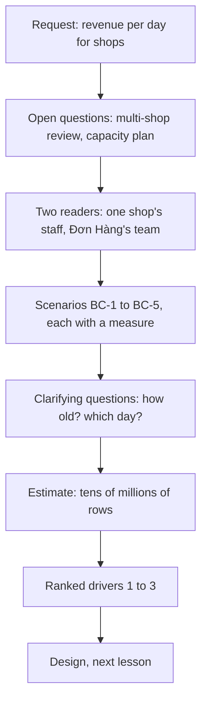

## Bạn cần biết trước

- [[sysdesign.l4.product-search-challenges]] — bạn đã xong bài toán đầu tiên của module bằng một buổi review thiết kế, trong đó mỗi câu phản biện được trả lời từ một ADR. Bài này mở bài toán thứ hai, từ bước 1.
- [[sysdesign.l4.multi-shop-challenges]] — bạn biết review thiết kế cho nhiều cửa hàng còn để mở câu hỏi về báo cáo trên mọi cửa hàng, có hai người phụ trách: báo cáo ấy đọc thế nào một cửa hàng có database riêng.
- [[backend.l4.read-routing]] — bạn biết ở stage-4 mọi lượt đọc đều vào primary, và một lượt đọc chỉ chuyển sang replica khi thao tác của nó chấp nhận dữ liệu hơi cũ.
- [[backend.l3.row-level-security]] — bạn biết PostgreSQL có thể thêm điều kiện cửa hàng vào các truy vấn mà một role chạy trên một bảng, để nhân viên một cửa hàng chỉ thấy dòng của cửa hàng mình.

## Tình huống

Một chủ cửa hàng nhờ người quyết định đội sẽ làm gì tiếp theo, tức product owner, đúng một việc: doanh thu theo ngày của cửa hàng mình, cho cả năm. Một đồng nghiệp bảo truy vấn đã có sẵn. Họ mở `db/queries/revenue-by-customer.sql`, đổi cách gom nhóm sang theo ngày, và định chạy nó từ màn hình nhân viên trên database primary.

Bạn chạy file gốc trước. Nó trả lời không lỗi, với những con số trông hợp lý. Rồi bạn nhớ ra payments đã chuyển sang database riêng từ stage-3, và tự hỏi truy vấn này lấy payments ở đâu ra. Trước khi ai đó viết báo cáo, nó phải trả lời được gì, cho ai, và từ dữ liệu nào?

## Khái niệm cốt lõi

- **truy vấn phân tích** (analytical query) — truy vấn gom rất nhiều dòng thành vài con số về một khoảng thời gian, như doanh thu theo ngày, trong khi đặt một đơn chỉ đọc và ghi vài dòng của một đơn.
- người đọc báo cáo — ai xem các con số và họ được thấy dòng nào: nhân viên một cửa hàng chỉ thấy cửa hàng mình, còn đội Đơn Hàng thấy mọi cửa hàng.
- thời điểm chốt số — lúc con số được tính gần nhất, hiện ngay cạnh nó, để một con số đã cũ hai giờ mang nhãn cũ thay vì trông như số hiện tại.
- ngày báo cáo — những giờ nào tính là "một ngày". Yêu cầu phải chốt điều này, vì cùng một đơn có thể rơi vào hai ngày khác nhau theo UTC, đồng hồ tham chiếu chung mà giờ Việt Nam chạy trước, và theo giờ Việt Nam.
- các yếu tố định hình kiến trúc đã xếp hạng — vài kịch bản, theo thứ tự, mà thiết kế phải ưu tiên đáp ứng khi hai kịch bản kéo về hai hướng khác nhau.

## Cơ chế hoạt động



Trong tình huống trên, chủ cửa hàng cần một truy vấn phân tích: một năm đơn hàng và thanh toán gom lại thành khoảng 365 con số. Đặt một đơn chỉ đụng vài dòng của một đơn. Hai loại công việc này hiện dùng chung primary, vì `capacity-plan.md` giữ mọi lượt đọc ở đó.

Đội không bắt đầu từ trang trắng. Đã có hai câu hỏi đang mở. Review thiết kế cho nhiều cửa hàng hỏi báo cáo trên mọi cửa hàng đọc thế nào một cửa hàng có database riêng. Kế hoạch dung lượng thì đưa mọi lượt đọc, dài hay ngắn, vào primary.

Tiếp theo là người đọc. Nhân viên một cửa hàng chỉ được thấy cửa hàng mình. Đội Đơn Hàng phải thấy mọi cửa hàng, kể cả những cửa hàng chuyển sang database riêng. Mỗi nhu cầu thành một kịch bản có cách đo, đánh số từ BC-1 tới BC-5.

Hai câu hỏi làm rõ yêu cầu sẽ đổi hình dạng của thiết kế. Một con số được phép cũ tới đâu? Câu trả lời được ghi là tối đa hai giờ (giả định), mỗi con số hiện kèm thời điểm chốt số. Một ngày là gì? Câu trả lời là một ngày theo giờ Việt Nam (giả định), vì ngày theo UTC chia một số đơn theo cách khác.

Sau đó bản ước lượng cho biết cỡ công việc: một năm đơn hàng là hàng chục triệu dòng. Cuối cùng, các kịch bản được xếp hạng thành yếu tố định hình kiến trúc, và thiết kế ở bài sau được đánh giá theo đúng thứ tự đó.

## Trong hệ thống Đơn Hàng

Truy vấn mà đồng nghiệp muốn dùng lại, ở tag này:

```sql file=db/queries/revenue-by-customer.sql tag=stage-4 lines=5-14
SELECT c.id,
       c.full_name,
       count(*)      AS rows_in_group,
       count(p.id)   AS payments_made,
       coalesce(sum(p.amount_vnd), 0) AS paid_vnd
FROM customers AS c
LEFT JOIN orders AS o   ON o.customer_id = c.id
LEFT JOIN payments AS p ON p.order_id = o.id
GROUP BY c.id, c.full_name
ORDER BY paid_vnd DESC, c.id;
```

Nhìn vào `LEFT JOIN` thứ hai (nó giữ mọi khách hàng kể cả khi không có đơn hay thanh toán nào khớp): nó đọc một bảng tên `payments` trong cùng database với `orders`. Từ stage-3, payments và refunds nằm trong `donhang_payments`, còn orders nằm trong `donhang`. Một truy vấn PostgreSQL thông thường chỉ đọc database mà kết nối của nó đã mở, nên đây không thể còn là một truy vấn nữa. File vẫn chạy được chỉ vì bảng `payments` cũ trong `donhang` chưa bị xóa: ADR `0008` chỉ xóa nó sau khi kế toán đối chiếu xong với `donhang_payments`. Đó là một bản sao không ai cập nhật từ khi tách, nên mọi khoản thanh toán sau đó đều vắng mặt trong tổng.

Yêu cầu của đội cho báo cáo, ở cùng tag:

```markdown file=docs/team/reporting-requirements.md tag=stage-4 lines=22-46
### Người đọc

- Nhân viên một cửa hàng: chỉ thấy số của cửa hàng mình.
- Đội Đơn Hàng: xem mọi cửa hàng, kể cả cửa hàng có database riêng.

### Kịch bản

| Số | Tình huống | Phản hồi | Đo |
|---|---|---|---|
| BC-1 | Nhân viên xem doanh thu, số đơn, số tiền hoàn theo ngày của cửa hàng mình | Bảng theo ngày, kèm thời điểm chốt số | Số cũ nhiều nhất 2 giờ (giả định) |
| BC-2 | Nhân viên xem sản phẩm bán chạy của cửa hàng mình trong một khoảng ngày | Danh sách sản phẩm theo số lượng bán | Như trên |
| BC-3 | Đội Đơn Hàng xem số đơn theo ngày của mọi cửa hàng | Đủ mọi cửa hàng, kể cả cửa hàng có database riêng | Không thiếu cửa hàng nào |
| BC-4 | Ai đó chạy báo cáo một năm vào giờ đông | Đặt đơn trả lời như ngày thường | Báo cáo không lấy kết nối của primary |
| BC-5 | Nhân viên cửa hàng A mở báo cáo | Chỉ số của cửa hàng A | Không con số nào của cửa hàng khác |

Một ngày tính theo giờ Việt Nam (giả định): `orders-by-day.sql` cho thấy có đơn
rơi vào hai ngày khác nhau theo UTC và theo giờ Việt Nam.

### Ước lượng

- 50.000 đơn mỗi ngày thường (`capacity-plan.md`), giữ 2 năm (giả định): khoảng
  36 triệu đơn, mỗi đơn vài dòng hàng.
- Báo cáo một năm trên dữ liệu gốc đọc hàng chục triệu dòng.
- Một truy vấn báo cáo giữ kết nối lâu hơn một lần đặt đơn hàng nghìn lần (giả
  định: vài giây so với vài mili giây).
```

Phần người đọc nêu tên hai người đọc. BC-1 cần doanh thu, số đơn và tiền hoàn theo ngày, cũ nhiều nhất hai giờ (giả định), kèm thời điểm chốt số. BC-2 cần sản phẩm bán chạy của một cửa hàng trong một khoảng ngày, cùng giới hạn độ cũ. BC-3 có cách đo không kèm con số: không thiếu cửa hàng nào, kể cả cửa hàng có database riêng. BC-4 được đo bằng điều báo cáo không làm: nó không lấy kết nối nào của primary. BC-5 nói nhân viên cửa hàng A không thấy con số nào của cửa hàng khác.

Dòng về ngày chỉ tới `orders-by-day.sql`. File đó gom đơn theo ngày UTC và theo ngày giờ Việt Nam đặt cạnh nhau, và truy vấn thứ hai của nó liệt kê các đơn có hai ngày khác nhau: những đơn đặt lúc sáng sớm theo giờ Việt Nam.

Bản ước lượng lấy 50.000 đơn mỗi ngày thường từ `capacity-plan.md` và giữ hai năm (giả định): khoảng 36 triệu đơn. Báo cáo một năm đọc khoảng 18 triệu đơn trong số đó, mỗi đơn có vài dòng hàng: tức hàng chục triệu dòng. Một báo cáo giữ kết nối lâu hơn một lần đặt đơn hàng nghìn lần (giả định: vài giây so với vài mili giây). Primary chỉ nhận một số kết nối có giới hạn cùng lúc, nên kết nối mà báo cáo giữ vài giây là kết nối mà đặt đơn không dùng được trong lúc đó.

Bên dưới đoạn trích, một bảng giả định ghi ai xác nhận từng giả định: product owner cùng vài cửa hàng cho "cũ hai giờ là đủ", kế toán cho ngày theo giờ Việt Nam. File kết thúc bằng các yếu tố định hình kiến trúc đã xếp hạng: báo cáo không bao giờ lấy phần dung lượng mà đặt đơn cần (BC-4), mỗi cửa hàng chỉ thấy số của mình (BC-5), báo cáo trên nhiều cửa hàng gồm cả cửa hàng có database riêng (BC-3). File không nêu lý do cho thứ tự này. Một lý do hợp lý là đặt đơn là cách cửa hàng kiếm tiền, nên báo cáo chậm tốn ít hơn đặt đơn chậm. BC-1 và BC-2 không được xếp hạng, nhưng thiết kế vẫn phải đáp ứng chúng: thứ hạng chỉ quyết kịch bản nào thắng khi có xung đột.

## Đánh đổi

| Cách đội đặt vấn đề | Thiết kế được gì | Cái giá | Đúng khi |
|---|---|---|---|
| Dùng lại file SQL, chạy trên primary | có báo cáo ngay tuần này | doanh thu sai do bản sao cũ, trượt BC-1, BC-3 và BC-4 | không bao giờ, với doanh thu, từ khi payments rời `donhang` |
| Con số chính xác tới từng giây | số trực tiếp | buộc mọi báo cáo vào bảng gốc trong giờ đông, ít lựa chọn thiết kế hơn | một con số trễ gây thiệt hại đo được cho cửa hàng |
| Con số cũ tới hai giờ, kèm thời điểm chốt số (đã chọn) | có chỗ để tính số tách khỏi đặt đơn | nhân viên phải chờ số mới, product owner và các cửa hàng phải xác nhận | nhân viên đọc kết quả cả ngày, không phải phút vừa qua |

Định nghĩa ngày cũng là một đánh đổi. Ngày theo UTC là một quy tắc cố định cho mọi người đọc, nhưng một cửa hàng ở Việt Nam khi chốt ngày sẽ thấy vài đơn sáng sớm bị tính vào ngày hôm trước. Ghi kế toán là người xác nhận giúp lựa chọn đó luôn hiện rõ và dễ xem lại với chi phí thấp.

## Bạn sẽ chọn gì nếu…

…kế toán nói ngày của họ chốt vào một giờ khác, không phải nửa đêm? Bảng giả định ghi kế toán là người xác nhận. Sửa ngày báo cáo trong yêu cầu trước khi thiết kế, vì mọi con số theo ngày đều phụ thuộc vào nó.

…một cửa hàng muốn doanh thu trực tiếp trong một đợt giảm giá kéo dài một giờ? Hỏi cửa hàng mất gì khi con số cũ hai giờ. Nếu không có gì đo được, giữ BC-1. Nếu có thiệt hại thật, viết nó thành một kịch bản mới có cách đo riêng, và chuẩn bị cho một thiết kế tốn kém hơn.

…product owner đòi giữ năm năm thay vì hai? Làm lại bản ước lượng trước. "Khoảng 36 triệu đơn" đến từ hai năm. Năm năm là khoảng 90 triệu đơn lưu trữ, và thiết kế được định cỡ từ tổng đó.

## Senior hay nhầm rằng…

- **"Báo cáo chỉ là một `SELECT` lớn hơn, nên chạy chung database với mọi thứ khác được."** → Thực ra nó đọc hàng chục triệu dòng và giữ kết nối vài giây, trong khi đặt một đơn giữ kết nối vài mili giây (cả hai là giả định), vì vậy chạy trên primary vào giờ đông, nó chiếm những kết nối mà đặt đơn cần, đúng điều BC-4 cấm. Bạn sẽ nhận ra khi request đặt đơn chậm đi mỗi lần có người mở báo cáo cả năm.
- **"Báo cáo luôn phải hiện số chính xác tới từng giây, không thì chẳng ai tin."** → Thực ra lòng tin đến từ chỗ biết con số cũ tới đâu, vì vậy BC-1 chấp nhận số cũ tới hai giờ (giả định), do mỗi con số đều hiện thời điểm chốt số. Bạn sẽ nhận ra khi nhân viên thôi hỏi "số này đúng không?" ngay khi thời điểm hiện cạnh bảng.
- **"Số của mọi cửa hàng nằm trong một database, nên báo cáo trên nhiều cửa hàng là một truy vấn."** → Thực ra payments nằm trong `donhang_payments`, tách khỏi orders, và theo ADR `0026` (đã quyết, chưa xây ở stage-4), cửa hàng chuyển đi giữ orders của nó trong database riêng, vì một truy vấn thông thường chỉ đọc database mà kết nối của nó đã mở. Bạn sẽ nhận ra khi một tổng trên nhiều cửa hàng chạy không lỗi mà lặng lẽ bỏ sót một cửa hàng đã chuyển đi.

## Thử ngay (3 phút)

Một đồng nghiệp đề xuất: chép `revenue-by-customer.sql`, gom theo ngày thay vì theo khách hàng, và chạy nó trên primary mỗi khi nhân viên hay đội Đơn Hàng mở màn hình báo cáo. Đối chiếu đề xuất với BC-1 tới BC-5 trong đoạn trích ở trên. Đề xuất trượt kịch bản nào, đạt kịch bản nào, và kịch bản nào nó không trả lời được?

Kết quả mong đợi: mỗi kịch bản từ BC-1 tới BC-5 được đánh dấu trượt, đạt hoặc không trả lời được, kèm một lý do.

<details><summary>Gợi ý đáp án</summary>

Trượt BC-1: doanh thu lấy từ bản sao `payments` cũ trong `donhang`, nên các khoản thanh toán từ sau khi tách bị thiếu, và refunds trong `donhang_payments` hoàn toàn không được đọc. Trượt BC-3: nó đọc một database, nên tổng của đội sẽ bỏ sót mọi cửa hàng chuyển sang database riêng. Trượt BC-4: theo chính đề xuất, nó chạy trên primary. BC-2 không phải thứ nó tính. Sản phẩm bán chạy cần một truy vấn khác. Riêng nó thì không trả lời được BC-5: truy vấn trên không có điều kiện cửa hàng, nên nhân viên có chỉ thấy cửa hàng mình hay không còn tùy màn hình kết nối thế nào, một câu hỏi dành cho thiết kế.

</details>

## Liên hệ

- [[sysdesign.l4.clarifying-requirements]] — bước tổng quát mà bài này áp dụng: một yêu cầu trở thành người đọc, kịch bản và câu trả lời cho những câu hỏi làm đổi hình dạng thiết kế.
- [[foundation.l1.time-and-timezones]] — vì sao "số đơn theo ngày" phụ thuộc múi giờ, sự thật đứng sau ngày báo cáo.
- [[backend.l4.data-ownership]] — vì sao payments nằm trong `donhang_payments` và không được tin bản sao cũ trong `donhang`.
- [[backend.l4.read-routing]] — quy tắc giữ mọi lượt đọc trên primary hiện nay, thứ mà BC-4 giờ đang đẩy ngược lại.
- [[sysdesign.l4.payment-reconciliation-requirements]] — một bước yêu cầu khác dựa trên payments trong `donhang_payments`, nhìn từ phía tiền thay vì phía báo cáo.
- [[sysdesign.l4.reporting-design]] — bước tiếp theo: một thiết kế được đánh giá theo các yếu tố định hình kiến trúc đã xếp hạng này.

## Tóm tắt 5 dòng

1. Truy vấn phân tích gom rất nhiều dòng thành vài con số về một khoảng thời gian, trong khi đặt một đơn chỉ đụng vài dòng của một đơn.
2. Báo cáo bắt đầu từ các câu hỏi đang mở: cửa hàng có database riêng, và kế hoạch dung lượng giữ mọi lượt đọc trên primary.
3. Payments nằm trong `donhang_payments`, nên `revenue-by-customer.sql` vẫn chạy được chỉ nhờ bản sao `payments` cũ còn sót trong `donhang`.
4. `reporting-requirements.md` nêu hai người đọc, chấp nhận số cũ tới hai giờ (giả định) kèm thời điểm chốt số, và ngày tính theo giờ Việt Nam.
5. Các yếu tố định hình kiến trúc đã xếp hạng là: báo cáo không bao giờ lấy dung lượng của đặt đơn, mỗi cửa hàng chỉ thấy số của mình, báo cáo trên nhiều cửa hàng gồm cả cửa hàng có database riêng.
