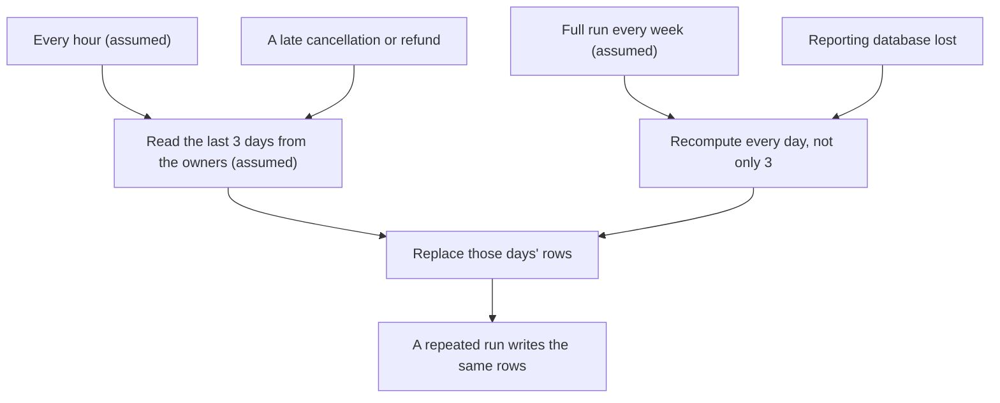

## Before you start

- [[sysdesign.l4.reporting-design]] — you know ADR `0031`'s ETL job reads the owners' databases every hour (assumed) and loads daily totals per shop into a reporting database that reports alone read.
- [[design.l4.trade-off-points]] — you know a trade-off point is one decision that moves two quality attributes in opposite directions.
- [[backend.l4.message-schema-evolution]] — you know a message may change only in ways every reader can still read, and old-shaped messages stay behind after a deploy.
- [[design.l3.event-projections]] — you know an event projection can be rebuilt by replaying stored events, and one built over events never kept cannot be.

## The situation

ADR `0031` is accepted, and the design review goes round before the job is built. Three replies come back. A developer writes that an hourly copy is only a slow version of real time: the API already publishes a message for every order, so reports could follow those messages as they arrive. The on-call developer asks what happens when a run fails halfway and is started again, and fears every total counted twice. The person who runs the backups asks for the same nightly backups and restore targets that `donhang` has.

What does copying in batches give up, and why does none of the three replies change the decision?

## Core concepts

- run interval — how often the job runs; ADR `0031` sets one hour (assumed), and this lesson treats it as a trade-off point.
- recompute window — the recent days that each run reads again from the owners; 3 days (assumed).
- replace, not add — a run removes the window's rows and writes them again from the sources, instead of adding new amounts to totals already written.
- rebuild from the sources — filling the reporting database again from the owners' data, the path the review chooses over restoring a backup.
- weekly full run — once a week (assumed) the job recomputes every day, not only the window, for changes older than 3 days.

## How it works



In the situation above, the first reply questions the run interval. Running every hour (assumed) keeps the extra load on `donhang` and `donhang_payments` small: short queries over the recompute window, once an hour. The price is freshness. A figure may be up to an hour old, plus the run time, which fits inside the two hours (assumed) the requirements accept, as long as a run finishes within the hour. Running more often would make figures fresher and add load on the owners, so the interval is a trade-off point, not merely a slow setting.

The second reply fears double counting. Each run reads the recompute window from the owners and replaces those days' rows; it never adds to a total already written. Two runs over the same sources write the same rows, so a repeated run is idempotent. The same window lets a late cancellation or refund reach the report: if it falls within the last 3 days, the next run reads it along with everything else.

Changes older than the window never reach the hourly runs; the review's risk table assigns them to the weekly full run. That kind of run also answers the third reply. The reporting database holds only copies, so losing it loses no figure for good; a run over every day fills it again. The review accepts the time that takes instead of keeping backups.

## In the Đơn Hàng system

The design review lists the rejected options and then four trade-off points, under its high-level design and deep dive:

```markdown file=docs/design/reporting-design-review.md tag=stage-4 lines=72-87
### Phương án bị loại và điểm đánh đổi (bước 3 và 4)

- Báo cáo trên primary: trái driver 1.
- Báo cáo trên `db-replica`: bản sao cả server `db`, vẫn không join hai
  database trong một truy vấn, không có cửa hàng ở database riêng (trái driver
  3).
- Read model nuôi từ message: `OrderMessage` không có số tiền hay dòng hàng, và
  đơn cũ không đọc lại được từ broker.
- Điểm đánh đổi, chu kỳ: mỗi giờ giữ tải thêm lên nguồn nhỏ, nhưng số cũ tới
  một giờ cộng thời gian job chạy.
- Điểm đánh đổi, lô so với message: lô không đổi `OrderMessage`, nhưng không
  bao giờ là số trực tiếp.
- Điểm đánh đổi, tổng theo ngày: trả lời nhanh các câu đã thỏa thuận; câu mới
  (doanh số theo giờ) cần bảng tổng mới.
- Điểm đánh đổi, dựng lại thay vì sao lưu: không thêm bản sao lưu, đổi lại thời
  gian dựng lại khi mất.
```

The first three bullets are the options the previous lesson rejected against its drivers: driver 1, reports never take the capacity ordering needs; driver 3, reports across shops include shops in their own databases. The four trade-off points follow.

The second point answers the first reply. `DonHang.Domain/OrderMessage.cs` defines four fields, `OrderId`, `CustomerEmail`, `CustomerName` and `OccurredAt`: nothing to sum. Feeding reports from messages would mean every order message carries amounts and items. ADR `0031` calls that a schema change every reader must accept, and the new fields would have to be optional for as long as old-shaped messages remain after a deploy. Orders placed before the change cannot be read again from the broker, and an event projection is rebuilt only from events that were kept, so a read model fed only from messages could not cover past orders. Batches leave `OrderMessage` untouched and pay with figures that are never live.

The ADR states the rules behind the diagram and the conditions that would reopen it:

```markdown file=docs/adr/0031-bao-cao-tu-database-bao-cao-rieng.md tag=stage-4 lines=40-60
- Mỗi lần chạy tính lại 3 ngày gần nhất (giả định) và thay các dòng của những
  ngày đó: chạy lặp lại cho cùng kết quả; hủy hay hoàn tiền muộn vẫn tới đúng
  ngày.
- Mỗi dòng tổng mang shop id. Nhân viên cửa hàng đọc theo cửa hàng lấy từ
  access token (từ release 2), có row-level security như ADR 0013 (giả định).
- Truy vấn báo cáo chỉ đọc database báo cáo.
- Mất database báo cáo thì dựng lại từ nguồn, không khôi phục từ bản sao lưu.

### Hệ quả

- Số báo cáo cũ tới một giờ, cộng thời gian job chạy.
- Thêm một database, một server và một job phải chạy; đội Cửa hàng phụ trách
  (ADR 0025, giả định).
- Câu hỏi mới mà tổng theo ngày không trả lời (ví dụ doanh số theo giờ) cần một
  bảng tổng mới, nạp lại từ nguồn.
- Số tiền trong báo cáo là bản sao; chủ của mỗi con số vẫn là Ordering hay
  Payments (`data-ownership.md`).

Đội xem lại quyết định khi: có yêu cầu số liệu trực tiếp (khi đó message đơn
phải mang số tiền); có câu hỏi mà tổng theo ngày không trả lời kịp, khi đó cần
một nơi lưu dành riêng cho truy vấn phân tích trên dữ liệu chi tiết.
```

The first bullet is the replace rule; the shop-id, read-only and team bullets come from the previous lesson's design and are not trade-offs here. The rebuild bullet works because of the last consequence: `data-ownership.md` lists the daily totals as a copy, and every figure is still owned by Ordering or Payments and lives in the owners' databases. The same fact makes the daily-totals point cheap to reverse: sales per hour need a new summary, filled again from the owners' detailed rows. The closing paragraph names the requirement that would end batches: live figures, and then order messages must carry amounts.

## Trade-offs

| Trade-off point | What the design buys | What it pays | What holds the cost, or reopens it |
|---|---|---|---|
| Run interval: every hour (assumed) | small extra load on the owners' databases | figures up to an hour old, plus the run time | the two-hour limit (assumed); a request for live figures reopens ADR `0031` |
| Batches instead of messages | no change to `OrderMessage`; past orders covered from the owners | figures are never live | the same revisit condition: live figures need amounts on order messages |
| Totals per shop per day | agreed questions answered quickly from a small table | a new question needs a new summary | filled again from the owners; questions daily totals cannot answer in time reopen the ADR |
| Rebuild instead of backup | no backups to take or test for this database | reports wait while a rebuild runs | the owners keep every figure, so nothing is lost for good |

The opposite choice, following order messages from the start, is right in a different context. When staff need a live sales screen, freshness is the driver, and the schema change and the missing past orders become costs worth paying. When a rebuild would take longer than reports may be down, a backup earns its place again. Neither holds for the agreed requirements, and the revisit conditions say how the team would notice.

## What would you choose if…

…a refund arrives for an order placed ten days ago? It falls outside the recompute window, so the hourly runs miss it, and the weekly full run (assumed) brings it in. Until then the report differs from `donhang_payments`, and `donhang_payments` is right. If a week is too long, a wider window or more frequent full runs fix it, each with more load on the owners: the same trade-off point again.

…the person who decides what reports must show asks for figures at most 15 minutes old? That is still a batch, not live figures, so the revisit condition is not met. Running four times as often changes the load the review estimated as small, so the estimate is redone before the interval changes.

…the reporting database is lost the day before a monthly review with shops? No figure is lost, because the owners still hold them, so the question is only how long reports may wait. In RPO and RTO terms, rebuilding makes the RPO zero, because no figure is lost, and leaves the RTO as the time a rebuild takes. If the rebuild takes longer than the team can wait, the fourth trade-off point is weighed again.

## Seniors often assume…

- **"An hourly copy is just a slow version of real-time, so real-time is always the better design."** → Actually live figures from messages cost a change to `OrderMessage` that every reader must accept, plus a read model that messages alone cannot fill with orders placed before it, while the requirements accept figures two hours old (assumed). You notice this when a "real-time" proposal names its freshness but not how it will fill the months of orders already placed.
- **"If the job runs twice by accident, every total will be counted twice."** → Actually each run replaces the rows of its recompute window with figures read from the owners, so a second run over the same sources writes the same rows. You notice this when you restart a failed run and the totals do not move, while a design that adds to running totals would have doubled them.
- **"The reporting database needs the same backups and restore targets as the orders database."** → Actually it holds only copies, and the owners keep every order and payment, so a rebuild from the sources loses nothing; the cost is the time reports are down. You notice this when a restore plan lists the reporting database next to `donhang`, yet a restore brings back older figures than a fresh run.

## Try it (3 minutes)

For each event, name the trade-off point or rule it touches and say what the reports show:

1. The 10:00 run fails halfway and is started again at 10:20.
2. A customer is refunded for an order placed two days ago.
3. On a Monday, a customer is refunded for an order placed eight days earlier; the weekly full run (assumed) is on Sunday.
4. The person who decides what reports must show asks which hour of the day sells most.

Expected result: four answers, each naming one trade-off point or rule from the design review or ADR `0031`.

<details><summary>Suggested answer</summary>

1. Replace, not add: the restarted run reads the same 3 days (assumed) and replaces their rows, so once it finishes, every day in the window is counted once, whatever the first attempt wrote.
2. Recompute window: the order is within the last 3 days, so the next hourly run includes the refund.
3. Recompute window and the weekly full run: hourly runs miss it; the report differs from `donhang_payments` until Sunday's full run, and `donhang_payments` is right.
4. Totals per shop per day: daily totals cannot answer it, so a new summary is filled from the owners. If such questions keep coming faster than summaries can be added, ADR `0031`'s revisit condition is met.

</details>

## Connections

- [[sysdesign.l4.reporting-design]] — the design whose costs this lesson lists.
- [[design.l4.trade-off-points]] — the idea applied here four times.
- [[backend.l4.message-schema-evolution]] — why adding amounts to `OrderMessage` is a change every reader must accept.
- [[design.l3.event-projections]] — why messages alone cannot fill a read model with past orders.
- [[backend.l2.at-least-once-jobs]] — the same danger, a job run twice, solved here by replacing rows.
- [[backend.l3.eventual-consistency]] — the same idea at report scale: reports agree with the owners after the next run.
- [[devops.l3.rpo-and-rto]] — the targets the third reply asks for; for a rebuildable copy only the RTO remains.
- [[sysdesign.l4.payment-reconciliation-trade-offs]] — the same kind of trade, a delay accepted for a simple scheduled job.
- [[sysdesign.l4.reporting-challenges]] — the next step: answering the review's challenges from who owns each figure.

## Five-line summary

1. Copying in batches gives up live figures so that `OrderMessage` stays unchanged and past orders are covered from the owners' data.
2. Running every hour (assumed) keeps the owners' extra load small; figures may be an hour old plus the run time.
3. Each run replaces the last 3 days' rows (assumed), so a repeated run changes nothing and late refunds within that window arrive.
4. Daily totals answer the agreed questions quickly; a new question needs a new summary filled again from the owners.
5. The reporting database holds only copies, so the review rebuilds it from the sources instead of restoring backups, paying in rebuild time.
