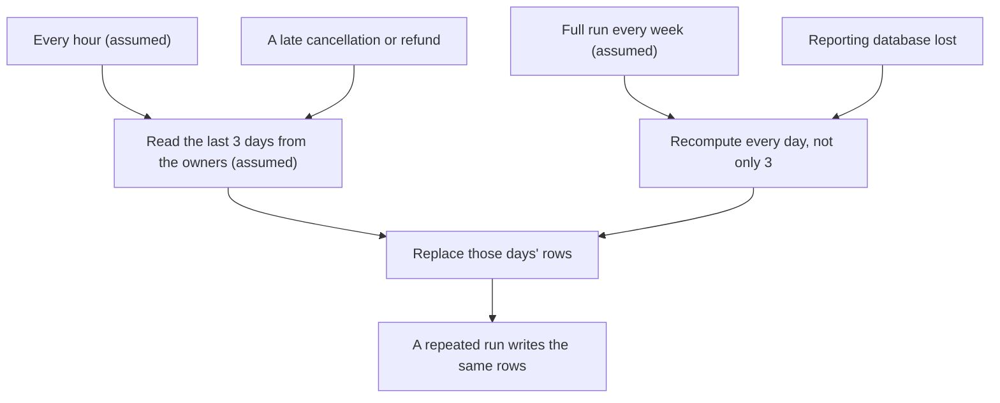

## Bạn cần biết trước

- [[sysdesign.l4.reporting-design]] — bạn biết job ETL của ADR `0031` đọc database của các bên sở hữu mỗi giờ (giả định) và nạp tổng theo ngày của từng cửa hàng vào một database báo cáo mà chỉ báo cáo đọc.
- [[design.l4.trade-off-points]] — bạn biết điểm đánh đổi là một quyết định đẩy hai thuộc tính chất lượng đi theo hai hướng ngược nhau.
- [[backend.l4.message-schema-evolution]] — bạn biết một message chỉ được đổi theo cách mọi bên đọc vẫn đọc được, và message hình dạng cũ vẫn còn lại sau một lần deploy.
- [[design.l3.event-projections]] — bạn biết event projection dựng lại được bằng cách phát lại các event đã lưu, còn projection dựng trên những event không được giữ thì không.

## Tình huống

ADR `0031` đã được chấp nhận, và buổi review thiết kế được gửi đi một vòng trước khi xây job. Ba phản hồi quay về. Một developer viết rằng chép mỗi giờ chỉ là bản chậm của thời gian thực: API đã publish một message cho mỗi đơn, nên báo cáo có thể theo các message đó ngay khi chúng tới. Developer trực on-call hỏi chuyện gì xảy ra khi một lần chạy hỏng giữa chừng rồi được chạy lại, và lo mọi tổng bị đếm hai lần. Người phụ trách sao lưu đòi bản sao lưu hằng đêm và mục tiêu khôi phục giống hệt `donhang`.

Chép theo lô phải từ bỏ những gì, và vì sao không phản hồi nào trong ba phản hồi đó đổi được quyết định?

## Khái niệm cốt lõi

- chu kỳ chạy — job chạy bao lâu một lần. ADR `0031` đặt một giờ (giả định), và bài này xem nó là một điểm đánh đổi.
- khoảng tính lại — những ngày gần đây mà mỗi lần chạy đọc lại từ các bên sở hữu: 3 ngày (giả định).
- thay, không cộng dồn — một lần chạy xóa các dòng của khoảng tính lại rồi ghi lại chúng từ nguồn, thay vì cộng thêm số tiền mới vào tổng đã ghi.
- dựng lại từ nguồn — nạp lại database báo cáo từ dữ liệu của các bên sở hữu, cách mà buổi review chọn thay cho khôi phục từ bản sao lưu.
- lần chạy đầy đủ hằng tuần — mỗi tuần một lần (giả định), job tính lại mọi ngày chứ không chỉ khoảng tính lại, để bắt các thay đổi cũ hơn 3 ngày.

## Cơ chế hoạt động



Trong tình huống trên, phản hồi đầu tiên chất vấn chu kỳ chạy. Chạy mỗi giờ (giả định) giữ tải thêm lên `donhang` và `donhang_payments` ở mức nhỏ: vài truy vấn ngắn trên khoảng tính lại, mỗi giờ một lần. Cái giá là độ mới. Một con số có thể cũ tới một giờ, cộng thời gian job chạy. Mức đó nằm trong hai giờ (giả định) mà yêu cầu chấp nhận, miễn mỗi lần chạy xong trong vòng một giờ. Chạy dày hơn thì số mới hơn nhưng tải lên các bên sở hữu tăng, nên chu kỳ là một điểm đánh đổi, không đơn thuần là một thiết lập chậm.

Phản hồi thứ hai lo đếm hai lần. Mỗi lần chạy đọc khoảng tính lại từ các bên sở hữu rồi thay các dòng của những ngày đó. Nó không bao giờ cộng vào một tổng đã ghi. Hai lần chạy trên cùng nguồn ghi ra cùng các dòng, nên chạy lặp lại là idempotent. Cũng khoảng tính lại đó cho phép một lần hủy hay hoàn tiền muộn tới được báo cáo: nếu nó rơi vào 3 ngày gần nhất, lần chạy kế tiếp đọc nó cùng mọi thứ khác.

Thay đổi cũ hơn khoảng tính lại không bao giờ tới các lần chạy hằng giờ. Bảng rủi ro của buổi review giao chúng cho lần chạy đầy đủ hằng tuần. Kiểu chạy đó cũng trả lời phản hồi thứ ba. Database báo cáo chỉ giữ bản sao, nên mất nó không làm mất vĩnh viễn con số nào: một lần chạy trên mọi ngày sẽ nạp lại nó. Buổi review chấp nhận thời gian đó thay vì giữ bản sao lưu.

## Trong hệ thống Đơn Hàng

Buổi review thiết kế liệt kê các phương án bị loại, rồi bốn điểm đánh đổi, sau phần thiết kế tổng quan và phần đi sâu:

```markdown file=docs/design/reporting-design-review.md tag=stage-4 lines=72-87
### Phương án bị loại và điểm đánh đổi (bước 3 và 4)

- Báo cáo trên primary: trái driver 1.
- Báo cáo trên `db-replica`: bản sao cả server `db`, vẫn không join hai
  database trong một truy vấn, không có cửa hàng ở database riêng (trái driver
  3).
- Read model nuôi từ message: `OrderMessage` không có số tiền hay dòng hàng, và
  đơn cũ không đọc lại được từ broker.
- Điểm đánh đổi, chu kỳ: mỗi giờ giữ tải thêm lên nguồn nhỏ, nhưng số cũ tới
  một giờ cộng thời gian job chạy.
- Điểm đánh đổi, lô so với message: lô không đổi `OrderMessage`, nhưng không
  bao giờ là số trực tiếp.
- Điểm đánh đổi, tổng theo ngày: trả lời nhanh các câu đã thỏa thuận; câu mới
  (doanh số theo giờ) cần bảng tổng mới.
- Điểm đánh đổi, dựng lại thay vì sao lưu: không thêm bản sao lưu, đổi lại thời
  gian dựng lại khi mất.
```

Ba gạch đầu dòng đầu là các phương án mà bài trước đã loại theo các yếu tố định hình kiến trúc của nó: yếu tố 1, báo cáo không bao giờ lấy phần dung lượng mà đặt đơn cần, và yếu tố 3, báo cáo trên nhiều cửa hàng gồm cả cửa hàng có database riêng. Bốn điểm đánh đổi theo sau.

Điểm thứ hai trả lời phản hồi đầu tiên. `DonHang.Domain/OrderMessage.cs` định nghĩa bốn field, `OrderId`, `CustomerEmail`, `CustomerName` và `OccurredAt`: không có gì để cộng. Nuôi báo cáo từ message nghĩa là mọi message đơn hàng phải mang số tiền và dòng hàng. ADR `0031` gọi đó là một lần đổi schema mà mọi bên đọc phải chấp nhận, và các field mới phải là tùy chọn chừng nào message hình dạng cũ còn sót lại sau deploy. Đơn đặt trước lần đổi không đọc lại được từ broker, và event projection chỉ dựng lại được từ những event đã được giữ, nên một read model chỉ nuôi từ message không thể phủ các đơn trong quá khứ. Chạy theo lô để nguyên `OrderMessage`, và trả giá bằng những con số không bao giờ là số trực tiếp.

ADR ghi các quy tắc đứng sau sơ đồ và những điều kiện sẽ mở lại quyết định:

```markdown file=docs/adr/0031-bao-cao-tu-database-bao-cao-rieng.md tag=stage-4 lines=40-60
- Mỗi lần chạy tính lại 3 ngày gần nhất (giả định) và thay các dòng của những
  ngày đó: chạy lặp lại cho cùng kết quả; hủy hay hoàn tiền muộn vẫn tới đúng
  ngày.
- Mỗi dòng tổng mang shop id. Nhân viên cửa hàng đọc theo cửa hàng lấy từ
  access token (từ release 2), có row-level security như ADR 0013 (giả định).
- Truy vấn báo cáo chỉ đọc database báo cáo.
- Mất database báo cáo thì dựng lại từ nguồn, không khôi phục từ bản sao lưu.

### Hệ quả

- Số báo cáo cũ tới một giờ, cộng thời gian job chạy.
- Thêm một database, một server và một job phải chạy; đội Cửa hàng phụ trách
  (ADR 0025, giả định).
- Câu hỏi mới mà tổng theo ngày không trả lời (ví dụ doanh số theo giờ) cần một
  bảng tổng mới, nạp lại từ nguồn.
- Số tiền trong báo cáo là bản sao; chủ của mỗi con số vẫn là Ordering hay
  Payments (`data-ownership.md`).

Đội xem lại quyết định khi: có yêu cầu số liệu trực tiếp (khi đó message đơn
phải mang số tiền); có câu hỏi mà tổng theo ngày không trả lời kịp, khi đó cần
một nơi lưu dành riêng cho truy vấn phân tích trên dữ liệu chi tiết.
```

Gạch đầu dòng đầu tiên là quy tắc thay, không cộng dồn. Các gạch đầu dòng về shop id, chỉ đọc và đội phụ trách đến từ thiết kế ở bài trước, và ở đây không phải là đánh đổi. Gạch đầu dòng dựng lại đứng được nhờ hệ quả cuối cùng: `data-ownership.md` ghi tổng theo ngày là bản sao, và mọi con số vẫn do Ordering hay Payments sở hữu, nằm trong database của bên sở hữu. Cũng chính điều đó khiến điểm tổng theo ngày đảo ngược được với giá rẻ: doanh số theo giờ cần một bảng tổng mới, nạp lại từ các dòng chi tiết của bên sở hữu. Đoạn cuối gọi tên yêu cầu sẽ chấm dứt cách chạy theo lô: số liệu trực tiếp, và khi đó message đơn hàng phải mang số tiền.

## Đánh đổi

| Điểm đánh đổi | Thiết kế được gì | Thiết kế trả gì | Điều giữ cái giá trong giới hạn, hoặc mở lại quyết định |
|---|---|---|---|
| Chu kỳ chạy: mỗi giờ (giả định) | tải thêm lên database của các bên sở hữu nhỏ | số cũ tới một giờ, cộng thời gian job chạy | giới hạn hai giờ (giả định). Yêu cầu số trực tiếp sẽ mở lại ADR `0031` |
| Chạy theo lô thay vì theo message | không đổi `OrderMessage`, đơn cũ vẫn được phủ từ dữ liệu của bên sở hữu | số không bao giờ trực tiếp | cùng điều kiện xem lại: số trực tiếp cần message đơn hàng mang số tiền |
| Tổng theo cửa hàng theo ngày | các câu đã thỏa thuận được trả lời nhanh từ một bảng nhỏ | câu hỏi mới cần bảng tổng mới | nạp lại từ các bên sở hữu. Câu hỏi mà tổng theo ngày không trả lời kịp sẽ mở lại ADR |
| Dựng lại thay vì sao lưu | không có bản sao lưu nào phải tạo hay kiểm thử cho database này | báo cáo phải chờ trong lúc dựng lại | bên sở hữu giữ mọi con số, nên không mất gì vĩnh viễn |

Lựa chọn ngược lại, theo message đơn hàng ngay từ đầu, là đúng trong một bối cảnh khác. Khi nhân viên cần một màn hình doanh số trực tiếp, độ mới là yếu tố định hình kiến trúc, và lần đổi schema cùng các đơn cũ bị thiếu trở thành cái giá đáng trả. Khi dựng lại mất lâu hơn thời gian báo cáo được phép ngừng, bản sao lưu lại có lý do tồn tại. Với yêu cầu đã thỏa thuận thì cả hai điều đó đều không đúng, và các điều kiện xem lại cho biết đội sẽ nhận ra bằng cách nào.

## Bạn sẽ chọn gì nếu…

…có một khoản hoàn tiền cho đơn đặt mười ngày trước? Nó nằm ngoài khoảng tính lại, nên các lần chạy hằng giờ bỏ sót, và lần chạy đầy đủ hằng tuần (giả định) sẽ đưa nó vào. Tới lúc đó báo cáo lệch với `donhang_payments`, và `donhang_payments` đúng. Nếu một tuần là quá lâu, mở rộng khoảng tính lại hoặc chạy đầy đủ dày hơn sẽ giải quyết, mỗi cách đều thêm tải lên các bên sở hữu: lại chính điểm đánh đổi đó.

…người quyết định báo cáo phải hiện gì đòi số cũ tối đa 15 phút? Đó vẫn là chạy theo lô, không phải số trực tiếp, nên điều kiện xem lại chưa tới. Chạy dày gấp bốn lần làm thay đổi mức tải mà buổi review đã ước lượng là nhỏ, nên phải ước lượng lại trước khi đổi chu kỳ.

…database báo cáo bị mất ngay hôm trước buổi họp tổng kết tháng với các cửa hàng? Không con số nào mất, vì các bên sở hữu vẫn giữ chúng, nên câu hỏi chỉ còn là báo cáo được phép chờ bao lâu. Nói theo RPO và RTO, dựng lại làm RPO bằng không, vì không con số nào mất, và để RTO bằng thời gian một lần dựng lại. Nếu dựng lại lâu hơn mức đội chờ được, điểm đánh đổi thứ tư được cân lại.

## Senior hay nhầm rằng…

- **"Chép mỗi giờ chỉ là bản chậm của thời gian thực, nên thời gian thực luôn là thiết kế tốt hơn."** → Thực ra số trực tiếp từ message đòi một lần đổi `OrderMessage` mà mọi bên đọc phải chấp nhận, cộng một read model mà riêng message không nạp được các đơn đặt trước nó, trong khi yêu cầu chấp nhận số cũ tới hai giờ (giả định). Bạn sẽ nhận ra khi một đề xuất "thời gian thực" nêu độ mới của nó nhưng không nói sẽ nạp nhiều tháng đơn đã đặt bằng cách nào.
- **"Nếu job lỡ chạy hai lần, mọi tổng sẽ bị đếm hai lần."** → Thực ra mỗi lần chạy thay các dòng trong khoảng tính lại bằng số đọc từ các bên sở hữu, nên lần chạy thứ hai trên cùng nguồn ghi ra đúng các dòng đó. Bạn sẽ nhận ra khi chạy lại một lần chạy hỏng mà các tổng không nhúc nhích, trong khi một thiết kế cộng dồn vào tổng đang chạy đã nhân đôi chúng.
- **"Database báo cáo cần bản sao lưu và mục tiêu khôi phục giống database đơn hàng."** → Thực ra nó chỉ giữ bản sao, và các bên sở hữu giữ mọi đơn và mọi khoản thanh toán, nên dựng lại từ nguồn không mất gì. Cái giá là khoảng thời gian báo cáo ngừng. Bạn sẽ nhận ra khi một kế hoạch khôi phục xếp database báo cáo cạnh `donhang`, vậy mà khôi phục lại mang về số cũ hơn một lần chạy mới.

## Thử ngay (3 phút)

Với mỗi sự kiện, gọi tên điểm đánh đổi hay quy tắc mà nó chạm tới, và nói báo cáo hiện gì:

1. Lần chạy 10:00 hỏng giữa chừng và được chạy lại lúc 10:20.
2. Một khách được hoàn tiền cho đơn đặt hai ngày trước.
3. Vào thứ Hai, một khách được hoàn tiền cho đơn đặt tám ngày trước đó. Lần chạy đầy đủ hằng tuần (giả định) rơi vào Chủ nhật.
4. Người quyết định báo cáo phải hiện gì hỏi giờ nào trong ngày bán được nhiều nhất.

Kết quả mong đợi: bốn câu trả lời, mỗi câu gọi tên một điểm đánh đổi hay quy tắc trong buổi review thiết kế hoặc ADR `0031`.

<details><summary>Gợi ý đáp án</summary>

1. Thay, không cộng dồn: lần chạy lại đọc cùng 3 ngày (giả định) và thay các dòng của chúng, nên khi nó xong, mỗi ngày trong khoảng được đếm một lần, bất kể lần đầu đã ghi gì.
2. Khoảng tính lại: đơn nằm trong 3 ngày gần nhất, nên lần chạy hằng giờ kế tiếp có khoản hoàn tiền.
3. Khoảng tính lại và lần chạy đầy đủ hằng tuần: các lần chạy hằng giờ bỏ sót nó. Báo cáo lệch với `donhang_payments` cho tới lần chạy đầy đủ hôm Chủ nhật, và `donhang_payments` đúng.
4. Tổng theo cửa hàng theo ngày: tổng theo ngày không trả lời được, nên một bảng tổng mới được nạp từ các bên sở hữu. Nếu câu hỏi kiểu này đến nhanh hơn tốc độ thêm bảng tổng, điều kiện xem lại của ADR `0031` đã tới.

</details>

## Liên hệ

- [[sysdesign.l4.reporting-design]] — thiết kế mà bài này liệt kê cái giá.
- [[design.l4.trade-off-points]] — ý tưởng được áp dụng ở đây bốn lần.
- [[backend.l4.message-schema-evolution]] — vì sao thêm số tiền vào `OrderMessage` là một thay đổi mà mọi bên đọc phải chấp nhận.
- [[design.l3.event-projections]] — vì sao riêng message không nạp được các đơn cũ vào read model.
- [[backend.l2.at-least-once-jobs]] — cùng mối nguy, một job chạy hai lần, ở đây được giải bằng cách thay dòng.
- [[backend.l3.eventual-consistency]] — cùng ý tưởng ở quy mô báo cáo: báo cáo khớp với bên sở hữu sau lần chạy kế tiếp.
- [[devops.l3.rpo-and-rto]] — các mục tiêu mà phản hồi thứ ba đòi. Với một bản sao dựng lại được, chỉ còn RTO.
- [[sysdesign.l4.payment-reconciliation-trade-offs]] — cùng kiểu đánh đổi: chấp nhận độ trễ để có một job chạy theo lịch đơn giản.
- [[sysdesign.l4.reporting-challenges]] — bước tiếp theo: trả lời các câu phản biện của buổi review dựa trên việc ai sở hữu mỗi con số.

## Tóm tắt 5 dòng

1. Chép theo lô từ bỏ số trực tiếp để `OrderMessage` giữ nguyên và các đơn cũ vẫn được phủ từ dữ liệu của bên sở hữu.
2. Chạy mỗi giờ (giả định) giữ tải thêm lên các bên sở hữu ở mức nhỏ. Số có thể cũ một giờ cộng thời gian job chạy.
3. Mỗi lần chạy thay các dòng của 3 ngày gần nhất (giả định), nên chạy lặp lại không đổi gì, và hoàn tiền muộn trong khoảng đó vẫn tới.
4. Tổng theo ngày trả lời nhanh các câu đã thỏa thuận. Câu hỏi mới cần một bảng tổng mới, nạp lại từ các bên sở hữu.
5. Database báo cáo chỉ giữ bản sao, nên buổi review dựng lại nó từ nguồn thay vì khôi phục bản sao lưu, và trả giá bằng thời gian dựng lại.
